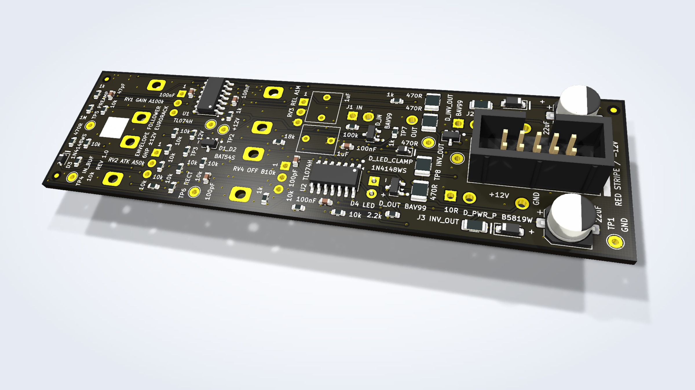
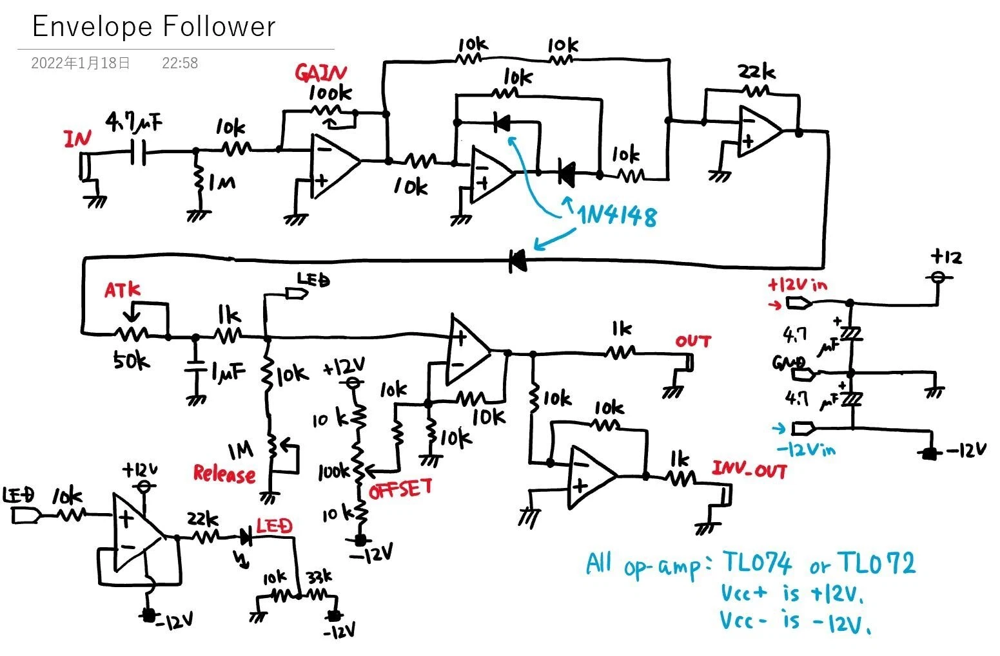

# Envelope Follower

An end-to-end hardware design tutorial (MkDocs Material site and clean-room stage snapshots) for turning Hagiwo's analog envelope follower sketch into a 6 HP Eurorack KiCad 10 PCB and 3U front panel using AI hardware skills and SKiDL.



The original schematic is based on Hagiwo's [$4 Envelope Follower module - DIY Eurorack Modular Synthesizer](https://note.com/solder_state/n/n110e9ba066b3?hl=en):



---

## ⚡ Improved Circuit Overview

The tutorial adapts Hagiwo's original circuit for modern **Texas Instruments TL074H** (`TL074HIDR`, `SOIC-14`) quad op-amps, introducing enhancements for buffered high-Z input, zero-deadzone envelope tracking, exact unity-gain precision rectification, linear offset summing, and Eurorack hardware protection:

1. **Dual `TL074HIDR` Configuration (All 8 Channels Active)**:
   - **U1 (`TL074H`)**: `U1A` Inverting Variable Gain Stage (`-0.47×` to `-10.47×`, `-6.56 dB` to `+20.4 dB`), `U1B` Precision Half-Wave Rectifier (`D1`, `D2` `1N4148W`), `U1C` Exact `1.00×` Summing Rectifier (`R8 = 20 kΩ`), `U1D` Non-Inverting Output Summing/Gain (`1.400×–1.436×`) & Linear `OFFSET` Stage (`±4.24 V`, `CW = +OUT`).
   - **U2 (`TL074H`)**: `U2A` Unity-Gain Inverting Output (`INV_OUT`, `-1.00×`), `U2B` Active Linear Feedback LED Current Sink (`I_LED = V_ENV / 3.3 kΩ`, `R21 = 3.3 kΩ` + anti-parallel `D10` `1N4148W`), `U2C` Dedicated `100 kΩ` Unity-Gain Input Buffer, `U2D` Active Zero-Deadzone Super-Diode Peak Detector (`D3` `1N4148W` inside loop at `ATK_IN`).

2. **Buffered High-Z Input, Gain Floor & HF Roll-Off**:
   - `J1.TN → GND` eliminates unpatched hum; `R26` ($1\text{ k}\Omega$ `1 W` `2512`) surge resistor, `C1` ($1\,\mu\text{F}$ $63\text{ V}$ `P=5mm` box film, `B.Cu` THT), `R1` ($100\text{ k}\Omega$), `R27` ($10\text{ k}\Omega$), and `D9` (`BAV99` clamp) feed `U2C` for $Z_{\text{in}} = 101\text{ k}\Omega$ and $f_c \approx 1.58\text{ Hz}$.
   - `R24` ($4.7\text{ k}\Omega$) in series with `RV1` (`A100k`) eliminates the `0×` dead zone (`R2` = $10\text{ k}\Omega$), while `C9` ($22\text{ pF}$ C0G across feedback) rolls off ultrasonic peaking at $f_c \approx 69.1\text{ kHz}$.

3. **Power Entry, Reverse-Polarity & Bus Decoupling**:
   - Shrouded keyed `2×5` Eurorack header `J4` (`B.Cu`) feeds series `B5819W SL` (`SOD-123`) Schottky diodes (`D5`, `D6`, internal `≈ ±11.65 V`) into $22\,\mu\text{F}$ $50\text{ V}$ SMD electrolytics (`C3`, `C4`), plus four $100\text{ nF}$ `50 V` `0603` X7R local IC bypass capacitors (`C5`–`C8`) at Pins 4 and 11 of `U1` and `U2`.

4. **Zero-Droop Film Hold, Linear `OFFSET` & Fault-Rated Outputs**:
   - Tapping `R10` ($10\text{ k}\Omega$) + `RV3` (`A1M`) directly at `ENV_CAP` (`C2` = $1\,\mu\text{F}$ $63\text{ V}$ box film, immune to MLCC microphonics and DC-bias droop) eliminates the `9.1%` short-release drop, while `U2D` removes the `~0.6 V` diode deadband and `R25` ($330\,\Omega$) bounds attack surge into `RV2` (`A50k`).
   - Removing `R14` and scaling `RV4` to `B10k` (`R11 = R12 = 1 kΩ`, `R13 = 22 kΩ`, `R15 = 10 kΩ` $\parallel$ `C10 = 47 pF`) lowers output gain to `1.400×–1.436×` (`2.6%` shift) across a linear `±4.24 V` offset span (`CW = +OUT`).
   - `1 kΩ` `1 W` `2512` output fault resistors (`R16`, `R19`) backed by `BAV99` rail clamps (`D7`, `D8`) survive continuous opposing-rail clashes (`0.58 W < 1.0 W`), with `J2.TN` and `J3.TN` left `NC`.

---

## 🔄 Signal Flow & Functional Blocks

The latest clean-room Stage 7 build covers **55 populated physical components (`44` `B.Cu` SMD across `17` BOM lines + `11` manual/consigned THT: `3` rear `B.Cu` + `8` front `F.Cu`)** plus **8 optional `DNP` test points** and **3 `DNP` optical fiducials** (**66 footprints total / 63 netlist components across 37 named nets**, matching [`stages/stage-7/EnvelopeFollowerImproved.md`](stages/stage-7/EnvelopeFollowerImproved.md) and [`stages/stage-7/EnvelopeFollowerBOM.md`](stages/stage-7/EnvelopeFollowerBOM.md)):

1. **Stage 0 — Power Entry, Protection & Decoupling (`J4`, `D5`–`D6`, `C3`–`C8`)**:
   Eurorack $\pm 12\text{ V}$ `2×5` IDC entry through `B5819W SL` Schottky reverse-polarity diodes, $22\,\mu\text{F}$ $50\text{ V}$ bulk electrolytics, and local $100\text{ nF}$ ceramic IC decoupling (`±11.65 V` protected rails).
2. **Stage 1 — `100 kΩ` Input Buffer & Variable Gain (`J1`, `R26`, `C1`, `R1`, `R27`, `D9`, `U2C`, `U1A`, `R2`, `R24`, `RV1`, `C9`)**:
   `J1.TN → GND`, `R26` ($1\text{ k}\Omega$ `1 W`), `C1` ($1\,\mu\text{F}$ film), `R1` ($100\text{ k}\Omega$), `R27` ($10\text{ k}\Omega$) + `D9` (`BAV99`) into unity buffer `U2C`, driving inverting gain stage `U1A` (`R2` $10\text{ k}\Omega$, `R24` $4.7\text{ k}\Omega$ + `RV1` `A100k` $\parallel$ `C9` $22\text{ pF}$ C0G).
3. **Stage 2 — Exact `1.00×` Precision Full-Wave Rectifier (`U1B`, `U1C`, `R3`–`R8`, `D1`–`D2`)**:
   `U1B` half-wave stage (`R3` = `R4` = $10\text{ k}\Omega$, `D1`/`D2` `1N4148W`) feeding `U1C` summer (`R6` + `R7` = $20\text{ k}\Omega$, `R5` = $10\text{ k}\Omega$, `R8` = $20\text{ k}\Omega$) for exact $+1.00\,|V_{\text{AMP}}|$.
4. **Stage 3 — Active Zero-Deadzone Peak Detector & Attack/Release (`U2D`, `D3`, `R25`, `RV2`, `C2`, `R10`, `RV3`)**:
   `U2D` super-diode loop wrapping `D3` (`1N4148W`) at `ATK_IN` to charge $1\,\mu\text{F}$ film `C2` through `R25` ($330\,\Omega$) + `RV2` (`A50k` attack) and discharge directly through `R10` ($10\text{ k}\Omega$) + `RV3` (`A1M` release).
5. **Stage 4 — Linear `OFFSET`, Output Buffer & Protected Dual Outputs (`U1D`, `U2A`, `RV4`, `R9`, `R11`–`R19`, `C10`–`C11`, `D7`–`D8`, `J2`, `J3`)**:
   `U1D` (`R9` $10\text{ k}\Omega$, `RV4` `B10k` + `R11`/`R12` $1\text{ k}\Omega$, `R13` $22\text{ k}\Omega$, `R15` $10\text{ k}\Omega$ $\parallel$ `C10` $47\text{ pF}$) and `U2A` unity inverter (`R17` = `R18` = $10\text{ k}\Omega$ $\parallel$ `C11` $47\text{ pF}$) driving `J2` (`OUT`) and `J3` (`INV_OUT`) via `BAV99` clamps (`D7`, `D8`) and `1 kΩ` `1 W` `2512` resistors (`R16`, `R19`).
6. **Stage 5 — Active Linear Feedback LED Driver (`U2B`, `R20`, `R21`, `D4`, `D10`)**:
   `R20` ($10\text{ k}\Omega$) into `U2B` driving `D4` (`3 mm` THT LED) and anti-parallel reverse clamp `D10` (`1N4148W`) against `R21` ($3.3\text{ k}\Omega$ sense resistor to `GND`) for linear $V_f$-independent brightness (`0.00 mA` idle).

---

## 🎛️ Controls, I/O & Test Points Summary

| Reference | Component / Value | Taper / Type | Function |
| :--- | :--- | :--- | :--- |
| **`RV1`** (`GAIN`) | $100\text{ k}\Omega$ Potentiometer | Audio / Log (`A100k`) | Input Preamp Gain ($-0.47\times$ to $-10.47\times$, `-6.56 dB` to `+20.4 dB`) |
| **`RV2`** (`ATK`) | $50\text{ k}\Omega$ Potentiometer | Audio / Log (`A50k`) | Attack Time Control ($\tau_{\text{atk}} \approx 0.33\text{--}50.33\text{ ms}$) |
| **`RV3`** (`REL`) | $1\text{ M}\Omega$ Potentiometer | Audio / Log (`A1M`) | Release Time Control ($\tau_{\text{rel}} \approx 10\text{ ms--}1.01\text{ s}$) |
| **`RV4`** (`OFFSET`) | $10\text{ k}\Omega$ Potentiometer | Linear (`B10k`) | Output DC Offset Adjust (`±4.24 V` linear span, `CW = +OUT`) |
| **`J1`** (`IN`) | 3.5mm Mono Jack (`WQP-PJ398SM`) | Switched THT (`TN → GND`) | AC-Coupled Audio / CV Input ($Z_{\text{in}} = 101\text{ k}\Omega$, $f_c \approx 1.58\text{ Hz}$, `BAV99` clamped) |
| **`J2`** (`OUT`) | 3.5mm Mono Jack (`WQP-PJ398SM`) | Switched THT (`TN = NC`) | Non-Inverted Envelope CV Output (`1.400×–1.436×`, `BAV99` + `1 kΩ 1 W` protected) |
| **`J3`** (`INV_OUT`) | 3.5mm Mono Jack (`WQP-PJ398SM`) | Switched THT (`TN = NC`) | Inverted Envelope CV Output ($-1.00\,V_{\text{OUT}}$, `BAV99` + `1 kΩ 1 W` protected) |
| **`D4`** (`LED`) | 3mm Yellow-Green THT LED (`C85161`) | Radial THT (In-Loop) | Active Linear V-to-I Indicator ($I_{\text{LED}} = V_{\text{ENV}} / 3.3\text{ k}\Omega$, `0.00 mA` idle, $V_f$-independent) |
| **`J4`** (`PWR`) | 2×5 Shrouded IDC Header (`C53207560`) | 10-Pin Eurorack (`B.Cu`) | $\pm 12\text{ V}$ & `GND` Power Input (`B5819W` + `22 µF 50 V` protected → `±11.65 V`) |
| **`TP1`–`TP8`** (`DNP`) | `Ronghe RH-5001` (`C5199801`) | Optional THT Loops (`1.0 mm` drill) | Rear `B.Cu` Probing (`GND`, `+12V`, `-12V`, `IN_BUF`, `V_AMP`, `V_FWR`, `ENV_CAP`, `V_OUT_PRE`) |

---

## 📄 Documentation, Tutorial & GitHub Pages Site

This repository publishes a multi-page **MkDocs Material** documentation site via [`.github/workflows/docs.yml`](.github/workflows/docs.yml) at **[https://domesticmouse.github.io/EnvelopeFollower/](https://domesticmouse.github.io/EnvelopeFollower/)**.

To preview the documentation site locally:

```bash
mkdocs serve
```

Documentation sources, clean-room stage artifacts, audit reports, and prompt logs:

* [**`mkdocs.yml`**](mkdocs.yml) & [**`docs/`**](docs/) – Multi-page MkDocs Material tutorial (Stages 1–7 plus optional DC-coupled CV mode) and technical reference source (deployed to GitHub Pages on push to `main`).
* [**`docs/reference/netlist-and-bom.md`**](docs/reference/netlist-and-bom.md) – Tutorial reference Bill of Materials, ready-to-upload JLCPCB CSV listing, netlist connection table, and manual KiCad capture guide.
* [**`docs/reference/build-checklist.md`**](docs/reference/build-checklist.md) – Interactive PCB layout, silkscreen verification, front-panel, and JLCPCB ordering checklist.
* [**`stages/`**](stages/) & [**`AuditReport.md`**](AuditReport.md) – Clean-room end-to-end replay artifacts (`stages/stage-1/` through `stages/stage-7/`) including SKiDL code, KiCad PCBs, Gerbers/drills, bottom-side CPL, [`stages/stage-7/OrderingNotes.md`](stages/stage-7/OrderingNotes.md), and test-drive audit report.
* [**`SkillImprovementAuditReport.md`**](SkillImprovementAuditReport.md) – Per-prompt `/agy-customizations` hardware skill improvement audit (`25` deduplicated findings across `15` tutorial prompts).
* [**`PotentialImprovements.md`**](PotentialImprovements.md) – Engineering note on adding an `AC / DC` input coupling switch (`SW1`) for CV rectification and AR slew limiting.
* [**`prompts/README.md`**](prompts/README.md) – Exported per-conversation prompt traces (`12` sessions) from [**EnvelopeFollowerWithSkewLimiter**](https://github.com/domesticmouse/EnvelopeFollowerWithSkewLimiter), a companion project loosely following this codelab (used as source material for updating [`docs/tutorial/`](docs/tutorial/)).

---

## 📁 Repository Structure

```text
EnvelopeFollower/
├── LICENSE                                # Apache License 2.0
├── README.md                              # Project overview & documentation
├── AuditReport.md                         # Clean-room Stages 1–7 test-drive audit report
├── SkillImprovementAuditReport.md         # Per-prompt hardware skills improvement audit
├── PotentialImprovements.md               # Optional DC-coupled CV / LFO slew design note
├── EnvelopeFollower.webp                  # Original Hagiwo hand-drawn reference schematic
├── .github/workflows/
│   └── docs.yml                           # GitHub Pages deployment workflow (MkDocs Material)
├── mkdocs.yml                             # MkDocs Material site configuration
├── docs/
│   ├── index.md                           # Documentation landing page & pipeline overview
│   ├── tutorial/                          # Multi-page stage-by-stage tutorial (Stages 1–7 + optional mode)
│   ├── reference/                         # Netlist/BOM guide and PCB fabrication checklist
│   ├── javascripts/mathjax.js             # MathJax v3 initialization for circuit equations
│   └── images/                            # Sketch, 3D portrait PCB/panel renders & landscape PCBA hero
├── stages/                                # Clean-room tutorial stage snapshots (stage-1 .. stage-7)
├── prompts/                               # Per-conversation prompt traces from EnvelopeFollowerWithSkewLimiter (12 sessions)
├── skills-lock.json                       # Agent skill lockfile
└── .agents/skills/                        # Workspace skills (agy-brain-explorer, skill-improvement-audit, tutorial-test-drive)
```

---

## 📜 License & Disclaimer

Licensed under the [Apache License 2.0](LICENSE).

This is not an officially supported Google product.
