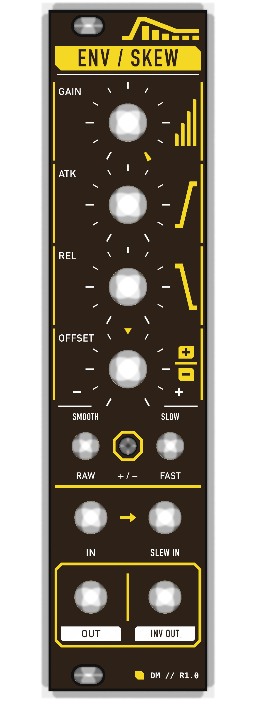
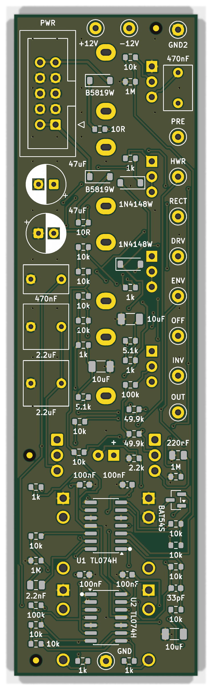

# ENV / SKEW Build Tutorial

An end-to-end, interactive human-in-the-loop engineering tutorial documenting the full 9-stage arc from **HAGIWO/ハギヲ** (`@solder_state`) Project **No. 43** — the hand-drawn **Hagiwo Sketch** ([`$4 Envelope Follower`](https://note.com/solder_state/n/n110e9ba066b3?hl=en), [`EnvelopeFollower.webp`](EnvelopeFollower.webp)) — through the **6 HP `ENV / SKEW`** Eurorack hardware (`2× TL074HIDR`, `30.0 × 108.0 mm` main PCB, `30.0 × 128.5 mm` Matte Black + ENIG Gold 3U front panel) using **Python (SKiDL)**, **KiCad 10**, and **VectorCraft**, and onward through `/wayfinder` planning to the live **Companion Site** launch.

> **Cross-Site Orientation:**
> - **Live Build Tutorial (this repository):** **[domesticmouse.github.io/EnvelopeFollower](https://domesticmouse.github.io/EnvelopeFollower/)** *(or read from [`site/src/content/tutorial/index.mdx`](site/src/content/tutorial/index.mdx) / serve locally with Astro Core on Node.js `24`)*
> - **Live `ENV / SKEW` Companion Site:** **[domesticmouse.github.io/EnvelopeFollowerWithSkewLimiter](https://domesticmouse.github.io/EnvelopeFollowerWithSkewLimiter/)** *(interactive **Patch Guides**, `211`-step **Build Checklists**, hardware showcase, and **Reference Specs**)*
> - **Hardware Source Repository:** [`domesticmouse/EnvelopeFollowerWithSkewLimiter`](https://github.com/domesticmouse/EnvelopeFollowerWithSkewLimiter) (pinned in `reference/` at [`8ad81d0`](https://github.com/domesticmouse/EnvelopeFollowerWithSkewLimiter/tree/8ad81d0))

<table align="center">
  <tr>
    <th>Matte Black + ENIG Front Panel</th>
    <th>Main PCB Front (<code>F.Cu</code> Controls)</th>
    <th>Main PCB Rear (<code>B.Cu</code> 50-SMD PCBA)</th>
  </tr>
  <tr>
    <td align="center"></td>
    <td align="center"></td>
    <td align="center"></td>
  </tr>
</table>

---

## Companion Reference Hardware & Companion Site (`8ad81d0`)

Every netlist rule, KiCad script, verification gate, manufacturing pack, **Build Checklist**, **Patch Guide**, and **Companion Site** workflow in this tutorial traces directly to [`domesticmouse/EnvelopeFollowerWithSkewLimiter`](https://github.com/domesticmouse/EnvelopeFollowerWithSkewLimiter) (`reference/` @ [`8ad81d0`](https://github.com/domesticmouse/EnvelopeFollowerWithSkewLimiter/tree/8ad81d0)):

- **6 HP Dual-Mode Hardware (`ENV / SKEW`):** Combines AC-coupled **Envelope Follower Mode** (`IN`, `J1`) and normal-broken DC-coupled **Asymmetric Skew Limiter Mode** (`SLEW IN`, `J2`) around `2× TL074HIDR` (`80` netlist components, `83` PCB footprints across `48` active nets): `50` Bottom-Side Economic SMDs across `17` rows in [`jlcpcb_bom.csv`](https://github.com/domesticmouse/EnvelopeFollowerWithSkewLimiter/blob/8ad81d0/jlcpcb_bom.csv) (`3` Extended SKUs), `18` manual through-hole parts in [`bom/ibom.html`](https://domesticmouse.github.io/EnvelopeFollowerWithSkewLimiter/bom/ibom.html), and `12` DNP Keystone test points (`TP1`–`TP12`).
- **Mated 3U Front Panel & Fabrication Packs:** Generated via `--blank-front` (`generate_eurorack_panel.py`), styled in Dark Techno / Brutalist Matte Black + White `F.SilkS` + ENIG Gold `F.Mask` with `vectorcraft-cli` (`40 px/mm` clearance audit), fractured via `SHAPE_POLY_SET` into KiCad 10, and bundled with dual-board Gerbers and CPL in [`manufacturing/`](https://github.com/domesticmouse/EnvelopeFollowerWithSkewLimiter/tree/8ad81d0/manufacturing).
- **Post-`4a02c46` Hardware Deliverables (`8ad81d0`):** Adds `81` deterministic visual **Build Checklist** PNGs (`pcba_alignment`, `hand_assembly`, `board_bringup`) backing [`checklists/`](https://github.com/domesticmouse/EnvelopeFollowerWithSkewLimiter/tree/8ad81d0/checklists), a real-world parts substitution record ([`tayda-1000489380.md`](https://github.com/domesticmouse/EnvelopeFollowerWithSkewLimiter/blob/8ad81d0/manufacturing/orders/tayda-1000489380.md)), and `8` musical **Patch Guides** ([`patches/`](https://github.com/domesticmouse/EnvelopeFollowerWithSkewLimiter/tree/8ad81d0/patches)) completing the `20`-file single-source hardware corpus.
- **25-Route Astro Core Companion Site:** Planned with `mattpocock/skills` and `/wayfinder` (`GLOSSARY.md`, `ADR 0001`, throwaway UI prototypes) and published as the live [**`ENV / SKEW` Companion Site**](https://domesticmouse.github.io/EnvelopeFollowerWithSkewLimiter/), compiling the `20` unmodified root Markdown files into `25` routes with `97` allowlisted **Static Passthroughs**, Pagefind search, Native Web Components, and `211`-step `localStorage` checklists.

---

## Tutorial Map

| Group | Section | Focus | File |
| :--- | :--- | :--- | :--- |
| **Overview** | **Overview** | 9-stage pipeline (`S0`–`S9`), prerequisites, panel I/O summary & cross-site orientation | [`site/src/content/tutorial/index.mdx`](site/src/content/tutorial/index.mdx) |
| **Hardware Build** | **Stage 1** | Hardware agent skills (`9` core + `vectorcraft-cli`), **Living Context Map**, `/agy-customizations` & skill smoke tests | [`site/src/content/tutorial/stages/01-hardware-agent-skills.mdx`](site/src/content/tutorial/stages/01-hardware-agent-skills.mdx) |
| **Hardware Build** | **Stage 2** | **Hagiwo Sketch** attribution, multi-scale extraction, KCL checks, Bode/Nyquist sweeps & doc linting | [`site/src/content/tutorial/stages/02-sketch-extraction-and-critique.mdx`](site/src/content/tutorial/stages/02-sketch-extraction-and-critique.mdx) |
| **Hardware Build** | **Stage 3** | Interactive Q&A → `DesignSpec.md`, `TP1`–`TP12` test strategy & BOM↔netlist checks | [`site/src/content/tutorial/stages/03-design-spec-and-dft.mdx`](site/src/content/tutorial/stages/03-design-spec-and-dft.mdx) |
| **Hardware Build** | **Stage 4** | SKiDL `80`-part capture, Dailywell `2MS1` footprint, 3-Extended-SKU budget & 9-section A3 schematic/PDF | [`site/src/content/tutorial/stages/04-skidl-and-schematic.mdx`](site/src/content/tutorial/stages/04-skidl-and-schematic.mdx) |
| **Hardware Build** | **Stage 5** | `6 HP` main PCB (`83` footprints), `silk_layout.json` & `/edit-silkscreen` hybrid GUI/AI loop | [`site/src/content/tutorial/stages/05-main-pcb-and-silkscreen.mdx`](site/src/content/tutorial/stages/05-main-pcb-and-silkscreen.mdx) |
| **Hardware Build** | **Stage 6** | Blank-front `5.2 mm` switch spec, `vectorcraft-cli` art & `SHAPE_POLY_SET` import | [`site/src/content/tutorial/stages/06-front-panel-and-artwork.mdx`](site/src/content/tutorial/stages/06-front-panel-and-artwork.mdx) |
| **Hardware Build** | **Stage 7** | Dual-board `manufacturing/` Gerbers, `81` visual **Build Checklist** renders, THT `ibom.html`, Tayda order record, `8` **Patch Guides** & `ruff` hygiene | [`site/src/content/tutorial/stages/07-fabrication-checklists-and-patches.mdx`](site/src/content/tutorial/stages/07-fabrication-checklists-and-patches.mdx) |
| **Companion Site** | **Stage 8** | `mattpocock/skills`, `/wayfinder` map, parallel research, HITL grilling (`GLOSSARY.md` + `ADR 0001`), prototypes & Spec `#17` | [`site/src/content/tutorial/stages/08-wayfinder-site-planning.mdx`](site/src/content/tutorial/stages/08-wayfinder-site-planning.mdx) |
| **Companion Site** | **Stage 9** | `/to-tickets` + `/implement-spec`, `25`-route Astro Core, 2-seam CI, `/code-review`, Chrome DevTools QA, Pages OIDC & **Repository Front Door** shift | [`site/src/content/tutorial/stages/09-companion-site-delivery.mdx`](site/src/content/tutorial/stages/09-companion-site-delivery.mdx) |
| **Optional Exploration** | **Optional: AC/DC Mode** | Adding `SW3` (`AC / DC`) across `C7` for `2×` LFO full-wave rectification | [`site/src/content/tutorial/optional/ac-dc-input-coupling.mdx`](site/src/content/tutorial/optional/ac-dc-input-coupling.mdx) |
| **Tutorial Appendix** | **Netlist, BOM & Silkscreen Schedule** | Canonical `80`-part design BOM, `17`-row `jlcpcb_bom.csv`, `48` nets & `silk_layout.json` | [`site/src/content/tutorial/appendix/netlist-and-bom.mdx`](site/src/content/tutorial/appendix/netlist-and-bom.mdx) |
| **Tutorial Appendix** | **Engineering Sign-Off Checklist** | 5-phase engineering, fabrication & **Companion Site** sign-off checklist (`8ad81d0`) | [`site/src/content/tutorial/appendix/engineering-sign-off-checklist.mdx`](site/src/content/tutorial/appendix/engineering-sign-off-checklist.mdx) |

---

## Repository Structure

```text
EnvelopeFollower/
├── AGENTS.md                              # Agent workflow rules & repo pointers
├── GLOSSARY.md                            # Canonical cross-repo domain vocabulary
├── site/                                  # Isolated Astro Core workspace (Node.js >= 24)
│   ├── astro.config.mjs                   # MDX, KaTeX, Shiki & remark/rehype pipeline
│   ├── package.json                       # Astro Core, Pagefind, Mermaid, @fontsource/*, Vitest
│   ├── scripts/check-site.ts              # Built-site & repo contract verifier CLI (`npm run check`)
│   ├── src/
│   │   ├── assets/images/                 # 14 unique images (8 renders + 3 checklists + 3 site WebPs)
│   │   ├── components/                    # PromptBlock, PromptGroup, Callout, Disclosure, Figure, Chrome
│   │   ├── content/tutorial/              # 13 MDX pages (Overview, Stages 1–9, Optional, Appendix)
│   │   ├── layouts/TutorialLayout.astro   # Unified 3-column Patchbay Workbench shell
│   │   ├── lib/                           # routes, panel-svg, site-contract, search/lightbox/copy
│   │   ├── plugins/                       # remark double-dollar math, mermaid, prompt-chips, code-console
│   │   └── styles/                        # Self-hosted @fontsource/* imports, tokens & workbench CSS
│   └── tests/                             # Vitest + happy-dom unit & contract suites
├── docs/                                  # Internal repo governance & engineering records (excluded from site)
│   ├── adr/                               # Architecture Decision Records (`0001-astro-core-mdx-tutorial-site.md`)
│   ├── agents/                            # Agent workflow contracts (issue tracker, triage labels, domain)
│   └── research/                          # Primary-source research notes
├── prompts/                               # 16 pre-Wayfinder hardware Session Traces (01–16) + README.md
├── reference/                             # Git submodule -> domesticmouse/EnvelopeFollowerWithSkewLimiter (8ad81d0)
├── .agents/skills/                        # Agent skills (agy-brain-explorer + mattpocock/skills suite)
├── .github/workflows/docs.yml             # Node.js 24 build, verifier & GitHub Pages deploy
├── EnvelopeFollower.webp                  # Original Hagiwo Sketch reference image
├── PotentialImprovements.md               # Standalone note on DC-coupled FWR bypass
├── skills-lock.json                       # Pinned upstream skill versions
└── LICENSE                                # Apache License 2.0
```

---

## Building & Verifying Docs Locally

Requires [Node.js `24` LTS](https://nodejs.org/) (`node >= 24.0.0`, `npm`) with zero Python or headless Chromium dependencies:

```bash
# Clone with companion hardware reference submodule
git clone --recurse-submodules https://github.com/domesticmouse/EnvelopeFollower.git
cd EnvelopeFollower/site

# Install dependencies and start live-reload Astro dev server
npm ci
npm run dev

# Full typecheck, Vitest suite, production build + Pagefind, and contract verification
npm run typecheck && npm test && npm run build && npm run check -- --require-reference
```

---

## Evidence Trails & Standalone Notes

- **Session Traces ([`prompts/README.md`](prompts/README.md)):** Stages 1–7 cite the `16` pre-Wayfinder exported transcripts (`01`–`16`), captured via [`.agents/skills/agy-brain-explorer/SKILL.md`](.agents/skills/agy-brain-explorer/SKILL.md).
- **Decision Trail (Public GitHub Record):** Stages 8–9 and this tutorial adaptation follow the public GitHub record:
  - Hardware planning map: [ENV / SKEW GitHub Pages Site & README Overhaul (`#4`)](https://github.com/domesticmouse/EnvelopeFollowerWithSkewLimiter/issues/4)
  - Hardware implementation spec: [ENV / SKEW GitHub Pages Site & README Overhaul — Implementation Specification (`#17`)](https://github.com/domesticmouse/EnvelopeFollowerWithSkewLimiter/issues/17)
  - Single-source site architecture: [`ADR 0001` — Astro Core Single-Source Site](https://github.com/domesticmouse/EnvelopeFollowerWithSkewLimiter/blob/8ad81d0/docs/adr/0001-astro-core-single-source-site.md)
  - Tutorial site architecture: [`ADR 0001` — Astro Core in `site/` with Relocated MDX Content Collections](docs/adr/0001-astro-core-mdx-tutorial-site.md)
  - Tutorial adaptation map: [Adapt EnvelopeFollower Tutorial Docs to Updated ENV / SKEW Reference Repo (`#4`)](https://github.com/domesticmouse/EnvelopeFollower/issues/4)
- **Standalone Notes:** See [`PotentialImprovements.md`](PotentialImprovements.md) for the original Hagiwo-RefDes `SW1`-across-`C1` analysis and [`site/src/content/tutorial/optional/ac-dc-input-coupling.mdx`](site/src/content/tutorial/optional/ac-dc-input-coupling.mdx) ([live page](https://domesticmouse.github.io/EnvelopeFollower/optional/ac-dc-input-coupling/)) for its `ENV / SKEW` translation (`SW3` across `C7`).

---

## Attribution & License

- **Hardware Origin:** Built on **HAGIWO/ハギヲ** (`@solder_state`)’s open-source DIY [No. 43: $4 Envelope Follower](https://note.com/solder_state/n/n110e9ba066b3?hl=en) (`2022-01-28`, [YouTube build demo](https://www.youtube.com/watch?v=0eHllqHmlZQ), [`EnvelopeFollower.webp`](EnvelopeFollower.webp)).
- **License:** Licensed under the [Apache License 2.0](LICENSE).
