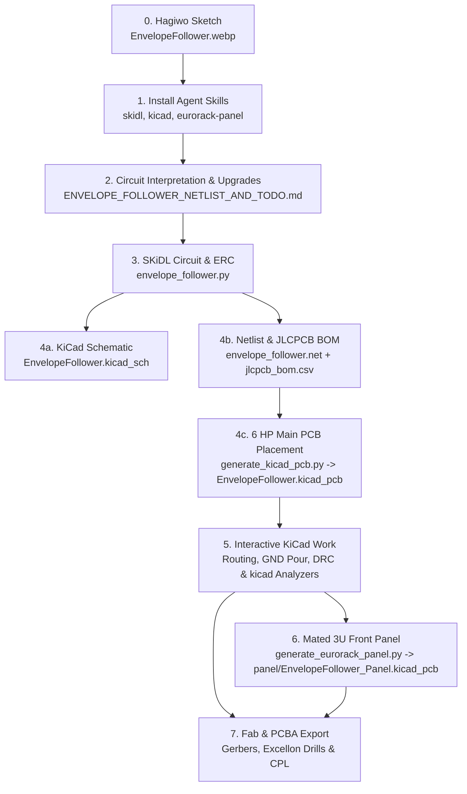
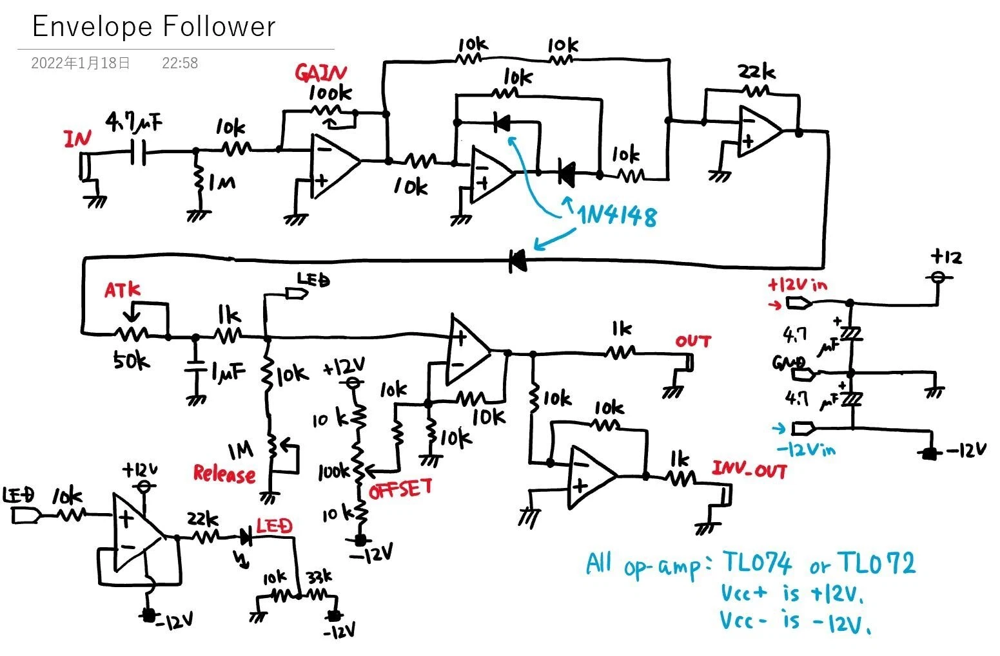
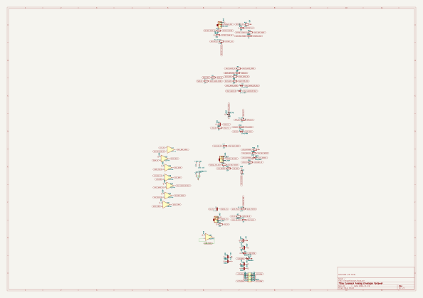
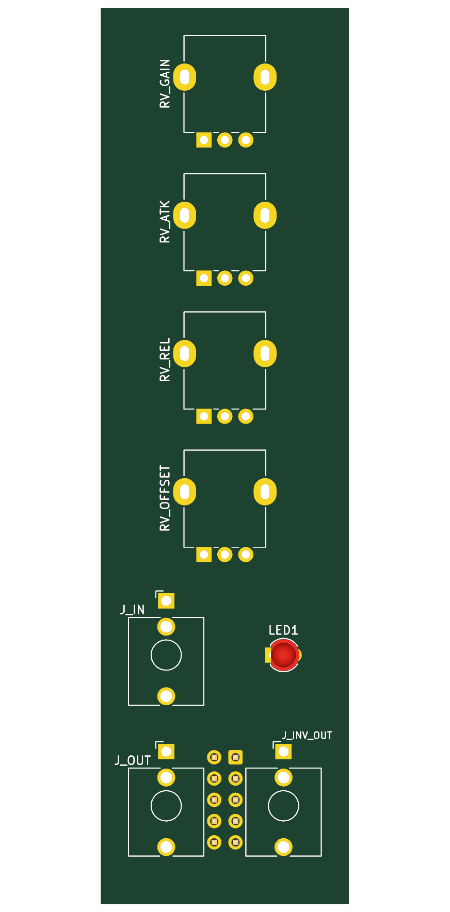
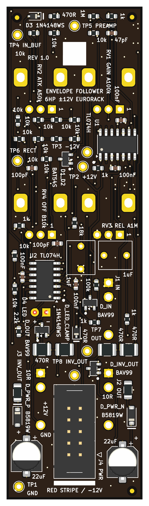
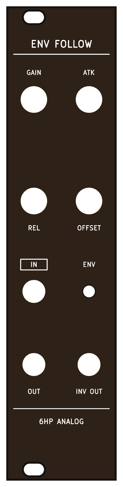

# From Sketch to Eurorack Module: End-to-End Hardware Design Tutorial with AI Skills, SKiDL, and KiCad

This tutorial walks through the complete workflow of turning **Hagiwo's hand-drawn [$4 Envelope Follower circuit sketch](https://note.com/solder_state/n/n110e9ba066b3?hl=en)** into a manufacturable **6 HP Eurorack PCB** and a **mated 3U aluminum-replacement FR4 front panel** using **Python (SKiDL)**, **KiCad 10**, and **AI hardware agent skills**.

Each stage uses a **hybrid workflow**: you will see both the **AI agent prompt** that drives the specialized skills and the **engineering details** underneath—circuit upgrades, Python netlist generation, mechanical coordinate math, PCB routing, DRC/Gerber checks, and JLCPCB manufacturing export.

---

## Architecture Pipeline



### Prerequisites

| Tool | Purpose | Notes |
| :--- | :--- | :--- |
| **[KiCad 10.0+](https://www.kicad.org/)** | Schematic/PCB CAD, bundled `pcbnew` Python API, and `kicad-cli` | Installed at `/Applications/KiCad/KiCad.app` on macOS |
| **[`uv`](https://docs.astral.sh/uv/)** | Fast Python environment and package manager | Target Python 3.12–3.14 for prebuilt `skidl` / `h5py` wheels |
| **Node.js (`npx`)** | Installs agent hardware skills from GitHub | Populates `.agents/skills/` and `skills-lock.json` |
| **[`ruff`](https://docs.astral.sh/ruff/)** | Python linter and formatter | Keeps SKiDL and panel generator scripts clean |

---

## Stage 1: Installing the Hardware Agent Skills

LLMs working without domain tooling tend to hallucinate KiCad S-expression syntax, guess footprint pinouts, overlook mechanical bushing offsets, or pick out-of-stock parts. Installing dedicated **agent skills** gives your coding agent verified reference docs, CLI wrappers, and deterministic Python analyzers inside `.agents/skills/`.

Install the three hardware skills recorded in [`skills-lock.json`](skills-lock.json):

```bash
npx skills add domesticmouse/skills --skill skidl --skill eurorack-panel
npx skills add aklofas/kicad-happy --skill kicad
```

Verify the installed directory layout:

```text
.agents/skills/
├── skidl/             # SKiDL circuit coding, symbol search & JLCPCB/LCSC catalog search
├── kicad/             # Schematic, PCB, Gerber, cross-domain & DFM analyzers
└── eurorack-panel/    # Main-PCB inspection, 3U panel generation, zone fill & DRC
```

| Skill | Key Scripts & Capabilities | When It Runs |
| :--- | :--- | :--- |
| [`skidl`](.agents/skills/skidl/SKILL.md) | `scripts/jlcpcb_search.py` for live LCSC stock/Basic vs. Extended tier lookup; KiCad 10 symbol/footprint idioms; `ERC()` + BOM export | Stage 3 & Stage 4a |
| [`kicad`](.agents/skills/kicad/SKILL.md) | `scripts/analyze_schematic.py`, `scripts/analyze_pcb.py`, `scripts/cross_analysis.py`, `scripts/analyze_gerbers.py` | Stage 5 & Stage 6 |
| [`eurorack-panel`](.agents/skills/eurorack-panel/SKILL.md) | `scripts/generate_eurorack_panel.py` (`--inspect`, `--drc`, `--gerber-dir`, `--zip`) and Doepfer A-100 mechanical spec | Stage 6 |

---

## Stage 2: Interpreting Hagiwo's Sketch & Designing Production Upgrades

Start from [Hagiwo's original post](https://note.com/solder_state/n/n110e9ba066b3?hl=en) and the hand-drawn reference schematic, [`EnvelopeFollower.webp`](EnvelopeFollower.webp):



### AI Agent Prompt

> *"Inspect `EnvelopeFollower.webp`. Trace every node and component in Hagiwo's Envelope Follower schematic, adapt the design for modern Texas Instruments `TL074H` quad op-amps (`SOIC-14`), apply Eurorack production safeguards (reverse-polarity protection, local decoupling, gain floor limiting, output protection, and unused op-amp termination), and write a complete BOM, 35-net connection list, and KiCad capture checklist to `ENVELOPE_FOLLOWER_NETLIST_AND_TODO.md`."*

### Signal Flow: 6 Functional Blocks

Reading the sketch left-to-right and top-to-bottom breaks the analog circuit into six clean stages:

1. **Power Entry, Protection & Decoupling (`J_PWR`, `D4`–`D5`, `C3`–`C8`)**:
   Eurorack $\pm 12\text{V}$ and `GND` enter via a 2×5 shrouded 10-pin IDC header (`J_PWR`: Pins 1–2 `-12V_RAW`, Pins 3–8 `GND`, Pins 9–10 `+12V_RAW`) before feeding dual `TL074H` ICs (`U1`, `U2` Pin 4 $= +12\text{V}$, Pin 11 $= -12\text{V}$).
2. **AC Input Coupling & Gain Stage (`U1A`)**:
   `J_IN` passes through a non-polarized $4.7\,\mu\text{F}$ coupling capacitor (`C1`) with a $1\text{ M}\Omega$ input pulldown (`R1`) into an inverting amplifier (`U1A`, $R_2 = 10\text{ k}\Omega$ input, `RV_GAIN` $= 100\text{ k}\Omega$ feedback).
3. **Precision Full-Wave Rectifier (`U1B`, `U1C`)**:
   `U1B` forms an active half-wave stage (`R3`, `R4` $= 10\text{ k}\Omega$, `D1`, `D2` = 1N4148), while `U1C` sums the half-wave path (`R7` $= 10\text{ k}\Omega$) against the direct signal (`R5 + R6` $= 20\text{ k}\Omega$ total) through `R8` $= 22\text{ k}\Omega$. Because the half-wave leg has twice the admittance of the direct leg ($\frac{1}{10\text{ k}\Omega}$ vs. $\frac{1}{20\text{ k}\Omega}$), `U1C` flips only one polarity to produce full-wave rectification with a clean $1.1\times$ summing gain ($\frac{22\text{ k}\Omega}{20\text{ k}\Omega}$).
4. **Peak Detector & Attack/Release Timing (`D3`, `RV_ATK`, `C2`, `RV_REL`)**:
   `D3` (1N4148) charges the $1\,\mu\text{F}$ smoothing capacitor `C2` through `RV_ATK` ($50\text{ k}\Omega$ attack pot) and discharges through `R9` ($1\text{ k}\Omega$), `R10` ($10\text{ k}\Omega$), and `RV_REL` ($1\text{ M}\Omega$ release pot).
5. **Output Amplifier & DC Offset Stage (`U1D`)**:
   `U1D` buffers the envelope on Pin 12 ($+$) while summing a bipolar DC bias divider (`R11`, `R12` $= 10\text{ k}\Omega$ across $\pm 12\text{V}$ feeding `RV_OFFSET` $100\text{ k}\Omega$ and `R13`–`R15` $10\text{ k}\Omega$) on Pin 13 ($-$), driving `J_OUT` through `R16` ($1\text{ k}\Omega$).
6. **Inverted Output & Pre-Biased LED Driver (`U2A`, `U2B`, `U2C`, `U2D`)**:
   `U2A` provides a unity-gain inverted envelope (`R17 = R18 = 10k`, driving `J_INV_OUT` through `R19` $= 1\text{ k}\Omega$). `U2B` buffers the envelope via `R20` ($10\text{ k}\Omega$) and drives `LED1` through `R21` ($22\text{ k}\Omega$) against a negative-biased cathode divider (`R22` $= 10\text{ k}\Omega$ to `GND`, `R23` $= 33\text{ k}\Omega$ to $-12\text{V}$), letting the LED respond smoothly near $0\text{V}$.

### Five Production Upgrades Over the Original Sketch

Hagiwo's sketch uses minimal parts for breadboard simplicity (`TL074 or TL072`). Translating it into a reliable SMT PCB in [`ENVELOPE_FOLLOWER_NETLIST_AND_TODO.md`](ENVELOPE_FOLLOWER_NETLIST_AND_TODO.md) adds five essential safeguards:

1. **Unused Op-Amp Termination (`U2C`, `U2D`)**: With 6 active op-amps across two `TL074H` packages (8 channels total), two channels remain spare. Leaving op-amp pins floating risks high-frequency oscillation and excess current draw. Both `U2C` (Pins 8–10) and `U2D` (Pins 12–14) are wired as unity-gain followers with their non-inverting inputs ($+$) tied to `GND`.
2. **Gain Floor Resistor (`R_GAIN_MIN` $= 1\text{ k}\Omega$)**: Placed in series with `RV_GAIN` ($100\text{ k}\Omega$) so turning the gain knob fully counter-clockwise never shorts `U1A`'s feedback loop to $0\,\Omega$, avoiding wiper-contact dead spots and op-amp capacitive loading.
3. **High-Frequency IC Decoupling (`C5`–`C8` $= 100\text{ nF}$)**: Four `0603` X7R ceramic capacitors sit directly beside Pins 4 ($+12\text{V}$) and 11 ($-12\text{V}$) of `U1` and `U2`, complementing the two bulk $4.7\,\mu\text{F}$ electrolytics (`C3`, `C4`).
4. **Reverse-Polarity Protection (`D4`, `D5` = `B5819W`)**: Series `SOD-123` Schottky diodes on `+12V_RAW` and `-12V_RAW` protect the `TL074H` rails if a keyed/unkeyed Eurorack power cable is plugged in backwards.
5. **Non-Polarized MLCC Input Coupling (`C1`) & Output Isolation (`R16`, `R19`)**: `C1` uses a $4.7\,\mu\text{F}$ 25V X7R `0805` MLCC for clean bipolar AC coupling without electrolytic reverse-biasing, and $1\text{ k}\Omega$ series resistors (`R16`, `R19`) protect `U1D` and `U2A` against short-circuited patch cables.

---

## Stage 3: Translating the Schematic to SKiDL (`envelope_follower.py`)

Defining the circuit in **SKiDL** turns the netlist into testable, version-controlled Python code that enforces `ERC()` assertions and outputs both a KiCad netlist and a JLCPCB-ready BOM in one execution.

### AI Agent Prompt

> *"Using the `skidl` skill and `ENVELOPE_FOLLOWER_NETLIST_AND_TODO.md`, implement the Envelope Follower circuit in `envelope_follower.py` using dual `TL074H` (`SOIC-14`) packages across 6 `@subcircuit` blocks. Query live JLCPCB/LCSC parts with `jlcpcb_search.py` to populate `LCSC`, `MPN`, and `JLCPCB_Class` fields, verify `ERC()` passes with 0 errors and 0 warnings, and export `envelope_follower.net`, `envelope_follower_bom.xml`, `jlcpcb_bom.csv`, and `EnvelopeFollower.kicad_sch`."*

### Step 3.1: Set Up the Python Environment & Query Parts

Create an isolated `.venv` with `uv` (Python 3.14 avoids compiling `h5py` from source) and install `skidl` and `kinet2pcb`:

```bash
uv venv --clear --python 3.14 .venv
uv pip install skidl kinet2pcb
```

Query JLCPCB stock and pricing directly from the `skidl` skill's catalog helper:

```bash
.venv/bin/python .agents/skills/skidl/scripts/jlcpcb_search.py \
    --in-stock-only "TL074HIDR" "B5819W" "1N4148W" "10k 0603" "100nF 0603"
```

You can also inspect exact KiCad 10 symbol pins before coding (`show("Amplifier_Operational", "TL074")`, `show("Connector_Audio", "AudioJack2_SwitchT")`).

### Step 3.2: Anatomy of `envelope_follower.py`

In [`envelope_follower.py`](envelope_follower.py), five SKiDL patterns make the circuit modular and fabrication-ready:

1. **Pre-Import Environment Setup (Lines 15–30)**:
   Before importing `skidl`, set `XDG_DATA_HOME`, `MPLCONFIGDIR`, `KICAD10_SYMBOL_DIR`, `KICAD_SYMBOL_DIR`, and `KICAD10_FOOTPRINT_DIR` so SKiDL resolves KiCad 10's `.kicad_sym` libraries cleanly on macOS.
2. **Reusable Templates & `part.fields` Dictionary (Lines 70–148)**:
   All 2-pin passives and panel hardware derive from `dest=TEMPLATE` parts (`make_templates()`). Catalog metadata is written into `part.fields["LCSC"]`, `part.fields["MPN"]`, and `part.fields["JLCPCB_Class"]` (rather than plain Python attributes, which SKiDL's netlist/XML exporters ignore):

   ```python
   JLCPCB_RESISTORS_0603 = {
       "1k": ("C21190", "0603WAF1001T5E", "Basic"),
       "10k": ("C25804", "0603WAF1002T5E", "Basic"),
       "22k": ("C31850", "0603WAF2202T5E", "Basic"),
       "33k": ("C4216", "0603WAF3302T5E", "Basic"),
       "1M": ("C22935", "0603WAF1004T5E", "Basic"),
   }
   ```

   Panel-mounted controls (`RV_*`, `J_IN`, `J_OUT`, `J_INV_OUT`, `LED1`, `J_PWR`) are tagged `JLCPCB_Class = "Manual THT"` so the SMT BOM generator excludes them automatically.
3. **Power `Interface` & `NetClass` Rules (Lines 476–486)**:
   Power rails are bundled into a SKiDL `Interface`, marked `drive = POWER` so ERC knows they are externally driven, and assigned to a `NetClass("Power", priority=1, trace_width=0.6, clearance=0.25)`.
4. **Six `@subcircuit` Functional Blocks (Lines 151–443)**:
   Each stage uses SKiDL's series network operator (`&`) and pin attachment operator (`+=`), while intentionally unused normalled jack switches (`j_in["TN"]`, `j_out["TN"]`, `j_inv_out["TN"]`) connect to `builtins.NC`:

   ```python
   # Example from precision_rectifier_stage (U1B + U1C)
   out_gain & r5 & sum_top_mid & r6 & sum_in
   half_wave_node & r7 & sum_in
   sum_in += u1[9]
   gnd += u1[10]
   rect_out += u1[8]
   sum_in & r8 & rect_out
   ```

5. **Programmatic `erc_assert()` & Exports (Lines 500–531)**:
   Custom assertions verify package pin counts (`len(u1.get_pins()) == 14`) and power connections before calling `ERC()`, `generate_netlist()`, `generate_xml()`, `generate_jlcpcb_bom()`, and `generate_schematic()`.

### Step 3.3: Run SKiDL & Inspect Outputs

```bash
.venv/bin/python envelope_follower.py
ruff check --fix envelope_follower.py envelope_follower_sklib.py
ruff format envelope_follower.py envelope_follower_sklib.py
```

Key generated files:
- [`envelope_follower.erc`](envelope_follower.erc): `ERC INFO: No errors or warnings found while running ERC.`
- [`envelope_follower.net`](envelope_follower.net): KiCad netlist containing all **48 physical components** and **35 nets**.
- [`envelope_follower_bom.xml`](envelope_follower_bom.xml): Full XML BOM with embedded `LCSC`, `MPN`, `JLCPCB_Class`, and `Notes` fields.
- [`jlcpcb_bom.csv`](jlcpcb_bom.csv): Grouped 4-column JLCPCB SMT BOM (`Comment,Designator,Footprint,LCSC Part #`) with **12 SMT line items** (39 SMT components total; the 9 THT components are filtered out as `Manual THT`).

<details>
<summary>Preview of generated <code>jlcpcb_bom.csv</code> (12 SMT line items)</summary>

```csv
Comment,Designator,Footprint,LCSC Part #
TL074H,"U1, U2",SOIC-14_3.9x8.7mm_P1.27mm,C2878713
B5819W,"D4, D5",D_SOD-123,C8598
4.7uF,"C3, C4",CP_Elec_4x5.4,C5246584
100nF,"C5, C6, C7, C8",C_0603_1608Metric,C14663
4.7uF,C1,C_0805_2012Metric,C354262
1M,R1,R_0603_1608Metric,C22935
10k,"R2, R3, R4, R5, R6, R7, R10, R11, R12, R13, R14, R15, R17, R18, R20, R22",R_0603_1608Metric,C25804
1k,"R_GAIN_MIN, R9, R16, R19",R_0603_1608Metric,C21190
22k,"R8, R21",R_0603_1608Metric,C31850
1N4148W,"D1, D2, D3",D_SOD-123,C81598
1uF,C2,C_0603_1608Metric,C559769
33k,R23,R_0603_1608Metric,C4216
```

</details>

---

## Stage 4: Generating the KiCad Schematic & 6 HP Main PCB Layout

### Part A: Auto-Generated KiCad Schematic (`EnvelopeFollower.kicad_sch`)

Calling `generate_schematic(...)` at the bottom of `envelope_follower.py` converts the SKiDL netlist into [`EnvelopeFollower.kicad_sch`](EnvelopeFollower.kicad_sch) using SKiDL's `schematizer` router. Notice line 515 of `envelope_follower.py`:

```python
import schematizer.engine.gen_schematic as _gs

# Disable two-pin snapping in schematizer so series protection diodes (D4, D5)
# do not overlap J_PWR pins and short -12V_RAW to GND.
_gs._snap_two_pin_parts = lambda node: None
```

Disabling `_snap_two_pin_parts` prevents compact series diodes (`D4`, `D5`) from visually snapping onto adjacent header pins in the schematic canvas.



*(Exported directly via `kicad-cli sch export svg --output docs/images/ EnvelopeFollower.kicad_sch`.)*

---

### Part B: Generating the 6 HP Main PCB (`generate_kicad_pcb.py`)

Rather than importing the netlist manually and placing 48 footprints by hand in `pcbnew`, [`generate_kicad_pcb.py`](generate_kicad_pcb.py) automates the board outline, control grid, sandwich placement, BOM metadata transfer, and power silkscreen.

### AI Agent Prompt

> *"Write `generate_kicad_pcb.py` using KiCad's `pcbnew` Python API and `kinet2pcb` to generate `EnvelopeFollower.kicad_pcb` from `envelope_follower.net`. Size the board for 6 HP (`29.60 x 107.00 mm`) centered behind a `30.00 x 128.50 mm` Doepfer 3U panel, place the 4 pots, LED, and 3 jacks on `F.Cu` aligned to an ergonomic panel grid using exact footprint-to-bushing offsets, flip `J_PWR` (oriented with Pin 1 / `-12V RED` at the bottom per Eurorack convention) and all 39 SMT parts onto `B.Cu` grouped by subcircuit, add `-12V RED` (bottom) / `+12V` (top) silkscreen markings, and configure the `Power` netclass."*

### How `generate_kicad_pcb.py` Works

1. **Dual-Environment Python Bootstrap (Lines 31–46)**:
   KiCad's compiled `pcbnew` C++ bindings only load inside KiCad's bundled Python (`/Applications/KiCad/KiCad.app/Contents/Frameworks/Python.framework/Versions/Current/bin/python3`), while `kinet2pcb` and `simp_sexp` live in `.venv`. If `import pcbnew` fails under `.venv`, the script re-executes itself (`os.execv`) using `KICAD_PYTHON` and appends `.venv/lib/python*/site-packages` to `sys.path`.
2. **6 HP Mechanical Coordinates & Bushing Offsets (Lines 51–76)**:
   The target 6 HP × 3U panel measures `30.00 x 128.50 mm` spanning global KiCad coordinates `X = [100.00, 130.00]`, `Y = [10.00, 138.50]`. Leaving `0.20 mm` horizontal clearance per side and `10.75 mm` vertical clearance top/bottom (clearing Eurorack rails and M3 screw heads) yields a main PCB outline of **`29.60 x 107.00 mm`** (`X = [100.20, 129.80]`, `Y = [20.75, 127.75]`).

   KiCad footprints do **not** put `(0, 0)` at the mechanical shaft or jack center. Inside KiCad's coordinate system ($X$ right, $Y$ down), rotating a local offset $(c_x, c_y)$ counter-clockwise by $\theta$ shifts the bushing relative to the footprint origin by:

   $$\Delta X = c_x \cos\theta + c_y \sin\theta, \qquad \Delta Y = -c_x \sin\theta + c_y \cos\theta$$

   | Component | KiCad Footprint | Local `fp_circle` | Placement Rot | Resulting Offset $(\Delta X, \Delta Y)$ | Footprint Origin $(X, Y)$ | Target Panel Bushing $(X, Y)$ |
   | :--- | :--- | :---: | :---: | :---: | :---: | :---: |
   | `RV_GAIN` | `Potentiometer_Alpha_RD901F-40-00D_Single_Vertical` | `(7.50, 2.50)` | `90°` | `(+2.50, -7.50)` | `(112.50, 36.50)` | `(115.00, 29.00)` |
   | `RV_ATK` | `Potentiometer_Alpha_RD901F-40-00D_Single_Vertical` | `(7.50, 2.50)` | `90°` | `(+2.50, -7.50)` | `(112.50, 53.00)` | `(115.00, 45.50)` |
   | `RV_REL` | `Potentiometer_Alpha_RD901F-40-00D_Single_Vertical` | `(7.50, 2.50)` | `90°` | `(+2.50, -7.50)` | `(112.50, 69.50)` | `(115.00, 62.00)` |
   | `RV_OFFSET` | `Potentiometer_Alpha_RD901F-40-00D_Single_Vertical` | `(7.50, 2.50)` | `90°` | `(+2.50, -7.50)` | `(112.50, 86.00)` | `(115.00, 78.50)` |
   | `J_IN` | `Jack_3.5mm_QingPu_WQP-PJ398SM_Vertical_CircularHoles` | `(0.00, 6.48)` | `0°` | `(0.00, +6.48)` | `(108.00, 91.52)` | `(108.00, 98.00)` |
   | `LED1` | `LED_D3.0mm` | `(1.27, 0.00)` | `0°` | `(+1.27, 0.00)` | `(120.73, 98.00)` | `(122.00, 98.00)` |
   | `J_OUT` | `Jack_3.5mm_QingPu_WQP-PJ398SM_Vertical_CircularHoles` | `(0.00, 6.48)` | `0°` | `(0.00, +6.48)` | `(108.00, 109.52)` | `(108.00, 116.00)` |
   | `J_INV_OUT` | `Jack_3.5mm_QingPu_WQP-PJ398SM_Vertical_CircularHoles` | `(0.00, 6.48)` | `0°` | `(0.00, +6.48)` | `(122.00, 109.52)` | `(122.00, 116.00)` |

3. **Single-Sided `B.Cu` Assembly & Rear Power Markings (Lines 76–123, 195–212)**:
   Every SMT component (`U1`, `U2`, `D1`–`D5`, `C1`–`C8`, `R1`–`R23`, `R_GAIN_MIN`) and the rear `J_PWR` header are flipped to `B.Cu` (keeping JLCPCB assembly single-sided). `J_PWR` is oriented at `0°` on `B.Cu` so Pins 1–2 (`-12V_RAW`) sit at the **bottom** (`-12V RED` silkscreen) and Pins 9–10 (`+12V_RAW`) sit at the **top** (`+12V` silkscreen) per Eurorack standard, while local bypass capacitors (`C5`–`C8`) hug Pins 4 and 11 of `U1` and `U2`, and `B.SilkS` labels mark `ENV FOLLOWER 6HP`.

Run the script to generate [`EnvelopeFollower.kicad_pcb`](EnvelopeFollower.kicad_pcb):

```bash
.venv/bin/python generate_kicad_pcb.py
```

Output:
```text
Generated EnvelopeFollower.kicad_pcb: 48 footprints, 35 nets, outline 29.60 x 107.00 mm.
```

| Main PCB Front (`F.Cu` — THT Panel Controls) | Main PCB Rear (`B.Cu` — SMT & `J_PWR`) |
| :---: | :---: |
|  |  |

---

## Stage 5: Interactive KiCad Work (Routing, Ground Pours & Verification)

At this stage, `EnvelopeFollower.kicad_pcb` has all 48 footprints positioned, `Edge.Cuts` defined, and all 35 nets loaded as an unrouted ratsnest (`0` copper tracks, `0` copper zones). Open `EnvelopeFollower.kicad_pcb` in **KiCad 10 PCB Editor** to complete routing and verification.

### 5.1 Routing Strategy

1. **Verify Grid & Netclass Setup**:
   In **File → Board Setup → Design Rules → Net Classes**, confirm the `Power` netclass (`0.60 mm` track width, `0.25 mm` clearance, `0.80 mm` via diameter, `0.40 mm` drill) is assigned to `+12V_RAW`, `-12V_RAW`, `+12V`, `-12V`, and `GND`. Leave the `Default` netclass at `0.25 mm` width for analog signal nets.
2. **Route Power Rails First (`B.Cu`)**:
   - Route `+12V_RAW` and `-12V_RAW` from `J_PWR` through Schottky diodes `D4` and `D5` into bulk electrolytics `C3` and `C4`.
   - Route `+12V` and `-12V` at `0.60 mm` width to `U1` and `U2` (Pins 4 and 11), passing **through** the pads of local ceramic bypass capacitors `C5`–`C8` before reaching the IC pins.
   - Branch `+12V` to `R11` and `-12V` to `R12` and `R23` (`RV_OFFSET` and `LED1` cathode bias).
3. **Route Sensitive Analog Summing Nodes (`B.Cu` / `F.Cu`)**:
   - Keep inverting summing junctions (`GAIN_FB_IN` at `U1` Pin 2, `HALF_WAVE_IN` at `U1` Pin 6, `SUM_IN` at `U1` Pin 9, `OFFSET_SUM_IN` at `U1` Pin 13, and `INV_SUM_IN` at `U2` Pin 2) as short and compact as possible to minimize parasitic capacitance and noise pickup.
   - Use `F.Cu` strictly for short jumpers or THT control interconnections so the front side stays clean beneath potentiometer bodies and jack housings.
4. **Add Ground Copper Pours & Stitching Vias (`F.Cu` + `B.Cu`)**:
   - Draw full-board filled copper zones (`Add Filled Zone`) assigned to net `GND` on both `F.Cu` and `B.Cu` (inset `0.30 mm` from `Edge.Cuts`, thermal relief spokes on THT/SMD pads).
   - Drop `GND` stitching vias (`0.4 mm` drill / `0.8 mm` pad) near `J_PWR`, `J_IN`, `J_OUT`, `J_INV_OUT`, `U1`, `U2`, and along the board perimeter, then press **`B`** to refill all zones.
5. **Run Design Rules Check (DRC)**:
   Run **Inspect → Design Rules Checker** (or CLI):
   ```bash
   /Applications/KiCad/KiCad.app/Contents/MacOS/kicad-cli pcb drc \
       --refill-zones --exit-code-violations --format json \
       --output /tmp/main_drc.json EnvelopeFollower.kicad_pcb
   ```
   Confirm `0` DRC errors, `0` clearance violations, and `0` unrouted nets.

### 5.2 Automated Design Audit with the `kicad` Skill

After routing, run the `kicad` skill analyzers on both the schematic and routed PCB to catch decoupling gaps, silkscreen overlaps, or cross-domain mismatches:

```bash
python3 .agents/skills/kicad/scripts/analyze_schematic.py EnvelopeFollower.kicad_sch --analysis-dir analysis/
python3 .agents/skills/kicad/scripts/analyze_pcb.py EnvelopeFollower.kicad_pcb --full --analysis-dir analysis/
python3 .agents/skills/kicad/scripts/cross_analysis.py \
    --schematic analysis/<run_id>/schematic.json \
    --pcb analysis/<run_id>/pcb.json \
    --analysis-dir analysis/
```

---

## Stage 6: Mated 3U Eurorack Front Panel Construction

Instead of buying costly custom-milled aluminum, you can fabricate a rigid `1.6 mm` FR4 PCB front panel (matte black solder mask with crisp white silkscreen) directly from the finalized coordinates in `EnvelopeFollower.kicad_pcb`.

### AI Agent Prompt

> *"Using the `eurorack-panel` skill, inspect `EnvelopeFollower.kicad_pcb` to extract every pot, jack, and LED bushing coordinate, generate the mated 6 HP × 3U front panel PCB at `panel/EnvelopeFollower_Panel.kicad_pcb` titled `ENV FOLLOW` (`6HP ANALOG`), refill `F.Cu`/`B.Cu` `GND` shield planes, run DRC, export Gerbers and drills to `production/panel/`, and verify the Gerbers with the `kicad` skill."*

### Step 6.1: Inspect Mechanical Coordinates

Run `generate_eurorack_panel.py --inspect` against the main PCB:

```bash
python3 .agents/skills/eurorack-panel/scripts/generate_eurorack_panel.py \
    --main-pcb EnvelopeFollower.kicad_pcb \
    --inspect
```

Observed output:

```text
=== Eurorack Panel Mechanical Report for EnvelopeFollower.kicad_pcb ===
Main PCB Outline   : 29.60 x 107.00 mm (X: 100.20..129.80, Y: 20.75..127.75)
Target Front Panel : 6HP x 3U (30.00 x 128.50 mm), Vertical rail overhang = 10.75 mm top/bottom
Panel Origin (0,0) : Global (100.00, 10.00) mm -> (130.00, 138.50) mm

Ref   Value      FP Origin (X, Y)     Bushing Global (X, Y)   Panel-Local (X, Y)   Drill
----------------------------------------------------------------------------------------
RV_GAIN 100k       (112.50,  36.50)     (115.00,  29.00)        ( 15.00,  19.00)     7.2 mm
RV_ATK 50k        (112.50,  53.00)     (115.00,  45.50)        ( 15.00,  35.50)     7.2 mm
RV_REL 1M         (112.50,  69.50)     (115.00,  62.00)        ( 15.00,  52.00)     7.2 mm
RV_OFFSET 100k       (112.50,  86.00)     (115.00,  78.50)        ( 15.00,  68.50)     7.2 mm
J_IN  3.5mm_Jack (108.00,  91.52)     (108.00,  98.00)        (  8.00,  88.00)     6.2 mm
LED1  LED_3mm    (120.73,  98.00)     (122.00,  98.00)        ( 22.00,  88.00)     3.2 mm
J_OUT 3.5mm_Jack (108.00, 109.52)     (108.00, 116.00)        (  8.00, 106.00)     6.2 mm
J_INV_OUT 3.5mm_Jack (122.00, 109.52)     (122.00, 116.00)        ( 22.00, 106.00)     6.2 mm
```

Notice how sharing the same global KiCad coordinate space (`100.00, 10.00` to `130.00, 138.50`) ensures every hole cutout aligns to the exact micron with the main PCB's shaft and bushing centers.

### Step 6.2: Generate the Panel PCB, Run DRC & Package Gerbers

```bash
python3 .agents/skills/eurorack-panel/scripts/generate_eurorack_panel.py \
    --main-pcb EnvelopeFollower.kicad_pcb \
    --output panel/EnvelopeFollower_Panel.kicad_pcb \
    --title "ENV FOLLOW" \
    --subtitle "6HP ANALOG" \
    --gerber-dir production/panel \
    --zip production/EnvelopeFollower_Panel.zip \
    --drc
```

Output:
```text
Generated panel/EnvelopeFollower_Panel.kicad_pcb (6HP / 30.0x128.5mm, 8 jack cutouts).
DRC Summary: 0 violations, 0 unconnected items.
Exported Gerbers & Drills to production/panel
Packaged fabrication archive at production/EnvelopeFollower_Panel.zip
```

### Panel Engineering Highlights

- **Doepfer A-100 3U Mounting Slots (`H1`, `H2`)**: Oval `5.5 x 3.2 mm` NPTH slots centered at panel-local `(7.50, 3.00)` and `(7.50, 125.50)` fit both fixed threaded rail strips and sliding M3 nuts.
- **Blemish-Free Front Shielding (`(layers "*.Cu" "B.Mask")`)**: Pot (`7.2 mm`) and jack (`6.2 mm`) holes use plated through-hole pads connected solidly to the `F.Cu` and `B.Cu` `GND` shield zones. Leaving `F.Mask` tented over the front copper ring yields a clean exterior surface around the M6/M7 nuts, while exposing `B.Mask` on the rear automatically grounds the entire front panel shield to chassis `GND` when the hardware nuts tighten against the back face.
- **Silkscreen Clarity & Input Callout Box**: Generic part values (`100k`, `50k`, `1M`, `3.5mm_Jack`, `LED_3mm`) map cleanly to `GAIN`, `ATK`, `REL`, `OFFSET`, boxed `IN`, `ENV`, `OUT`, and `INV OUT`, with a `5 × 5 mm` white square placed on `B.SilkS` that JLCPCB replaces with a QR code during ordering.

| 3U Front Panel (`F.Cu` / `F.SilkS`) | 3U Front Panel Rear (`B.Cu` / Grounding Rings) |
| :---: | :---: |
|  |  |

### Step 6.3: Verify Panel PCB & Gerbers with `kicad` Analyzers

```bash
python3 .agents/skills/kicad/scripts/analyze_pcb.py panel/EnvelopeFollower_Panel.kicad_pcb --full --output /tmp/panel_pcb.json
python3 .agents/skills/kicad/scripts/analyze_gerbers.py production/panel/ --full --output /tmp/panel_gerbers.json
```

Verified analyzer results on [`panel/EnvelopeFollower_Panel.kicad_pcb`](panel/EnvelopeFollower_Panel.kicad_pcb) and [`production/panel/`](production/panel/):
- **PCB Analyzer**: `0` errors, `0` warnings, `10` footprints (`8` controls + `2` M3 slots), `2` filled copper zones (`F.Cu`, `B.Cu`), `30.0 x 128.5 mm` outline, `routing_complete: True`.
- **Gerber Analyzer**: `0` findings across all severities; `9/9` Gerber layers complete (`B.Cu`, `B.Mask`, `B.Paste`, `B.SilkS`, `Edge.Cuts`, `F.Cu`, `F.Mask`, `F.Paste`, `F.SilkS`); `7` PTH component holes (`3 × 6.2 mm`, `4 × 7.2 mm`) and `3` NPTH mounting/LED holes (`3.2 mm` LED hole + `2` M3 oval slots).

---

## Stage 7: Exporting for JLCPCB PCBA & Hardware Assembly

### 7.1 Export Main PCB Manufacturing Files

Once you finish routing `EnvelopeFollower.kicad_pcb` in KiCad and pass DRC (`0` violations), export Gerbers, Excellon drills, and the SMD Centroid (`.pos`) file for JLCPCB SMT assembly:

```bash
mkdir -p production/main

# 1. Export Gerbers (using standard PCB layers)
/Applications/KiCad/KiCad.app/Contents/MacOS/kicad-cli pcb export gerbers \
    --layers F.Cu,B.Cu,F.Paste,B.Paste,F.SilkS,B.SilkS,F.Mask,B.Mask,Edge.Cuts \
    --output production/main/ EnvelopeFollower.kicad_pcb

# 2. Export Excellon drill files
/Applications/KiCad/KiCad.app/Contents/MacOS/kicad-cli pcb export drill \
    --format excellon --excellon-separate-th --generate-map --map-format gerberx2 \
    --output production/main/ EnvelopeFollower.kicad_pcb

# 3. Export SMD placement file (B.Cu only, relative to drill/aux origin)
/Applications/KiCad/KiCad.app/Contents/MacOS/kicad-cli pcb export pos \
    --side back --format csv --units mm --use-drill-file-origin --smd-only --exclude-dnp \
    --output production/main/EnvelopeFollower_cpl.csv EnvelopeFollower.kicad_pcb
```

*(Note: JLCPCB's uploader expects CPL headers named `Designator,Val,Package,Mid X,Mid Y,Rotation,Layer`—rename KiCad's `Ref,Val,Package,PosX,PosY,Rot,Side` header row or export via the KiCad JLCPCB plugin.)*

### 7.2 Ordering on JLCPCB

1. **Main Circuit PCB (`EnvelopeFollower.kicad_pcb`)**:
   - Upload the zipped `production/main/` Gerbers (`1.6 mm` FR4, 2 layers).
   - Enable **PCB Assembly** on **Bottom Side** only (`B.Cu`).
   - Upload [`jlcpcb_bom.csv`](jlcpcb_bom.csv) and `EnvelopeFollower_cpl.csv`.
   - Always inspect the 3D SMT assembly preview for Pin-1 / cathode orientation on `U1`, `U2` (`TL074HIDR`), `D1`–`D3` (`1N4148W`), `D4`–`D5` (`B5819W`), and polarized electrolytics `C3`–`C4`.
2. **Front Panel PCB (`production/EnvelopeFollower_Panel.zip`)**:
   - Upload `production/EnvelopeFollower_Panel.zip` (`1.6 mm` FR4, **Black** solder mask with **White** silkscreen, **Specify a location** for the order QR code over the `5 × 5 mm` white square on `B.SilkS`, which JLCPCB replaces with a QR code during ordering). No assembly needed.

### 7.3 Stress-Free Mechanical Assembly

When your PCBs arrive and you hand-solder the 9 `Manual THT` parts (`J_PWR` on the rear, plus `RV_GAIN`, `RV_ATK`, `RV_REL`, `RV_OFFSET`, `J_IN`, `J_OUT`, `J_INV_OUT`, and `LED1` on the front):

1. Solder `J_PWR` on `B.Cu` first (confirming Pin 1/Pin 2 (`-12V`) is at the bottom, aligned with the `-12V RED` silkscreen label).
2. Insert all four pots, three jacks, and the 3mm LED **unsoldered** into `F.Cu` of the main PCB.
3. Place the 3U front panel over the shafts and bushings, tighten the M6/M7 panel nuts finger-tight, and position `LED1` flush inside its `3.2 mm` bezel hole.
4. **Only after the front panel aligns everything mechanically**, solder all pot lugs, jack pins, and LED leads on `B.Cu`. This guarantees zero mechanical stress on solder joints and perfectly centered front-panel controls.
