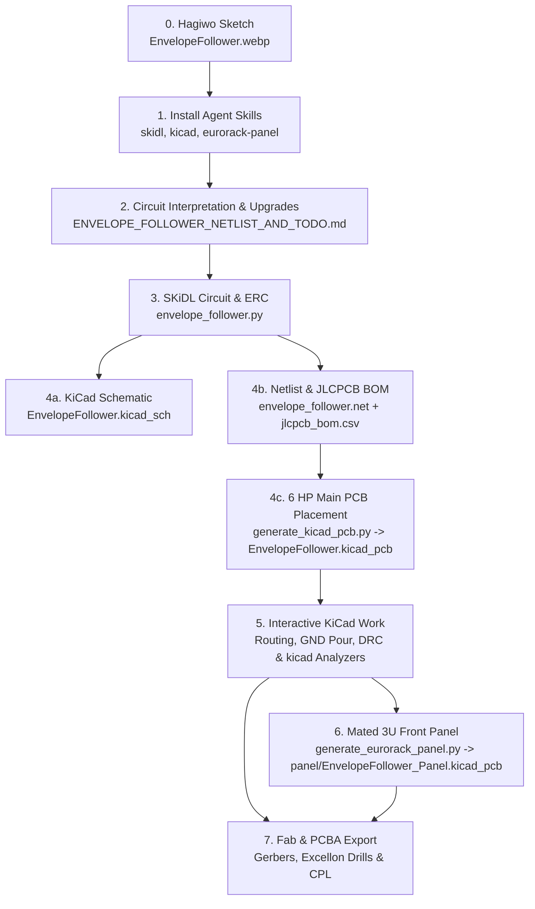

# From Sketch to Eurorack Module: End-to-End Hardware Design Tutorial

This tutorial walks through the complete workflow of turning **Hagiwo's hand-drawn [$4 Envelope Follower circuit sketch](https://note.com/solder_state/n/n110e9ba066b3)** into a manufacturable **6 HP Eurorack PCB** and a **mated 3U aluminum-replacement FR4 front panel** using **Python (SKiDL)**, **KiCad 10**, and **AI hardware agent skills**.

Each stage uses a **hybrid workflow**: you will see both the **AI agent prompt** that drives the specialized skills and the **engineering details** underneath—circuit upgrades, Python netlist generation, mechanical coordinate math, PCB routing, DRC/Gerber checks, and JLCPCB manufacturing export.

---

## Architecture Pipeline

---

## Prerequisites

| Tool | Purpose | Notes |
| :--- | :--- | :--- |
| **[KiCad 10.0+](https://www.kicad.org/)** | Schematic/PCB CAD, bundled `pcbnew` Python API, and `kicad-cli` | Installed at `/Applications/KiCad/KiCad.app` on macOS |
| **[`uv`](https://docs.astral.sh/uv/)** | Fast Python environment and package manager | Target Python 3.12–3.14 for prebuilt `skidl` / `h5py` wheels |
| **Node.js (`npx`)** | Installs agent hardware skills from GitHub | Populates `.agents/skills/` and `skills-lock.json` |
| **[`ruff`](https://docs.astral.sh/ruff/)** | Python linter and formatter | Keeps SKiDL and panel generator scripts clean |

---

## Controls & I/O Summary

| Reference | Component / Value | Taper / Type | Function |
| :--- | :--- | :--- | :--- |
| **`RV_GAIN`** | $100\text{ k}\Omega$ Potentiometer | Linear / Log | Input Gain Control |
| **`RV_ATK`** | $50\text{ k}\Omega$ Potentiometer | Linear | Attack Time Control |
| **`RV_REL`** | $1\text{ M}\Omega$ Potentiometer | Audio / Log | Release Time Control |
| **`RV_OFFSET`** | $100\text{ k}\Omega$ Potentiometer | Linear | Output DC Offset Adjust |
| **`J_IN`** | 3.5mm Mono Jack | Switched | Audio / CV Input |
| **`J_OUT`** | 3.5mm Mono Jack | Switched | Non-Inverted Envelope CV Output |
| **`J_INV_OUT`** | 3.5mm Mono Jack | Switched | Inverted Envelope CV Output |
| **`LED1`** | 3mm / 5mm LED | Red / Blue / Green | Envelope Signal Level Indicator |
| **`J_PWR`** | 2x5 Shrouded Header | 10-Pin Eurorack | $\pm 12\text{V}$ & `GND` Power Input |

---

## Stage-by-Stage Guide

1. **[Stage 1: Hardware Agent Skills](tutorial/stage-1-agent-skills.md)** — Install the `skidl`, `kicad`, and `eurorack-panel` skills into `.agents/skills/`.
2. **[Stage 2: Sketch & Circuit Upgrades](tutorial/stage-2-circuit-upgrades.md)** — Trace Hagiwo's original sketch into 6 functional blocks and apply 5 Eurorack production safeguards (`TL074H`, reverse-polarity protection, local decoupling, gain floor limiting, and unused op-amp termination).
3. **[Stage 3: SKiDL Circuit & ERC](tutorial/stage-3-skidl.md)** — Express the 48-component, 35-net circuit in Python (`envelope_follower.py`), verify live LCSC stock, and pass `ERC()` with zero errors or warnings.
4. **[Stage 4: Schematic & 6 HP PCB](tutorial/stage-4-schematic-and-pcb.md)** — Export `EnvelopeFollower.kicad_sch` and automate the `29.60 x 107.00 mm` main PCB placement (`generate_kicad_pcb.py`) with exact bushing offsets.
5. **[Stage 5: Routing, Pour & Audit](tutorial/stage-5-routing-and-drc.md)** — Route power and sensitive summing nodes in KiCad 10, pour stitched `GND` zones, pass DRC, and run automated schematic/PCB/cross-domain audits.
6. **[Stage 6: Mated 3U Front Panel](tutorial/stage-6-front-panel.md)** — Inspect main PCB bushing coordinates and generate a grounded `1.6 mm` FR4 3U front panel (`panel/EnvelopeFollower_Panel.kicad_pcb`) with Gerbers and DRC verification.
7. **[Stage 7: JLCPCB PCBA & Assembly](tutorial/stage-7-manufacturing.md)** — Export Gerbers, Excellon drills, and bottom-side CPL files for JLCPCB SMT assembly, plus stress-free THT mechanical soldering.

### Technical References

- **[Netlist, BOM & Capture Guide](reference/netlist-and-bom.md)** — Complete Bill of Materials, all 35 nets, and the 8-step manual KiCad capture guide.
- **[PCB & Fabrication Checklist](reference/build-checklist.md)** — Interactive checklist tracking layout, panel generation, and JLCPCB ordering.
- **[GitHub Repository](https://github.com/domesticmouse/EnvelopeFollower)** — Full source code, KiCad project files, Gerbers, and [Apache 2.0 License](https://github.com/domesticmouse/EnvelopeFollower/blob/main/LICENSE).
