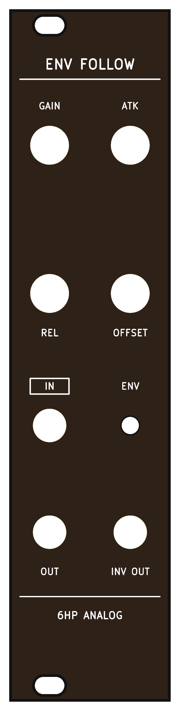
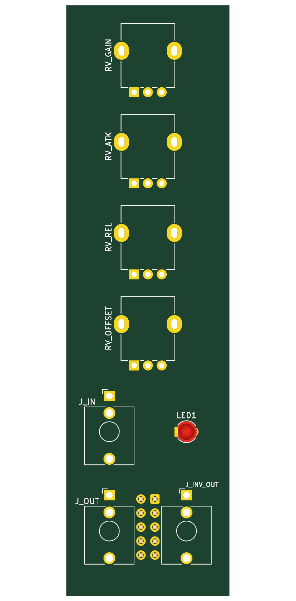
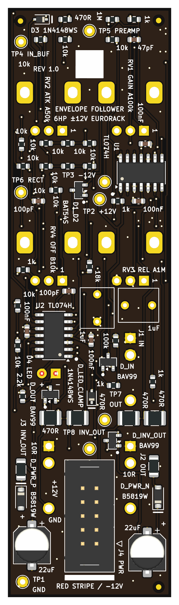
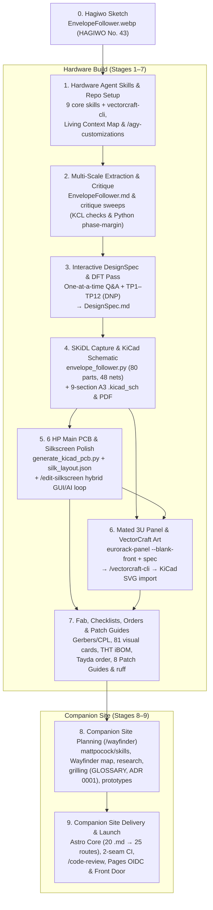

# ENV / SKEW Build Tutorial: From Sketch to Eurorack Module & Companion Site

The **`ENV / SKEW Build Tutorial`** walks through the complete, human-in-the-loop workflow of turning the **Hagiwo Sketch** (**HAGIWO/ハギヲ** `@solder_state`, Project **No. 43**, [`$4 Envelope Follower module`](https://note.com/solder_state/n/n110e9ba066b3?hl=en), `2022-01-28`, [YouTube `0eHllqHmlZQ`](https://www.youtube.com/watch?v=0eHllqHmlZQ)) into the manufacturable **6 HP Eurorack `ENV / SKEW`** module (**Envelope Follower Mode** + normal-switched **Asymmetric Skew Limiter Mode**, `2× TL074HIDR`, `30.0 × 108.0 mm` main PCB), a **mated 3U Matte Black + ENIG Gold FR4 front panel** (`30.0 × 128.5 mm`), and a `25`-route single-source **Companion Site** using **Python (SKiDL)**, **KiCad 10**, **VectorCraft**, **`/wayfinder`**, and **Astro Core**.

!!! tip "Two Sites, One Palette — Build Tutorial vs. ENV / SKEW Companion Site"
    Both repositories share `ENV / SKEW`'s Matte Black + ENIG Gold dark-studio palette, so keep the two published sites distinct:

    - **You are here — `ENV / SKEW Build Tutorial`** ([`domesticmouse/EnvelopeFollower`](https://github.com/domesticmouse/EnvelopeFollower)): The `9`-stage AI-assisted engineering tutorial teaching how the hardware and website were designed, verified, and shipped.
    - **Module site — live [`ENV / SKEW` Companion Site](https://domesticmouse.github.io/EnvelopeFollowerWithSkewLimiter/)** ([`domesticmouse/EnvelopeFollowerWithSkewLimiter` @ `8ad81d0`](https://github.com/domesticmouse/EnvelopeFollowerWithSkewLimiter/tree/8ad81d0), pinned in this repository's `reference/` submodule): The finished module's interactive **Patch Guides** workbench, `211`-step persistent **Build Checklists**, zoomable schematic/PCB/panel inspectors, **Reference Specs**, and **Static Passthrough** fabrication downloads.

| Matte Black + ENIG Front Panel | Main PCB Front (`F.Cu` Controls) | Main PCB Rear (`B.Cu` 50-SMD PCBA) |
| :---: | :---: | :---: |
| { width="230" } | { width="230" } | { width="230" } |

!!! info "Interactive Human-in-the-Loop Workflow (Not Unattended Replay)"
    Instead of automating everything behind brittle one-shot commands, this **Build Tutorial** teaches an **interactive human-in-the-loop engineering workflow** grounded in two complementary primary-source records:

    - **`16` pre-Wayfinder Session Traces ([`prompts/` in `EnvelopeFollower`](https://github.com/domesticmouse/EnvelopeFollower/tree/main/prompts)):** Exported interactive sessions powering Stages 1–7 — covering one-at-a-time architectural Q&A (`DesignSpec.md`), `/agy-customizations` skill authoring (`edit-silkscreen` locally; extensions upstreamed to `eurorack-panel`), hybrid GUI + AI silkscreen/artwork loops, and dual-board `manufacturing/` exports.
    - **Public GitHub Decision Trail ([`domesticmouse/EnvelopeFollowerWithSkewLimiter` @ `8ad81d0`](https://github.com/domesticmouse/EnvelopeFollowerWithSkewLimiter/tree/8ad81d0)):** Wayfinder [Map `#4`](https://github.com/domesticmouse/EnvelopeFollowerWithSkewLimiter/issues/4), parallel AFK research reports, `GLOSSARY.md`, 3-criteria ADR `0001`, throwaway UI prototype branches, [Implementation Specification `#17`](https://github.com/domesticmouse/EnvelopeFollowerWithSkewLimiter/issues/17), and delivery [PRs `#29`](https://github.com/domesticmouse/EnvelopeFollowerWithSkewLimiter/pull/29)–[`#32`](https://github.com/domesticmouse/EnvelopeFollowerWithSkewLimiter/pull/32) powering Stages 7–9 (`81` visual **Build Checklist** PNGs, real-world order tracking, `8` **Patch Guides**, and the **Companion Site** launch).

---

## Architecture Pipeline

---

## Prerequisites

| Tool | Purpose | Notes |
| :--- | :--- | :--- |
| **[KiCad 10.0+](https://www.kicad.org/)** | Schematic/PCB CAD, bundled `pcbnew` Python API, and `kicad-cli` | Installed at `/Applications/KiCad/KiCad.app` on macOS |
| **[`uv`](https://docs.astral.sh/uv/)** | Fast Python environment and package manager | Pin `.venv` to Python `3.12`–`3.14` for prebuilt `skidl` / `h5py` wheels |
| **Cairo (`pycairo`) & `Pillow`** | Multi-scale sketch crops (Stage 2) and `81` annotated PNG **Build Checklist** renders (Stage 7) | Install via `uv` (`pycairo` requires the system `cairo` C library on macOS/Linux) |
| **[Node.js `24` LTS](https://nodejs.org/)** (`node`, `npx`, `npm`) | Installs agent skills (`npx skills add`) in Stages 1 & 8 and builds/checks `site/` in Stage 9 | Powers the isolated Astro Core build, Vitest/`happy-dom`, and `npm run check` |
| **[GitHub CLI (`gh`)](https://cli.github.com/)** | Manages Wayfinder map issues, `blocked_by` sub-issues, research PRs, and slices in Stages 8–9 | Used by `/setup-matt-pocock-skills`, `/wayfinder`, `/to-tickets`, and `/implement-spec` |
| **[`ruff`](https://docs.astral.sh/ruff/)** | Python linter and formatter | Keeps SKiDL, schematic, PCB, panel, artwork, and checklist-image scripts clean |
| **`vectorcraft-cli`** *(Optional)* | Scriptable vector graphics engine for Stage 6 front-panel artwork | Needed only for custom Matte Black + ENIG Gold SVG artwork |
| **[`InteractiveHtmlBom`](https://github.com/openscopeproject/InteractiveHtmlBom)** *(v2.11+)* | KiCad PCB Editor plugin for Stage 7 THT assembly map | Generates `bom/ibom.html` filtered to `Manual THT` |

---

## Controls, I/O & Test Points Summary

| Reference | Component / Value | Taper / Type | Function |
| :--- | :--- | :--- | :--- |
| **`RV1`** (`GAIN`) | $100\text{ k}\Omega$ Potentiometer (`Tayda A-1855`) | Audio / Log (`A100K`, `RD901F`) | Input attenuator feeding switchless `×2.00` `U1A` preamp ($Z_{\text{in}} = 90.9\,\text{k}\Omega$) |
| **`RV2`** (`ATK`) | $1\text{ M}\Omega$ Potentiometer (`Tayda A-1672`) | Audio / Log (`A1M`, `RD901F`) | Fail-safe attack rheostat (`0.29–289 ms` `FAST` / `3.0 ms–3.00 s` `SLOW`, $0\rightarrow 5\text{ V}$) |
| **`RV3`** (`REL`) | $1\text{ M}\Omega$ Potentiometer (`Tayda A-1672`) | Audio / Log (`A1M`, `RD901F`) | Fail-safe release rheostat (`0.18–178 ms` `FAST` / `1.84 ms–1.84 s` `SLOW`, $5\rightarrow 0\text{ V}$) |
| **`RV4`** (`OFFSET`) | $10\text{ k}\Omega$ Potentiometer (`Tayda A-8401`) | Linear Center-Detent (`B10K`, `RD901F`) | RC-filtered `±4.98 V` linear offset (`0.00%` gain modulation, `CW = +OUT`) |
| **`SW1`** (`SMOOTH`) | Sub-Mini Vertical SPDT (`Tayda A-6087`) | `Dailywell 2MS1T1B1M2QES` (`2.54 mm`) | UP = `SMOOTH` (`29.0 Hz` split-$R_{\text{env}}$ T-filter, `−11.1 dB @ 100 Hz`, `0.00%` DC loss); DOWN = `RAW` |
| **`SW2`** (`FAST / SLOW`) | Sub-Mini Vertical SPDT (`Tayda A-6087`) | `Dailywell 2MS1T1B1M2QES` (`2.54 mm`) | UP = `SLOW` (`C12+C13` `4.4 µF` $\parallel$ `C11` `470 nF` = `4.87 µF` nominal); DOWN = `FAST` (`470 nF`) |
| **`LED1`** (`OUT`) | `3 mm` 2-Pin Anti-Parallel Red/Green (`Tayda A-1076`) | Bipolar THT (In-Loop `U2D`) | Post-offset active $V$-to-$I$ indicator (`R33 = 2.2 kΩ`, `+V = Green`, `−V = Red`, `0.00 mA` idle) |
| **`J1`** (`IN`) | `3.5 mm` Mono Jack (`WQP-PJ398SM`) | Switched THT (`TN → GND`) | AC-coupled audio input (`C7 = 470 nF` film, $f_c = 3.72\,\text{Hz}$, $Z_{\text{in}} = 90.9\,\text{k}\Omega$) |
| **`J2`** (`SLEW IN`) | `3.5 mm` Mono Jack (`WQP-PJ398SM`) | Switched THT (Normaled to FWR) | Unpatched = `U1C` FWR via `R15` (`1 kΩ`); patched = DC-coupled `1.00 MΩ` bipolar slew input |
| **`J3`** (`OUT`) | `3.5 mm` Mono Jack (`WQP-PJ398SM`) | Switched THT (`TN = NC`) | Non-inverted envelope/skew output $+(V_{\text{env}} + V_{\text{off}})$ via `R32` (`1 kΩ`) |
| **`J4`** (`INV_OUT`) | `3.5 mm` Mono Jack (`WQP-PJ398SM`) | Switched THT (`TN = NC`) | Inverted sidechain ducking output $-(V_{\text{env}} + V_{\text{off}})$ via `R25` (`1 kΩ`) |
| **`J_PWR`** (`PWR`) | `2×5` Shrouded IDC Header (`2.54 mm`) | `10-Pin` Eurorack (`B.Cu`) | $\pm 12\text{ V}$ & `GND` entry (`B5819W` + `10 Ω` / `47 µF` RC → `±11.54 V`) |
| **`TP1`–`TP12`** (`DNP`) | `Ronghe RH-5001` (`LCSC C5199801`) | Optional THT Loops (`1.0 mm` drill) | Rear `B.Cu` probing (`GND`, `+12V`, `-12V`, `PRE`, `RECT`, `ENV`, `INV`, `OUT`, `HWR`, `DRV`, `OFF`, `GND2`) |

---

## Stage-by-Stage Guide

1. **[Stage 1: Hardware Agent Skills & Repo Setup](tutorial/stage-1-agent-skills.md)** — Install the `9` core hardware skills (plus optional `vectorcraft-cli`), set up `.gitignore` and `README.md` as a **Living Context Map**, learn when to author repo-local skills vs. extend/upstream existing skills with `/agy-customizations`, and smoke-test skill upgrades before committing `skills-lock.json` (deferring the `39` `mattpocock/skills` workflow skills until Stage 8).
2. **[Stage 2: Sketch Extraction & Circuit Critique](tutorial/stage-2-circuit-upgrades.md)** — Extract the **Hagiwo Sketch** (`EnvelopeFollower.md`) with multi-scale Pillow crops, KCL cross-checks, and a Python BOM↔netlist pin-completeness assertion; then audit the analog circuit (`EnvelopeFollowerImprovements.md`) with Tier 1–3 triage and Python Bode/Nyquist phase-margin stability sweeps.
3. **[Stage 3: Interactive DesignSpec & Test Points](tutorial/stage-3-bom-and-dfm.md)** — Walk through `EnvelopeFollowerImprovements.md` one improvement at a time via interactive Q&A (upfront 6 HP / `2× TL074H` / musical context constraints, strategic UI deferral, live vendor checks) and add `12` probe-safe `DNP` test points (`TP1`–`TP12`) directly into a unified `DesignSpec.md`.
4. **[Stage 4: SKiDL Capture & KiCad Schematic](tutorial/stage-4-skidl.md)** — Hand off `DesignSpec.md` to `/skidl`, build a project-local `Dailywell 2MS1` switch footprint (`Eurorack_Custom.pretty`), enforce a strict 3-Extended-SKU budget across `50` SMDs (`17` BOM rows, `80` netlist components, `48` nets), and drive a 9-section A3 `.kicad_sch` + PDF from `build_circuit()` with 4-layer netlist parity and visual crop verification.
5. **[Stage 5: 6 HP PCB, `silk_layout.json` & `/edit-silkscreen`](tutorial/stage-5-schematic-and-pcb.md)** — Generate the `30.00 × 108.00 mm` main PCB (`83` footprints including `3` fiducials) with cross-layer collision checks, BFS routing debugging, and 3D render gates; extract silkscreen coordinates into declarative `silk_layout.json` (`--silk-only`, `--sync-silk`, `--check-silk`, `--show-silk`); and mint `/edit-silkscreen` for hybrid KiCad GUI + AI ruler-preview polishing.
6. **[Stage 6: Mated 3U Front Panel & VectorCraft Artwork](tutorial/stage-6-front-panel.md)** — Audit hardware switch drill mismatches (`5.2 mm` sub-mini toggle vs. `6.2 mm` default), extend and upstream `eurorack-panel` (`--blank-front`, `--spec-md`, `--drill`, obstacle-aware `B.SilkS`), design Matte Black + ENIG Gold front artwork with `/vectorcraft-cli` (`40 px/mm` clearance audit + multi-turn visual critique), and import `F.SilkS`/`F.Mask` polygons into KiCad via `SHAPE_POLY_SET` with `(stackup ...)` injection.
7. **[Stage 7: Fabrication, Visual Checklists, Orders & Patch Guides](tutorial/stage-7-manufacturing.md)** — Export upload-ready dual-board Gerbers, routed-slot Excellon drills, and bottom-side CPL (`manufacturing/`), pair PCB-verified **Build Checklists** (`01`, `01b`, `02`–`05`) with `81` deterministic Cairo PNG cards, filter `InteractiveHtmlBom` to the `18` `Manual THT` parts (`bom/ibom.html`), log real-world vendor substitutions (`manufacturing/orders/tayda-1000489380.{md,tsv}`), author `8` musical **Patch Guides** (`patches/01`–`08`), and run `ruff` hygiene + **Living Context Map** sync.
8. **[Stage 8: Planning the Companion Site with `/wayfinder`](tutorial/stage-8-wayfinder-site-planning.md)** — Layer `mattpocock/skills` (`10` → `49` skills) + `/setup-matt-pocock-skills` onto the hardware repo, chart a `/wayfinder` map from one seed **Prompt Block** ([Map `#4`](https://github.com/domesticmouse/EnvelopeFollowerWithSkewLimiter/issues/4)), run parallel AFK `wayfinder:research` (SSG corpus audit + HAGIWO No. 43 provenance), settle `GLOSSARY.md` (`5` archetypes) and 3-criteria ADR `0001` via HITL `wayfinder:grilling`, validate UX with throwaway HTML prototypes (`c1547cb`, `4baa64e`), and compile [Spec `#17`](https://github.com/domesticmouse/EnvelopeFollowerWithSkewLimiter/issues/17).
9. **[Stage 9: Building, Reviewing & Shipping the Companion Site](tutorial/stage-9-companion-site-delivery.md)** — Slice Spec `#17` with `/to-tickets` + `/implement-spec` ([PRs `#29`](https://github.com/domesticmouse/EnvelopeFollowerWithSkewLimiter/pull/29)–[`#31`](https://github.com/domesticmouse/EnvelopeFollowerWithSkewLimiter/pull/31)), build an isolated Astro Core site (`20` unmodified root `.md` files → `25` routes, `97` **Static Passthroughs**, `3` Native Web Components, `211`-item `localStorage` checklists, Pagefind `⌘K`), run zero-Chromium 2-seam CI (`npm run check` + `79` Vitest/`happy-dom` tests), resolve two-axis `/code-review` (`56b323f`) + live Chrome DevTools QA ([PR `#32`](https://github.com/domesticmouse/EnvelopeFollowerWithSkewLimiter/pull/32)), deploy via GitHub Pages OIDC, and transition `README.md` into a **Repository Front Door**.

### Optional Exploration

- **[Optional: AC/DC Input Coupling Mode](tutorial/optional-dc-coupled-mode.md)** — How to branch off `EnvelopeFollowerImprovements.md` when exploring optional features, and how adding a `C7` AC/DC bypass switch (`SW3`) complements the main build's dedicated `J2` (`SLEW IN`) jack by unlocking DC-coupled precision full-wave CV rectification (`2×` LFO frequency doubling).

### Tutorial Appendix

- **[Netlist, BOM & Silkscreen Schedule](reference/netlist-and-bom.md)** — Complete canonical design BOM (`50` `B.Cu` SMD + `18` Manual THT + `12` `DNP` test points + `3` fiducials = `83` PCB footprints), exact `17`-row `jlcpcb_bom.csv`, all `48` active nets with IC pin numbers, `9`-section manual KiCad capture checklist, and full `silk_layout.json` schedule.
- **[Engineering Sign-Off Checklist](reference/build-checklist.md)** — End-to-end verification summary spanning SKiDL capture, `9`-section schematic parity, `silk_layout.json` + `/edit-silkscreen`, Matte Black + ENIG panel import, `bom/ibom.html`, `81` visual **Build Checklist** renders, real-world order logs, `8` **Patch Guides**, and **Companion Site** verification & launch (`8ad81d0`).
- **[GitHub Repositories & Live Companion Site](https://github.com/domesticmouse/EnvelopeFollower)** — **Build Tutorial** source (`16` **Session Traces** under [`prompts/`](https://github.com/domesticmouse/EnvelopeFollower/tree/main/prompts) and [Apache 2.0 License](https://github.com/domesticmouse/EnvelopeFollower/blob/main/LICENSE)), pinned [`EnvelopeFollowerWithSkewLimiter` (`reference/` @ `8ad81d0`)](https://github.com/domesticmouse/EnvelopeFollowerWithSkewLimiter/tree/8ad81d0), and the live [**`ENV / SKEW` Companion Site**](https://domesticmouse.github.io/EnvelopeFollowerWithSkewLimiter/).
