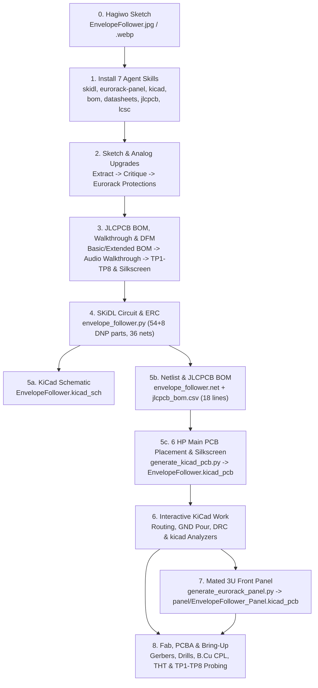

# From Sketch to Eurorack Module: End-to-End Hardware Design Tutorial

This tutorial walks through the complete workflow of turning **Hagiwo's hand-drawn [$4 Envelope Follower circuit sketch](https://note.com/solder_state/n/n110e9ba066b3?hl=en)** into a manufacturable **6 HP Eurorack PCB** and a **mated 3U aluminum-replacement FR4 front panel** using **Python (SKiDL)**, **KiCad 10**, and **AI hardware agent skills**.

Each stage uses a **hybrid workflow**: you will see both the **AI agent prompt** that drives the specialized skills and the **engineering details** underneath—analog circuit critique and upgrades, live JLCPCB part selection, Python netlist generation, mechanical coordinate math, dual-sided silkscreen and test-point markup, PCB routing, DRC/Gerber checks, and manufacturing export.

---

## Architecture Pipeline

---

## Prerequisites

| Tool | Purpose | Notes |
| :--- | :--- | :--- |
| **[KiCad 10.0+](https://www.kicad.org/)** | Schematic/PCB CAD, bundled `pcbnew` Python API, and `kicad-cli` | Installed at `/Applications/KiCad/KiCad.app` on macOS |
| **[`uv`](https://docs.astral.sh/uv/)** | Fast Python environment and package manager | Target Python 3.12–3.14 for prebuilt `skidl` / `h5py` wheels |
| **Node.js (`npx`)** | Installs agent hardware skills from GitHub | Populates `.agents/skills/` and `skills-lock.json` |
| **[`ruff`](https://docs.astral.sh/ruff/)** | Python linter and formatter | Keeps SKiDL and panel generator scripts clean |

---

## Controls, I/O & Test Points Summary

| Reference | Component / Value | Taper / Type | Function |
| :--- | :--- | :--- | :--- |
| **`RV1`** (`GAIN`) | $100\text{ k}\Omega$ Potentiometer | Audio / Log (`A100k`) | Input Preamp Gain ($-0.1\times$ to $-10.1\times$) |
| **`RV2`** (`ATK`) | $50\text{ k}\Omega$ Potentiometer | Audio / Log (`A50k`) | Attack Time Control ($\tau_{\text{atk}} \approx 0.22\text{--}11.2\text{ ms}$) |
| **`RV3`** (`Release`) | $1\text{ M}\Omega$ Potentiometer | Audio / Log (`A1M`) | Release Time Control ($\tau_{\text{rel}} \approx 10.3\text{--}230\text{ ms}$) |
| **`RV4`** (`OFFSET`) | $10\text{ k}\Omega$ Potentiometer | Linear (`B10k`) | Output DC Offset Adjust ($\approx -9.8\text{ V}$ to $+9.8\text{ V}$, flat $\approx 2.98\times$ gain) |
| **`J1`** (`IN`) | 3.5mm Mono Jack (`WQP-PJ398SM`) | Switched THT | AC-Coupled Audio / CV Input ($Z_{\text{in}} \approx 10\text{ k}\Omega$, $f_c \approx 15.9\text{ Hz}$) |
| **`J2`** (`OUT`) | 3.5mm Mono Jack (`WQP-PJ398SM`) | Switched THT | Non-Inverted Envelope CV Output (`BAT54S` + `1k` `1/4 W` protected) |
| **`J3`** (`INV_OUT`) | 3.5mm Mono Jack (`WQP-PJ398SM`) | Switched THT | Inverted Envelope CV Output ($-V_{\text{AMP\_OUT}}$, `BAT54S` + `1k` `1/4 W` protected) |
| **`D4`** (`LED`) | 3mm THT LED | Any Color | Active Voltage-to-Current Envelope Indicator ($I_{\text{LED}} = V_{\text{ENV\_SIG}} / 1.5\text{ k}\Omega$) |
| **`J_PWR`** | 2×5 Shrouded IDC Header | 10-Pin Eurorack | $\pm 12\text{ V}$ & `GND` Power Input (`B5819W` + `10 Ω` RC protected) |
| **`TP1`–`TP8`** (`DNP`) | `Ronghe RH-5001` (`C5199801`) | Optional THT Loops (`1.0 mm` drill) | Bench Probing (`GND`, `+12V`, `-12V`, `PRE`, `HALF`, `RECT`, `ENV`, `OFS`) |

---

## Stage-by-Stage Guide

1. **[Stage 1: Hardware Agent Skills](tutorial/stage-1-agent-skills.md)** — Install all 7 hardware design and fabrication skills (`skidl`, `eurorack-panel`, `kicad`, `bom`, `datasheets`, `jlcpcb`, `lcsc`) into `.agents/skills/`.
2. **[Stage 2: Sketch & Circuit Upgrades](tutorial/stage-2-circuit-upgrades.md)** — Extract Hagiwo's hand-drawn sketch (`EnvelopeFollower.md`), critique and fix analog flaws (`OFFSET` pot loading, passive diode deadzone and loop stability using `U2C`/`U2D` + `D7` + `C11`, active V-to-I LED driver), and add Eurorack hardware protections (`EnvelopeFollowerImprovements.md`).
3. **[Stage 3: JLCPCB BOM, Walkthrough & Test Points](tutorial/stage-3-bom-and-dfm.md)** — Research live JLCPCB Basic/Extended SMT parts vs. manual THT controls (`EnvelopeFollowerImproved.md` & `EnvelopeFollowerBOM.md`), document the 7-stage audio signal path (`EnvelopeFollowerExplanation.md`), and define `TP1`–`TP8` (`DNP`) test points and dual-sided silkscreen rules (`SilkscreenInstructions.md`).
4. **[Stage 4: SKiDL Circuit & ERC](tutorial/stage-4-skidl.md)** — Express the 54 populated components + 8 `DNP` test points (62 footprints, 36 nets) in Python (`envelope_follower.py`), verify live LCSC stock across 18 JLCPCB SMT BOM lines, and pass `ERC()` with zero errors or warnings.
5. **[Stage 5: Schematic & 6 HP PCB](tutorial/stage-5-schematic-and-pcb.md)** — Export `EnvelopeFollower.kicad_sch` and automate the `29.60 × 107.00 mm` main PCB placement (`generate_kicad_pcb.py`) with `F.Cu` panel controls, `B.Cu` single-sided SMT + `J_PWR` + `TP1`–`TP8`, and automated `Reference + Value` / dual-sided silkscreen markup.
6. **[Stage 6: Routing, Pour & Audit](tutorial/stage-6-routing-and-drc.md)** — Route protected power rails, sensitive summing junctions, and the high-impedance `ENV_CAP` node in KiCad 10, pour stitched `GND` zones, verify zero silkscreen pad clipping, pass DRC, and run automated schematic/PCB/cross-domain audits.
7. **[Stage 7: Mated 3U Front Panel](tutorial/stage-7-front-panel.md)** — Inspect main PCB bushing coordinates and generate a grounded `1.6 mm` FR4 3U front panel (`panel/EnvelopeFollower_Panel.kicad_pcb`) with clean functional labels (`GAIN`, `ATK`, `REL`, `OFFSET`, boxed `IN`, `ENV`, `OUT`, `INV OUT`), Gerbers, and DRC verification.
8. **[Stage 8: JLCPCB PCBA & Assembly](tutorial/stage-8-manufacturing.md)** — Export Gerbers, Excellon drills, and bottom-side CPL files (excluding `DNP` test points) for single-sided JLCPCB Economic PCBA (\$0.85/board SMD + \$9.00 Extended setup), verify placement previews against `B.SilkS` values, hand-solder THT controls/test loops, and probe `TP1`–`TP8` on the bench.

### Technical References

- **[Netlist, BOM & Capture Guide](reference/netlist-and-bom.md)** — Complete JLCPCB SMD + Manual THT Bill of Materials, ready-to-upload 18-line CSV, all 36 nets with IC pin numbers, 8-step manual KiCad capture guide, and complete silkscreen schedule.
- **[PCB & Fabrication Checklist](reference/build-checklist.md)** — Interactive checklist tracking layout, dual-sided silkscreen markup, optional `DNP` test points, panel generation, and JLCPCB ordering.
- **[GitHub Repository](https://github.com/domesticmouse/EnvelopeFollower)** — Full source code, KiCad project files, Gerbers, and [Apache 2.0 License](https://github.com/domesticmouse/EnvelopeFollower/blob/main/LICENSE).
