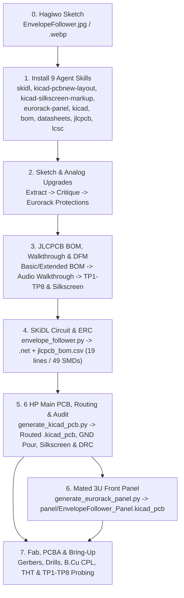

# From Sketch to Eurorack Module: End-to-End Hardware Design Tutorial

This tutorial walks through the complete workflow of turning **Hagiwo's hand-drawn [$4 Envelope Follower circuit sketch](https://note.com/solder_state/n/n110e9ba066b3?hl=en)** into a manufacturable **6 HP Eurorack PCB** and a **mated 3U aluminum-replacement FR4 front panel** using **Python (SKiDL)**, **KiCad 10**, and **AI hardware agent skills**.

Each stage uses a **hybrid workflow**: you will see both the **AI agent prompt** that drives the specialized skills and the **engineering details** underneath—analog circuit critique and upgrades, live JLCPCB part selection, Python netlist generation, mechanical coordinate math, dual-sided silkscreen and test-point markup, PCB routing, DRC/Gerber checks, and manufacturing export.

---

## Architecture Pipeline

---

## Prerequisites

| Tool | Purpose | Notes |
| :--- | :--- | :--- |
| **[KiCad 10.0+](https://www.kicad.org/)** | Schematic/PCB CAD, bundled `pcbnew` Python API, and `kicad-cli` | Installed at `/Applications/KiCad/KiCad.app` on macOS |
| **[`uv`](https://docs.astral.sh/uv/)** | Fast Python environment and package manager | Target Python 3.12–3.14 for prebuilt `skidl` / `h5py` wheels |
| **Node.js (`npx`)** | Installs agent hardware skills from GitHub | Populates `.agents/skills/` and `skills-lock.json` |
| **[`ruff`](https://docs.astral.sh/ruff/)** | Python linter and formatter | Keeps SKiDL and panel generator scripts clean |

---

## Controls, I/O & Test Points Summary

| Reference | Component / Value | Taper / Type | Function |
| :--- | :--- | :--- | :--- |
| **`RV1`** (`GAIN`) | $100\text{ k}\Omega$ Potentiometer | Audio / Log (`A100k`) | Input Preamp Gain ($-0.10\times$ to $-9.17\times$, `-20 dB` to `+19.25 dB`) |
| **`RV2`** (`ATK`) | $50\text{ k}\Omega$ Potentiometer | Audio / Log (`A50k`) | Attack Time Control ($\tau_{\text{atk}} \approx 0.47\text{--}50.5\text{ ms}$) |
| **`RV3`** (`REL`) | $1\text{ M}\Omega$ Potentiometer | Audio / Log (`A1M`) | Release Time Control ($\tau_{\text{rel}} \approx 10\text{ ms--}1.01\text{ s}$) |
| **`RV4`** (`OFFSET`) | $10\text{ k}\Omega$ Potentiometer | Linear (`B10k`) | Output DC Offset Adjust (`±5.09 V` linear span, `1.476×–1.529×` env gain) |
| **`J1`** (`IN`) | 3.5mm Mono Jack (`WQP-PJ398SM`) | Switched THT (`TN → GND`) | AC-Coupled Audio / CV Input ($Z_{\text{in}} = 101\text{ k}\Omega$, $f_c = 1.58\text{ Hz}$, `BAV99` clamped) |
| **`J2`** (`OUT`) | 3.5mm Mono Jack (`WQP-PJ398SM`) | Switched THT (`TN = NC`) | Non-Inverted Envelope CV Output (`BAV99` + split `470R + 470R 0.5W` protected) |
| **`J3`** (`INV_OUT`) | 3.5mm Mono Jack (`WQP-PJ398SM`) | Switched THT (`TN = NC`) | Inverted Envelope CV Output ($-V_{\text{OUT}}$, `0.00%` tracking mismatch) |
| **`D4`** (`LED`) | 3mm Red THT LED (`C99771`) | Radial THT (In-Loop) | Precision V-to-I Envelope Indicator ($I_{\text{LED}} = V_{\text{ENV}} / 2.2\text{ k}\Omega$, `0.00 mA` idle) |
| **`J4`** (`PWR`) | 2×5 Shrouded IDC Header (`C53207560`) | 10-Pin Eurorack (`B.Cu`) | $\pm 12\text{ V}$ & `GND` Power Input (`B5819W` + `10 Ω / 22 µF` RC protected → `±11.55 V`) |
| **`TP1`–`TP8`** (`DNP`) | `Ronghe RH-5001` (`C5199801`) | Optional THT Loops (`1.0 mm` drill) | Rear `B.Cu` Probing (`GND`, `+12V`, `-12V`, `IN_BUF`, `PREAMP`, `RECT`, `OUT`, `INV_OUT`) |

---

## Stage-by-Stage Guide

1. **[Stage 1: Hardware Agent Skills](tutorial/stage-1-agent-skills.md)** — Install all 9 hardware design and fabrication skills (`skidl`, `kicad-pcbnew-layout`, `kicad-silkscreen-markup`, `eurorack-panel`, `kicad`, `bom`, `datasheets`, `jlcpcb`, `lcsc`) into `.agents/skills/`.
2. **[Stage 2: Sketch & Circuit Upgrades](tutorial/stage-2-circuit-upgrades.md)** — Extract Hagiwo's hand-drawn sketch (`EnvelopeFollower.md`), critique and fix analog flaws (`U1D`/`OFFSET` clipping and loading, `U2D` `101 kΩ` input buffer, `U2C` active zero-deadzone peak detector + `R9` removal, `0.1%`-matched `1.000×` rectifier, `U2B` in-loop LED sink, PET film caps), and add Eurorack hardware protections (`EnvelopeFollowerImprovements.md`).
3. **[Stage 3: JLCPCB BOM, Walkthrough & Test Points](tutorial/stage-3-bom-and-dfm.md)** — Research live JLCPCB Basic/Extended SMT parts vs. manual THT controls (`EnvelopeFollowerImproved.md` & `EnvelopeFollowerBOM.md`), document the audio signal path (`EnvelopeFollowerExplanation.md`), and define `TP1`–`TP8` (`DNP`) test points and dual-sided silkscreen rules (`SilkscreenInstructions.md`).
4. **[Stage 4: SKiDL Circuit & ERC](tutorial/stage-4-skidl.md)** — Express all 60 populated components + 8 `DNP` test points + 3 `DNP` fiducials (`71` footprints, `42` nets) in Python (`envelope_follower.py`), verify live LCSC stock across `19` JLCPCB SMT BOM lines (`49` SMDs), and pass `ERC()` with zero errors or warnings.
5. **[Stage 5: 6 HP Main PCB, Routing & Silkscreen](tutorial/stage-5-schematic-and-pcb.md)** — Automate the `30.00 × 108.00 mm` main PCB (`generate_kicad_pcb.py`) directly from `envelope_follower.net` with a `2 × 4` `F.Cu` panel control grid, `B.Cu` single-sided SMT + `J4` + `C1`/`C2` PET film + `TP1`–`TP8` + `FID1`–`FID3`, 2-layer `HVGridRouter` copper routing and stitched `GND` pours, density-adaptive silkscreen markup, DRC, and semantic silkscreen auditing.
6. **[Stage 6: Mated 3U Front Panel](tutorial/stage-6-front-panel.md)** — Inspect main PCB bushing coordinates and generate a grounded `1.6 mm` FR4 3U front panel (`panel/EnvelopeFollower_Panel.kicad_pcb`) with clean functional labels (`GAIN`, `ATK`, `REL`, `OFFSET`, boxed `IN`, `ENV`, `OUT`, `INV OUT`), Gerbers, and DRC verification.
7. **[Stage 7: JLCPCB PCBA & Assembly](tutorial/stage-7-manufacturing.md)** — Export Gerbers, Excellon drills, and bottom-side CPL files (excluding `THT`, `TP1`–`TP8` `DNP`, and `FID1`–`FID3`) for single-sided JLCPCB Economic PCBA (`$1.05`/board SMD + `$15.00` Extended setup), verify placement previews against `B.SilkS` values, hand-solder `B.Cu`/`F.Cu` THT hardware, and probe `TP1`–`TP8` on the bench.

### Optional Explorations

- **[Optional Direction: DC-Coupled CV / LFO Slew & Precision Rectification Mode](tutorial/optional-dc-coupled-mode.md)** — An example of using Antigravity to explore functional circuit modifications beyond the main tutorial flow: adding an `AC / DC` input coupling switch (`SW1` across `C1`) to unlock full-wave CV rectification, LFO frequency doubling, and gate-to-AR slew limiting.

### Technical References

- **[Netlist, BOM & Capture Guide](reference/netlist-and-bom.md)** — Complete JLCPCB SMD + Manual THT Bill of Materials, ready-to-upload 19-line CSV, all 42 active nets with IC pin numbers, manual KiCad capture guide, and complete silkscreen schedule.
- **[PCB & Fabrication Checklist](reference/build-checklist.md)** — Interactive checklist tracking layout, dual-sided silkscreen markup, optional `DNP` test points, panel generation, and JLCPCB ordering.
- **[GitHub Repository](https://github.com/domesticmouse/EnvelopeFollower)** — Tutorial source, clean-room stage snapshots (`stages/`), audit report, reference sketch, and [Apache 2.0 License](https://github.com/domesticmouse/EnvelopeFollower/blob/main/LICENSE).
