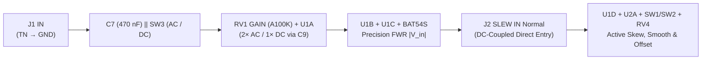

# Optional Exploration: AC/DC Input Coupling Mode (`SW3` Across `C7`)

Rather than bolting on every possible feature at once, [Stage 2](stage-2-circuit-upgrades.md) (`EnvelopeFollowerImprovements.md`) shows how an interactive AI engineering session captures **modular upgrade ideas** as standalone option notes before you lock a panel layout.

!!! info "Relationship to the `ENV / SKEW` Worked Build"
    The completed 6 HP module featured throughout [Stage 3](stage-3-bom-and-dfm.md) through [Stage 7](stage-7-manufacturing.md) (**`ENV / SKEW`**, built in `domesticmouse/EnvelopeFollowerWithSkewLimiter`) **already includes three major Eurorack upgrades**:

    - **`J2` (`SLEW IN`):** A dedicated **DC-coupled** direct input to the active skew limiter (`U1D`/`U2A`, `R16 = 1 MΩ` to `GND`, `R17 = 10 kΩ`), normalled from the internal full-wave rectifier when unpatched.
    - **`SW1` (`SMOOTH` / `RAW`):** Switchable `29 Hz` Sallen/T-network `2f` ripple filter (`R21`/`R22` = `49.9 kΩ`, `C14 = 220 nF`).
    - **`SW2` (`FAST` / `SLOW`):** Switchable timing bank (`470 nF` `C11` vs `4.87 µF` `C11 + C12 + C13`).

    Consequently, **you already have DC-coupled CV slew limiting via `J2` (`SLEW IN`)**. Adding an optional front-panel `AC / DC` bypass toggle (**`SW3`**) across input coupling capacitor **`C7`** (`470 nF` WIMA MKS2 film) uniquely unlocks **DC-coupled Full-Wave Rectification (`|V_in|`) ahead of the skew limiter**—letting you frequency-double (`2×`) bipolar LFOs or fold slow offsets around `0 V`.

---

## Concept Overview

On the main PCB (`envelope_follower.kicad_pcb`), input jack `J1` (`IN`) feeds the non-inverting attenuator/preamp stage through `C7` (`470 nF`), with `R3` (`1 MΩ`) referencing `J1.T` to `GND`, `RV1` (`A100K` `GAIN` pot) loading the AC-coupled side, and `R4` (`10 kΩ 0.1%`) + `R5` (`1 MΩ`) feeding `U1A.+`:

\[
f_{\text{c,in}} = \frac{1}{2\pi \cdot R_{\text{RV1}} \cdot C_7} = \frac{1}{2\pi \cdot 100\,\text{k}\Omega \cdot 470\,\text{nF}} \approx 3.39\text{ Hz}
\]

While `3.39 Hz` passes all audio fundamentals with `< 0.1 dB` droop at `20 Hz`, `C7` blocks `0 Hz` offsets and heavily attenuates `0.05–1.5 Hz` modulation sources.

---

## What Adding `SW3` Across `C7` Unlocks (Beyond `SLEW IN`)

1. **Full-Wave CV Rectification (`2×` LFO Folding / Absolute Value):** Patching a bipolar triangle or sine LFO into `J1` (`IN`) with `SW3` closed (**`DC`**) folds negative half-cycles positive through `U1B`/`U1C` (`10 kΩ ±0.1%` matched resistors + `BAT54S` `D3`), turning a `±5 V` triangle wave into a `0–5 V` bouncing CV at **double frequency**—which `SW1` (`SMOOTH`) and `RV2`/`RV3` (`ATK`/`REL`) can then reshape asymmetrically.
2. **Comparison vs. Existing `J2` (`SLEW IN`):** Patching an unrectified LFO or pitch CV into `J2` (`SLEW IN`) bypasses `U1B`/`U1C` and preserves signed polarity (`+V` slews up via `RV2`, `-V` slews down via `RV3`). Adding `SW3` gives you the rectified `|V|` waveshaper behavior too.
3. **One-Switch Audio vs. Sub-Audio Routing:** Keep `SW3` UP in **`AC`** mode for guitars, drum machines, and line audio (blocking DC thumps before gain), and flip DOWN to **`DC`** for LFOs, envelopes, and stepped random voltages.

---

## Critical Design Interactions on the Updated Schematic

If you add `SW3` on top of the [`DesignSpec.md`](../reference/netlist-and-bom.md) circuit ([view the Reference Spec on the `ENV / SKEW` Companion Site](https://domesticmouse.github.io/EnvelopeFollowerWithSkewLimiter/specs/design-spec/)), inspect these **four** concrete circuit interactions identified by the agent architecture:

### 1. Preamp `C9` (`10 µF`) Low-Frequency Gain Shelf (`1.59 Hz`)

In **`ENV / SKEW`**, `U1A` uses `R6 = 10 kΩ`, `R7 = 10 kΩ`, and `C9 = 10 µF` to `GND` (`1 / (2π · 10 kΩ · 10 µF) = 1.59 Hz`) so DC offset is already blocked (`1.00×` DC gain -> only `~1 mV` typical offset with **`TL074HIDR`**):

- **Good news:** Shorting `C7` with `SW3` will **never** saturate `U1A` or require a second blocking switch, because `C9` keeps DC gain at unity (`1.00×`).
- **Shelf effect to decide on:** Because `U1A` has **`1.00×` gain below `~0.5 Hz`** and **`2.00×` (`+6 dB`) gain above `~5 Hz`**, a variable-rate LFO swept across `0.2–5 Hz` shifts amplitude by `2×` unless you either keep LFO gain unified or switch `C9` out in `DC` mode. Use a **DPDT toggle for `SW3`** (`pole 1` shorts `C7` for DC passage; `pole 2` disconnects `C9` or leaves unity `1×` gain everywhere for flat `DC–20 kHz` LFO tracking) if flat sub-Hz CV amplitude matters.

### 2. Zero Deadzone with `TL074HIDR` + `U1B`/`U1C` Precision FWR

Thanks to the Tier 2 upgrades already present in the main build—**`TL074HIDR`** (`V_os ≈ 1 mV` typ., `~1 pA` input bias), **`10 kΩ ±0.1%`** resistors (`R8`–`R14`), and **`BAT54S`** (`D3`) inside `U1B`'s feedback loop—low-amplitude `±1 V` LFOs track cleanly near `0 V` with zero `0.6 V` diode deadzone.

### 3. Clean Unpatched Behavior (`J1.TN → GND` + `R3`)

Because `J1`'s switched normal pin (`J1.TN`) connects directly to `GND`, unplugging `J1` in `DC` mode grounds `RV1.3` (`0 V` reference) with zero open-input drift or mains hum. Closing `SW3` while unpatched causes zero switching thump because `R3` (`1 MΩ`) keeps `C7.1` pre-discharged to `0 V`.

### 4. `6 HP` Front-Panel Budget Constraint

On the `30.00 mm` (`6 HP`) [`envelope_follower_panel.kicad_pcb`](stage-6-front-panel.md), **`SW1` (`SMOOTH`) and `SW2` (`FAST / SLOW`) already occupy both side toggle slots** flanking `LED1` at `Y = 82.25 mm`. Adding **`SW3` (`AC / DC`)** requires one of two mechanical choices:

- **Expand to `8 HP` (`40.30 mm`):** Keep `SW1` and `SW2` intact and add a `5.2 mm` sub-mini SPDT/DPDT (`Dailywell 2MS1`/`2MD1`) cutout beside `J1` (`IN`) with `AC` / `DC` front-panel legends.
- **Keep `6 HP` and repurpose a toggle:** Swap `SW1` (`SMOOTH`) or `SW2` (`FAST/SLOW`) for `SW3` if DC-coupled FWR waveshaping matters more to your rack than ripple filtering or slow timing.

---

## Modification Summary (`SW3` Variant)

| Component / Item | Location / Net | Implementation Details |
| :--- | :--- | :--- |
| **`SW3`** | Across `C7` pads (`NET_IN_JACK` ↔ `NET_IN_AC`) | Sub-mini SPST/SPDT toggle (`5.2 mm` panel drill for Dailywell `2MS1`); use **DPDT** if also switching `C9` for flat `1×` AC/DC LFO gain |
| **Preamp / Op-Amps** | `U1`, `U2` (`TL074HIDR`, `C2878713`) | Already fitted in main build (`~1 mV` $V_{\text{os}}$, zero phase reversal on rail hits) |
| **Input Grounding** | `J1.TN → GND`, `R3` (`1 MΩ`) | Already fitted on PCB; prevents floating offset drift or switch-toggle pops |
| **Related Reading** | Standalone baseline engineering note | See [`PotentialImprovements.md`](https://github.com/domesticmouse/EnvelopeFollower/blob/main/PotentialImprovements.md) in the repo root for the original Hagiwo-RefDes `SW1`-across-`C1` analysis |
