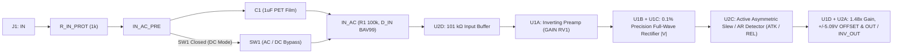

# Optional Direction: DC-Coupled CV / LFO Slew & Precision Rectification Mode

In [Stage 2: Sketch & Circuit Upgrades](stage-2-circuit-upgrades.md) (Step 2.2), asking Antigravity an open-ended circuit review prompt (*"Please review `EnvelopeFollower.md`. Are there improvements that could be made to the circuit?"*) did not only surface electrical bug fixes—it also proposed **optional Eurorack feature enhancements** in `EnvelopeFollowerImprovements.md`, including adding a panel-mounted **AC / DC Input Coupling Switch (`SW1`)** across input capacitor `C1`.

Asking Antigravity to expand on one of those optional suggestions yields a complete engineering feasibility note:

### AI Agent Prompt

> *"In `EnvelopeFollowerImprovements.md`, you suggested adding an AC / DC input coupling switch across `C1`. Can you expand on that idea—explaining how each downstream stage of the envelope follower behaves in `DC` mode, what CV/LFO processing utilities it unlocks in a Eurorack system, and what circuit design constraints or conflicts with our other upgrades we need to watch out for?"*

!!! info "Optional Branch — Not Required for the Main Tutorial Flow"
    The main tutorial ([Stage 3](stage-3-bom-and-dfm.md) through [Stage 7](stage-7-manufacturing.md)) keeps the baseline 8-control layout (`RV1`–`RV4`, `J1`–`J3`, `D4`) without `SW1` so the 6 HP PCB and front panel stay compact and focused. This page preserves the full engineering analysis generated by Antigravity as an example of what the agent produces when asked to explore an optional direction—and shows how to carry `SW1` into Stages 3–6 if you choose to build this variant.

---

## 1. Concept Overview (`AC` vs. `DC` Input Coupling)

In the baseline circuit ([Stage 2](stage-2-circuit-upgrades.md)), input jack `J1` (`IN`) passes through `R_IN_PROT` (`1 kΩ`) and feeds `U2D` (`100 kΩ` buffer) through AC-coupling capacitor `C1` ($1\,\mu\text{F}$ PET film into $R_1 = 100\,\text{k}\Omega$ for $f_c = 1.58\text{ Hz}$, $Z_{\text{in}} = 101\text{ k}\Omega$):

- **Advantage for audio:** Strips any DC offset from audio signals so silence sits strictly at `0 V` entering the precision full-wave rectifier (`U1B`, `U1C`).
- **Limitation for CV / LFO sources:** Sub-audio modulation (slow LFOs, stepped sequencer CVs, gates/triggers, or static DC voltages) decays back toward `0 V` across `C1` instead of being tracked accurately.

Adding a panel-mounted **AC / DC Input Coupling Switch (`SW1`, SPST)** directly in parallel across `C1` (`IN_AC_PRE` to `IN_AC`) lets you short out `C1` on demand, converting the module from a dedicated audio envelope follower into a **DC-coupled precision full-wave CV rectifier, asymmetric unipolar slew limiter, and bipolar offset/inverter processor**:

---

## 2. How Each Downstream Stage Behaves in `DC` Mode (`SW1` Closed)

When `SW1` bypasses `C1`, DC and low-frequency control voltages (`-10 V` to `+10 V`, scaled by `GAIN` pot `RV1`) flow unmodified into `U2D` and the signal chain:

### 2.1 Precision Full-Wave CV Rectification ("Absolute Value" / LFO Frequency Doubler)

- **Mechanism:** `U1B` (`D1_D2` `BAT54S`, `R3`, `R6`) and `U1C` (`R4+R5`, `R7`, `R8A+R8B` `0.1%`) compute exact $V_{\text{RECT\_OUT}} = +1.000 \cdot |V_{\text{PREAMP\_OUT}}|$ (`≤ 0.80%` error).
- **With fast `ATK` & `Release` (both fully CCW):**
  - Bipolar LFOs (triangle, sine, ramp) centered around `0 V` fold their negative half-cycle upward cleanly with **no `0.6 V` diode deadzone** at zero crossings.
  - A symmetric triangle or sine LFO emerges as a **unipolar rectified wave at `2×` the input frequency** (classic octave-up LFO / analog wave-folder behavior).
  - Unipolar positive or negative CV inputs pass through as strictly positive magnitude $|V_{\text{in}}|$.

### 2.2 Asymmetric Unipolar Slew Limiter / Gate-to-AR Envelope Generator

- **Mechanism:** Stage 4 charges `C2` (`1 µF` PET film at `ENV_NODE`) via `D3` + `R_ATK_MIN` (`470 Ω`) + `RV2` (`ATK`) and discharges `C2` to `GND` via `R10` (`10 kΩ`) + `RV3` (`Release`). Because `D3` sits inside `U2C`'s active feedback loop (`< 5 mV` threshold) and only conducts when $V_{\text{RECT\_OUT}} > V_{C2}$, rise and fall times are governed independently:
  - **Rising CV / Audio Gate $\rightarrow$ Attack Slew:** Patching a `0 to +5 V` or `0 to +10 V` gate/trigger into `IN` charges `C2` at the `ATK` rate while the gate is high, then decays exponentially at the `Release` rate once the gate returns to `0 V`—turning the module into a standalone **Attack–Release (AR) envelope generator** ($\tau_{\text{atk}} \approx 0.47\text{–}50.5\text{ ms}$, $\tau_{\text{rel}} \approx 10\text{ ms–}1.01\text{ s}$).
  - **Stepped CV Portamento / Lag Processing:** Patching unipolar stepped CV (e.g., `0 to +5 V` sequencer or quantized random voltages) smooths upward voltage jumps via `ATK` and downward steps via `Release` (unipolar portamento; note that bipolar inputs will be full-wave rectified first unless `U1B`/`U1C` are also bypassed).

### 2.3 Simultaneous Polarizer, Gain & Dual Offset Shaper (`OUT` + `INV_OUT`)

- `GAIN` (`RV1`) sets the overall CV scaling (`-0.10×` to `-9.17×` via `R_GAIN_MIN = 1 kΩ` and `R_GAIN_FAIL = 1 MΩ`), `OFFSET` (`RV4`) shifts the resulting unipolar rectified/slewed CV upward or downward (`±5.09 V` linear span with `~1.48×` envelope gain), and Stage 5 outputs both **`OUT`** and **`INV_OUT`** (`-OUT`, `0.00%` tracking error) simultaneously for parallel positive and ducking/inverted modulation patches.
- `D4` (`LED`) continues tracking the pre-offset `ENV_NODE` level cleanly via the in-loop V-to-I sink (`U2B`, `0.00 mA` idle).

---

## 3. Critical Design Constraints When Implementing `SW1` (`AC / DC`)

When reviewing `SW1` alongside the other Stage 2 analog improvements in `EnvelopeFollowerImprovements.md`, three subtle circuit interactions stand out—two of which the main tutorial's `TL074H` + `U2D` architecture already solves by design:

1. **Inter-Stage AC Coupling Conflict:**
   - When pairing a standard `TL074` with an active zero-deadzone peak detector (`D3` inside `U2C`'s feedback loop), builders sometimes add a second `1 µF + 100 kΩ` AC-coupling network *between* `PREAMP_OUT` and the rectifier (`R3`/`R4`) to block `U1A`'s amplified input offset voltage ($10 \times V_{\text{os}}$).
   - **Conflict:** If that inter-stage capacitor remains permanently in series, closing `SW1` across `C1` alone will **still block DC** at `U1B`/`U1C`.
   - **Solution Options:**
     - **Option A (Already used in the main tutorial):** Use **`TL074H`** ($V_{\text{os}} \approx 1\text{ mV}$ typ., $\pm 10\text{ mV}$ max at $10\times$ gain) or **`OPA4172`** ($V_{\text{os}} \approx 0.2\text{ mV}$ typ.) and **omit the inter-stage AC-coupling capacitor**, leaving only `C1` to bypass via a single **SPST** `AC/DC` switch.
     - **Option B (If keeping inter-stage AC coupling with standard `TL074`):** Use a **DPST / DPDT** toggle switch for `SW1` so one pole shorts `C1` and the second pole simultaneously shorts the inter-stage coupling capacitor in `DC` mode.

2. **Input `101 kΩ` Impedance (`U2D` Buffer):**
   - In `DC` mode, `C1` is shorted, so `J1` (`IN_TIP`) connects through `R_IN_PROT` (`1 kΩ`) straight into `R1` (`100 kΩ` to `GND`) and `U2D+`. Because the main tutorial already uses **`U2D` as a `101 kΩ` JFET buffer** ahead of `R2` (`10 kΩ`), `DC` mode preserves full Eurorack `100 kΩ`-class impedance and never loads external passive CV attenuators or `1 kΩ`-output LFOs (`< 1%` droop instead of `-9.2%` into `9.9 kΩ`).

3. **Unplugged Switch-Ground Behavior (`J1.TN → GND`):**
   - The main tutorial's [Stage 4](stage-4-skidl.md) netlist already wires `J1`'s switched normal pin (`J1.TN`) unconditionally to **`GND`**: unplugging `J1` in `DC` mode safely grounds `R_IN_PROT` / `U2D+` (`0 V` reference) with zero hum or offset drift, and switching between `AC` and `DC` while unpatched causes no transient pop once `C1` sits at `0 V` DC across `R1` (`100 kΩ` to `GND`).

---

## 4. Implementation Checklist & Carrying `SW1` Into Stages 3–6

| Item | Specification / Placement | Notes |
| :--- | :--- | :--- |
| **Switch (`SW1`)** | Panel-mount SPST ON-ON (or SPDT with one throw `NC`) | Connects directly across `C1` (`IN_AC_PRE` ↔ `IN_AC`). Use DPST if an inter-stage coupling cap is present. |
| **Panel Silkscreen** | Top: `AC`, Bottom: `DC` (or `AUDIO` / `CV`) | Place near `J1` (`IN`) jack on the 3U front panel. |
| **Companion Upgrades Already Present** | `TL074H` (low `V_os`), `U2D` `101 kΩ` buffer, `J1.TN → GND`, `U2C` active peak detector | Eliminates `0.6 V` diode deadzone on low-amplitude LFOs (`±1 V` to `±5 V`) and removes DC offset error without a second blocking capacitor. |

If you choose to include `SW1` while following the rest of the tutorial, adapt the prompts in Stages 3–6 as follows:

- **[Stage 3: BOM & Silkscreen](stage-3-bom-and-dfm.md):** In the Step 3.1 prompt, ask the agent to add `SW1` (a panel-mounted sub-miniature SPDT toggle switch, tagged `Manual THT`) across `C1` (`IN_AC_PRE` to `IN_AC`) and record `SW1 AC/DC` in `SilkscreenInstructions.md` for dual-sided `F.SilkS`/`B.SilkS` labeling (`J1.TN` is already grounded).
- **[Stage 4: SKiDL Circuit](stage-4-skidl.md):** Instantiate `sw1` on `F.Cu` (`JLCPCB_Class="Consigned THT"`, `Silkscreen="SW1 AC/DC"`), wire `in_ac_pre += sw1[1]`, `in_ac += sw1[2]`, `builtins.NC += sw1[3]`, and update the `erc_assert()` total footprint check from `71` to `72` (the 19-line `jlcpcb_bom.csv` SMT BOM remains unchanged because `SW1` is a manual THT part).
- **[Stage 5: Main PCB](stage-5-schematic-and-pcb.md) & [Stage 6: 3U Front Panel](stage-6-front-panel.md):** Place `SW1` on `F.Cu` near `J1` (`IN`) with enough vertical clearance from the `RV3`/`RV4` pots and `D4` (`ENV` LED), and extract its bushing cutout coordinate (`6.2 mm` drill) into `generate_eurorack_panel.py` with `AC` / `DC` front-panel legends.
