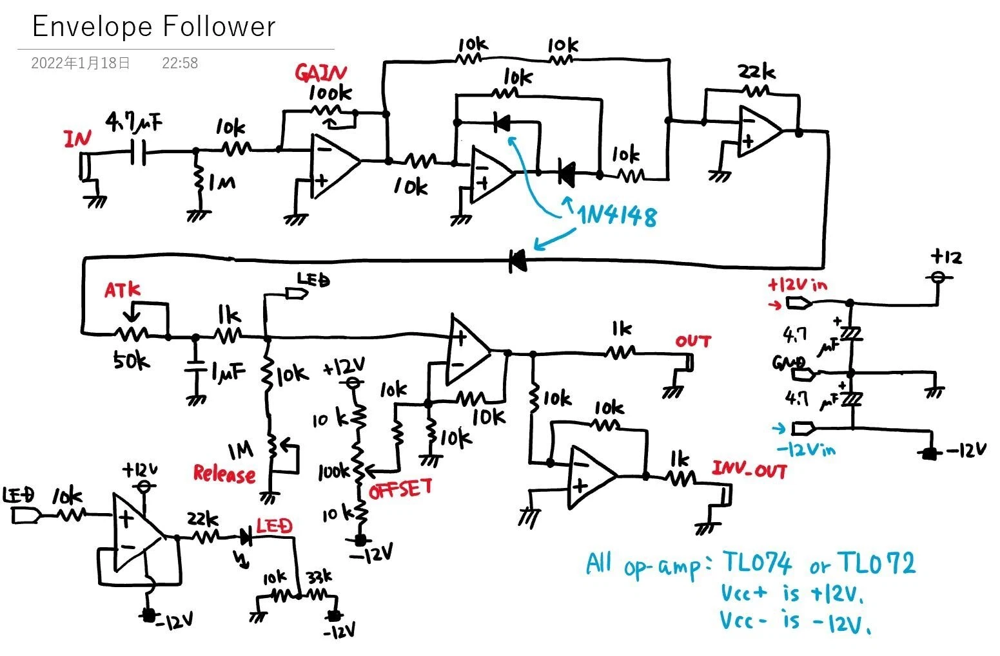

# Stage 2: Sketch Extraction, Analog Critique & Eurorack Protections

Start from [Hagiwo's original post](https://note.com/solder_state/n/n110e9ba066b3?hl=en) and the hand-drawn reference schematic, [`EnvelopeFollower.webp`](https://github.com/domesticmouse/EnvelopeFollower/blob/main/EnvelopeFollower.webp):



Download the reference schematic into your project directory and verify that you fetched the raw image rather than an HTML wrapper page before asking your AI agent to inspect it:

```bash
curl -LO https://raw.githubusercontent.com/domesticmouse/EnvelopeFollower/main/EnvelopeFollower.webp
file EnvelopeFollower.webp
```

Confirm `file` reports a valid image (`RIFF ... Web/P image` or `JPEG image data`) rather than `HTML document`.

Rather than jumping straight from a raw sketch to a PCB in a single prompt, breaking the upfront circuit design into focused engineering prompts catches hidden analog bugs and hardens the module for Eurorack power and patching before locking down the JLCPCB BOM, audio walkthrough, test points, and silkscreen DFM rules in [Stage 3](stage-3-bom-and-dfm.md).

---

## Step 2.1: Extracting the Baseline Circuit from the Schematic

First, ask the agent to transcribe every net, component value, and diode orientation from the hand-drawn image into a clean Markdown specification (`EnvelopeFollower.md`).

### AI Agent Prompt

> *"Please review `EnvelopeFollower.webp`. I'd like to extract a Markdown description of the circuit that can be used to build a circuit."*

### Baseline 7-Stage Topology

Reading the sketch left-to-right reveals **6 active op-amp stages** (`1× TL074` + `1× TL072`, or `3× TL072`), **23 fixed resistors** (`1× 1M`, `1× 33k`, `2× 22k`, `16× 10k`, `3× 1k`), **4 capacitors**, **4 potentiometers**, **3 signal diodes**, and **1 LED**:

1. **Power Supply Filtering (`C3`, `C4`)**: Bipolar $\pm 12\text{ V}$ entry bypassed only by bulk $4.7\,\mu\text{F}$ electrolytics (`C3` on `+12V`, `C4` on `-12V`).
2. **AC-Coupled Variable-Gain Preamp (`U1A`)**: `J1` (`IN`) passes through `C1` ($4.7\,\mu\text{F}$) and `R1` ($1\text{ M}\Omega$ pulldown) into an inverting amplifier (`R2` $= 10\text{ k}\Omega$, feedback pot `RV1` $= 100\text{ k}\Omega$, $0\times$ to $-10\times$ gain).
3. **Precision Full-Wave Rectifier (`U1B`, `U1C`)**: `U1B` forms an active half-wave rectifier (`R3`, `R4` $= 10\text{ k}\Omega$, `D1`, `D2` $= \text{1N4148}$), summed by `U1C` (`R5` $= 10\text{ k}\Omega$ half-wave leg vs. `R6 + R7` $= 20\text{ k}\Omega$ direct leg, `R8` $= 22\text{ k}\Omega$ feedback for $+1.1\times |V_{\text{PREAMP\_OUT}}|$).
4. **Attack / Release Peak Detector (`D3`, `RV2`, `C2`, `R9`, `R10`, `RV3`)**: Passive `1N4148` diode `D3` charges `C2` ($1\,\mu\text{F}$) through `RV2` (`ATK`, $50\text{ k}\Omega$), followed by `R9` ($1\text{ k}\Omega$) into `ENV_SIG`, discharging through `R10` ($10\text{ k}\Omega$) and `RV3` (`Release`, $1\text{ M}\Omega$).
5. **Output Amplifier & DC Offset (`U1D`)**: Non-inverting `ENV_SIG` buffer on `+` with a $\pm 12\text{ V}$ bias divider (`R11`, `R12` $= 10\text{ k}\Omega$, `RV4` `OFFSET` $= 100\text{ k}\Omega$, `R13`–`R15` $= 10\text{ k}\Omega$) on `-`, driving `J2` (`OUT`) via `R16` ($1\text{ k}\Omega$).
6. **Unity-Gain Inverted Output (`U2A`)**: Inverts `AMP_OUT` (`R17` $= \text{R18} = 10\text{ k}\Omega$) and drives `J3` (`INV_OUT`) via `R19` ($1\text{ k}\Omega$).
7. **Pre-Biased LED Driver (`U2B`)**: Unity follower fed via `R20` ($10\text{ k}\Omega$), driving `D4` (`LED`) via `R21` ($22\text{ k}\Omega$) against a cathode bias divider (`R22` $= 10\text{ k}\Omega$ to `GND`, `R23` $= 33\text{ k}\Omega$ to `-12V`).

---

## Step 2.2: Critiquing the Analog Circuit & Fixing Hidden Flaws

Before ordering parts, ask the agent to audit the transcribed circuit for mathematical errors, loading problems, deadzones, and suboptimal component values (`EnvelopeFollowerImprovements.md`).

### AI Agent Prompt

> *"Please review `EnvelopeFollower.md`. Are there improvements that could be made to the circuit? Record the suggested improvements and explanations to `EnvelopeFollowerImprovements.md`."*

### Key Analog Engineering Findings

#### 1. Stage 5 `OFFSET` Loading & Transfer-Function Bug

The naive transfer equation $V_{\text{AMP\_OUT}} = 3 V_{\text{ENV\_SIG}} - V_{\text{OFFSET\_WIPER}}$ treats the `OFFSET` wiper as an ideal zero-impedance voltage source. In Hagiwo's original schematic, `RV4` ($100\text{ k}\Omega$) is fed through `R11`/`R12` ($10\text{ k}\Omega$) and drives `U1D` (`-`) through `R13` ($10\text{ k}\Omega$). Looking back into the wiper, the divider's Thevenin source impedance $R_{\text{th}}$ shifts wildly across rotation—from **$9.17\text{ k}\Omega$** at the ends ($10\text{ k}\Omega \parallel 110\text{ k}\Omega$) to **$30.0\text{ k}\Omega$** at center ($60\text{ k}\Omega \parallel 60\text{ k}\Omega$):

$$
V_{\text{AMP\_OUT}} = \left(2 + \frac{R_{15}}{R_{13} + R_{\text{th}}}\right) V_{\text{ENV\_SIG}} - \left(\frac{R_{15}}{R_{13} + R_{\text{th}}}\right) V_{\text{th}}
$$

- **Consequences**: Envelope gain shifts with knob position from **$2.25\times$** (center) to **$2.52\times$** (ends)—never reaching $3\times$—while actual DC offset output span is halved to **$\approx \mp 5.22\text{ V}$** with heavy S-curve deadening near center.
- **Fix (Impedance Inversion + Ripple Bypass)**: Change `R13`, `R14`, `R15` to **`100k`**, decrease `RV4` (`OFFSET`) to **`B10k` (Linear)**, decrease `R11`, `R12` to **`1k`**, and add **`C9` (`100 nF`)** from `OFFSET_WIPER` to `GND`. Source impedance drops to $0.92\text{ k}\Omega \le R_{\text{th}} \le 3.0\text{ k}\Omega$ against `R13 = 100k`, locking envelope gain flat at **$2.97\times\text{--}2.99\times$**, expanding linear offset span to **$\approx \pm 9.8\text{ V}$**, and rejecting power-rail ripple.

#### 2. Stage 4 Peak Detector Flaws & Active Zero-Deadzone Upgrade (`U2C`, `U2D`)

Hagiwo's passive peak detector suffers from three compounding issues:

1. **`0.6 V` Diode Deadzone**: Precision rectification in Stage 3 resolves millivolts, only for passive `D3` (`1N4148`) to discard everything below $\approx 0.6\text{ V}$.
2. **Zero-Ohm Attack Current Spike & Misplaced `R9`**: `R9` ($1\text{ k}\Omega$) was placed *after* `C2` (`ENV_CAP` $\rightarrow$ `ENV_SIG`), so dialing `ATK` (`RV2`) to `0 Ω` shorts `U1C` directly into `C2` on every audio transient.
3. **83.6% (`-15.7 dB`) Attack/Release Divider Attenuation**: With `ATK = 50k` and `Release = 0 Ω` (`R10 = 10k`), the voltage divider passes only $\frac{10\text{k}}{51\text{k} + 10\text{k}} \approx 16.4\%$ of the peak voltage.

- **Fix**: Using **`2× TL074H`** (`8` op-amp channels) leaves `U2C` and `U2D` available to build an **active zero-deadzone peak detector and buffer**:
  - **`U2C` (Active Peak Driver)**: Drives `D3` (`1N4148W`) inside a closed feedback loop from `ENV_SIG` via **`R24` (`100k`)**, eliminating `D3`'s `0.6 V` forward drop and compensating for Attack/Release divider sag.
  - **Anti-Saturation Catch Diode `D7` (`1N4148W`) & Loop Compensation `C11` (`47 pF` C0G)**: During Release ($V_{\text{FULL\_RECT}} < V_{\text{ENV\_SIG}}$), `D7` clamps `U2C` just one diode drop below `FULL_RECT` instead of letting `U2C` slam into the `-12V` rail—with **`D7` anode at `PK_FB_INV` (`U2C-`) and cathode at `PK_DRV_OUT`** (reversing `D7` would clamp positive attack drive to $+0.6\text{ V}$ and defeat peak tracking). Meanwhile, because placing the attack RC network (`R9 + RV2 + C2`) inside `U2C`'s feedback loop adds a second pole that causes a $\sim 61\text{ kHz}$ small-signal oscillation, `C11` (`47 pF` C0G) across `U2C` paired with `R24` (`100 kΩ`) introduces a phase-lead zero ($f_z \approx 33.9\text{ kHz}$) that stabilizes loop phase margin without extra BOM lines.
  - **Moved `R9` & Scaled Timing**: Move `R9` (`1k`) to the **input side** of `C2` (between `D3` cathode and `RV2` `A50k`) to protect `U2C`; scale `C2` to **`220 nF` (`0805` X7R)** and `R10` to **`47k`** with `RV3 = A1M`, yielding $\tau_{\text{atk}} \approx 0.22\text{--}11.2\text{ ms}$ and $\tau_{\text{rel}} \approx 10.3\text{--}230\text{ ms}$.
  - **`U2D` (Zero-Load JFET Buffer)**: Buffers `ENV_CAP` ($\sim 1\text{ pA}$ input bias) so Stage 5, Stage 7, and feedback `R24` never drain `C2`.

#### 3. Stage 7 Active Voltage-to-Current LED Driver (`U2B`)

The original $-2.79\text{ V}$ cathode pre-bias divider (`R22 = 10k`, `R23 = 33k`) exceeds the $\sim 1.8\text{--}2.0\text{ V}$ $V_F$ of modern red/yellow/green LEDs, causing **dim glow at `0 V` silence** while limiting `+3 V` LED current to just `~0.13 mA`.

- **Fix**: Place `D4` (`3 mm` LED) **inside `U2B`'s negative-feedback loop**, with `ENV_SIG` directly into `U2B (+)` and `D4` cathode tied to `U2B (-)` and **`R21` (`1.5k`)** to `GND`. Op-amp feedback forces $I_{\text{LED}} = V_{\text{ENV\_SIG}} / 1.5\text{ k}\Omega$ (`0 mA` at silence, `2.0 mA` at `+3 V`), compensates automatically for *any* LED color's $V_F$, and **eliminates `R20`, `R22`, and `R23`**.

#### 4. Stage 2 & Stage 3 Signal-Path Refinements

- **Input Coupling (`C1 = 1 µF`)**: With `R2 = 10k` virtual ground, `C1 = 1 µF` gives $f_c \approx 15.9\text{ Hz}$ in a compact `0603` MLCC package instead of a bulky $4.7\,\mu\text{F}$ film cap.
- **Preamp HF Roll-Off (`C10 = 47 pF` C0G/NP0)**: Spans `U1A` (`PREAMP_INV` to `PREAMP_OUT`), setting $f_c \approx 33.5\text{ kHz}$ at max gain (`101 kΩ`) to improve phase stability and stop RF/ultrasonic noise from rectifying into false DC offsets.
- **Exact `1.0×` Rectifier Symmetry (`R8 = 20k` 1%)**: Replaces `22k` with **`20k` 1%** (matching `R6 + R7 = 20k`) and specifies 1% tolerance across `R3`–`R8` so positive and negative half-cycles sum identically ($+1.0\,|V_{\text{PREAMP\_OUT}}|$).
- **Potentiometer Tapers**: **`A100k`** (`GAIN`), **`A50k`** (`ATK`), and **`A1M`** (`Release`) Audio/Log tapers spread fine adjustment comfortably across knob rotation, while **`B10k`** (`OFFSET`) stays Linear for a centered `0 V` midpoint.

---

## Step 2.3: Adding Eurorack Hardware Protections

Next, harden the design against reverse-plugged ribbon cables, noisy digital power buses, floating/shorted inputs, and patch-cable mis-wiring.

### AI Agent Prompt

> *"Please review `EnvelopeFollower.md` and `EnvelopeFollowerImprovements.md`. Can you please add appropriate protections for a Eurorack circuit? Reverse-polarity protection for power supply, local decoupling caps for ICs, gain floor limiting, output protection, and unused op-amp termination. Update `EnvelopeFollowerImprovements.md`."*

### Five Production Protections

1. **Reverse-Polarity Protection & RC Bus Filtering (`D5`, `D6`, `R26`, `R27`, `C3`, `C4`)**:
   - Insert series `B5819W` (`1N5819` SMD equiv., `40 V` `1 A` Schottky) diodes on `+12V_IN` (`D5`) and `-12V_IN` (`D6`), followed by **`10 Ω` `1/4 W` (`1206`)** resistors (`R26`, `R27`) into **`10 µF` `50 V`** SMD electrolytic bulk caps (`C3`, `C4`). At ~15–20 mA draw, Schottky drop is only $\approx 0.22\text{ V}$ ($V_{CC\pm} \approx \pm 11.78\text{ V}$), while the $10\,\Omega / 10\,\mu\text{F}$ RC filter rolls off bus switching noise above $\approx 1.59\text{ kHz}$ and limits turn-on inrush.
2. **Local IC Decoupling (`C5`–`C8` = `100 nF` `50 V` X7R `0603`)**:
   - Placed within `2 mm` of `U1` and `U2` supply pins (`Pin 4` $+12\text{ V}$, `Pin 11` $-12\text{ V}$) with short vias to `GND` to prevent high-frequency oscillation during fast rectifier switching.
3. **Preamp Gain-Floor Limiting (`R25 = 1k`)**:
   - Placed in series with `RV1` (`A100k`) inside `U1A`'s feedback loop (`PREAMP_INV` $\rightarrow$ `R25` $\rightarrow$ `RV1` $\rightarrow$ `PREAMP_OUT`), with `C10` (`47 pF`) spanning the entire loop. Minimum gain stops at **$-0.1\times$ (`-20 dB`)** so hot $10\text{--}20\text{ V}_{\text{pp}}$ Eurorack signals can be padded down cleanly without muting or shorting out `C10`.
4. **Output Short-Circuit, Back-Drive & ESD Protection (`R16`, `R19`, `D8`, `D9`)**:
   - Upgrade `R16` (`OUT`) and `R19` (`INV_OUT`) to **`1 kΩ` `1/4 W` (`1206`)** outside the feedback loops so sustained $\pm 12\text{ V}$ output-to-output mis-patching cannot overheat miniature `0603` parts.
   - Add **`BAT54SLT1G` (`SOT-23`)** dual series Schottky rail clamps (`D8` on `AMP_OUT`, `D9` on `INV_AMP_OUT`) wired from `-12V` to `+12V` on the op-amp side of `R16`/`R19` to steer ESD zaps and over-voltage spikes safely into the supply rails.
5. **Op-Amp Channel Utilization (`U2C`, `U2D`)**:
   - Never leave spare op-amp pins floating. In this improved build, **all 8 channels** across `2× TL074H` are actively used (`U2C`/`U2D` implement the Stage 4 active peak detector and buffer); any build leaving spare channels must wire them as unity-gain followers with `+` tied to `GND`.
