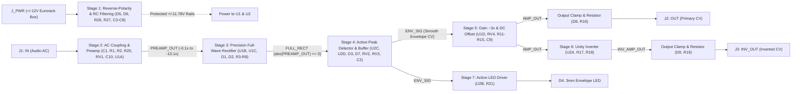

# Stage 2: Sketch Interpretation, Analog Critique & Production Design

Start from [Hagiwo's original post](https://note.com/solder_state/n/n110e9ba066b3?hl=en) and the hand-drawn reference schematic, [`EnvelopeFollower.webp`](https://github.com/domesticmouse/EnvelopeFollower/blob/main/EnvelopeFollower.webp):


Download the reference schematic into your project directory and verify that you fetched the raw image rather than an HTML wrapper page before asking your AI agent to inspect it:

```bash
curl -LO https://raw.githubusercontent.com/domesticmouse/EnvelopeFollower/main/EnvelopeFollower.webp
file EnvelopeFollower.webp
```

Confirm `file` reports a valid image (`RIFF ... Web/P image` or `JPEG image data`) rather than `HTML document`.

Rather than jumping straight from a raw sketch to a PCB in a single prompt, breaking Stage 2 into **six focused engineering prompts** catches hidden analog bugs, validates real JLCPCB part stock, creates a learning guide, and locks down test points and silkscreen DFM rules before writing a single line of SKiDL.

---

## Step 2.1: Extracting the Baseline Circuit from the Schematic

First, ask the agent to transcribe every net, component value, and diode orientation from the hand-drawn image into a clean Markdown specification (`EnvelopeFollower.md`).

### AI Agent Prompt

> *"Please review `EnvelopeFollower.webp`. I'd like to extract a Markdown description of the circuit that can be used to build a circuit."*

### Baseline 7-Stage Topology

Reading the sketch left-to-right reveals **6 active op-amp stages** (`1× TL074` + `1× TL072`, or `3× TL072`), **23 fixed resistors** (`1× 1M`, `1× 33k`, `2× 22k`, `16× 10k`, `3× 1k`), **4 capacitors**, **4 potentiometers**, **3 signal diodes**, and **1 LED**:

1. **Power Supply Filtering (`C3`, `C4`)**: Bipolar $\pm 12\text{ V}$ entry bypassed only by bulk $4.7\,\mu\text{F}$ electrolytics (`C3` on `+12V`, `C4` on `-12V`).
2. **AC-Coupled Variable-Gain Preamp (`U1A`)**: `J1` (`IN`) passes through `C1` ($4.7\,\mu\text{F}$) and `R1` ($1\text{ M}\Omega$ pulldown) into an inverting amplifier (`R2` $= 10\text{ k}\Omega$, feedback pot `RV1` $= 100\text{ k}\Omega$, $0\times$ to $-10\times$ gain).
3. **Precision Full-Wave Rectifier (`U1B`, `U1C`)**: `U1B` forms an active half-wave rectifier (`R3`, `R4` $= 10\text{ k}\Omega$, `D1`, `D2` $= \text{1N4148}$), summed by `U1C` (`R5` $= 10\text{ k}\Omega$ half-wave leg vs. `R6 + R7` $= 20\text{ k}\Omega$ direct leg, `R8` $= 22\text{ k}\Omega$ feedback for $+1.1\times |V_{\text{PREAMP\_OUT}}|$).
4. **Attack / Release Peak Detector (`D3`, `RV2`, `C2`, `R9`, `R10`, `RV3`)**: Passive `1N4148` diode `D3` charges `C2` ($1\,\mu\text{F}$) through `RV2` (`ATK`, $50\text{ k}\Omega$), followed by `R9` ($1\text{ k}\Omega$) into `ENV_SIG`, discharging through `R10` ($10\text{ k}\Omega$) and `RV3` (`Release`, $1\text{ M}\Omega$).
5. **Output Amplifier & DC Offset (`U1D`)**: Non-inverting `ENV_SIG` buffer on `+` with a $\pm 12\text{ V}$ bias divider (`R11`, `R12` $= 10\text{ k}\Omega$, `RV4` `OFFSET` $= 100\text{ k}\Omega$, `R13`–`R15` $= 10\text{ k}\Omega$) on `-`, driving `J2` (`OUT`) via `R16` ($1\text{ k}\Omega$).
6. **Unity-Gain Inverted Output (`U2A`)**: Inverts `AMP_OUT` (`R17` $= \text{R18} = 10\text{ k}\Omega$) and drives `J3` (`INV_OUT`) via `R19` ($1\text{ k}\Omega$).
7. **Pre-Biased LED Driver (`U2B`)**: Unity follower fed via `R20` ($10\text{ k}\Omega$), driving `D4` (`LED`) via `R21` ($22\text{ k}\Omega$) against a cathode bias divider (`R22` $= 10\text{ k}\Omega$ to `GND`, `R23` $= 33\text{ k}\Omega$ to `-12V`).

---

## Step 2.2: Critiquing the Analog Circuit & Fixing Hidden Flaws

Before ordering parts, ask the agent to audit the transcribed circuit for mathematical errors, loading problems, deadzones, and suboptimal component values (`EnvelopeFollowerImprovements.md`).

### AI Agent Prompt

> *"Please review `EnvelopeFollower.md`. Are there improvements that could be made to the circuit? Record the suggested improvements and explanations to `EnvelopeFollowerImprovements.md`."*

### Key Analog Engineering Findings

#### 1. Stage 5 `OFFSET` Loading & Transfer-Function Bug

The naive transfer equation $V_{\text{AMP\_OUT}} = 3 V_{\text{ENV\_SIG}} - V_{\text{OFFSET\_WIPER}}$ treats the `OFFSET` wiper as an ideal zero-impedance voltage source. In Hagiwo's original schematic, `RV4` ($100\text{ k}\Omega$) is fed through `R11`/`R12` ($10\text{ k}\Omega$) and drives `U1D` (`-`) through `R13` ($10\text{ k}\Omega$). Looking back into the wiper, the divider's Thevenin source impedance $R_{\text{th}}$ shifts wildly across rotation—from **$9.17\text{ k}\Omega$** at the ends ($10\text{ k}\Omega \parallel 110\text{ k}\Omega$) to **$30.0\text{ k}\Omega$** at center ($60\text{ k}\Omega \parallel 60\text{ k}\Omega$):

$$
V_{\text{AMP\_OUT}} = \left(2 + \frac{R_{15}}{R_{13} + R_{\text{th}}}\right) V_{\text{ENV\_SIG}} - \left(\frac{R_{15}}{R_{13} + R_{\text{th}}}\right) V_{\text{th}}
$$

- **Consequences**: Envelope gain shifts with knob position from **$2.25\times$** (center) to **$2.52\times$** (ends)—never reaching $3\times$—while actual DC offset output span is halved to **$\approx \mp 5.22\text{ V}$** with heavy S-curve deadening near center.
- **Fix (Impedance Inversion + Ripple Bypass)**: Change `R13`, `R14`, `R15` to **`100k`**, decrease `RV4` (`OFFSET`) to **`B10k` (Linear)**, decrease `R11`, `R12` to **`1k`**, and add **`C9` (`100 nF`)** from `OFFSET_WIPER` to `GND`. Source impedance drops to $0.92\text{ k}\Omega \le R_{\text{th}} \le 3.0\text{ k}\Omega$ against `R13 = 100k`, locking envelope gain flat at **$2.97\times\text{--}2.99\times$**, expanding linear offset span to **$\approx \pm 9.8\text{ V}$**, and rejecting power-rail ripple.

#### 2. Stage 4 Peak Detector Flaws & Active Zero-Deadzone Upgrade (`U2C`, `U2D`)

Hagiwo's passive peak detector suffers from three compounding issues:

1. **`0.6 V` Diode Deadzone**: Precision rectification in Stage 3 resolves millivolts, only for passive `D3` (`1N4148`) to discard everything below $\approx 0.6\text{ V}$.
2. **Zero-Ohm Attack Current Spike & Misplaced `R9`**: `R9` ($1\text{ k}\Omega$) was placed *after* `C2` (`ENV_CAP` $\rightarrow$ `ENV_SIG`), so dialing `ATK` (`RV2`) to `0 Ω` shorts `U1C` directly into `C2` on every audio transient.
3. **83.6% (`-15.7 dB`) Attack/Release Divider Attenuation**: With `ATK = 50k` and `Release = 0 Ω` (`R10 = 10k`), the voltage divider passes only $\frac{10\text{k}}{51\text{k} + 10\text{k}} \approx 16.4\%$ of the peak voltage.

- **Fix**: Using **`2× TL074H`** (`8` op-amp channels) leaves `U2C` and `U2D` available to build an **active zero-deadzone peak detector and buffer**:
  - **`U2C` (Active Peak Driver)**: Drives `D3` (`1N4148W`) inside a closed feedback loop from `ENV_SIG` via **`R24` (`100k`)**, eliminating `D3`'s `0.6 V` forward drop and compensating for Attack/Release divider sag.
  - **Anti-Saturation Catch Diode `D7` (`1N4148W`) & Loop Compensation `C11` (`47 pF` C0G)**: During Release ($V_{\text{FULL\_RECT}} < V_{\text{ENV\_SIG}}$), `D7` clamps `U2C` just one diode drop below `FULL_RECT` instead of letting `U2C` slam into the `-12V` rail—with **`D7` anode at `PK_FB_INV` (`U2C-`) and cathode at `PK_DRV_OUT`** (reversing `D7` would clamp positive attack drive to $+0.6\text{ V}$ and defeat peak tracking). Meanwhile, because placing the attack RC network (`R9 + RV2 + C2`) inside `U2C`'s feedback loop adds a second pole that causes a $\sim 61\text{ kHz}$ small-signal oscillation, `C11` (`47 pF` C0G) across `U2C` paired with `R24` (`100 kΩ`) introduces a phase-lead zero ($f_z \approx 33.9\text{ kHz}$) that stabilizes loop phase margin without extra BOM lines.
  - **Moved `R9` & Scaled Timing**: Move `R9` (`1k`) to the **input side** of `C2` (between `D3` cathode and `RV2` `A50k`) to protect `U2C`; scale `C2` to **`220 nF` (`0805` X7R)** and `R10` to **`47k`** with `RV3 = A1M`, yielding $\tau_{\text{atk}} \approx 0.22\text{--}11.2\text{ ms}$ and $\tau_{\text{rel}} \approx 10.3\text{--}230\text{ ms}$.
  - **`U2D` (Zero-Load JFET Buffer)**: Buffers `ENV_CAP` ($\sim 1\text{ pA}$ input bias) so Stage 5, Stage 7, and feedback `R24` never drain `C2`.

#### 3. Stage 7 Active Voltage-to-Current LED Driver (`U2B`)

The original $-2.79\text{ V}$ cathode pre-bias divider (`R22 = 10k`, `R23 = 33k`) exceeds the $\sim 1.8\text{--}2.0\text{ V}$ $V_F$ of modern red/yellow/green LEDs, causing **dim glow at `0 V` silence** while limiting `+3 V` LED current to just `~0.13 mA`.

- **Fix**: Place `D4` (`3 mm` LED) **inside `U2B`'s negative-feedback loop**, with `ENV_SIG` directly into `U2B (+)` and `D4` cathode tied to `U2B (-)` and **`R21` (`1.5k`)** to `GND`. Op-amp feedback forces $I_{\text{LED}} = V_{\text{ENV\_SIG}} / 1.5\text{ k}\Omega$ (`0 mA` at silence, `2.0 mA` at `+3 V`), compensates automatically for *any* LED color's $V_F$, and **eliminates `R20`, `R22`, and `R23`**.

#### 4. Stage 2 & Stage 3 Signal-Path Refinements

- **Input Coupling (`C1 = 1 µF`)**: With `R2 = 10k` virtual ground, `C1 = 1 µF` gives $f_c \approx 15.9\text{ Hz}$ in a compact `0603` MLCC package instead of a bulky $4.7\,\mu\text{F}$ film cap.
- **Preamp HF Roll-Off (`C10 = 47 pF` C0G/NP0)**: Spans `U1A` (`PREAMP_INV` to `PREAMP_OUT`), setting $f_c \approx 33.5\text{ kHz}$ at max gain (`101 kΩ`) to improve phase stability and stop RF/ultrasonic noise from rectifying into false DC offsets.
- **Exact `1.0×` Rectifier Symmetry (`R8 = 20k` 1%)**: Replaces `22k` with **`20k` 1%** (matching `R6 + R7 = 20k`) and specifies 1% tolerance across `R3`–`R8` so positive and negative half-cycles sum identically ($+1.0\,|V_{\text{PREAMP\_OUT}}|$).
- **Potentiometer Tapers**: **`A100k`** (`GAIN`), **`A50k`** (`ATK`), and **`A1M`** (`Release`) Audio/Log tapers spread fine adjustment comfortably across knob rotation, while **`B10k`** (`OFFSET`) stays Linear for a centered `0 V` midpoint.

---

## Step 2.3: Adding Eurorack Hardware Protections

Next, harden the design against reverse-plugged ribbon cables, noisy digital power buses, floating/shorted inputs, and patch-cable mis-wiring.

### AI Agent Prompt

> *"Please review `EnvelopeFollower.md` and `EnvelopeFollowerImprovements.md`. Can you please add appropriate protections for a Eurorack circuit? Reverse-polarity protection for power supply, local decoupling caps for ICs, gain floor limiting, output protection, and unused op-amp termination. Update `EnvelopeFollowerImprovements.md`."*

### Five Production Protections

1. **Reverse-Polarity Protection & RC Bus Filtering (`D5`, `D6`, `R26`, `R27`, `C3`, `C4`)**:
   - Insert series `B5819W` (`1N5819` SMD equiv., `40 V` `1 A` Schottky) diodes on `+12V_IN` (`D5`) and `-12V_IN` (`D6`), followed by **`10 Ω` `1/4 W` (`1206`)** resistors (`R26`, `R27`) into **`10 µF` `50 V`** SMD electrolytic bulk caps (`C3`, `C4`). At ~15–20 mA draw, Schottky drop is only $\approx 0.22\text{ V}$ ($V_{CC\pm} \approx \pm 11.78\text{ V}$), while the $10\,\Omega / 10\,\mu\text{F}$ RC filter rolls off bus switching noise above $\approx 1.59\text{ kHz}$ and limits turn-on inrush.
2. **Local IC Decoupling (`C5`–`C8` = `100 nF` `50 V` X7R `0603`)**:
   - Placed within `2 mm` of `U1` and `U2` supply pins (`Pin 4` $+12\text{ V}$, `Pin 11` $-12\text{ V}$) with short vias to `GND` to prevent high-frequency oscillation during fast rectifier switching.
3. **Preamp Gain-Floor Limiting (`R25 = 1k`)**:
   - Placed in series with `RV1` (`A100k`) inside `U1A`'s feedback loop (`PREAMP_INV` $\rightarrow$ `R25` $\rightarrow$ `RV1` $\rightarrow$ `PREAMP_OUT`), with `C10` (`47 pF`) spanning the entire loop. Minimum gain stops at **$-0.1\times$ (`-20 dB`)** so hot $10\text{--}20\text{ V}_{\text{pp}}$ Eurorack signals can be padded down cleanly without muting or shorting out `C10`.
4. **Output Short-Circuit, Back-Drive & ESD Protection (`R16`, `R19`, `D8`, `D9`)**:
   - Upgrade `R16` (`OUT`) and `R19` (`INV_OUT`) to **`1 kΩ` `1/4 W` (`1206`)** outside the feedback loops so sustained $\pm 12\text{ V}$ output-to-output mis-patching cannot overheat miniature `0603` parts.
   - Add **`BAT54SLT1G` (`SOT-23`)** dual series Schottky rail clamps (`D8` on `AMP_OUT`, `D9` on `INV_AMP_OUT`) wired from `-12V` to `+12V` on the op-amp side of `R16`/`R19` to steer ESD zaps and over-voltage spikes safely into the supply rails.
5. **Op-Amp Channel Utilization (`U2C`, `U2D`)**:
   - Never leave spare op-amp pins floating. In this improved build, **all 8 channels** across `2× TL074H` are actively used (`U2C`/`U2D` implement the Stage 4 active peak detector and buffer); any build leaving spare channels must wire them as unity-gain followers with `+` tied to `GND`.

---

## Step 2.4: Researching JLCPCB Part Availability & Finalizing the Spec

Now ask the agent to verify live JLCPCB SMT availability, consolidate values onto JLCPCB **Basic** parts, and freeze the improved schematic and BOM (`EnvelopeFollowerImproved.md` & `EnvelopeFollowerBOM.md`).

### AI Agent Prompt

> *"Given `EnvelopeFollower.md` and `EnvelopeFollowerImprovements.md`, I'd like to research part availability on JLCPCB. I'd like the TL074s to be TL074H (SOIC), and most of the parts to be surface mount parts for JLCPCB construction. The jacks, pots, IDC power header, and 3mm indicator LED will be THT parts, mounted later. Incorporate the circuit improvements and Eurorack protections, use `U2C` and `U2D` for the active zero-deadzone peak detector and buffer, and adopt the improved potentiometer values (`A100k`, `A50k`, `A1M`, `B10k`)."*

### Consolidated Assembly Strategy

- **Single-Sided SMT PCBA (`45` SMD components across `18` BOM lines)**:
  - **15 JLCPCB Basic lines** (`$0` feeder loading fee): All `24` fixed resistors (`0603` & `1206`), `9` ceramic capacitors (`C1`, `C2`, `C5`–`C11`), and `6` `SOD-123` diodes (`D1`–`D3`, `D5`–`D7`).
  - **3 JLCPCB Extended lines** (`$3.00`/line = `$9.00` setup): `TL074HIDR` (`C2878713`, fallbacks `TL074CDR` `C12594` / `TL074CDT` `C6963`), `BAT54SLT1G` (`C19726`), and `10 µF 50V` SMD electrolytic (`C72488`).
  - **Per-board SMD part cost**: **~$0.85 USD**.
- **Manual Post-Reflow THT (`9` required parts)**: `J_PWR` (`2×5` IDC header), `J1`–`J3` (`WQP-PJ398SM` jacks), `RV1`–`RV4` (9 mm vertical pots), and `D4` (`3 mm` LED).

---

## Step 2.5: Audio Electronics Walkthrough

Generating an educational explanation (`EnvelopeFollowerExplanation.md`) alongside the BOM verifies every equation and pin connection along the chronological signal arc.

### AI Agent Prompt

> *"Given `EnvelopeFollowerImproved.md` and `EnvelopeFollowerBOM.md`, please create a markdown file explaining the circuit for someone learning audio electronics. I'd like to follow the audio signal path for the main arc, with supporting sections for power handling and the like."*

### Signal Architecture & Key Engineering Takeaways



#### Complete 7-Stage Signal-Path Cheat Sheet

1. **Power & Decoupling (`J_PWR`, `D5`, `D6`, `R26`, `R27`, `C3`–`C8`)**: Takes raw `±12V_IN` from the Eurorack power header and produces protected `+12V` and `-12V` rails ($V_{CC\pm} \approx \pm 11.78\text{ V}$). Series Schottky diodes block reversed ribbon cables, the series $10\,\Omega$ / $10\,\mu\text{F}$ RC network filters power-bus switching noise above $1.59\text{ kHz}$, and local $100\text{ nF}$ ceramic caps bypass `U1` and `U2` directly at their supply pins.
2. **Preamp & AC Coupling (`J1`, `C1`, `R1`, `R2`, `R25`, `RV1`, `C10`, `U1A`)**: Routes `IN_TIP` through AC-coupling capacitor `C1` into `AC_IN` and outputs `PREAMP_OUT`. The input network blocks DC with a $15.9\text{ Hz}$ high-pass cutoff, the inverting op-amp stage pads or boosts the audio signal across a $-0.1\times$ to $-10.1\times$ gain span according to $V_{\text{PREAMP\_OUT}} = -\left(\frac{1\text{ k}\Omega + R_{\text{GAIN}}}{10\text{ k}\Omega}\right)V_{\text{AC\_IN}}$, and feedback capacitor `C10` rolls off ultrasonic and RF noise above $\sim 33.5\text{ kHz}$ at maximum gain.
3. **Precision Rectifier (`U1B`, `U1C`, `D1`, `D2`, `R3`–`R8`)**: Converts the bipolar `PREAMP_OUT` signal via the intermediate half-wave node `HALF_RECT` into a unipolar full-wave rectified output `FULL_RECT`. Active diode feedback eliminates the diode deadzone, while $1\%$ matched resistors fold negative half-cycles positive with unity symmetry so that $V_{\text{FULL\_RECT}} = +1.0\,\lvert V_{\text{PREAMP\_OUT}}\rvert \ge 0$.
4. **Active Peak Detector & Buffer (`U2C`, `U2D`, `D3`, `D7`, `R9`, `RV2`, `R10`, `RV3`, `R24`, `C2`, `C11`)**: Tracks peaks from `FULL_RECT` onto storage node `ENV_CAP` and buffers the resulting envelope onto `ENV_SIG`. Wrapping `D3` inside `U2C`'s feedback loop eliminates diode forward-voltage drop across attack ($\tau_{\text{atk}} \approx 0.22\text{--}11.2\text{ ms}$) and release ($\tau_{\text{rel}} \approx 10.3\text{--}230\text{ ms}$), catch diode `D7` and lead capacitor `C11` prevent negative-rail saturation and loop oscillation, and JFET follower `U2D` isolates `C2` from downstream loading.
5. **Gain, Offset & Primary Out (`U1D`, `R11`–`R15`, `RV4`, `C9`, `D8`, `R16`, `J2`)**: Amplifies `ENV_SIG` to `AMP_OUT` and drives the primary output jack at `OUT_TIP`. The stage boosts the raw envelope by $\sim 2.98\times$ and sums in a linear $\pm 9.8\text{ V}$ DC offset following $V_{\text{AMP\_OUT}} \approx 3\,V_{\text{ENV\_SIG}} - V_{\text{OFFSET\_WIPER}}$, before passing through dual Schottky rail clamps (`D8`) and a $1\text{ k}\Omega$ ($1/4\text{ W}$) series isolation resistor (`R16`).
6. **Inverted CV Out (`U2A`, `R17`, `R18`, `D9`, `R19`, `J3`)**: Inverts `AMP_OUT` into `INV_AMP_OUT` and delivers it to `INV_OUT_TIP` through rail clamp `D9` and series resistor `R19`. Unity-gain inversion ($V_{\text{INV\_OUT}} = -V_{\text{AMP\_OUT}}$) flips the primary CV polarity—including any dialed-in DC offset—for ducking and inverse modulation patches.
7. **Active LED Driver (`U2B`, `D4`, `R21`)**: Feeds `ENV_SIG` into an active voltage-to-current converter driving the indicator LED nodes `LED_A` and `LED_K`. Placing `D4` inside `U2B`'s feedback loop sets LED current linearly to $I_{\text{LED}} = V_{\text{ENV\_SIG}} / 1.5\text{ k}\Omega$, guaranteeing a true dark state ($0\text{ mA}$) at silence regardless of the LED's forward voltage drop.

!!! warning "Capacitor Dielectric & Negative-Rail Polarity Watch-Outs"
    - **Dielectrics**: `C10`/`C11` (`47 pF`) use **`C0G/NP0`** for zero voltage/temperature drift in feedback loops; `C2` (`220 nF`, `0805`) and `C5`–`C9` (`100 nF`) use **`X7R`** at `50 V` rating for minimal DC-bias capacitance drop on `±12 V` rails.
    - **Negative-Rail Electrolytic Polarity (`C4`)**: Polarized caps must keep their `+` lead at a higher voltage than `-`. For **`C4`** (`10 µF` on the `-12V` rail), **`+` connects to `GND` (`0 V`) and `-` connects to `-12V` (`-11.78 V`)**, because `0 V` is `11.78 V` more positive than `-11.78 V`.

---

## Step 2.6: Optional THT Test Points & Silkscreen Markup Rules

Finally, define bench test points (`TP1`–`TP8`, marked **`DNP`** so JLCPCB leaves the `1.0 mm` plated holes unpopulated) and document silkscreen labeling rules (`SilkscreenInstructions.md`) so every component value, pot taper, and test point is readable during both JLCPCB placement review and panel-on troubleshooting.

### AI Agent Prompts

> *"Are there useful places to add test points to `EnvelopeFollowerImproved.md`? I'd prefer to use through-hole test points that I can optionally solder in."*
>
> *"Please add these test points to `EnvelopeFollowerImproved.md` and `EnvelopeFollowerBOM.md`. I'll be using Ronghe `RH-5001`. Mark as DNP in the BOM."*
>
> *"Please create a markdown file for capturing instructions on how to mark up components on the silkscreens. Marking test points on both sides is a useful instruction. I also want the component values marked on the silkscreen for ease of comparing the populated component against its required value in the JLCPCB reports."*

### `TP1`–`TP8` Test Point Schedule (`Ronghe RH-5001`, LCSC `C5199801`, `DNP`)

| Ref | `F.SilkS` & `B.SilkS` Label | Net Name | Stage / Bench Role |
| :--- | :--- | :--- | :--- |
| `TP1` | `TP1 GND` | `GND` | Ground reference clip anchor |
| `TP2` | `TP2 +12V` | `+12V` | Protected `+12V` rail (post-`D5`/`R26`, expect `~+11.78 V`) |
| `TP3` | `TP3 -12V` | `-12V` | Protected `-12V` rail (post-`D6`/`R27`, expect `~-11.78 V`) |
| `TP4` | `TP4 PRE` | `PREAMP_OUT` | Stage 2 inverting preamp output (`U1A` pin 1) |
| `TP5` | `TP5 HALF` | `HALF_RECT` | Stage 3.1 negative half-wave rectifier output (`D2` anode) |
| `TP6` | `TP6 RECT` | `FULL_RECT` | Stage 3.2 full-wave rectified audio (`U1C` pin 8) |
| `TP7` | `TP7 ENV` | `ENV_SIG` | Stage 4 buffered raw envelope (`U2D` pin 14 — never probe raw `ENV_CAP`!) |
| `TP8` | `TP8 OFS` | `OFFSET_WIPER` | Stage 5 filtered DC offset voltage (`RV4` wiper / `C9`) |

### Four Core Silkscreen Rules (`SilkscreenInstructions.md`)

1. **Reference + Value on SMD Silkscreen (`B.SilkS`)**: Display both the reference designator and concise value/MPN (`U1 TL074H`, `R8 20k`, `C10 47pF`, `D8 BAT54S`) outside component courtyards and pads so unmarked `0603`/`0805` MLCCs and `SOD-123`/`SOT-23` diodes can be verified directly in JLCPCB's 3D/DFM preview.
2. **Dual-Sided Test Point Labels (`F.SilkS` & `B.SilkS`)**: Print `TP1 GND` through `TP8 OFS` on **both** `F.SilkS` (for bare-board bring-up) and `B.SilkS` (for rear bench probing once the 3U front panel hides `F.Cu`).
3. **Dual-Sided THT Control & Power Labels (`F.SilkS` & `B.SilkS`)**: Print `RV1 GAIN A100k`, `RV2 ATK A50k`, `RV3 REL A1M`, `RV4 OFFSET B10k`, `J1 IN`, `J2 OUT`, `J3 INV_OUT`, `D4 LED` (`+`/`-`), and `J_PWR +/-12V` (`-12V / RED STRIPE` on pins 1–2) on **both** sides so identical-footprint pots cannot be swapped during hand assembly.
4. **Visible Orientation Marks & JLCPCB Geometry**: Keep Pin-1 dots (`U1`, `U2`), diode cathode bars (`|`), and electrolytic `+` symbols outside component bodies; enforce $\ge 0.8\text{ mm}$ text height (`0.9–1.2 mm` recommended), $\ge 0.15\text{ mm}$ stroke thickness, $\ge 0.20\text{ mm}$ pad clearance, `0°`/`90°` rotations only, and include a `5 × 5 mm` solid filled silkscreen square as the JLCPCB 2D QR code placeholder (JLCPCB's legacy `JLCJLCJLC` text placeholder string is obsolete and no longer used).
