# Stage 3: Interactive `DesignSpec.md` & Design-for-Testability (DFT)

Rather than firing a single one-shot prompt to generate four disconnected Markdown files (`EnvelopeFollowerImproved.md`, `EnvelopeFollowerBOM.md`, `EnvelopeFollowerExplanation.md`, `SilkscreenInstructions.md`), Stage 3 uses a **two-step interactive workflow** ([Trace 04](https://github.com/domesticmouse/EnvelopeFollower/blob/main/prompts/04-4dfb0979-let-s-work-through-envelopefollowerimprovements-md.md) and [Trace 05](https://github.com/domesticmouse/EnvelopeFollower/blob/main/prompts/05-a4aff487-designspec-md-i-m-wondering-what-options.md)) to converge on a single, pin-accurate **`DesignSpec.md`**.

---

## Step 3.1: Interactive One-Improvement-at-a-Time Q&A → `DesignSpec.md`

### AI Agent Prompt

> *"Let's work through `@[EnvelopeFollowerImprovements.md]`, one improvement at a time. This is primarily for my education, but in cases where there are options or trade offs, I want to make informed decisions."*

*(Finish the session with: *"write design spec to disk, update `@[README.md]`, and git commit"*.)*

### Four Habits That Make Interactive Design Q&A Work

1. **Declare Hard Constraints & Musical Context Up Front**:
   Right in Turn 2 and Turn 3 of Trace 04, the builder stated three non-negotiables: **`6 HP × 3U` (`30.0 × 128.5 mm`)**, **majority JLCPCB SMD PCBA with strictly `2× TL074H`** (`8/8` sections, `0` trimmers), and **musical context** (**techno kick-drum sidechain ducking** plus **ambient swells**). Those two sentences immediately resolved multiple analog trade-offs: switching from a `LINE/EURO` toggle to a switchless `×2.00` Eurorack `10 Vpp` input, preferring symmetric `1 kΩ / 1 kΩ` skew floor resistors, and choosing a post-offset bi-color LED (`A-1076`) so you can tune kick-drum ducking down to dark (`0 V`) by eye.
2. **Use Strategic Deferral for Panel-Space Choices**:
   When choosing between a `SMOOTH` toggle, `FAST / SLOW` toggle, `SLEW IN` jack, `GATE OUT`, or `AC / DC` switch, avoid locking in switches early. Defer panel-UI commitments until **all Tier 3 candidates are inventoried**—preventing 6 HP overcrowding and keeping the panel clean (`4` single-column pots, `2` sub-mini toggles + bi-color LED, and a symmetric `2 × 2` jack grid).
3. **Verify Real Datasheets & Vendor Parts During the Q&A**:
   - Checked **`TL074H`** datasheet common-mode input range (`VCM` includes `V+`, confirming `+10.0 V` swings inside `±11.54 V` rails work cleanly without clipping).
   - Verified **`BAT54S`** (`D3`) SOT-23 pinout (`1 = A1`, `2 = K2`, `3 = K1/A2`) and confirmed why **`1N4148W` silicon diodes (`D4`, `D5`)**—never Schottky—are mandatory on the hold capacitor so reverse leakage cannot ruin multi-second `SLOW` ambient swells.
   - Checked real Tayda THT SKUs and mechanical dimensions: Alpha `9 mm` vertical pots (`A-1855` `A100K`, `A-1672` `A1M`, `A-8401` `B10K` center-detent), Dailywell `2MS1` sub-mini SPDT toggles (`A-6087`), `3 mm` 2-pin anti-parallel Red/Green LED (`A-1076`), `47 µF / 35 V` radial electrolytics (`A-7257`), and `5.0 mm` pitch `WIMA MKS2` box film capacitors (`470 nF` & `2.2 µF`).
4. **Sequential RefDes Renumbering & Python Netlist Completeness Verification**:
   Once all choices locked in, `DesignSpec.md` renumbered every part cleanly (`R1`–`R33`, `C1`–`C16`, `D1`–`D5`, `LED1`, `RV1`–`RV4`, `SW1`–`SW2`, `J1`–`J4`, `J_PWR`, `U1`–`U2`) and ran a Python BOM↔Netlist completeness check confirming every single IC/diode/connector pin appeared on its exact named net before writing `DesignSpec.md` to disk.

### Locked-In Architecture (`EnvelopeFollowerWithSkewLimiter`)

| Review Item | Topic | Final Choice in `DesignSpec.md` | Key Rationale |
| :--- | :--- | :--- | :--- |
| **1.1** | Detector Core | **Active 2-op-amp Skew Limiter** (`U1D` + `U2A`) | `100%` independent `ATK` and `REL` (`0 dB` divider collapse); fits `2× TL074H` cleanly. |
| **1.2** | Loop Comp & Floor | `R18 = 10 kΩ`, `C10 = 2.2 nF` C0G; **symmetric `1 kΩ / 1 kΩ`** (`R19`, `R20`) | Eliminates `~0.65 V` deadzone & thermal drift; `~90.3°` phase margin; linear-safe (`≤ 16 mA` peak). |
| **1.3** | Output & `OFFSET` | **Virtual-ground summer** (`U2B` $\rightarrow$ `INV_OUT`) + inverter (`U2C` $\rightarrow$ `OUT`); split RC filter | `0.00%` gain shift; `49.6%` linear travel at `75%`; `CW = +OUT`; `1 kΩ → 10 µF → 5.1 kΩ` (`16.7 Hz` LPF, `±4.98 V`). |
| **1.4** | Input & Preamp | `J1.TN → GND`, `R3 = 1 MΩ`, `C7 = 470 nF` film, **switchless `×2.00` `U1A` preamp** | $Z_{\text{in}} = 90.9\,\text{k}\Omega$, $f_c = 3.72\,\text{Hz}$, `±10.0 V` headroom on `10 Vpp` Eurorack, `R13 + R14 = 20 kΩ` (`1.000×` FWR). |
| **1.5** | LED Driver | **Post-offset active $V$-to-$I$ driver** (`U2D`) with **Tayda `A-1076`** (`R33 = 2.2 kΩ`) | Anti-parallel LED dies clamp each other; `0.00 mA` idle; Red/Green zero-crossing lets you dial kick ducking by eye. |
| **2.1–2.2** | Op-Amps & Precision | **`2× TL074HIDR`** (SOIC-14) + **`10 kΩ ±0.1%`** + **`BAT54S`** + **`1N4148W`** | Single IC SKU (`8/8` sections used, `0` trimmers); low $1f$ ripple; silicon hold diodes preserve `3 s` swells. |
| **2.3** | `2f` Ripple Filter | **`SMOOTH` toggle (`SW1`)**: split-`R_env` T-filter (`2× 49.9 kΩ` + `220 nF`) | $f_c = 29.0\,\text{Hz}$ (`−11.1 dB @ 100 Hz` kick ripple) with **`0.00%` DC amplitude loss** when engaged. |
| **2.4–2.5** | Power, Caps & Pots | Shrouded `J_PWR`, **`B5819W`**, `10 Ω` / `47 µF` TH caps, `4× 100 nF`, Alpha `9 mm` pots + **`FAST / SLOW` (`SW2`)** | `0 mA` reverse-polarity fault current (`±11.54 V` internal); `FAST` (`470 nF`: `0.29–289 ms`) / `SLOW` (`4.87 µF`: `3.0 ms–3.00 s`). |
| **3.1** | Normaled `SLEW IN` | Switched jack `J2` (`R15 = 1 kΩ`, `R16 = 1 MΩ`, `R17 = 10 kΩ`) ahead of `U1D.+` | Fills `2 × 2` jack grid; unpatched = Envelope Follower, patched = DC-coupled `1.00 MΩ` bipolar skew limiter. |
| **3.2–3.4** | Skipped Extras | Skipped `GATE OUT`, `PRE OUT`, `AC / DC`, `CLIP`, `LM13700` | Preserves `2× TL074H` budget, zero trimmers, and uncrowded single-column 6 HP ergonomics. |

### Signal Flow & `2× TL074HIDR` Allocation

```mermaid
flowchart LR
    IN["J1 IN (R3 1M, C7 470nF)"] --> ATT["RV1 100k A Atten (90.9k Zin)"]
    ATT --> PRE["U1A Non-Inv x2 Preamp (10k 0.1%, C9 10uF)"]
    PRE --> HWR["U1B HWR (BAT54S D3, 10k 0.1%)"]
    PRE --> FF["Feedforward (R11+R12 20k)"]
    HWR --> SUM["U1C FWR Summer (R13+R14 20k = 1.000x)"]
    FF --> SUM
    SUM -->|"R15 1k to TN"| SLEWJ["J2 SLEW IN (Normaled Jack)"]
    SLEWJ -->|"R17 10k, R16 1M"| DRV["U1D Skew Driver (R18 10k, C10 2.2nF C0G, D4/D5 1N4148W)"]
    DRV -->|"R19/R20 1k + RV2/RV3 A1M"| CAP["C11 470nF + SW2 FAST/SLOW (C12+C13 4.4uF)"]
    CAP --> BUF["U2A Hold Buffer"]
    BUF -->|"R18 10k feedback"| DRV
    BUF --> SMOOTH["R21/R22 49.9k + SW1 SMOOTH (C14 220nF)"]
    SMOOTH --> INV["U2B Inverting Unity Summer (100k, RV4 B10K OFFSET)"]
    INV -->|"R25 1k"| INVOUT["J4 INV_OUT"]
    INV --> OUTAMP["U2C Unity Inverter (10k 0.1%)"]
    OUTAMP -->|"R32 1k"| OUTJ["J3 OUT"]
    OUTAMP -->|"pre-R32 tap"| LEDDRV["U2D V-to-I Driver (LED1 A-1076, R33 2.2k)"]
```

| IC | Section | Pins (`+`, `-`, `OUT`) | Functional Role |
| :--- | :--- | :--- | :--- |
| `U1` | `U1A` | `3`, `2`, `1` | Non-inverting `×2.00` preamp (`C9 = 10 µF` keeps DC gain `1.00×`, `C8 = 33 pF`) |
| `U1` | `U1B` | `5`, `6`, `7` | Precision half-wave rectifier (`10 kΩ ±0.1%` `R8`–`R9`, `BAT54S` `D3`) |
| `U1` | `U1C` | `10`, `9`, `8` | Full-wave summing amplifier (`10 kΩ ±0.1%` `R10`–`R14` = exact `1.000×`) |
| `U1` | `U1D` | `12`, `13`, `14` | Active skew-limiter driver (`R18 = 10 kΩ`, `C10 = 2.2 nF` C0G, `D4`/`D5` `1N4148W`) |
| `U2` | `U2A` | `3`, `2`, `1` | Hold-capacitor (`C11`–`C13`) unity-gain buffer (`V_env`) |
| `U2` | `U2B` | `5`, `6`, `7` | Virtual-ground inverting unity summer (`100 kΩ` `R23`–`R24`, `RV4` `OFFSET`) $\rightarrow$ `INV_OUT` |
| `U2` | `U2C` | `10`, `9`, `8` | Unity-gain inverter (`10 kΩ ±0.1%` `R30`–`R31`) $\rightarrow$ `OUT` |
| `U2` | `U2D` | `12`, `13`, `14` | Post-offset active $V$-to-$I$ bi-color LED driver (`LED1` `A-1076`, `R33 = 2.2 kΩ`) |

### Skew-Limiter Timing Summary (`0 ↔ +5 V` on `±11.54 V` Rails)

| `RV2`/`RV3` (`A1M`) Setting | Total $R$ | `FAST` (`470 nF`) Rise | `FAST` (`470 nF`) Fall | `SLOW` (`4.87 µF`) Rise | `SLOW` (`4.87 µF`) Fall |
| :--- | :--- | :--- | :--- | :--- | :--- |
| **0% (CCW Min)** | `1 kΩ` | `0.29 ms` | `0.18 ms` | `2.99 ms` | `1.84 ms` |
| **25% (9 o'clock)** | `~41 kΩ` | `11.8 ms` | `7.28 ms` | `123 ms` | `75.4 ms` |
| **50% (Noon)** | `~151 kΩ` | `43.6 ms` | `26.8 ms` | `452 ms` | `278 ms` |
| **100% (CW Max)** | `1.001 MΩ` | `289 ms` | `178 ms` | **`3.00 s`** | **`1.84 s`** |

- **Sourcing Split Locked in `DesignSpec.md`**: **`50` JLCPCB SMD parts** using strictly **`3` Extended SKUs** (`C2878713` `TL074HIDR` `×2`, `C83935` `BAT54S` `×1`, `C95204` `10 kΩ ±0.1%` `×14`, totaling `` `$9` `` batch feeder fees; all remaining `33` SMDs across `14` rows are **JLCPCB Basic** parts at `` `$0` `` feeder fee) + **`18` Tayda / panel through-hole components** (`4×` Alpha `9 mm` pots, `2×` `Dailywell 2MS1` toggles, `1×` `A-1076` bi-color LED, `4×` `WQP-PJ398SM` jacks, `1×` `2×5` IDC header, `2×` `47 µF / 35 V` radial electrolytics, `4×` `5 mm` pitch `WIMA MKS2` box film caps).

---

## Step 3.2: Design-for-Testability (DFT) Test-Point Pass (`TP1`–`TP12`)

### AI Agent Prompts ([Trace 05](https://github.com/domesticmouse/EnvelopeFollower/blob/main/prompts/05-a4aff487-designspec-md-i-m-wondering-what-options.md))

> *"@[DesignSpec.md] I'm wondering what options we have for adding test points, specifically Ronghe RH-5001, LCSC C5199801, DNP."*
>
> *"All 12 TP, I'm ok with tight silkscreen. I'm planning on hand optimising the labels anyway."*

### Authoritative Verification & Probe-Safe TP Rules

1. **Resolve Conflicting Web Results with Local Tools**: Generic web searches mixed up SMD vs. THT descriptions for `C5199801`. Running `.agents/skills/lcsc/scripts/search_lcsc.py C5199801 --details` and reading KiCad's local `TestPoint:TestPoint_Keystone_5000-5004_Miniature.kicad_mod` (`1.0 mm` drill, `2.0 mm` circular pad, `3.3 mm` courtyard) confirmed `RH-5001` fits as a rear `B.Cu` through-hole pin/loop marked `dnp=True` and `exclude_from_bom=True` for **`$0` JLCPCB assembly cost**.
2. **Never Probe High-Z Hold or Virtual-Ground Nodes**: Omit `NET_ENV_CAP` (where scope capacitance and solder flux corrupt multi-second `SLOW` curves) and omit op-amp inverting summing pins (`U1A.-`, `U1B.-`, `U1C.-`, `U1D.-`, `U2B.-`, `U2C.-`). Probe only power rails and buffered/closed-loop outputs.
3. **Place Two `GND` Test Points at Opposite Ends**: On a tall `108 mm` 6 HP board, putting `TP1` (`GND`) at the bottom and `TP12` (`GND2`) at the top keeps oscilloscope ground leads short everywhere.
4. **Clear Opposite-Side Panel Hardware & Guard Markdown Currency `$` Signs**: Keep `B.Cu` test point drills outside `F.Cu` pot, toggle, and jack metal bodies, update `DesignSpec.md` directly (reaching **`80` netlist components across `48` nets**), and wrap prices like `` `$0` `` in backticks so KaTeX/MathJax never interprets two currency signs as an accidental inline math span.

| RefDes | Label | Net | Verification Role |
| :--- | :--- | :--- | :--- |
| **`TP1`** | `GND` | `GND` | Lower/power-section scope ground clip reference (`(15.00, 105.60)`) |
| **`TP2`** | `+12V` | `+12V` | Filtered `+11.54 V` internal rail (post-`D1`/`R1`) |
| **`TP3`** | `-12V` | `-12V` | Filtered `-11.54 V` internal rail (post-`D2`/`R2`, `C2` polarity check) |
| **`TP4`** | `PRE` | `NET_PREAMP_OUT` | `U1A.1` `×2` preamp output (`±10.0 V` headroom, `RV1` check) |
| **`TP5`** | `RECT` | `NET_RECT_OUT` | `U1C.8` FWR output (`1.000×` gain, half-cycle symmetry) |
| **`TP6`** | `ENV` | `NET_ENV_BUF` | `U2A.1` buffered `V_env` (zero loading on high-Z `NET_ENV_CAP`) |
| **`TP7`** | `INV` | `NET_INV_AMP` | `U2B.7` inverted summer output (`SMOOTH` + `OFFSET` check) |
| **`TP8`** | `OUT` | `NET_OUT_AMP` | `U2C.8` unity inverter output & `U2D` LED driver input |
| **`TP9`** | `HWR` | `NET_RECT_HALF` | `D3.1`/`R9.2`/`R10.1` `U1B` half-wave rectifier isolation check |
| **`TP10`** | `DRV` | `NET_U1D_OUT` | `U1D.14` active skew driver swing & `C10` loop stability |
| **`TP11`** | `OFF` | `NET_OFF_WIPER` | `RV4.2` RC-filtered `±4.98 V` offset voltage & center-detent check |
| **`TP12`** | `GND2` | `GND` | Upper-board scope ground clip reference (`(3.20, 2.50)`) |

!!! tip "Optional Educational Walkthrough (`EnvelopeFollowerExplanation.md`)"
    If you are building this module to learn analog audio electronics, you can still ask the agent after `DesignSpec.md` is locked: *"Given `@[DesignSpec.md]`, create `EnvelopeFollowerExplanation.md` tracing the signal path stage-by-stage."* Because `DesignSpec.md` already holds every net, BOM part, and equation, `EnvelopeFollowerExplanation.md` is purely an optional study guide rather than a mandatory Stage 3 gate.
