# Stage 3: JLCPCB BOM, Audio Walkthrough & Test-Point / Silkscreen Prep

With the analog circuit upgrades and Eurorack protections recorded in `EnvelopeFollowerImprovements.md` ([Stage 2](stage-2-circuit-upgrades.md)), the next three prompts verify live JLCPCB component stock, generate an educational audio-electronics signal walkthrough, and lock down bench test points (`TP1`–`TP8`) and dual-sided silkscreen rules before writing any SKiDL code in [Stage 4](stage-4-skidl.md).

---

## Step 3.1: Researching JLCPCB Part Availability & Finalizing the Spec

Now ask the agent to verify live JLCPCB SMT availability, consolidate values onto JLCPCB **Basic** parts, and freeze the improved schematic and BOM (`EnvelopeFollowerImproved.md` & `EnvelopeFollowerBOM.md`).

### AI Agent Prompt

> *"Given `EnvelopeFollower.md` and `EnvelopeFollowerImprovements.md`, I'd like to research part availability on JLCPCB. I'd like the TL074s to be TL074H (SOIC), and most of the parts to be surface mount parts placed on the bottom side (`B.Cu`) for single-sided JLCPCB Economic PCBA. Reserve the front side (`F.Cu`) for the panel-facing THT controls (jacks, pots, and 3mm indicator LED), and mount the THT IDC power header (plus any non-SMT film capacitors) on the rear (`B.Cu`), all hand-soldered later. Incorporate the circuit improvements and Eurorack protections, use `U2C` and `U2D` for the active zero-deadzone peak detector and `100 kΩ` input buffer, and adopt the improved potentiometer values (`A100k`, `A50k`, `A1M`, `B10k`). Save the updated circuit specification to `EnvelopeFollowerImproved.md` and the BOM to `EnvelopeFollowerBOM.md`."*

### Consolidated Assembly Strategy

- **Single-Sided Bottom-Side (`B.Cu`) SMT PCBA (`49` SMD components across `19` BOM lines)**:
  - **14 JLCPCB Basic lines (`33` parts, `$0` feeder loading fee)**: `26` thick-film `0603`/`1206` fixed resistors, `7` ceramic capacitors (`C_DEC1`–`C_DEC4` `100 nF` `0603` X7R, `C_HF` `47 pF` `C0G`, `C_OUT1`/`C_OUT2` `100 pF` `C0G`), and `7` SMD diodes (`D_PWR_P`/`D_PWR_N` `B5819W` `SOD-123`, `D3`/`D_LED_CLAMP` `1N4148WS` `SOD-323`, and `D_IN`/`D_OUT`/`D_INV_OUT` `BAV99` `SOT-23`).
  - **5 JLCPCB Extended lines (`16` parts, `$3.00`/line = `$15.00` setup)**: `TL074HIDR` (`C2878713`, `2×`), `BAT54S` (`D1_D2`, `C47546`), `10 kΩ ±0.1%` thin-film rectifier network (`R3`–`R8B`, `C95204`, `7×` consolidated on one reel), `470 Ω 0.5 W` `1210` clash resistors (`R16A/B`, `R19A/B`, `C333193`, `4×`), and `22 µF 50 V` SMD electrolytics (`C3`, `C4`, `C2836438`, `2×`).
  - **Per-board SMD part cost**: **~$1.05 USD (`$1.0494`)**.
- **Manual Post-Reflow THT (`11` populated parts) & `DNP` Footprints**:
  - **Front panel (`F.Cu`, `8` parts)**: `J1`–`J3` (`WQP-PJ398SM` jacks), `RV1`–`RV4` (`9 mm` vertical pots `Alps RK09K`), and `D4` (`3 mm` Red LED `C99771`).
  - **Rear (`B.Cu`, `3` populated + `8` `DNP` TPs + `3` `DNP` fiducials)**: `J4` (`2×5` shrouded keyed Eurorack IDC header `C53207560`), `C1` & `C2` (`1 µF 100 V` TDK `P=5mm` PET box film `C125397`, mounted on `B.Cu` because their `11.0 mm` height exceeds the `~10.25 mm` front-panel standoff—avoiding Class-2 MLCC microphonics and DC-bias capacitance collapse while JLCPCB stocks `0` `1 µF` SMD film parts), `TP1`–`TP8` (`DNP`), and `FID1`–`FID3` (`B.Cu` optical fiducials, `DNP`).

---

## Step 3.2: Audio Electronics Walkthrough

Generating an educational explanation (`EnvelopeFollowerExplanation.md`) alongside the BOM verifies every equation and pin connection along the chronological signal arc.

### AI Agent Prompt

> *"Given `EnvelopeFollowerImproved.md` and `EnvelopeFollowerBOM.md`, please create `EnvelopeFollowerExplanation.md` explaining the circuit for someone learning audio electronics. I'd like to follow the audio signal path for the main arc, with supporting sections for power handling and the like."*

### Signal Architecture & Key Engineering Takeaways

```mermaid
flowchart LR
    PWR["Stage 0: J4 (+/-12V Bus)"] -->|"B5819W + 10R / 22uF RC + C_DEC1-4"| U12["Protected +/-11.55V Rails to U1 & U2"]

    J1["J1: IN (Audio AC)"] --> S1A["Stage 1A: Input Clamp, AC Coupling & Buffer (R_IN_PROT, C1, R1, D_IN, U2D)"]
    S1A -->|"IN_BUF (101 kΩ Zin, fc=1.58 Hz)"| S1B["Stage 1B: Protected Preamp (R2, R_GAIN_MIN, RV1, R_GAIN_FAIL, C_HF, U1A)"]
    S1B -->|"PREAMP_OUT (-0.10x to -9.17x)"| S23["Stages 2 & 3: 0.1%-Matched Rectifier (U1B, D1_D2 BAT54S, U1C, R3-R8B)"]
    S23 -->|"RECT_OUT (+1.000 * |PREAMP_OUT|)"| S4["Stage 4: Active Peak Detector & AR (U2C, D3, R_ATK_MIN, RV2, C2, R10, RV3)"]
    S4 -->|"ENV_NODE (0V to ~+10V)"| S5["Stage 5: Linearized OFFSET Summer & In-Loop Out (R_ENV_PROT, U1D, RV4, R11-R15, C_OUT1)"]
    S5 -->|"OUT_CLAMP"| CLAMP1["R16A/B 0.5W + D_OUT BAV99"] --> J2["J2: OUT (Primary CV)"]
    S5 -->|"OUT_CLAMP"| INV["U2A Unity Inverter (R17, R18, C_OUT2)"] --> CLAMP2["R19A/B 0.5W + D_INV_OUT BAV99"] --> J3["J3: INV_OUT (-OUT)"]
    S4 -->|"ENV_NODE"| S6["Stage 6: In-Loop LED Sink (R20, U2B, D_LED_CLAMP, R_LED)"] --> D4["D4: 3mm Envelope LED"]
```

#### Complete Stage-by-Stage Signal-Path Cheat Sheet

1. **Stage 0 — Power, Reverse-Polarity & Decoupling (`J4`, `D_PWR_P`, `D_PWR_N`, `R_PWR_P`, `R_PWR_N`, `C3`, `C4`, `C_DEC1`–`C_DEC4`)**: Takes raw `±12V_IN` from the `2×5` Eurorack header and produces protected `+12V` and `-12V` rails (`≈ ±11.55 V` at `~15 mA` nominal draw). Series `B5819W` Schottky diodes block reversed or row-shifted cables with zero fault current, the `10 Ω` / `22 µF` RC filter attenuates bus switching noise above `723 Hz` and limits inrush, and four `100 nF` `X7R` caps decouple `U1`/`U2` pins `4` and `11` within `< 3–5 mm`.
2. **Stage 1A — Input Clamp, AC Coupling & `101 kΩ` Buffer (`J1`, `R_IN_PROT`, `C1`, `R1`, `D_IN`, `R_IN_BUF`, `U2D`)**: `J1.TN` ties unconditionally to `GND` to mute unpatched hum. Input audio passes through `R_IN_PROT` (`1 kΩ`) and non-polarized `C1` (`1 µF` PET film) onto `IN_AC`, biased to `GND` by `R1` (`100 kΩ`) for $Z_{\text{in}} = 101\text{ k}\Omega$ and $f_c = 1.58\text{ Hz}$. `D_IN` (`BAV99`) clamps spikes to `±12V`, while JFET unity follower `U2D` isolates `C1`/`R1` from `U1A`'s `10 kΩ` input resistor (`IN_BUF`).
3. **Stage 1B — Protected Inverting Preamp (`U1A`, `R2`, `R_GAIN_MIN`, `RV1`, `R_GAIN_FAIL`, `C_HF`)**: Inverts `IN_BUF` across a `-0.10×` (`-20 dB`) to `-9.17×` (`+19.25 dB`) span via `R_GAIN_MIN` (`1 kΩ`) + `RV1` (`A100k`) in parallel with `R_GAIN_FAIL` (`1 MΩ` open-pot fail-safe) and `C_HF` (`47 pF` `C0G`, rolling off ultrasonic/wiring noise above `36.9 kHz` at max gain).
4. **Stages 2 & 3 — `0.1%`-Matched Precision Rectifier (`U1B`, `D1_D2`, `U1C`, `R3`–`R8B`)**: Converts bipolar `PREAMP_OUT` via half-wave node `RECT_HW` into unipolar `RECT_OUT`. Using **`BAT54S` (`D1_D2`)** saves `~0.35 V` of negative swing headroom at `U1B_OUT`, while **`7 × 10 kΩ ±0.1%` (`25 ppm/°C`)** resistors (`R4 + R5 = 20 kΩ` feedforward and `R8A + R8B = 20 kΩ` feedback) lock unity gain $V_{\text{RECT\_OUT}} = +1.000\,\lvert V_{\text{PREAMP\_OUT}}\rvert$ with `≤ 0.80%` half-cycle asymmetry.
5. **Stage 4 — Active Zero-Deadzone Peak Detector (`U2C`, `D3`, `R_ATK_MIN`, `RV2`, `C2`, `R10`, `RV3`)**: Wraps low-leakage `D3` (`1N4148WS`, `< 25 nA` leakage) inside `U2C`'s feedback loop (`< 5 mV` threshold), charging non-polarized `C2` (`1 µF` PET film) directly on `ENV_NODE` through `R_ATK_MIN` (`470 Ω` surge limiter) + `RV2` (`A50k`, $\tau_{\text{atk}} \approx 0.47\text{–}50.5\text{ ms}$). Deleting legacy `R9` eliminates the `9.1%` release droop across `R10` (`10 kΩ`) + `RV3` (`A1M`, $\tau_{\text{rel}} = 10\text{ ms–}1.01\text{ s}$).
6. **Stage 5 — Linearized `OFFSET`, In-Loop Feedback & Protected Outputs (`R_ENV_PROT`, `U1D`, `RV4`, `R11`–`R15`, `C_OUT1`, `D_OUT`, `R16A/B`, `U2A`, `R17`, `R18`, `C_OUT2`, `D_INV_OUT`, `R19A/B`, `J2`, `J3`)**: `R_ENV_PROT` (`10 kΩ`) protects `U1D+` during brownouts; deleting `R14` and scaling `RV4` (`B10k`) between `R11`/`R12` (`1 kΩ`, `±9.63 V`) into `R13` (`18 kΩ`) yields `1.476×–1.529×` envelope gain (`3.5%` variation), headroom up to `ENV_NODE ≈ +7.5 V`, and `±5.09 V` linear offset (`CW = +OUT`). Both `OUT` (`J2`) and unity-inverted `INV_OUT` (`J3`, `U2A`) route through split **`470 Ω + 470 Ω` `0.5 W` (`1210`)** clash resistors with midpoint `BAV99` clamps (`OUT_CLAMP`, `INV_OUT_CLAMP`) inside the `10 kΩ` DC feedback loops (`R15`, `R18` + `100 pF` `C0G` `C_OUT1`/`C_OUT2`), halving output impedance to `470 Ω` with `0.00%` tracking error.
7. **Stage 6 — In-Loop Precision LED Current Sink (`R20`, `U2B`, `D4`, `D_LED_CLAMP`, `R_LED`)**: Places `D4` inside `U2B`'s feedback loop over `R_LED` (`2.2 kΩ`), setting $I_{\text{LED}} = V_{\text{ENV\_NODE}} / 2.2\text{ k}\Omega$ (`0.00 mA` idle, `0–4.5 mA` peak) for any LED color/forward voltage, while anti-parallel `D_LED_CLAMP` (`1N4148WS`) prevents `-12 V` reverse LED breakdown.

!!! warning "Capacitor Dielectric & Negative-Rail Polarity Watch-Outs"
    - **Four Dielectrics by Role**: `C_HF` (`47 pF`) and `C_OUT1`/`C_OUT2` (`100 pF`) use **`C0G/NP0`** Class I ceramic for zero drift in feedback loops; `C_DEC1`–`C_DEC4` (`100 nF`) use **`50 V` `X7R`** for minimal DC-bias loss on `±12 V` rails; `C3`/`C4` (`22 µF`) use **`50 V`** SMD electrolytics (`4.2×` voltage derating); and **`C1`/`C2` (`1 µF 100 V`) use `P=5mm` PET box film** because Class-2 `X7R`/`X5R` MLCCs introduce piezoelectric microphonics and `30–60%` DC-bias capacitance loss on `ENV_NODE`.
    - **Negative-Rail Electrolytic Polarity (`C4`)**: Polarized caps must keep their `+` lead at a higher voltage than `-`. For **`C4`** (`22 µF` on the `-12V` rail), **`+` connects to `GND` (`0 V`) and `-` connects to `-12V` (`-11.55 V`)**, because `0 V` is `11.55 V` more positive than `-11.55 V`.

---

## Step 3.3: Optional THT Test Points & Silkscreen Markup Rules

Finally, define bench test points (`TP1`–`TP8`, marked **`DNP`** so JLCPCB leaves the `1.0 mm` plated holes unpopulated) and document silkscreen labeling rules (`SilkscreenInstructions.md`) so every component value, pot taper, and test point is readable during both JLCPCB placement review and panel-on troubleshooting.

### AI Agent Prompts

> *"Are there useful places to add test points to `EnvelopeFollowerImproved.md`? I'd prefer to use through-hole test points that I can optionally solder in."*
>
> *"Please add these test points to `EnvelopeFollowerImproved.md` and `EnvelopeFollowerBOM.md` on the rear (`B.Cu`) side so they stay accessible behind the front panel. I'll be using Ronghe `RH-5001`. Mark them as DNP in the BOM."*
>
> *"Given `EnvelopeFollowerImproved.md` and `EnvelopeFollowerBOM.md`, please create `SilkscreenInstructions.md` for capturing instructions on how to mark up components on the silkscreens for our single-sided bottom-side (`B.Cu`) JLCPCB PCBA layout (with `F.Cu` reserved for panel-facing THT controls and all SMT parts, rear power header/film capacitors, and `DNP` test points on `B.Cu`). Marking test points and THT controls/power header on both `F.SilkS` and `B.SilkS` is a useful instruction. I also want the component values marked on `B.SilkS` for ease of comparing the populated SMT components against their required values in the JLCPCB reports—for resistors and capacitors, label just the concise value on `B.SilkS` (keeping their reference designators on `B.Fab`) so the narrow 6 HP board doesn't get overcrowded."*

### `TP1`–`TP8` Test Point Schedule (`Ronghe RH-5001`, LCSC `C5199801`, `DNP`)

Every test point sits exclusively on a low-impedance power rail or buffered/closed-loop op-amp output (`IN_AC`, op-amp `-` summing junctions, and high-impedance `ENV_NODE` are deliberately omitted because scope probe capacitance or solder flux leakage would inject hum, degrade phase margin, or distort `1 s` release decay):

| Ref | `F.SilkS` & `B.SilkS` Label | Net Name | Stage / Bench Role |
| :--- | :--- | :--- | :--- |
| `TP1` | `TP1 GND` | `GND` | Ground reference clip anchor (`0.000 V`) |
| `TP2` | `TP2 +12V` | `+12V` | Protected `+12V` rail (post-`D_PWR_P`/`R_PWR_P`, expect `≈ +11.55 V`) |
| `TP3` | `TP3 -12V` | `-12V` | Protected `-12V` rail (post-`D_PWR_N`/`R_PWR_N`, expect `≈ -11.55 V`) |
| `TP4` | `TP4 IN_BUF` | `IN_BUF` | Stage 1A `U2D` buffered input (`±V_in` AC, `0 V` DC, zero `IN_AC` loading) |
| `TP5` | `TP5 PREAMP` | `PREAMP_OUT` | Stage 1B inverting preamp output (`U1A` pin 1, `-0.10×` to `-9.17×`) |
| `TP6` | `TP6 RECT` | `RECT_OUT` | Stage 3 `0.1%`-matched full-wave rectified output (`U1C` pin 8, `+1.000× |PREAMP|`) |
| `TP7` | `TP7 OUT` | `OUT_CLAMP` | Stage 5 closed-loop `U1D` output (`1.476×–1.529× ENV ± 5.09 V`; monitor `ENV` with `OFFSET` centered) |
| `TP8` | `TP8 INV_OUT` | `INV_OUT_CLAMP` | Stage 5 closed-loop `U2A` inverted output (`-1.000 × OUT_CLAMP`) |

### Four Core Silkscreen Rules (`SilkscreenInstructions.md`)

1. **Density-Adaptive SMD Silkscreen (`B.SilkS` — Value-Only Passives, `<REF> + <VAL>` Actives/Diodes)**: For all `41` fixed `R*`/`C*` passives (including suffixed refs like `R_PWR_P`, `R16A/B`, `C_DEC1`–`C_DEC4`, `C_HF`, `C_OUT1`/`C_OUT2`), display only the concise primary value token (`10R`, `470R`, `1k`, `2.2k`, `10k`, `18k`, `100k`, `1M`, `47pF`, `100pF`, `100nF`, `22uF`, and dual-sided `1uF` for THT `C1`/`C2`) on `.SilkS` while retaining exact reference designators on `.Fab` so `0.1%` vs. `1%` parts cross-check cleanly against Assembly PDFs. Display `<REF> + <VAL>` (`U1 TL074H`, `U2 TL074H`, `D_PWR_P B5819W`, `D1_D2 BAT54S`, `D3 1N4148WS`, `D_IN BAV99`, etc.) for ICs and diodes—all tethered within `<= 3.5 mm` outside component `.Fab` bodies, courtyards, and pads. Hide all text on the 3 `B.Cu` SMT optical fiducials (`FID1`–`FID3`).
2. **Dual-Sided Test Point Labels (`F.SilkS` & `B.SilkS`)**: Print `TP1 GND` through `TP8 INV_OUT` on **both** `F.SilkS` (for bare-board bring-up) and mirrored `B.SilkS` (for rear bench probing once the 3U front panel hides `F.Cu`), keeping `>= 2.5–3.0 mm` probe-clip clearance and `"DNP"` on `B.Fab`.
3. **Dual-Sided THT Control & Power Labels (`F.SilkS` & `B.SilkS`)**: Print `RV1 GAIN A100k`, `RV2 ATK A50k`, `RV3 REL A1M`, `RV4 OFF B10k`, `J1 IN`, `J2 OUT`, `J3 INV_OUT`, `D4 LED` (`+`/`-`), and `J4 PWR` (`RED STRIPE / -12V`, `GND`, `+12V` on `B.SilkS`, `-12V Pin 1` on `F.SilkS`) on **both** sides so identical-footprint pots cannot be swapped during hand assembly.
4. **Visible Orientation Marks & JLCPCB Geometry**: Keep `SOIC-14` & `SOT-23` Pin-1 dots (`U1`, `U2`, `D1_D2`, `D_IN`, `D_OUT`, `D_INV_OUT`), `0.25 mm` discrete diode cathode bars (`D_PWR_P/N`, `D3`, `D_LED_CLAMP`), electrolytic `+` symbols (`C3`, `C4`), pot Pin-1 (`"1"`) markers (`RV1`–`RV4`), and the `0.85 mm` `J4` `-12V` stripe outside component bodies; enforce `>= 0.80 mm` height, `>= 0.15 mm` stroke, `>= 0.20–0.25 mm` pad/mask clearance, `0°`/`90°` rotations only, a `5.0 × 5.0 mm` via-free solid square on `B.SilkS` for JLCPCB's 2D QR code (obsolete `JLCJLCJLC` text is never used), and complete 6-check `B.Fab` fabrication notes (`FR4`, `1.6mm`, `1oz CU`, `ENIG / HASL-LF`, `IPC-6012 CLASS 2`, `SOLDER MASK: BLACK`).
