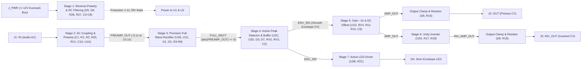

# Stage 3: JLCPCB BOM, Audio Walkthrough & Test-Point / Silkscreen Prep

With the analog circuit upgrades and Eurorack protections recorded in `EnvelopeFollowerImprovements.md` ([Stage 2](stage-2-circuit-upgrades.md)), the next three prompts verify live JLCPCB component stock, generate an educational audio-electronics signal walkthrough, and lock down bench test points (`TP1`–`TP8`) and dual-sided silkscreen rules before writing any SKiDL code in [Stage 4](stage-4-skidl.md).

---

## Step 3.1: Researching JLCPCB Part Availability & Finalizing the Spec

Now ask the agent to verify live JLCPCB SMT availability, consolidate values onto JLCPCB **Basic** parts, and freeze the improved schematic and BOM (`EnvelopeFollowerImproved.md` & `EnvelopeFollowerBOM.md`).

### AI Agent Prompt

> *"Given `EnvelopeFollower.md` and `EnvelopeFollowerImprovements.md`, I'd like to research part availability on JLCPCB. I'd like the TL074s to be TL074H (SOIC), and most of the parts to be surface mount parts for JLCPCB construction. The jacks, pots, IDC power header, and 3mm indicator LED will be THT parts, mounted later. Incorporate the circuit improvements and Eurorack protections, use `U2C` and `U2D` for the active zero-deadzone peak detector and buffer, and adopt the improved potentiometer values (`A100k`, `A50k`, `A1M`, `B10k`). Save the updated circuit specification to `EnvelopeFollowerImproved.md` and the BOM to `EnvelopeFollowerBOM.md`."*

### Consolidated Assembly Strategy

- **Single-Sided SMT PCBA (`45` SMD components across `18` BOM lines)**:
  - **15 JLCPCB Basic lines** (`$0` feeder loading fee): All `24` fixed resistors (`0603` & `1206`), `9` ceramic capacitors (`C1`, `C2`, `C5`–`C11`), and `6` `SOD-123` diodes (`D1`–`D3`, `D5`–`D7`).
  - **3 JLCPCB Extended lines** (`$3.00`/line = `$9.00` setup): `TL074HIDR` (`C2878713`, fallbacks `TL074CDR` `C12594` / `TL074CDT` `C6963`), `BAT54SLT1G` (`C19726`), and `10 µF 50V` SMD electrolytic (`C72488`).
  - **Per-board SMD part cost**: **~$0.85 USD**.
- **Manual Post-Reflow THT (`9` required parts)**: `J_PWR` (`2×5` IDC header), `J1`–`J3` (`WQP-PJ398SM` jacks), `RV1`–`RV4` (9 mm vertical pots), and `D4` (`3 mm` LED).

---

## Step 3.2: Audio Electronics Walkthrough

Generating an educational explanation (`EnvelopeFollowerExplanation.md`) alongside the BOM verifies every equation and pin connection along the chronological signal arc.

### AI Agent Prompt

> *"Given `EnvelopeFollowerImproved.md` and `EnvelopeFollowerBOM.md`, please create `EnvelopeFollowerExplanation.md` explaining the circuit for someone learning audio electronics. I'd like to follow the audio signal path for the main arc, with supporting sections for power handling and the like."*

### Signal Architecture & Key Engineering Takeaways

#### Complete 7-Stage Signal-Path Cheat Sheet

1. **Power & Decoupling (`J_PWR`, `D5`, `D6`, `R26`, `R27`, `C3`–`C8`)**: Takes raw `±12V_IN` from the Eurorack power header and produces protected `+12V` and `-12V` rails ($V_{CC\pm} \approx \pm 11.78\text{ V}$). Series Schottky diodes block reversed ribbon cables, the series $10\,\Omega$ / $10\,\mu\text{F}$ RC network filters power-bus switching noise above $1.59\text{ kHz}$, and local $100\text{ nF}$ ceramic caps bypass `U1` and `U2` directly at their supply pins.
2. **Preamp & AC Coupling (`J1`, `C1`, `R1`, `R2`, `R25`, `RV1`, `C10`, `U1A`)**: Routes `IN_TIP` through AC-coupling capacitor `C1` into `AC_IN` and outputs `PREAMP_OUT`. The input network blocks DC with a $15.9\text{ Hz}$ high-pass cutoff, the inverting op-amp stage pads or boosts the audio signal across a $-0.1\times$ to $-10.1\times$ gain span according to $V_{\text{PREAMP\_OUT}} = -\left(\frac{1\text{ k}\Omega + R_{\text{GAIN}}}{10\text{ k}\Omega}\right)V_{\text{AC\_IN}}$, and feedback capacitor `C10` rolls off ultrasonic and RF noise above $\sim 33.5\text{ kHz}$ at maximum gain.
3. **Precision Rectifier (`U1B`, `U1C`, `D1`, `D2`, `R3`–`R8`)**: Converts the bipolar `PREAMP_OUT` signal via the intermediate half-wave node `HALF_RECT` into a unipolar full-wave rectified output `FULL_RECT`. Active diode feedback eliminates the diode deadzone, while $1\%$ matched resistors fold negative half-cycles positive with unity symmetry so that $V_{\text{FULL\_RECT}} = +1.0\,\lvert V_{\text{PREAMP\_OUT}}\rvert \ge 0$.
4. **Active Peak Detector & Buffer (`U2C`, `U2D`, `D3`, `D7`, `R9`, `RV2`, `R10`, `RV3`, `R24`, `C2`, `C11`)**: Tracks peaks from `FULL_RECT` onto storage node `ENV_CAP` and buffers the resulting envelope onto `ENV_SIG`. Wrapping `D3` inside `U2C`'s feedback loop eliminates diode forward-voltage drop across attack ($\tau_{\text{atk}} \approx 0.22\text{--}11.2\text{ ms}$) and release ($\tau_{\text{rel}} \approx 10.3\text{--}230\text{ ms}$), catch diode `D7` and lead capacitor `C11` prevent negative-rail saturation and loop oscillation, and JFET follower `U2D` isolates `C2` from downstream loading.
5. **Gain, Offset & Primary Out (`U1D`, `R11`–`R15`, `RV4`, `C9`, `D8`, `R16`, `J2`)**: Amplifies `ENV_SIG` to `AMP_OUT` and drives the primary output jack at `OUT_TIP`. The stage boosts the raw envelope by $\sim 2.98\times$ and sums in a linear $\pm 9.8\text{ V}$ DC offset following $V_{\text{AMP\_OUT}} \approx 3\,V_{\text{ENV\_SIG}} - V_{\text{OFFSET\_WIPER}}$, before passing through dual Schottky rail clamps (`D8`) and a $1\text{ k}\Omega$ ($1/4\text{ W}$) series isolation resistor (`R16`).
6. **Inverted CV Out (`U2A`, `R17`, `R18`, `D9`, `R19`, `J3`)**: Inverts `AMP_OUT` into `INV_AMP_OUT` and delivers it to `INV_OUT_TIP` through rail clamp `D9` and series resistor `R19`. Unity-gain inversion ($V_{\text{INV\_OUT}} = -V_{\text{AMP\_OUT}}$) flips the primary CV polarity—including any dialed-in DC offset—for ducking and inverse modulation patches.
7. **Active LED Driver (`U2B`, `D4`, `R21`)**: Feeds `ENV_SIG` into an active voltage-to-current converter driving the indicator LED nodes `LED_A` and `LED_K`. Placing `D4` inside `U2B`'s feedback loop sets LED current linearly to $I_{\text{LED}} = V_{\text{ENV\_SIG}} / 1.5\text{ k}\Omega$, guaranteeing a true dark state ($0\text{ mA}$) at silence regardless of the LED's forward voltage drop.

!!! warning "Capacitor Dielectric & Negative-Rail Polarity Watch-Outs"
    - **Dielectrics**: `C10`/`C11` (`47 pF`) use **`C0G/NP0`** for zero voltage/temperature drift in feedback loops; `C2` (`220 nF`, `0805`) and `C5`–`C9` (`100 nF`) use **`X7R`** at `50 V` rating for minimal DC-bias capacitance drop on `±12 V` rails.
    - **Negative-Rail Electrolytic Polarity (`C4`)**: Polarized caps must keep their `+` lead at a higher voltage than `-`. For **`C4`** (`10 µF` on the `-12V` rail), **`+` connects to `GND` (`0 V`) and `-` connects to `-12V` (`-11.78 V`)**, because `0 V` is `11.78 V` more positive than `-11.78 V`.

---

## Step 3.3: Optional THT Test Points & Silkscreen Markup Rules

Finally, define bench test points (`TP1`–`TP8`, marked **`DNP`** so JLCPCB leaves the `1.0 mm` plated holes unpopulated) and document silkscreen labeling rules (`SilkscreenInstructions.md`) so every component value, pot taper, and test point is readable during both JLCPCB placement review and panel-on troubleshooting.

### AI Agent Prompts

> *"Are there useful places to add test points to `EnvelopeFollowerImproved.md`? I'd prefer to use through-hole test points that I can optionally solder in."*
>
> *"Please add these test points to `EnvelopeFollowerImproved.md` and `EnvelopeFollowerBOM.md`. I'll be using Ronghe `RH-5001`. Mark as DNP in the BOM."*
>
> *"Given `EnvelopeFollowerImproved.md` and `EnvelopeFollowerBOM.md`, please create `SilkscreenInstructions.md` for capturing instructions on how to mark up components on the silkscreens. Marking test points on both sides is a useful instruction. I also want the component values marked on the silkscreen for ease of comparing the populated component against its required value in the JLCPCB reports—for resistors and capacitors, label just the concise value on the silkscreen (keeping their reference designators on `.Fab`) so the narrow 6 HP board doesn't get overcrowded."*

### `TP1`–`TP8` Test Point Schedule (`Ronghe RH-5001`, LCSC `C5199801`, `DNP`)

| Ref | `F.SilkS` & `B.SilkS` Label | Net Name | Stage / Bench Role |
| :--- | :--- | :--- | :--- |
| `TP1` | `TP1 GND` | `GND` | Ground reference clip anchor |
| `TP2` | `TP2 +12V` | `+12V` | Protected `+12V` rail (post-`D5`/`R26`, expect `~+11.78 V`) |
| `TP3` | `TP3 -12V` | `-12V` | Protected `-12V` rail (post-`D6`/`R27`, expect `~-11.78 V`) |
| `TP4` | `TP4 PRE` | `PREAMP_OUT` | Stage 2 inverting preamp output (`U1A` pin 1) |
| `TP5` | `TP5 HALF` | `HALF_RECT` | Stage 3.1 negative half-wave rectifier output (`D2` anode) |
| `TP6` | `TP6 RECT` | `FULL_RECT` | Stage 3.2 full-wave rectified audio (`U1C` pin 8) |
| `TP7` | `TP7 ENV` | `ENV_SIG` | Stage 4 buffered raw envelope (`U2D` pin 14 — never probe raw `ENV_CAP`!) |
| `TP8` | `TP8 OFS` | `OFFSET_WIPER` | Stage 5 filtered DC offset voltage (`RV4` wiper / `C9`) |

### Four Core Silkscreen Rules (`SilkscreenInstructions.md`)

1. **Density-Adaptive SMD Silkscreen (`B.SilkS` — Value-Only Passives, `<REF> + <VAL>` Actives/Diodes)**: For `R*` and `C*` passives on dense `B.Cu`, display only the concise primary value token (`20k`, `47pF`, `100nF`, `10uF`, `1k`, `10R`) on `B.SilkS` (keeping their `Reference` designators on `B.Fab`), while displaying `<REF> + <VAL>` (`U1 TL074H`, `D1 1N4148W`, `D5 B5819W`, `D8 BAT54S`) for ICs and diodes—all tethered locally outside component courtyards and pads so unmarked `0603`/`0805` MLCCs and `SOD-123`/`SOT-23` diodes can be verified directly in JLCPCB's 3D/DFM preview without saturating the board.
2. **Dual-Sided Test Point Labels (`F.SilkS` & `B.SilkS`)**: Print `TP1 GND` through `TP8 OFS` on **both** `F.SilkS` (for bare-board bring-up) and `B.SilkS` (for rear bench probing once the 3U front panel hides `F.Cu`).
3. **Dual-Sided THT Control & Power Labels (`F.SilkS` & `B.SilkS`)**: Print `RV1 GAIN A100k`, `RV2 ATK A50k`, `RV3 REL A1M`, `RV4 OFFSET B10k`, `J1 IN`, `J2 OUT`, `J3 INV_OUT`, `D4 LED` (`+`/`-`), and `J_PWR +/-12V` (`-12V / RED STRIPE` on pins 1–2) on **both** sides so identical-footprint pots cannot be swapped during hand assembly.
4. **Visible Orientation Marks & JLCPCB Geometry**: Keep Pin-1 dots (`U1`, `U2`), diode cathode bars (`|`), and electrolytic `+` symbols outside component bodies; enforce $\ge 0.8\text{ mm}$ text height (`0.9–1.2 mm` recommended), $\ge 0.15\text{ mm}$ stroke thickness, $\ge 0.20\text{ mm}$ pad clearance, `0°`/`90°` rotations only, and include a `5 × 5 mm` solid filled silkscreen square as the JLCPCB 2D QR code placeholder (JLCPCB's legacy `JLCJLCJLC` text placeholder string is obsolete and no longer used).
