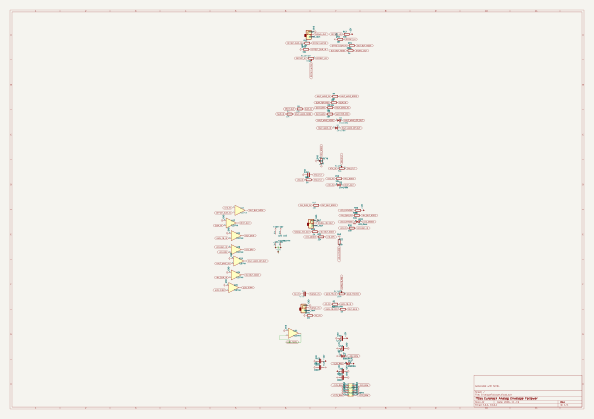
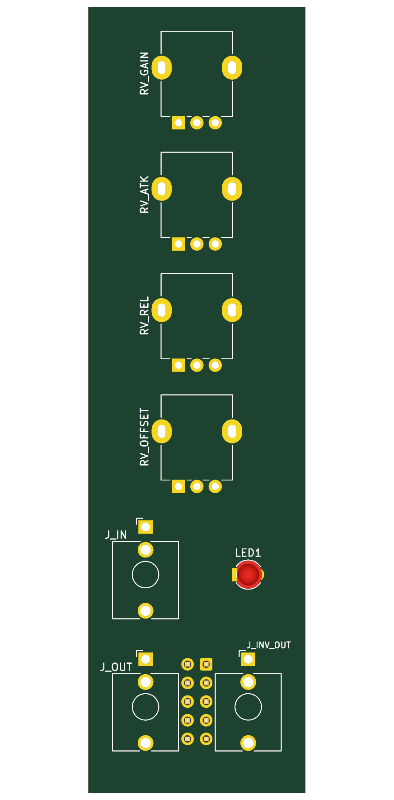
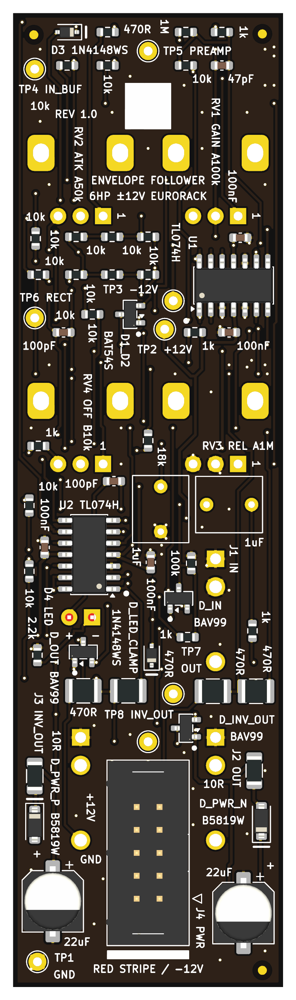

# Stage 4: Generating the KiCad Schematic & 6 HP Main PCB Layout

## Part A: Auto-Generated KiCad Schematic (`EnvelopeFollower.kicad_sch`)

Calling `generate_schematic(...)` at the bottom of `envelope_follower.py` converts the SKiDL netlist into [`EnvelopeFollower.kicad_sch`](https://github.com/domesticmouse/EnvelopeFollower/blob/main/EnvelopeFollower.kicad_sch) using SKiDL's `schematizer` router. Notice line 515 of `envelope_follower.py`:

```python
import schematizer.engine.gen_schematic as _gs

# Disable two-pin snapping in schematizer so series protection diodes (D4, D5)
# do not overlap J_PWR pins and short -12V_RAW to GND.
_gs._snap_two_pin_parts = lambda node: None
```

Disabling `_snap_two_pin_parts` prevents compact series diodes (`D4`, `D5`) from visually snapping onto adjacent header pins in the schematic canvas.



*(Exported directly via `kicad-cli sch export svg --output docs/images/ EnvelopeFollower.kicad_sch`.)*

---

## Part B: Generating the 6 HP Main PCB (`generate_kicad_pcb.py`)

Rather than importing the netlist manually and placing 48 footprints by hand in `pcbnew`, [`generate_kicad_pcb.py`](https://github.com/domesticmouse/EnvelopeFollower/blob/main/generate_kicad_pcb.py) automates the board outline, control grid, sandwich placement, BOM metadata transfer, and power silkscreen.

### AI Agent Prompt

> *"Write `generate_kicad_pcb.py` using KiCad's `pcbnew` Python API and `kinet2pcb` to generate `EnvelopeFollower.kicad_pcb` from `envelope_follower.net`. Size the board for 6 HP (`29.60 x 107.00 mm`) centered behind a `30.00 x 128.50 mm` Doepfer 3U panel, place the 4 pots, LED, and 3 jacks on `F.Cu` aligned to an ergonomic panel grid using exact footprint-to-bushing offsets, flip `J_PWR` and all 39 SMT parts onto `B.Cu` grouped by subcircuit, add `-12V RED` / `+12V` silkscreen markings, and configure the `Power` netclass."*

### How `generate_kicad_pcb.py` Works

1. **Dual-Environment Python Bootstrap (Lines 31–46)**:
    KiCad's compiled `pcbnew` C++ bindings only load inside KiCad's bundled Python (`/Applications/KiCad/KiCad.app/Contents/Frameworks/Python.framework/Versions/Current/bin/python3`), while `kinet2pcb` and `simp_sexp` live in `.venv`. If `import pcbnew` fails under `.venv`, the script re-executes itself (`os.execv`) using `KICAD_PYTHON` and appends `.venv/lib/python*/site-packages` to `sys.path`.

2. **6 HP Mechanical Coordinates & Bushing Offsets (Lines 51–76)**:
    The target 6 HP × 3U panel measures `30.00 x 128.50 mm` spanning global KiCad coordinates `X = [100.00, 130.00]`, `Y = [10.00, 138.50]`. Leaving `0.20 mm` horizontal clearance per side and `10.75 mm` vertical clearance top/bottom (clearing Eurorack rails and M3 screw heads) yields a main PCB outline of **`29.60 x 107.00 mm`** (`X = [100.20, 129.80]`, `Y = [20.75, 127.75]`).

    KiCad footprints do **not** put `(0, 0)` at the mechanical shaft or jack center. Inside KiCad's coordinate system ($X$ right, $Y$ down), rotating a local offset $(c_x, c_y)$ counter-clockwise by $\theta$ shifts the bushing relative to the footprint origin by:

    $$
    \Delta X = c_x \cos\theta + c_y \sin\theta, \qquad \Delta Y = -c_x \sin\theta + c_y \cos\theta
    $$

    | Component | KiCad Footprint | Local `fp_circle` | Placement Rot | Resulting Offset $(\Delta X, \Delta Y)$ | Footprint Origin $(X, Y)$ | Target Panel Bushing $(X, Y)$ |
    | :--- | :--- | :---: | :---: | :---: | :---: | :---: |
    | `RV_GAIN` | `Potentiometer_Alpha_RD901F-40-00D_Single_Vertical` | `(7.50, 2.50)` | `90°` | `(+2.50, -7.50)` | `(112.50, 36.50)` | `(115.00, 29.00)` |
    | `RV_ATK` | `Potentiometer_Alpha_RD901F-40-00D_Single_Vertical` | `(7.50, 2.50)` | `90°` | `(+2.50, -7.50)` | `(112.50, 53.00)` | `(115.00, 45.50)` |
    | `RV_REL` | `Potentiometer_Alpha_RD901F-40-00D_Single_Vertical` | `(7.50, 2.50)` | `90°` | `(+2.50, -7.50)` | `(112.50, 69.50)` | `(115.00, 62.00)` |
    | `RV_OFFSET` | `Potentiometer_Alpha_RD901F-40-00D_Single_Vertical` | `(7.50, 2.50)` | `90°` | `(+2.50, -7.50)` | `(112.50, 86.00)` | `(115.00, 78.50)` |
    | `J_IN` | `Jack_3.5mm_QingPu_WQP-PJ398SM_Vertical_CircularHoles` | `(0.00, 6.48)` | `0°` | `(0.00, +6.48)` | `(108.00, 91.52)` | `(108.00, 98.00)` |
    | `LED1` | `LED_D3.0mm` | `(1.27, 0.00)` | `0°` | `(+1.27, 0.00)` | `(120.73, 98.00)` | `(122.00, 98.00)` |
    | `J_OUT` | `Jack_3.5mm_QingPu_WQP-PJ398SM_Vertical_CircularHoles` | `(0.00, 6.48)` | `0°` | `(0.00, +6.48)` | `(108.00, 109.52)` | `(108.00, 116.00)` |
    | `J_INV_OUT` | `Jack_3.5mm_QingPu_WQP-PJ398SM_Vertical_CircularHoles` | `(0.00, 6.48)` | `0°` | `(0.00, +6.48)` | `(122.00, 109.52)` | `(122.00, 116.00)` |

3. **Single-Sided `B.Cu` Assembly & Rear Power Markings (Lines 76–123, 195–212)**:
    Every SMT component (`U1`, `U2`, `D1`–`D5`, `C1`–`C8`, `R1`–`R23`, `R_GAIN_MIN`) and the rear `J_PWR` header are flipped to `B.Cu` (keeping JLCPCB assembly single-sided). Local bypass capacitors (`C5`–`C8`) hug Pins 4 and 11 of `U1` and `U2`, while `B.SilkS` labels mark `-12V RED`, `+12V`, and `ENV FOLLOWER 6HP`.

Run the script to generate [`EnvelopeFollower.kicad_pcb`](https://github.com/domesticmouse/EnvelopeFollower/blob/main/EnvelopeFollower.kicad_pcb):

```bash
.venv/bin/python generate_kicad_pcb.py
```

Output:

```text
Generated EnvelopeFollower.kicad_pcb: 48 footprints, 35 nets, outline 29.60 x 107.00 mm.
```

| Main PCB Front (`F.Cu` — THT Panel Controls) | Main PCB Rear (`B.Cu` — SMT & `J_PWR`) |
| :---: | :---: |
|  |  |
