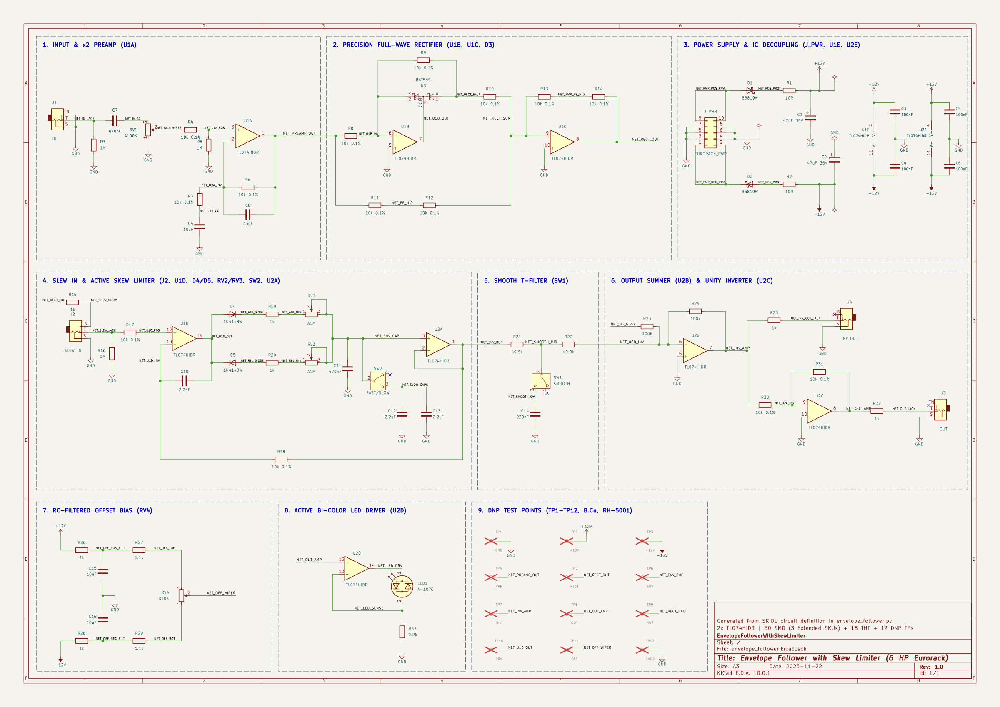

# Stage 4: SKiDL Capture, Custom Footprints & KiCad PDF Schematic

With every net, part number, and `DNP` test point locked inside `DesignSpec.md` ([Stage 3](stage-3-bom-and-dfm.md)), SKiDL turns the netlist into testable Python code (`envelope_follower.py`)—and then drives a custom 9-section KiCad 10 `.kicad_sch` schematic and printable PDF (`generate_schematic.py`) directly from `build_circuit()` as the single source of truth.

---

## Step 4.1: Single-Sentence `/skidl` Handoff & Downstream-First Alignment

### AI Agent Prompt ([Trace 06 Turn 1](https://github.com/domesticmouse/EnvelopeFollower/blob/main/prompts/06-c0e24b1d-please-turn-designspec-md-into-a-circuit.md))

!!! prompt "AI Agent Prompt"
    `/skidl` Please turn `@[DesignSpec.md]` into a circuit.

Notice how a complete `DesignSpec.md` shrinks the SKiDL prompt to one sentence. The only remaining hardware ambiguity (`SW1`/`SW2` SPST vs. SPDT symbol and footprint) surfaced as a single multiple-choice question—locking in `Switch:SW_SPDT` (`Pin 2` common, `Pin 3` active when lever is UP, `Pin 1 = NC`) on a project-local `Dailywell 2MS1` footprint.

### Environment Setup & Downstream-First Habits

1. **Pin `.venv` to Python 3.14 (Not 3.15+)**:
   System Python 3.15 lacks prebuilt `h5py` wheels needed by `skidl`. Create `.venv` on Python `3.12`–`3.14`:

```bash
uv venv --clear --python 3.14 .venv
uv pip install skidl
```

2. **Read Downstream Skills Before Writing SKiDL**:
   Inspect `.agents/skills/kicad-pcbnew-layout/` and `.agents/skills/eurorack-panel/` *before* coding `envelope_follower.py`. Those downstream generators read `LCSC`, `MPN`, `Manufacturer`, `JLCPCB_Class`, `Silkscreen`, and `Notes` directly from `part.fields`, rely on `JLCPCB_Class = "Manual THT"` for [Stage 7](stage-7-manufacturing.md)'s THT-only `InteractiveHtmlBom` filter, and expect front-panel bushings (`(0, 0)` on switches) to match `eurorack-panel`.
3. **Budgeted JLCPCB Basic vs. Extended Sourcing**:
   Query live stock and feeder fees via `jlcpcb_search.py --in-stock-only`:

```bash
.venv/bin/python .agents/skills/skidl/scripts/jlcpcb_search.py \
    --in-stock-only "TL074HIDR" "BAT54S" "RT0603BRD0710KL" "B5819W" "1N4148W" "2.2nF 50V" "220nF 50V" "10uF 1206"
```

   The finalized **`50` SMDs** fit across **`17` BOM rows** while honoring a strict **3-Extended-SKU budget** (`C2878713` `TL074HIDR` `×2`, `C83935` `BAT54S` `×1`, `C95204` `10k 0.1%` `×14`). Upgrading `10 µF` decoupling/filter caps (`C9`, `C15`, `C16`) to Basic `50 V` `1206` MLCCs (`C13585`) preserves far more capacitance under DC bias than `0805` X5R parts at zero extra feeder fee, while `C10` uses a Basic `2.2 nF 50 V C0G` `0805` (`C28260`) and `C14` uses a Basic `220 nF 50 V X7R` `0805` (`C5378`).

---

## Step 4.2: Authoring & Validating Custom Project-Local Footprints

KiCad 10 does not ship a vertical sub-miniature PCB toggle footprint for the Dailywell `2MS1T1B1M2QES` (`Tayda A-6087`, `2.54 mm` pitch, `1.2 mm` drills). Instead of approximating it with a pin header, create a project-local library:

- **`footprints/Eurorack_Custom.pretty/SW_Toggle_SPDT_Dailywell_2MS1.kicad_mod`**: Sets `(0, 0)` at `Pad 2` (and the `5.0 mm` bushing `fp_circle` on `F.Fab`) so `eurorack-panel` extracts exact drill coordinates automatically, with `Pad 1` (`NC`) at `(0, -2.54)` and `Pad 3` (active throw when toggle lever is UP = `SMOOTH` / `SLOW`) at `(0, +2.54)`.
- **`fp-lib-table`** in the repo root registers `Eurorack_Custom` via `${KIPRJMOD}/footprints/Eurorack_Custom.pretty`.
- Append `pathlib.Path(__file__).resolve().parent / "footprints"` to `footprint_search_paths[KICAD]` in `envelope_follower.py`, and validate that KiCad loads the footprint cleanly with `pcbnew.FootprintLoad()`:

```bash
/Applications/KiCad/KiCad.app/Contents/Frameworks/Python.framework/Versions/Current/bin/python3 - <<'EOF'
import pcbnew
fp = pcbnew.FootprintLoad("footprints/Eurorack_Custom.pretty", "SW_Toggle_SPDT_Dailywell_2MS1")
assert fp is not None and len(fp.Pads()) == 3
print("Loaded custom footprint with pads:", [p.GetNumber() for p in fp.Pads()])
EOF
```

---

## Step 4.3: Anatomy of `envelope_follower.py` & Multi-Layer Netlist Verification

Key patterns inside `reference/envelope_follower.py` (`80` footprints, `48` active nets):

```python
# Excerpt from reference/envelope_follower.py: NetClasses, ERC assertions & XML BOM
pwr_class = NetClass("Power", priority=1, trace_width=0.30, clearance=0.20)
hiz_class = NetClass("HighImpedance", priority=2, trace_width=0.25, clearance=0.25)

erc_assert(
    "len(builtins.default_circuit.parts) == 80",
    "Expected 80 total footprints (68 populated + 12 DNP test points).",
)
erc_assert(
    "{n.name for n in builtins.default_circuit.get_nets()} == EXPECTED_NETS",
    "Circuit net set does not match the 48 nets in DesignSpec.md.",
)
erc_assert(
    "_part('C2')[1].net.name == 'GND' and _part('C2')[2].net.name == '-12V'",
    "C2 (-12V electrolytic) must have pin 1 (+) on GND and pin 2 (-) on -12V.",
)
erc_assert(
    "_part('D3')[1].net.name == 'NET_RECT_HALF' "
    "and _part('D3')[2].net.name == 'NET_U1B_INV' "
    "and _part('D3')[3].net.name == 'NET_U1B_OUT'",
    "D3 (BAT54S) pinout mismatch against DesignSpec.md.",
)
erc_assert(
    "all(getattr(_part(f'TP{i}'), 'dnp', False) "
    "and getattr(_part(f'TP{i}'), 'exclude_from_bom', False) for i in range(1, 13))",
    "All test points TP1-TP12 must be marked dnp=True and exclude_from_bom=True.",
)
```

- **Multi-Layer Netlist Verification**: After running `.venv/bin/python envelope_follower.py`, check every `(ref, pin)` pair in `envelope_follower.net` against real `.kicad_mod` pad names (`S`/`T`/`TN`, `1`/`2`/`3`, `1`–`14`), and verify `parse_netlist("envelope_follower.net")` *without* passing `dnp_prefixes` so you confirm genuine `.net` `dnp` properties propagate on `TP1`–`TP12`.
- **Clean Execution & Linting**:

```bash
.venv/bin/python envelope_follower.py
ruff check --fix envelope_follower.py
ruff format envelope_follower.py
```

??? info "Preview of generated `jlcpcb_bom.csv` (17 SMD rows, 50 SMD parts, 3 Extended SKUs)"

    ```csv
    Comment,Designator,Footprint,LCSC Part #
    100nF,"C3, C4, C5, C6",C_0603_1608Metric,C14663
    33pF,C8,C_0603_1608Metric,C1663
    10uF,"C9, C15, C16",C_1206_3216Metric,C13585
    2.2nF,C10,C_0805_2012Metric,C28260
    220nF,C14,C_0805_2012Metric,C5378
    B5819W,"D1, D2",D_SOD-123,C8598
    BAT54S,D3,SOT-23,C83935
    1N4148W,"D4, D5",D_SOD-123,C81598
    10R,"R1, R2",R_0603_1608Metric,C22859
    1M,"R3, R5, R16",R_0603_1608Metric,C22935
    10k 0.1%,"R4, R6, R7, R8, R9, R10, R11, R12, R13, R14, R17, R18, R30, R31",R_0603_1608Metric,C95204
    1k,"R15, R19, R20, R25, R26, R28, R32",R_0603_1608Metric,C21190
    49.9k,"R21, R22",R_0603_1608Metric,C23184
    100k,"R23, R24",R_0603_1608Metric,C25803
    5.1k,"R27, R29",R_0603_1608Metric,C23186
    2.2k,R33,R_0603_1608Metric,C4190
    TL074HIDR,"U1, U2",SOIC-14_3.9x8.7mm_P1.27mm,C2878713
    ```

---

## Step 4.4: Generating a Human-Readable KiCad 10 Schematic & PDF

### AI Agent Prompts ([Trace 06 Turns 2 & 4](https://github.com/domesticmouse/EnvelopeFollower/blob/main/prompts/06-c0e24b1d-please-turn-designspec-md-into-a-circuit.md))

!!! prompt "AI Agent Prompt — Turn 1"
    `/skidl` I'd like a KiCad schematic so I can visualise this circuit

!!! prompt "AI Agent Prompt — Turn 2"
    Please generate a PDF version of the schematic. Add to `@[README.md]` and git commit.

!!! warning "Do Not Rely on `skidl.generate_schematic()` (`schematizer 0.2.0`)"
    SKiDL's built-in `generate_schematic()` (`schematizer`) fails or produces tangled, stub-exploded diagrams on multi-op-amp analog circuits with shared rails, multi-unit `TL074` packages, and switched jacks. Keep `envelope_follower.py` as your electrical single source of truth and drive a clean KiCad 10 `.kicad_sch` generator directly from `envelope_follower.build_circuit()`.

### Architecture of `generate_schematic.py`

1. **SKiDL as Single Source of Truth**: Imports `envelope_follower.build_circuit()` directly so component values, footprints, `LCSC`/`MPN`/`Silkscreen` fields, `DNP` flags, and net connectivity never drift from `envelope_follower.net`.
2. **Quote-Preserving S-Expression Parser**: Uses a custom `Quoted(str)` AST parser/dumper instead of `simp_sexp`, which strips quotes from strings containing spaces or parentheses.
3. **Flattening `(extends ...)` KiCad Symbols**: Recursively merges child flags (`pin_names`, `in_bom`, `on_board`) onto parent symbols during `_flatten()` so extended symbols like `Amplifier_Operational:TL074` keep valid KiCad properties.
4. **KiCad 10 Formatting & Text Rules**: Omits explicit `(justify center)` (which aborts KiCad 10 schematic loading), applies empirical `_text_transform(rot, mirror)` relative-angle rules for `SCH_FIELD`s, emits explicit `PWR_FLAG` symbols on driven rails, and lays out **9 titled sections** (`128` symbol instances, `236` wires, `4` no-connect markers) clear of the A3 title block.

### 4-Layer Schematic Verification Loop

Before committing `envelope_follower.kicad_sch` and `envelope_follower.pdf`, verify all four layers:

```bash
# 1. Generate schematic & export its KiCad netlist for 100% pin-for-pin parity diff against SKiDL
.venv/bin/python generate_schematic.py
kicad-cli sch export netlist --output /tmp/sch_check.net envelope_follower.kicad_sch

# 2. Run KiCad 10 schematic ERC (0 errors)
kicad-cli sch erc --severity-all --output /tmp/sch_erc.rpt envelope_follower.kicad_sch

# 3. Run kicad skill schematic analyzer
python3 .agents/skills/kicad/scripts/analyze_schematic.py envelope_follower.kicad_sch

# 4. Export printable A3 PDF & rasterize preview for Pillow visual inspection of every section
kicad-cli sch export pdf --output envelope_follower.pdf envelope_follower.kicad_sch
sips -s format png -Z 2400 envelope_follower.pdf --out images/schematic.png
```

Use `PIL.Image.crop()` on `images/schematic.png` to inspect each of the 9 schematic sections visually—catching overlapping labels, dangling wires, or clipped title-block margins before PCB layout begins.



---

!!! warning "SKiDL 3.0.0 & KiCad 10 Pitfalls"
    - **Python `<= 3.14`:** System Python 3.15 lacks prebuilt `h5py` wheels (`uv venv --clear --python 3.14 .venv`).
    - **Upstream `generate_xml()` Bug:** SKiDL 3.0.0's `generate_xml()` emits invalid unparseable XML—write your own `xml.etree.ElementTree` XML exporter (`generate_kicad_xml()`).
    - **`erc_assert()` Evaluation Scoping:** Python 3 generator comprehensions referencing caller locals inside `erc_assert("...")` string expressions raise `NameError` inside `eval()`. Keep helper lookups in module scope (`_part('C2')`) or avoid local captures inside assertion strings.
    - **Benign `default_circuit.root.tag = ""` Warning:** Keep `builtins.default_circuit.root.tag` empty and pass `tag=...` on subcircuits/parts; ignore SKiDL's benign tag warning when organizing `@subcircuit` blocks.
    - **Scratch File Hygiene & KiCad Python `< 3.12`:** Ensure `.gitignore` ignores `skidl_REPL.*` and `*.kicad_prl`, and pull dict lookups out of f-strings (`{...}`) whenever a script may run under KiCad's bundled Python 3.9 (`SyntaxError` on backslashes inside `{...}`).
