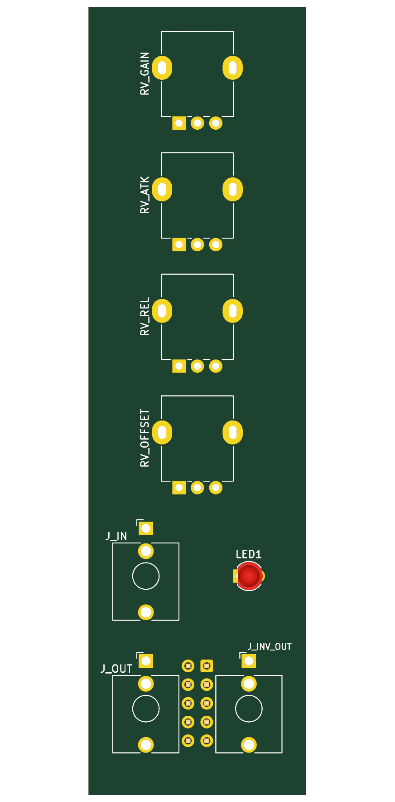
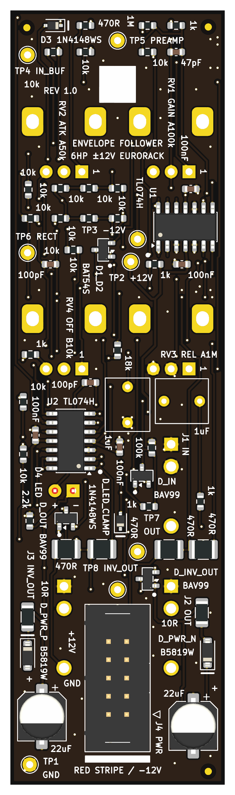
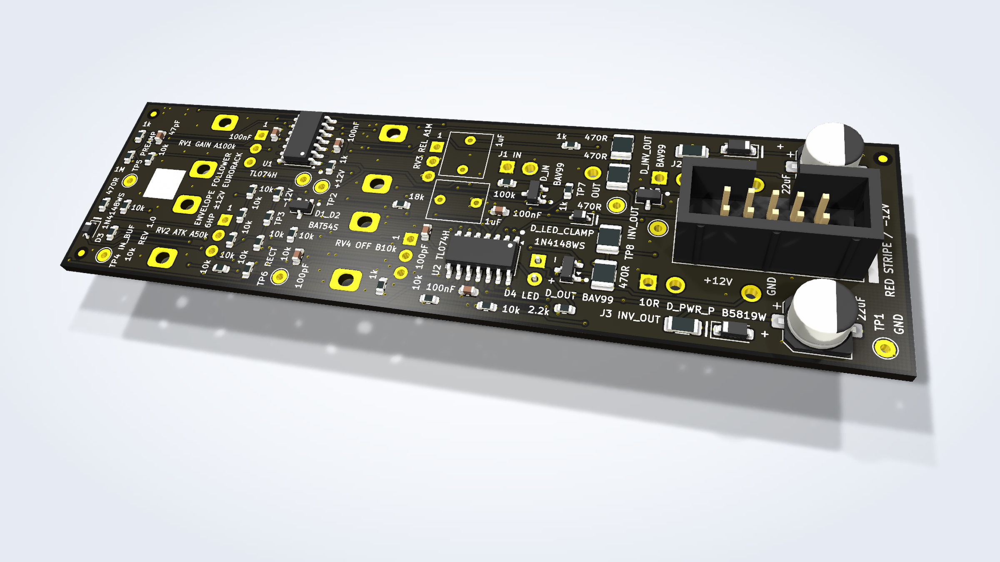

# Stage 5: Generating, Routing & Auditing the 6 HP Main PCB (`generate_kicad_pcb.py`)

Because `envelope_follower.net` ([Stage 4](stage-4-skidl.md)) already contains all 71 footprints, 42 active nets, `dnp` flags, and custom BOM/silkscreen fields (`LCSC`, `MPN`, `JLCPCB_Class`, `Silkscreen`), KiCad's `pcbnew` API and `pcbnew_layout_template.py` can generate `EnvelopeFollower.kicad_pcb` directly from the netlist without needing an intermediate `.kicad_sch` schematic.

Rather than importing the netlist manually, placing 71 footprints by hand, and routing traces interactively in `pcbnew`, `generate_kicad_pcb.py` automates the board outline, `2 × 4` front-panel grid, single-sided `B.Cu` SMT placement, rear `J4` + `C1`/`C2` PET film placement, `DNP` test points and fiducials, dual-sided silkscreen markup, 2-layer copper routing, `GND` copper pours, and DRC/DFM verification.

## AI Agent Prompt

> *"`/kicad-pcbnew-layout` `/kicad-silkscreen-markup` `/eurorack-panel` `/kicad` Please create and run `generate_kicad_pcb.py` to generate a 6 HP main PCB (`EnvelopeFollower.kicad_pcb`) from `envelope_follower.net`, following `@EnvelopeFollowerImproved.md` and `@SilkscreenInstructions.md`. Place the 4 pots, 3 jacks, and LED on `F.Cu` aligned to a 6 HP front-panel grid, and place the Eurorack power header, any other non-panel THT parts, the `DNP` test points, and all SMD parts from the netlist (with their `@SilkscreenInstructions.md` silkscreen labels) on `B.Cu`."*

### How the Prompt Delegates to Your Skills & Specs

1. **`/kicad-pcbnew-layout` + `/eurorack-panel` + `/kicad` (`generate_kicad_pcb.py` from `envelope_follower.net`)**:
   Converts the SKiDL netlist (`71` footprints, `42` nets, embedded `LCSC`/`MPN`/`JLCPCB_Class`/`Silkscreen` fields, and `dnp` flags) directly into `EnvelopeFollower.kicad_pcb` using KiCad 10's bundled `pcbnew` Python API and `.agents/skills/kicad-pcbnew-layout/scripts/pcbnew_layout_template.py` (`parse_netlist`, `create_base_board`, `populate_footprints`, `assign_nets`, `GridRouter`, `pour_gnd_zones`). `/eurorack-panel` supplies the 6 HP × 3U Doepfer mechanical envelope (`30.00 × 108.00 mm` main board centered behind a `30.00 × 128.50 mm` panel with `10.25 mm` rail clearance top/bottom) and footprint-to-bushing offset rules, while `/kicad` audits the resulting board.
2. **Pots, Jacks & LED on `F.Cu` Aligned to a 6 HP `2 × 4` Front-Panel Grid**:
   Keeps the 8 user-facing through-hole controls (`RV1`–`RV4`, `J1`–`J3`, `D4`) on `F.Cu` facing the front panel in two columns (`X = 7.50, 22.50 mm`) and applies each footprint's shaft/bushing offset (`Alps RK09K` pots, `WQP-PJ398SM` jacks, `3 mm` LED) so the physical shafts and jack bushings land on exact millimeter grid coordinates that [Stage 6](stage-6-front-panel.md) reads to drill the front panel.
3. **Power Header, Film Caps, Fiducials, `DNP` Test Points & All 49 SMDs on `B.Cu`**:
   Flips everything that is not a front-panel control onto the rear of the PCB (`B.Cu`)—orienting `J4` with Pins `1–2` (`RED STRIPE / -12V`) at the bottom, mounting the `11 mm`-tall `C1`/`C2` (`1 µF 100 V`) PET film capacitors on `B.Cu` so `F.Cu` clears the `10.25 mm` panel standoff, flagging `TP1`–`TP8` and `FID1`–`FID3` with `SetDNP(True)`, `SetExcludedFromBOM(True)`, and `SetExcludedFromPosFiles(True)` so JLCPCB leaves the `1.0 mm` probe holes open and excludes fiducials from the CPL, and grouping all 49 SMD components across dedicated corridors for single-sided **Bottom Side** JLCPCB Economic PCBA.
4. **`/kicad-silkscreen-markup` & `@SilkscreenInstructions.md` Labels on `B.SilkS` & Dual-Sided THT/TP Markup**:
   Uses `/kicad-silkscreen-markup` (`scripts/silk_annotator.py`) and `@SilkscreenInstructions.md` to enforce density-adaptive `B.SilkS` labels (concise value-only tokens via `place_val_only()` for all `41` `R*`/`C*` passives—explicitly handling suffixed refs like `R_PWR_P`, `R16A`, `C_DEC1`—and `<REF> + <VAL>` via `place_ref_val_pair()` for ICs and diodes) tethered within `<= 3.5 mm` outside every `.Fab` body and pad keepout, print `TP1`–`TP8`, `C1`/`C2` (`1uF`), and all 9 THT control/power labels (`RV1 GAIN A100k` … `J4 PWR`) on **both** `F.SilkS` and `B.SilkS`, and add external Pin-1 dots (`U1`, `U2`, `D1_D2`, `D_IN`, `D_OUT`, `D_INV_OUT`), diode cathode bars (`D_PWR_P/N`, `D3`, `D_LED_CLAMP`), `C3`/`C4` `+` marks, `RV1`–`RV4` Pin `1` marks, the `5.0 × 5.0 mm` via-free JLCPCB QR square, and wrapped `B.Fab` fabrication notes.

## Step 5.1: How `generate_kicad_pcb.py` Works

1. **Self-Bootstrapping KiCad 10 `pcbnew` Runner**:
   KiCad's compiled `pcbnew` C++ bindings load inside KiCad's bundled Python (`/Applications/KiCad/KiCad.app/Contents/Frameworks/Python.framework/Versions/Current/bin/python3`). If `import pcbnew` fails under `.venv`, `generate_kicad_pcb.py` immediately re-executes itself via `os.execv(str(KICAD_PYTHON), ...)`, then loads `pcbnew_layout_template` and `silk_annotator` directly from `.agents/skills/` and converts `envelope_follower.net` into `EnvelopeFollower.kicad_pcb`.

2. **6 HP Mechanical Coordinates & Bushing Offsets (`30.00 × 108.00 mm`)**:
   The target 6 HP × 3U panel measures `30.00 × 128.50 mm`. Centering a **`30.00 × 108.00 mm`** main PCB (`X = [0.00, 30.00]`, `Y = [0.00, 108.00]`) behind the panel leaves **`10.25 mm` vertical overhang top and bottom** (`Y = [-10.25, 118.25]` globally) to clear Eurorack rails and M3 mounting slots.

   KiCad footprints do **not** place `(0, 0)` at the mechanical shaft or jack center. Inside KiCad's coordinate system ($X$ right, $Y$ down), rotating a local `fp_circle` offset $(c_x, c_y)$ counter-clockwise by $\theta$ shifts the bushing relative to the footprint origin by:

   $$
   \Delta X = c_x \cos\theta + c_y \sin\theta, \qquad \Delta Y = -c_x \sin\theta + c_y \cos\theta
   $$

   | Component | Panel Role / Value | KiCad Footprint | Local `fp_circle` | Placement Rot | Offset $(\Delta X, \Delta Y)$ | Footprint Origin $(X, Y)$ | Target Panel Bushing $(X, Y)$ |
   | :--- | :--- | :--- | :---: | :---: | :---: | :---: | :---: |
   | `RV1` | `GAIN` (`A100k`) | `Potentiometer_Alps_RK09K_Single_Vertical` | `(7.50, 2.50)` | `90°` | `(+2.50, -7.50)` | `(5.00, 22.50)` | `(7.50, 15.00)` |
   | `RV2` | `ATK` (`A50k`) | `Potentiometer_Alps_RK09K_Single_Vertical` | `(7.50, 2.50)` | `90°` | `(+2.50, -7.50)` | `(20.00, 22.50)` | `(22.50, 15.00)` |
   | `RV3` | `REL` (`A1M`) | `Potentiometer_Alps_RK09K_Single_Vertical` | `(7.50, 2.50)` | `90°` | `(+2.50, -7.50)` | `(5.00, 50.00)` | `(7.50, 42.50)` |
   | `RV4` | `OFFSET` (`B10k`) | `Potentiometer_Alps_RK09K_Single_Vertical` | `(7.50, 2.50)` | `90°` | `(+2.50, -7.50)` | `(20.00, 50.00)` | `(22.50, 42.50)` |
   | `J1` | `IN` (`3.5mm`) | `Jack_3.5mm_QingPu_WQP-PJ398SM_Vertical_CircularHoles` | `(0.00, 6.48)` | `0°` | `(0.00, +6.48)` | `(7.50, 60.52)` | `(7.50, 67.00)` |
   | `D4` | `ENV` (`3mm Red LED`) | `LED_D3.0mm` | `(1.27, 0.00)` | `0°` | `(+1.27, 0.00)` | `(21.23, 67.00)` | `(22.50, 67.00)` |
   | `J2` | `OUT` (`3.5mm`) | `Jack_3.5mm_QingPu_WQP-PJ398SM_Vertical_CircularHoles` | `(0.00, 6.48)` | `0°` | `(0.00, +6.48)` | `(7.50, 80.32)` | `(7.50, 86.80)` |
   | `J3` | `INV_OUT` (`3.5mm`) | `Jack_3.5mm_QingPu_WQP-PJ398SM_Vertical_CircularHoles` | `(0.00, 6.48)` | `0°` | `(0.00, +6.48)` | `(22.50, 80.32)` | `(22.50, 86.80)` |

3. **Single-Sided `B.Cu` SMT Placement, Geometry Guardrails & `DNP`/`POS` Exclusions**:
   Keeping only the 8 panel controls on `F.Cu` and placing all **49 SMD components**, `J4`, `C1`/`C2` PET film caps, `TP1`–`TP8`, and `FID1`–`FID3` on **`B.Cu`** prevents pot lug or X-axis panel mirroring, keeps `F.Cu` completely clear beneath flush-mounted panel housings across the `30.00 mm` board, and keeps every SMT part and `B.SilkS` value token visible from the rear—all at zero extra cost under **JLCPCB Economic PCBA** (single-sided **Bottom Side** assembly).

    ```python
    # Excerpt from generate_kicad_pcb.py: placement & DNP/POS flag enforcement
    def build_placements() -> dict[str, tuple[float, float, float, bool]]:
        """Return (x, y, rot_deg, is_back) for all 71 footprints."""
        return {
            # 8 Front-panel THT strictly on F.Cu (2 x 4 grid: X = 7.5, 22.5)
            "RV1": (5.00, 22.50, 90.0, False),    # shaft (7.50, 15.00)
            "RV2": (20.00, 22.50, 90.0, False),   # shaft (22.50, 15.00)
            "RV3": (5.00, 50.00, 90.0, False),    # shaft (7.50, 42.50)
            "RV4": (20.00, 50.00, 90.0, False),   # shaft (22.50, 42.50)
            "J1": (7.50, 60.52, 0.0, False),      # bushing (7.50, 67.00)
            "D4": (21.23, 67.00, 0.0, False),     # lens (22.50, 67.00)
            "J2": (7.50, 80.32, 0.0, False),      # bushing (7.50, 86.80)
            "J3": (22.50, 80.32, 0.0, False),     # bushing (22.50, 86.80)
            # 3 SMT optical fiducials on B.Cu (excluded from BOM/CPL)
            "FID1": (2.30, 2.30, 0.0, True),
            "FID2": (27.70, 2.40, 0.0, True),
            "FID3": (2.30, 106.15, 0.0, True),
            # Rear THT on B.Cu (J4 power header, C1/C2 PET film, TP1-TP8)
            "J4": (13.73, 98.20, 0.0, True),
            "C1": (3.50, 54.50, 0.0, True),
            "C2": (13.60, 52.50, 270.0, True),
            ...
        }

    # In main(): mark both TP1-TP8 and FID1-FID3 DNP + BOM/POS-excluded
    components, nets = parse_netlist(
        HERE / "envelope_follower.net", dnp_prefixes=("TP", "FID")
    )
    fps = populate_footprints(board, components, placements)
    for ref, fp in fps.items():
        if ref.startswith(("FID", "TP")):
            fp.SetDNP(True)
            fp.SetExcludedFromBOM(True)
            fp.SetExcludedFromPosFiles(True)
    ```

   Before silkscreen placement or routing runs, `check_geometry()` verifies zero same-side courtyard overlaps, zero edge-margin violations (`>= 0.20 mm`), zero THT pad collisions, and zero THT-pad vs. opposite-side SMD courtyard collisions.

4. **Automated Silkscreen Markup & Bounded `B.Fab` Notes (`apply_silkscreen_and_fab()`)**:
   KiCad defaults `Value` fields onto `.Fab` (excluded from silkscreen Gerbers). `apply_silkscreen_and_fab()` hides every raw `fp.Reference()` and `fp.Value()` on `.Fab` and places collision-checked silkscreen items via `SilkGrid`:
   - **Passives (`41` parts via `place_val_only()`)**: Explicitly routes every fixed `R*` and `C*` part (excluding `RV*`) through `place_val_only()` so both numbered (`R1`–`R20`, `C1`–`C4`) and suffixed (`R_PWR_P/N`, `R16A/B`, `C_DEC1`–`C_DEC4`, `C_HF`, `C_OUT1`/`C_OUT2`) passives render concise value tokens (`10k`, `470R`, `100nF`, `22uF`, dual-sided `1uF` for `C1`/`C2`).
   - **Actives, Diodes, THT Controls & Test Points (`27` parts)**: Placed via `place_ref_val_pair()` (`U1 TL074H`, `U2 TL074H`, `D1_D2 BAT54S`, `D3 1N4148WS`, `D_IN BAV99`, `RV1 GAIN A100k`, `RV4 OFF B10k`, `J1 IN`, `J4 PWR`, `TP1 GND`–`TP8 INV_OUT`), with opposite-side echoes on both `F.SilkS` and `B.SilkS`, `"DNP"` printed on `B.Fab` for `TP1`–`TP8`, and THT housing `.Fab` keepouts (`_block_tht_fab_bodies`) preventing labels from hiding underneath installed pots, jacks, `J4`, or `C1`/`C2`.
   - **External Polarity Marks, QR Square & `B.Fab` Notes**: Places `r = 0.25 mm` Pin-1 dots (`U1`, `U2`), `r = 0.22 mm` `SOT-23` Pin-1 dots (`D1_D2`, `D_IN`, `D_OUT`, `D_INV_OUT`), `0.25 mm` discrete diode cathode bars (`D_PWR_P/N`, `D3`, `D_LED_CLAMP`), `C3`/`C4` `+` marks, `D4` `+`/`-` marks on both sides, `RV1`–`RV4` Pin `1` markers on both sides, the `J4` `0.85 mm` `RED STRIPE / -12V` bar + rail labels, board title block (`ENVELOPE FOLLOWER`, `6HP ±12V EURORACK`, `REV 1.0`), the `5.0 × 5.0 mm` solid QR square on `B.SilkS` at `(12.50, 7.80)–(17.50, 12.80)`, and `_add_bounded_fab_notes()` wrapped inside `30.00 mm` on `B.Fab` (`100%` completeness).

5. **2-Layer `HVGridRouter` Routing & Stitched `GND` Copper Pours (`route_board()`)**:
   - **H/V Directional Bias & Soft Silkscreen Via Avoidance (`HVGridRouter`)**: Subclasses `GridRouter` (`0.25 mm` grid, `0.55 mm` edge clearance) to bias `F.Cu` horizontal and `B.Cu` vertical, hard-blocks vias inside `WQP-PJ398SM` bushing keepouts, SMD pads (`0` `VP-001` warnings), THT holes (`0` `holes_co_located`), and the `5 × 5 mm` QR square (`mark_via_block_rect`), and softly penalizes placing vias underneath silkscreen text (`mark_silk_via_rect`) for clean legibility.
   - **Pre-Routed Clusters, Escapes & Net Ordering**: Pre-places immediate `GND` stitching vias for every `B.Cu` SMD `GND` pad, pre-routes `U1`/`U2` ↔ `C_DEC1`–`C_DEC4` (`0.30 mm` power width) directly on `B.Cu`, reserves outward `SOIC-14` escape stubs, bridges adjacent same-net pins (`RV1.2–3`, `RV2.2–3` with an upward `F.Cu` corridor escape, `U2.13–14`), and routes constrained analog summing/feedback nets before power (`0.30 mm`) and general signals (`0.25 mm`), preserving junction vertices with `_merge_collinear_path()` (`0` `track_dangling`).
   - **Stitched `F.Cu` & `B.Cu` `GND` Pours**: Distributes grid stitching vias (`>= 3.2 mm` apart, avoiding QR/silk), fills `F.Cu` and `B.Cu` `GND` zones (`0.50 mm` edge clearance, `0.20 mm` clearance) via `pour_gnd_zones()`, and iteratively stitches any isolated copper pockets (`3` passes with `board.BuildConnectivity()`).

6. **Automated DRC, `kicad` PCB Audit & Silkscreen Inspection**:
   Run the generator and audit `EnvelopeFollower.kicad_pcb` with KiCad 10 CLI DRC, `analyze_pcb.py`, and `silk_annotator.py --inspect`:

    ```bash
    .venv/bin/python generate_kicad_pcb.py

    /Applications/KiCad/KiCad.app/Contents/MacOS/kicad-cli pcb drc \
        --refill-zones --exit-code-violations --format json \
        --output /tmp/main_drc.json EnvelopeFollower.kicad_pcb

    python3 .agents/skills/kicad/scripts/analyze_pcb.py EnvelopeFollower.kicad_pcb --full --analysis-dir analysis/
    python3 .agents/skills/kicad-silkscreen-markup/scripts/silk_annotator.py --inspect EnvelopeFollower.kicad_pcb
    ```

    Observed output:

    ```text
    Saved .../EnvelopeFollower.kicad_pcb (71 footprints, 42 nets)
    Silkscreen Inspection: EnvelopeFollower.kicad_pcb
      Footprints:         71 (68 non-fiducial)
      Labeled on SilkS:   68/68 (27 with REF, 19 value-only passives)
      Unlabeled parts:    0
      Raw Values on Silk: 0
      F.SilkS texts:      37 | B.SilkS texts: 101
      Text overlaps:      0
      Keepout/pad hits:   0
      Out-of-bounds:      0
      Tether drift hits:  0
      Split pair hits:    0
      RESULT: PASS
    ```

    Verified metrics: **`0` DRC violations**, **`0` unconnected items**, **`42/42` nets routed** (`632` track segments, `212` stitching/signal vias, `2` filled `GND` zones), **`0` `analyze_pcb.py` errors**, and **`100%` `B.Fab` fabrication notes completeness**.

| Main PCB Front (`F.Cu` — `2 × 4` Panel Controls) | Main PCB Rear (`B.Cu` — `49` SMDs, `J4`, `C1`/`C2`, `TP1`–`TP8`) |
| :---: | :---: |
|  |  |



---

## Step 5.2: Semantic Silkscreen & Polarity Audit (Verification & Fix Prompts)

Geometric verification tools (`kicad-cli pcb drc` and `analyze_pcb.py`) confirm **physical and electrical rules** (`0` copper shorts, `0` unrouted nets, `0` `silk_overlap` / `silk_over_copper` violations, and `100%` `B.Fab` notes completeness), while `silk_annotator.py --inspect` confirms **`100%` labeled non-fiducial footprints (`68/68`) with `0` tether-drift or split-pair hits (`RESULT: PASS`)**; however, they do **not** verify **semantic label parity**—whether every printed function/value label matches `@SilkscreenInstructions.md` and `envelope_follower.net`, or whether every polarized package category in `@SilkscreenInstructions.md` received its external orientation mark cleanly outside physical 3D housings.

For example, during the clean-room Stage 5 test drive (`AuditReport.md`), running the semantic audit and inspecting KiCad's 3D renders surfaced two batches of real layout/DFM bugs that automated checks alone missed:

1. **Bottom-Side PCBA Reconciliation & Fiducial POS Leakage (Step 5.1b)**: Early specs placed the `49` SMDs on `F.Cu`, which conflicted with flush front-panel mounting and Stage 7's `--side back --smd-only` CPL export; meanwhile `FID1`–`FID3` only set `exclude_from_bom` (without `exclude_from_pos_files`), which would leak fiducials into JLCPCB's `.pos` file, and stitching vias sat inside the `5 × 5 mm` QR square. Moving all `49` SMDs + `FID1`–`FID3` to `B.Cu`, adding `SetExcludedFromPosFiles(True)` on `FID*` and `TP*`, and calling `mark_via_block_rect(*QR_RECT)` eliminated all three issues.
2. **Polarity Clearances, Bounded `B.Fab` Notes & `RV2` Pin-1 Drift (Step 5.2 Audit)**: Inspecting the rendered silkscreen and `B.Fab` bounding boxes uncovered `J4`'s `RED STRIPE / -12V` bar colliding with `J4`'s 3D shroud overhang, `SOT-23` Pin-1 dot collisions, `RV2`'s `"1"` marker drifting toward Pad 2 instead of Pad 1, `B.Fab` notes overflowing the `30.00 mm` board width, missing `"DNP"` text on `TP1`–`TP8` `B.Fab`, and tight QR square margins—all resolved cleanly via `_block_tht_fab_bodies()`, `_place_silk_dot_checked()`, `_add_bounded_fab_notes()`, and strict `d1 < d2` Pin-1 assertions.

### 1. Verification Prompt (Finds Semantic Label & Polarity Discrepancies)

Run this follow-up audit prompt to catch any drift between the generated PCB silkscreen and `@SilkscreenInstructions.md`:

> *"Please audit `generate_kicad_pcb.py` and the generated `EnvelopeFollower.kicad_pcb` against `@SilkscreenInstructions.md` and `@envelope_follower.net`. Check: (1) whether every component's rendered silkscreen value/function label on `F.SilkS` and `B.SilkS` matches the exact schedule in `@SilkscreenInstructions.md` and the `Silkscreen` field in `@envelope_follower.net` rather than hardcoded overrides, and (2) whether all polarized component categories in `@SilkscreenInstructions.md` (IC Pin-1 dots, discrete diode cathode bars and multi-pin diode Pin-1 marks, LED `+`/`-`, Eurorack power header `-12V / RED STRIPE` bar and rail labels, pot Pin-1 markers, and external electrolytic capacitor `+` marks) are present on the silkscreen outside package bodies and pad keepouts. Report every discrepancy without editing files yet."*

### 2. Fix Prompt (Resolves Discrepancies & Re-Verifies DRC)

Once the audit lists any mismatches, send this self-contained prompt to fix every issue and re-verify the board:

> *"Please update `generate_kicad_pcb.py` against `@SilkscreenInstructions.md` and `@envelope_follower.net` to fix every silkscreen and polarity discrepancy found in the audit: remove any hardcoded label override tables and derive silkscreen text directly from `@envelope_follower.net`'s `Silkscreen` fields and `@SilkscreenInstructions.md` so multi-token labels (pot functions/tapers, jack/LED/power-header labels, IC/diode `<REF> + <VAL>` labels, electrolytic values, and all test-point net names) are preserved without truncation while fixed resistors and capacitors follow the concise value-only `B.SilkS` rule; print the full board title block from `@SilkscreenInstructions.md`; seed silkscreen collision keepouts with SMD `B.Fab` package body outlines so IC and SMD labels sit outside physical package bodies; assert placement of all required external polarity and orientation markers (IC and multi-pin diode Pin-1 dots, discrete diode cathode bars clear of diode outlines, electrolytic capacitor external anode `+` markers on `B.SilkS`, LED `+`/`-`, pot Pin-1 markers, and the Eurorack power header `-12V / RED STRIPE` bar and rail labels outside the shroud keepout); re-run `generate_kicad_pcb.py` to regenerate `EnvelopeFollower.kicad_pcb`; and re-verify with `ruff`, `kicad-cli pcb drc --refill-zones`, `analyze_pcb.py`, `silk_annotator.py --inspect`, and top/bottom `kicad-cli pcb render` 3D renders."*
