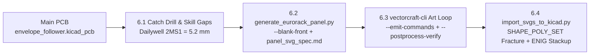
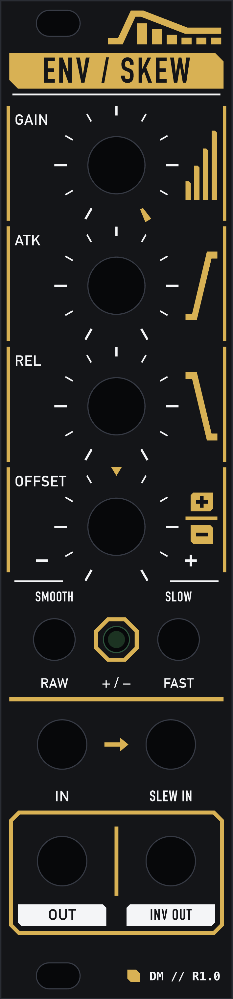
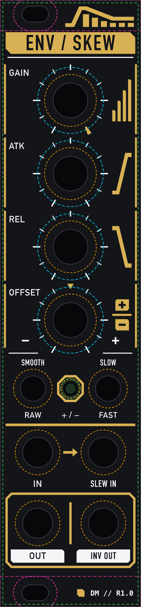
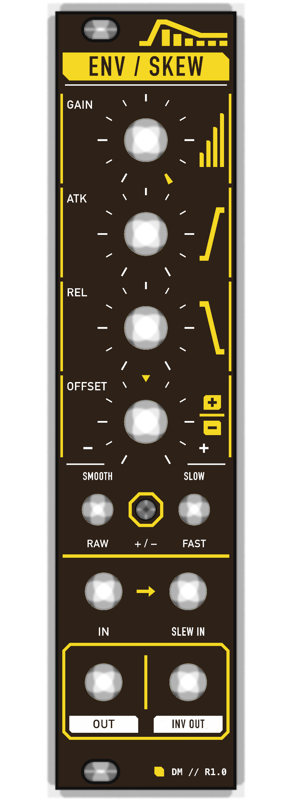
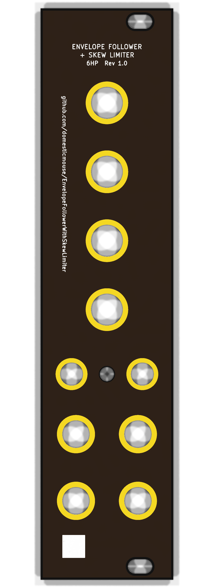

# Stage 6: Blank-Front Panel Spec, VectorCraft Art & KiCad Panel Integration

A raw aluminum or PCB panel with auto-generated KiCad text works for bench testing, but Eurorack modules live on crowded racks where typography, jack grouping, input/output polarity cues, and panel-to-panel spacing determine daily playability. In this stage — captured in traces [`13-03d1c3c6` (`prompts/13-03d1c3c6-how-do-i-build-a-faceplate-that.md`)](https://github.com/domesticmouse/EnvelopeFollower/blob/main/prompts/13-03d1c3c6-how-do-i-build-a-faceplate-that.md), [`15-ef99cb65` (`prompts/15-ef99cb65-please-create-a-front-panel-for-this.md`)](https://github.com/domesticmouse/EnvelopeFollower/blob/main/prompts/15-ef99cb65-please-create-a-front-panel-for-this.md), and [`16-cd7d0409` (`prompts/16-cd7d0409-i-d-like-to-design-a-front.md`)](https://github.com/domesticmouse/EnvelopeFollower/blob/main/prompts/16-cd7d0409-i-d-like-to-design-a-front-panel-for-this.md) — you split mechanical panel generation from vector graphic design: first generate a precision blank-front KiCad panel with a machine-readable specification contract, then design custom Matte Black + ENIG Gold artwork in `vectorcraft-cli`, and finally fracture and import those SVG polygons back into KiCad 10 for full DRC and 3D verification.



---

## Step 6.1: Exploratory Q&A, Skill Customization & KiCad Python 3.9 Compatibility

Rather than jumping straight to code generation, start with an exploratory conversation ([Trace 13](https://github.com/domesticmouse/EnvelopeFollower/blob/main/prompts/13-03d1c3c6-how-do-i-build-a-faceplate-that.md)) asking how to build a blank-front Matte Black + ENIG Gold faceplate mated to `envelope_follower.kicad_pcb`. That audit immediately exposes three mechanical and tooling gaps that would otherwise only surface after fabrication:

1. **Dailywell `2MS1` toggle drill mismatch (`SW1`, `SW2`):** Standard Eurorack panel templates default to `6.2 mm` toggle bushings (`1/4-40`), whereas the Dailywell `2MS1` sub-miniature SPDT toggle specified in [`Stage 4`](stage-4-skidl.md) uses a metric M5 (`4.95 mm`) threaded bushing. Leaving a `6.2 mm` hole allows the `8.0 mm` hex nut and locking washer to rock or pull through. Overriding the drill to `5.2 mm` (`7.2 mm` copper pad, `8.2 mm` front nut keepout) gives an exact slip fit.
2. **Skill extension via `/agy-customizations` (`eurorack-panel`):** Existing panel generation scripts assumed auto-generated `F.SilkS` labels around every cutout. Using `/agy-customizations` ([Trace 13](https://github.com/domesticmouse/EnvelopeFollower/blob/main/prompts/13-03d1c3c6-how-do-i-build-a-faceplate-that.md), Turn 25) before running the updated script in [Trace 15](https://github.com/domesticmouse/EnvelopeFollower/blob/main/prompts/15-ef99cb65-please-create-a-front-panel-for-this.md), extend `.agents/skills/eurorack-panel/scripts/generate_eurorack_panel.py` cleanly:
   - Add `--blank-front`, `--version`, `--url`, `--drill REF=MM`, and `--spec-md` CLI arguments, plus the `switch_submini` component class (`5.2 mm` drill / `7.2 mm` pad / `8.2 mm` keepout).
   - Extract module title and revision cleanly from the main board's `(title_block ...)` S-expression when omitted.
   - Implement a **2D Signed Distance Field (`plan_rear_silkscreen()`)** planner on `B.SilkS` so rear documentation (module title, `Rev 1.0`, rotated GitHub URL, and `5.0 × 5.0 mm` JLCPCB QR placeholder) places automatically inside the largest obstacle-free corridors clearing `B.Mask` rings, oval slots, and neighboring panel footprints.
3. **KiCad bundled Python 3.9 check + upstream skill sync:** KiCad 10 on macOS bundles **Python 3.9** inside `KiCad.app/Contents/Frameworks/Python.framework/Versions/Current/bin/python3` for `pcbnew`. Any Python `>= 3.10` syntax such as `zip(a, b, strict=True)` raises `TypeError: zip() takes no keyword arguments` inside `pcbnew` scripts even when your project `.venv` runs Python 3.14. Validate modified skill scripts directly under KiCad's Python 3.9 interpreter, run `ruff check` / `ruff format`, and upstream/sync changes back to your shared skills repository (`../skills/`) verifying zero drift with `diff -ru`.

!!! warning "Verify custom hardware drills before generating cutouts"
    Never assume "panel toggle = 6.2 mm." Always cross-check `Footprint`, `MPN`, and bushing thread diameter from `envelope_follower.kicad_pcb` before freezing panel Gerbers: pots (`RV1`–`RV4`) take `7.2 mm`, jacks (`J1`–`J4`) take `6.2 mm`, `3 mm` T-1 LEDs (`LED1`) take `3.2 mm` NPTH, and Dailywell `2MS1` sub-mini toggles (`SW1`–`SW2`) require `5.2 mm`.

---

## Step 6.2: Generating the Blank-Front Panel & `panel_svg_spec.md` Contract

Once the extended `eurorack-panel` skill passes KiCad Python 3.9 checks, generate the mated blank-front KiCad board and machine-readable SVG contract in one pass:

```bash
python3 .agents/skills/eurorack-panel/scripts/generate_eurorack_panel.py \
  --main-pcb envelope_follower.kicad_pcb \
  --output envelope_follower_panel.kicad_pcb \
  --blank-front \
  --title "ENVELOPE FOLLOWER + SKEW LIMITER" \
  --version "Rev 1.0" \
  --url "github.com/domesticmouse/EnvelopeFollowerWithSkewLimiter" \
  --spec-md panel_svg_spec.md \
  --drc
```

> *(The `switch_submini` matcher automatically detects `Dailywell_2M` / `2MS1` footprints and selects `5.2 mm` drills; use `--drill REF=MM` whenever you need an ad-hoc override on another cutout, or omit `--blank-front` / `--spec-md` to produce a standard auto-labeled shop panel directly from KiCad footprints.)*

### Mechanical Alignment & Panel Cutouts (`11` Controls + `2` M3 Slots)

Both PCBs share a `30.00 mm` (6 HP Doepfer standard `30.00 mm` panel width with `0.00 mm` X-overhang vs the `30.00 × 108.00 mm` main board) horizontal footprint, while the `128.50 mm` Doepfer 3U panel height adds a symmetrical `10.25 mm` top and bottom rail overhang (`Y_panel = Y_pcb + 10.25 mm`). KiCad sets `AuxOrigin` / `GridOrigin` at `(100.00, 29.75)` so panel-local coordinates `(0..30.00, 0..128.50)` align pixel-for-pixel with exported SVGs:

| Ref | Kind / MPN | Label / Role | Panel `(X, Y)` mm | KiCad Global `(X, Y)` mm | Drill / Slot Size | Hole Type | Nut Keepout / Mask Ring |
| :--- | :--- | :--- | :--- | :--- | :--- | :--- | :--- |
| **`H1`** | Eurorack Top Slot | M3 Mounting Slot | `(7.50, 3.00)` | `(107.50, 32.75)` | `5.50 × 3.20 mm` oval | NPTH | Rail keepout `Y = 0.0–6.5 mm` |
| **`H2`** | Eurorack Bottom Slot | M3 Mounting Slot | `(7.50, 125.50)` | `(107.50, 155.25)` | `5.50 × 3.20 mm` oval | NPTH | Rail keepout `Y = 122.0–128.5 mm` |
| **`RV1`** | Alpha `RD901F` `A100K` | `GAIN` | `(15.00, 21.25)` | `(115.00, 51.00)` | `Ø 7.20 mm` | PTH `GND` | `11.00 mm` keepout (`9.60 mm` `B.Mask`), knob `<= 14.0 mm` |
| **`RV2`** | Alpha `RD901F` `A1M` | `ATK` (Attack) | `(15.00, 36.75)` | `(115.00, 66.50)` | `Ø 7.20 mm` | PTH `GND` | `11.00 mm` keepout (`9.60 mm` `B.Mask`), knob `<= 14.0 mm` |
| **`RV3`** | Alpha `RD901F` `A1M` | `REL` (Release) | `(15.00, 52.25)` | `(115.00, 82.00)` | `Ø 7.20 mm` | PTH `GND` | `11.00 mm` keepout (`9.60 mm` `B.Mask`), knob `<= 14.0 mm` |
| **`RV4`** | Alpha `RD901F` `B10K` (center-detent) | `OFFSET` | `(15.00, 67.75)` | `(115.00, 97.50)` | `Ø 7.20 mm` | PTH `GND` | `11.00 mm` keepout (`9.60 mm` `B.Mask`), knob `<= 14.0 mm` |
| **`SW1`** | Dailywell `2MS1` SPDT | `SMOOTH` / `RAW` | `(7.00, 82.25)` | `(107.00, 112.00)` | `Ø 5.20 mm` | PTH `GND` | `8.20 mm` nut keepout (`7.20 mm` `F.Cu` pad, tented front) |
| **`LED1`** | `3 mm` T-1 Dual R/G | `OUT` Polarity LED | `(15.00, 82.25)` | `(115.00, 112.00)` | `Ø 3.20 mm` | NPTH | `5.20 mm` bezel keepout (`2.00 mm` margin around edge) |
| **`SW2`** | Dailywell `2MS1` SPDT | `FAST` / `SLOW` | `(23.00, 82.25)` | `(123.00, 112.00)` | `Ø 5.20 mm` | PTH `GND` | `8.20 mm` nut keepout (`7.20 mm` `F.Cu` pad, tented front) |
| **`J1`** | QingPu `WQP-PJ398SM` | `IN` (Signal In) | `(8.00, 95.75)` | `(108.00, 125.50)` | `Ø 6.20 mm` | PTH `GND` | `9.50 mm` nut keepout (`9.00 mm` `B.Mask`, tented front) |
| **`J2`** | QingPu `WQP-PJ398SM` | `SLEW IN` (Normalled) | `(22.00, 95.75)` | `(122.00, 125.50)` | `Ø 6.20 mm` | PTH `GND` | `9.50 mm` nut keepout (`9.00 mm` `B.Mask`, tented front) |
| **`J3`** | QingPu `WQP-PJ398SM` | `OUT` (+ Envelope) | `(8.00, 110.75)` | `(108.00, 140.50)` | `Ø 6.20 mm` | PTH `GND` | `9.50 mm` nut keepout (`9.00 mm` `B.Mask`, tented front) |
| **`J4`** | QingPu `WQP-PJ398SM` | `INV OUT` (− Envelope) | `(22.00, 110.75)` | `(122.00, 140.50)` | `Ø 6.20 mm` | PTH `GND` | `9.50 mm` nut keepout (`9.00 mm` `B.Mask`, tented front) |

### Blank-Front Verification & KiCad 10 Project Hygiene

Inspecting the generated `envelope_follower_panel.kicad_pcb` and `panel_svg_spec.md` confirms:

- **Blank front, documented back:** `0` entities on `F.SilkS` and `0` custom graphics on `F.Mask`; `5` automatically placed `B.SilkS` items:
  - 3 stacked mirrored text lines centered as a block at `(15.00, 10.50)` (`clearance = 2.40 mm`): `ENVELOPE FOLLOWER` at `(15.00, 8.65)`, `+ SKEW LIMITER` at `(15.00, 10.50)`, and `6HP  Rev 1.0` at `(15.00, 12.35)`.
  - Vertical `90°` mirrored GitHub repository URL (`github.com/domesticmouse/EnvelopeFollowerWithSkewLimiter`) at `(24.61, 39.47)` (`clearance = 3.25 mm`).
  - `5.00 × 5.00 mm` filled `gr_rect` JLCPCB QR blank centered at `(22.50, 121.00)` (`clearance = 2.73 mm`).
- **Copper fill & KiCad 10 inline nets:** Both `F.Cu` and `B.Cu` pour `~95%` solid `GND` zones tied to the `10` plated control shells via KiCad 10 inline `(net "GND")` declarations on every hole pad, while `envelope_follower_panel.kicad_pro` is generated and tracked alongside the PCB.
- **Specification contract (`panel_svg_spec.md`):** Documents exact safe artwork bounds (`X = 0.50..29.50 mm`, `Y = 0.50..128.00 mm`), rail keepouts (`Y = 0..6.5 mm` top, `122.0..128.5 mm` bottom), cutout keepouts, rear mirror zones, and layer color semantics (`#FFFFFF` White `F.SilkS`, `#D4AF37` ENIG Gold `F.Mask` over `F.Cu`, `#111111` Matte Black soldermask background).

---

## Step 6.3: VectorCraft Front Artwork & Clearance Audit

Armed with `panel_svg_spec.md`, open a dedicated artwork session ([Trace 16](https://github.com/domesticmouse/EnvelopeFollower/blob/main/prompts/16-cd7d0409-i-d-like-to-design-a-front.md)) invoking `/vectorcraft-cli` and let the agent walk you through aesthetic requirements (visual vibe, gold-vs-silkscreen hierarchy, knob dial scale style, LED polarity markings, and header motif) before writing code. For this build, those design interviews converge on a **Dark Techno / Brutalist** aesthetic: `#111111` Matte Black solder mask, bare `F.Cu` finished in `#D4AF37` ENIG Gold for structural zone blocks and reversed knock-outs (`OUT` / `INV OUT` output bay, title accent slab, angular envelope follower peak over decaying kick-drum bars, asymmetric LED polarity ticks), and crisp `#FFFFFF` `F.SilkS` ticks, callouts, and labels (`GAIN`, `ATK`, `REL`, `OFFSET`, `SMOOTH`/`RAW`, `FAST`/`SLOW`, `IN`, `SLEW IN`).

### Split Sandbox-Safe Batch Pipeline

Because `vectorcraft-cli` writes SVG exports outside typical sandbox assumptions or needs native macOS font services, split generation cleanly into three commands in `panel_art/generate_panel_art.py`:

```bash
# 1. Emit VectorCraft JSON command queue (runs inside sandbox)
.venv/bin/python panel_art/generate_panel_art.py --emit-commands panel_art/build_steps.json

# 2. Execute headless VectorCraft CLI engine (exports .raw.svg + .vectorcraft)
/Users/brett/.local/bin/vectorcraft-cli run --commands panel_art/build_steps.json

# 3. Normalize pt->mm Plain SVGs, run 40 px/mm clearance audit, clean temp files
.venv/bin/python panel_art/generate_panel_art.py --postprocess-verify
```

Key VectorCraft CLI engineering lessons discovered and codified in `generate_panel_art.py`:

- **`72 pt/in` coordinate scaling:** VectorCraft operates in PostScript points (`1 pt = 25.4 / 72.0 mm`). Convert every millimeter coordinate from `panel_svg_spec.md` with `MM_TO_PT = 72.0 / 25.4`, emit an outer `30.00 × 128.50 mm` `0.05 mm` `registration_frame` (`align: "inside"`), and rescale exported `viewBox` attributes back to exact `1:1` millimeters (`0 0 30.0 128.5`) during `--postprocess-verify`.
- **Omit `text.fontList` from batch runs & guard `result: None`:** Enumerating system fonts on every rebuild adds startup latency and can clutter JSON step logs. Probe available fonts once (`vectorcraft-cli run --command text.fontList`), pin installed geometric faces (`DIN Condensed`, `DIN Alternate`, and `Menlo`), and guard command result lookups in Python when steps return `None`.
- **Outline & flatten every graphic primitive:** Convert every label via `type.createOutlines`, expand strokes via `object.path.outlineStroke`, and execute reversed mask cutouts (`OUT`, `INV OUT`, chamfered pills) via `object.pathfinder.minusFront` rather than relying on white-on-gold overprints. Assert `text_nodes == 0` and `stroked_nodes == 0` in `--postprocess-verify` so KiCad imports pure closed fills.

### `40 px/mm` (`1016 PPI`) Morphological Clearance Audit & Visual Critique

Rather than trusting visual spot-checks alone, `--postprocess-verify` rasterizes `front_silkscreen.svg` and `front_soldermask.svg` at `AUDIT_PPI = 1016.0` (`40 px/mm`, `0.025 mm/px`) using Pillow, NumPy, and SciPy Euclidean distance transforms, failing loudly unless every constraint passes with `0 px` overlap:

- **Silk-to-Mask minimum gap:** `>= 0.20 mm` required (achieved `>= 0.60 mm` across all glyphs, tick marks, and the header envelope/kick-drum motif).
- **`F.Mask` edge & NPTH pullback:** `>= 0.60 mm` from PCB perimeter and `LED1` NPTH rim.
- **`F.SilkS` board-edge inset:** `>= 0.50 mm` all around (`X = 0.50..29.50 mm`, `Y = 0.50..128.00 mm`).
- **Nut & Potentiometer Keepouts:** `0 px` inside any `8.20 mm` switch nut, `9.50 mm` jack nut, `11.00 mm` pot keepout, or `5.20 mm` `LED1` bezel keepout.

Render both `panel_art/preview_clean.png` (simulating Matte Black + ENIG Gold + White Silkscreen) and `panel_art/preview_keepouts.png` (overlaying magenta drill rings, cyan nut/knob boundaries, and top/bottom rail zones) and iterate through interactive human+AI critique rounds — aligning chamfered `OFFSET` accents horizontally, moving the decaying kick-drum transient bars underneath the angular envelope tail, and equalizing bar spacing — before touching KiCad:

| Clean Mockup (`preview_clean.png`) | Keepout Audit Overlay (`preview_keepouts.png`) |
| :---: | :---: |
|  |  |

---

## Step 6.4: Importing SVGs into KiCad (`SHAPE_POLY_SET` + ENIG Stackup)

Exporting valid 1:1 mm SVGs is only half the battle: KiCad GUI SVG import requires manual clicks and lacks headless CI reproducibility, while KiCad `gr_poly` (`PCB_SHAPE` with `SHAPE_T_POLY`) objects only support a **single outer boundary without inner holes**. If you naively import glyphs containing counters (`O`, `A`, `R`, `D`, `0`) or reversed mask pills (`OUT`, `INV OUT`), inner islands fill solid!

In [`panel_art/import_svgs_to_kicad.py`](https://github.com/domesticmouse/EnvelopeFollowerWithSkewLimiter/blob/main/panel_art/import_svgs_to_kicad.py), solve both compound-path fracturing and stackup finish cleanly inside KiCad's bundled Python 3.9 `pcbnew` runtime:

1. **Inject KiCad 10 `(stackup ...)` before `LoadBoard()`:** Prepend the physical finish block (`F.Mask`/`B.Mask` `"Black"`, `F.SilkS`/`B.SilkS` `"White"`, `copper_finish "ENIG"`, `FR4` dielectric) into `envelope_follower_panel.kicad_pcb` before `pcbnew.LoadBoard()`. Reloading and saving preserves it natively so `kicad-cli pcb render` displays authentic Matte Black solder mask and brushed ENIG Gold pads.
2. **Idempotent cleanup & `AuxOrigin` alignment:** Delete any prior `F.SilkS` or `F.Mask` drawings (while leaving all `5` `B.SilkS` rear markings untouched), read `ds.GetAuxOrigin()` (`(100.00, 29.75)`), and drop the `30.00 × 128.50 mm` `registration_frame` `<rect>`.
3. **Adaptive De Casteljau flattening + `BooleanXor()` / `Fracture()`:** Subdivide cubic (`C`/`S`) and quadratic (`Q`/`T`) SVG Bezier curves down to `BEZIER_TOL_MM = 0.002 mm`, combine nested subpaths using `pcbnew.SHAPE_POLY_SET.BooleanXor()` (winding-agnostic even-odd decomposition), and call `Fracture()` so KiCad automatically cuts hairline keyhole seams into zero-hole native outlines. Each fractured outline becomes one filled `pcbnew.PCB_SHAPE` (`SHAPE_T_POLY`, `SetFilled(True)`, `SetWidth(0)`).
4. **Refill zones & run DRC + static Gerber analysis:** Run the importer with KiCad's Python 3.9 interpreter, inspect the `104` `F.SilkS` polygons + `33` `F.Mask` gold polygons + `5` preserved `B.SilkS` markings, verify `~95%` `GND` zone fill, and filter KiCad DRC (`kicad-cli pcb drc --severity-all --format json`) confirming **`0` non-library violations** (`13` expected `lib_footprint_issues` info markers from embedded `Eurorack_Panel:*` footprints):

```bash
/Applications/KiCad/KiCad.app/Contents/Frameworks/Python.framework/Versions/Current/bin/python3 \
  panel_art/import_svgs_to_kicad.py
kicad-cli pcb drc --severity-all --format json --output /tmp/panel_drc.json envelope_follower_panel.kicad_pcb
kicad-cli pcb render --side top --width 900 --height 2400 --background transparent --quality high \
  --output images/panel_front.png envelope_follower_panel.kicad_pcb
kicad-cli pcb render --side bottom --width 900 --height 2400 --background transparent --quality high \
  --output images/panel_back.png envelope_follower_panel.kicad_pcb
```

Inspect both high-resolution raytraced KiCad 3D renders closely — checking every counter (`O`, `A`, `R`, `D`, `0`), crisp `F.Mask` gold edges over `F.Cu`, Matte Black background uniformity, tented front holes around controls, and mirrored rear `B.SilkS` text and QR box — before moving on to manufacturing files:

| Front Panel 3D Render (`panel_front.png`) | Back Panel 3D Render (`panel_back.png`) |
| :---: | :---: |
|  |  |

---

## Pitfalls Caught in Stage 6

| Pitfall Discovered | Symptom | Fix Applied |
| :--- | :--- | :--- |
| **Generic `6.2 mm` switch drill** | Dailywell `2MS1` M5 (`4.95 mm`) bushing rattles inside a standard `6.2 mm` toggle hole | Added `--drill REF=MM` & `switch_submini` (`5.2 mm` drill / `8.2 mm` keepout) in `generate_eurorack_panel.py` |
| **Python `>= 3.10` syntax inside `pcbnew`** | `zip(..., strict=True)` raises `TypeError` under KiCad 10's bundled Python `3.9` | Test all `pcbnew` scripts under `KiCad.app/.../bin/python3` after editing skills |
| **`SHAPE_POLY_SET` holes inside `gr_poly`** | KiCad `PCB_SHAPE` (`SHAPE_T_POLY`) only keeps a single hole-free outline; counters like `O` / `A` fill solid | Combine SVG subpaths with `BooleanXor()` and call `Fracture()` before `SetPolyShape()` |
| **VectorCraft `72 pt/in` & live fonts** | Imported artwork scales to `2.83×` or leaves unclosed strokes/`<text>` tags | Scale by `25.4 / 72.0`, outline all type & strokes, use `pathfinder.minusFront`, omit `text.fontList` from batches |
| **Missing KiCad 10 `(stackup ...)`** | `kicad-cli pcb render` renders default green mask + silver HASL instead of Matte Black + ENIG Gold | Inject `(stackup ...)` (`Black` mask, `White` silk, `ENIG`) before `pcbnew.LoadBoard()` |
| **`generate_eurorack_panel.py` `lib_footprint_issues`** | DRC exits non-zero if `13` embedded footprint library warnings aren't distinguished from real errors | Filter `lib_footprint_issues` and assert **`0`** electrical, silk, mask, or copper-edge violations |

With both the main board (`envelope_follower.kicad_pcb`) and front panel (`envelope_follower_panel.kicad_pcb`) verified cleanly in 3D and DRC, you are ready for **[Stage 7: Gerbers, Ordering Checklists, Interactive BOM & Renders](stage-7-manufacturing.md)**.
