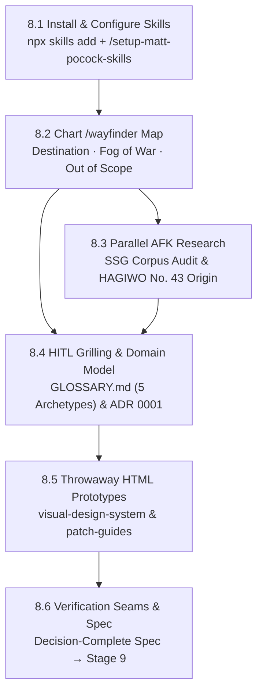

# Stage 8: Planning the Companion Site with `/wayfinder`

Across Stages 1–7, `10` focused hardware skills (plus `/edit-silkscreen`) and `16` interactive Antigravity **Session Traces** (`prompts/`) took `ENV / SKEW` from the **Hagiwo Sketch** to fabrication-ready Gerbers, `81` visual **Build Checklist** PNGs, a real-world Tayda order record, and `8` musical **Patch Guides**. Publishing a `25`-route interactive **Companion Site** on top of that `20`-file hardware corpus — without duplicating Markdown or binaries, and without losing architectural coherence across sessions — is too large for any single 100K-token context window.

In Stage 8, you shift from single-session hardware authoring into multi-session **Wayfinder** planning, grounded in the public GitHub **Decision Trail** on `domesticmouse/EnvelopeFollowerWithSkewLimiter` ([PR `#3`](https://github.com/domesticmouse/EnvelopeFollowerWithSkewLimiter/pull/3), Wayfinder Map [`ENV / SKEW GitHub Pages Site & README Overhaul`](https://github.com/domesticmouse/EnvelopeFollowerWithSkewLimiter/issues/4), child tickets `#5`–`#13` and `#16`, research PRs [`#14`](https://github.com/domesticmouse/EnvelopeFollowerWithSkewLimiter/pull/14)–[`#15`](https://github.com/domesticmouse/EnvelopeFollowerWithSkewLimiter/pull/15), and compiled Spec [`#17`](https://github.com/domesticmouse/EnvelopeFollowerWithSkewLimiter/issues/17)):



---

## Step 8.1: Installing `mattpocock/skills` & Configuring `/setup-matt-pocock-skills`

During hardware layout, installing `39` software-planning skills upfront would add unneeded noise to `.agents/skills/`. Now that hardware fabrication artifacts and the `20`-file Markdown corpus are complete, layer `mattpocock/skills` onto your existing hardware skills:

```bash
npx skills add mattpocock/skills
```

In `EnvelopeFollowerWithSkewLimiter`, running that command expanded [`skills-lock.json`](https://github.com/domesticmouse/EnvelopeFollowerWithSkewLimiter/blob/8ad81d0/skills-lock.json) from `10` locked hardware entries to **`49` locked entries** (`10` hardware + `39` workflow skills).

!!! tip "Selective `--skill` installation"
    To keep `.agents/skills/` minimal instead of installing all `39` bundled skills, pass explicit `--skill <name>` flags — for example, installing only the `11` core workflow skills below.

### Core 11 Workflow Skills Across Stages 8 & 9

Out of the `39` installed workflow skills, `11` form the repeatable planning-to-shipping loop across Stages 8 and 9:

| Skill | Phase | Role in the Workflow |
| :--- | :---: | :--- |
| **`setup-matt-pocock-skills`** | Stage 8.1 | One-time repo bootstrap configuring issue tracker, triage labels, and domain-doc layout |
| **`wayfinder`** | Stage 8.2–8.6 | Charts a loose goal as a **map** of decision tickets (`Destination`, **Fog of War**, **Out of scope**) and advances the frontier one ticket per session |
| **`research`** | Stage 8.3 | AFK primary-source investigation (docs, AST/corpus audits, attribution verification) before decisions harden |
| **`grilling`** | Stage 8.4, 8.6 | Structured HITL questioning that resolves open architectural, UX, and testing branches one decision at a time |
| **`domain-modeling`** | Stage 8.4 | Sharpens canonical project language into `GLOSSARY.md` and records ADRs sparingly when a 3-part test holds |
| **`prototype`** | Stage 8.5 | Builds throwaway logic or multi-variant HTML UI prototypes on unmerged branches to settle visual and UX questions directly |
| **`to-spec`** | Stage 8.6 | Compiles resolved map decisions, domain terms, ADRs, and verification seams into one decision-complete specification |
| **`to-tickets`** | Stage 9.1 | Breaks a compiled spec into vertical, tracer-bullet implementation tickets (`ready-for-agent`) with native blocking dependencies |
| **`implement-spec`** | Stage 9.1–9.3 | Executes spec tickets slice-by-slice while reading `GLOSSARY.md` and respecting ADRs |
| **`tdd`** | Stage 8.6, 9.3 | Red-green-refactor loop tested strictly at pre-agreed public seams rather than internal implementation details |
| **`code-review`** | Stage 9.4 | Independent two-axis review checking **Spec** parity and repository **Standards** side by side before merge |

### Repo-Tracked Skills vs. IDE & MCP Plugins

Keep a clear boundary between **repo-tracked `.agents/skills/`** and **editor/MCP environment tools**:

- **Repo-tracked skills (`skills-lock.json`):** Portable Markdown instructions and scripts shared by every coding agent in the repo (`wayfinder`, `research`, `tdd`, `skidl`, `eurorack-panel`, and companions).
- **IDE & MCP plugins (environment-level):** Tools such as **`modern-web-guidance`** (providing current HTML/DOM standards like `<dialog closedby="any">` and `[popover="hint"]`) and **Chrome DevTools MCP** (driving live browser DOM, SVG, font, and viewport checks during Stage 8 prototyping and Stage 9 pre-merge QA). These run in your editor/agent harness and never appear in `skills-lock.json`.

### Configuring Repo Conventions (`/setup-matt-pocock-skills`)

Before opening a Wayfinder map, run `/setup-matt-pocock-skills` once so every downstream skill knows where issues live, which labels represent triage states, and where domain docs belong. In `EnvelopeFollowerWithSkewLimiter`, [PR `#3` (`Configure engineering skills for GitHub issues, triage, and domain docs`)](https://github.com/domesticmouse/EnvelopeFollowerWithSkewLimiter/pull/3) wrote four small governance files:

- **[`AGENTS.md` in `EnvelopeFollowerWithSkewLimiter`](https://github.com/domesticmouse/EnvelopeFollowerWithSkewLimiter/blob/8ad81d0/AGENTS.md):** Points agents to the three `docs/agents/` contracts below.
- **[`docs/agents/issue-tracker.md` in `EnvelopeFollowerWithSkewLimiter`](https://github.com/domesticmouse/EnvelopeFollowerWithSkewLimiter/blob/8ad81d0/docs/agents/issue-tracker.md):** Configures GitHub Issues via the `gh` CLI, defines Wayfinding map/child-ticket/frontier/claim/resolve operations using GitHub's native sub-issues and `blocked_by` dependencies, and keeps external PRs off the triage surface (`PRs as a request surface: no`).
- **[`docs/agents/triage-labels.md` in `EnvelopeFollowerWithSkewLimiter`](https://github.com/domesticmouse/EnvelopeFollowerWithSkewLimiter/blob/8ad81d0/docs/agents/triage-labels.md):** Maps the five canonical triage roles (`needs-triage`, `needs-info`, `ready-for-agent`, `ready-for-human`, `wontfix`). Wayfinder planning tickets use `wayfinder:<type>` labels exclusively; `ready-for-agent` waits until Stage 9 when `/to-tickets` turns the finished spec into build slices.
- **[`docs/agents/domain.md` in `EnvelopeFollowerWithSkewLimiter`](https://github.com/domesticmouse/EnvelopeFollowerWithSkewLimiter/blob/8ad81d0/docs/agents/domain.md):** Declares a **single-context** domain layout (`GLOSSARY.md` + `docs/adr/` at repo root) created **lazily** only when real terms or qualifying ADRs crystallize.

---

## Step 8.2: Charting a `/wayfinder` Map from One Seed Prompt

With repo conventions in place, start a fresh session and launch `/wayfinder` with a single short seed instruction — documented in the hardware repository's **Decision Trail** on [ENV / SKEW GitHub Pages Site & README Overhaul](https://github.com/domesticmouse/EnvelopeFollowerWithSkewLimiter/issues/4):

!!! prompt "AI Agent Prompt — Chart Wayfinder Map"
    `/wayfinder` I'd like to make a website for this Eurorack module

Instead of immediately scaffolding Astro folders or guessing page layouts, `/wayfinder` runs a short two-stage charting pass:

1. **Pin the Destination first:** Invoking `grilling` + `domain-modeling`, the session settles what reaching the end of the map means — here, a **decision-complete implementation specification** covering both the **`ENV / SKEW` Companion Site** and the root `README.md` overhaul.
2. **Chart the frontier and leave fog alone:** Breadth-first grilling surfaces the crisp questions takeable right away while keeping murky downstream areas inside **Not yet specified** (**Fog of war**) and ruling non-goals into **Out of scope** (never to graduate).
3. **Two-pass create-then-wire native dependencies:** `/wayfinder` creates child issues first (`wayfinder:research`, `wayfinder:grilling`, `wayfinder:prototype`, `wayfinder:task`) so real GitHub issue numbers exist, then runs a second pass to wire native `blocked_by` dependencies (`gh issue edit <child> --add-blocked-by <blocker>`) and cross-references. GitHub's UI then renders the **frontier** — open, unblocked, unassigned tickets — directly without opening the map issue.
4. **One ticket per session (with AFK research in parallel):** Once charted, each subsequent session claims **one** frontier ticket (`gh issue edit <n> --add-assignee @me`), resolves only that question, posts the decision as a comment, closes the ticket, appends a one-line gist to **Decisions so far**, and graduates any newly sharpened fog. The map stays a lean **index**; each decision lives in exactly one ticket.

### Named Decision Trail Ledger (`Map #4` → `Spec #17`)

Every artifact on `EnvelopeFollowerWithSkewLimiter`'s Wayfinder arc is named below rather than cited by bare issue number:

| Role | Wayfinder / Spec Artifact (Named Decision Ledger) | Type / Output |
| :--- | :--- | :--- |
| **Parent Map** | [ENV / SKEW GitHub Pages Site & README Overhaul](https://github.com/domesticmouse/EnvelopeFollowerWithSkewLimiter/issues/4) | `wayfinder:map` (destination, decisions index, fog, out-of-scope) |
| **Research 1** | [Research static site generators for GitHub Pages single-source Markdown and interactive components](https://github.com/domesticmouse/EnvelopeFollowerWithSkewLimiter/issues/5) | `wayfinder:research` → PR [`docs(research): compare SSGs for single-source docs (#5)`](https://github.com/domesticmouse/EnvelopeFollowerWithSkewLimiter/pull/14) |
| **Research 2** | [Research Hagiwo origin post and domesticmouse/EnvelopeFollower attribution facts](https://github.com/domesticmouse/EnvelopeFollowerWithSkewLimiter/issues/6) | `wayfinder:research` → PR [`docs(research): add origin and attribution report for issue #6`](https://github.com/domesticmouse/EnvelopeFollowerWithSkewLimiter/pull/15) |
| **Grilling 1** | [Decide site information architecture and content-to-page mapping](https://github.com/domesticmouse/EnvelopeFollowerWithSkewLimiter/issues/7) | `wayfinder:grilling` → `GLOSSARY.md` (`5` archetypes, `25` routes) |
| **Prototype 1** | [Prototype visual design system from the ENV / SKEW front panel](https://github.com/domesticmouse/EnvelopeFollowerWithSkewLimiter/issues/8) | `wayfinder:prototype` → `prototype/visual-design-system` (`c1547cb`) |
| **Grilling 2** | [Decide static site tech stack, content sourcing model, and Pages deploy pipeline](https://github.com/domesticmouse/EnvelopeFollowerWithSkewLimiter/issues/9) | `wayfinder:grilling` → `docs/adr/0001-astro-core-single-source-site.md` |
| **Prototype 2** | [Prototype interactive Patch Guides UX and ENV / SKEW panel-state visualizer](https://github.com/domesticmouse/EnvelopeFollowerWithSkewLimiter/issues/10) | `wayfinder:prototype` → `prototype/patch-guides` (`4baa64e`) |
| **Grilling 3** | [Decide build, bringup, and interactive BOM web experience](https://github.com/domesticmouse/EnvelopeFollowerWithSkewLimiter/issues/11) | `wayfinder:grilling` → `211`-item checklist, lightbox, & iBOM spec |
| **Grilling 4** | [Decide origin story narrative, schematic viewer, and panel artwork showcase](https://github.com/domesticmouse/EnvelopeFollowerWithSkewLimiter/issues/12) | `wayfinder:grilling` → `/origin/`, `/hardware/`, `<zoom-pan-viewer>` spec |
| **Grilling 5** | [Decide README.md structure and repo-vs-site boundary](https://github.com/domesticmouse/EnvelopeFollowerWithSkewLimiter/issues/13) | `wayfinder:grilling` → **Living Context Map** → **Repository Front Door** |
| **Grilling 6** | [Decide testing seams and compile final implementation spec for ENV / SKEW site and README overhaul](https://github.com/domesticmouse/EnvelopeFollowerWithSkewLimiter/issues/16) | `wayfinder:grilling` → 2-seam zero-Chromium verification + inline compile |
| **Master Spec** | [ENV / SKEW GitHub Pages Site & README Overhaul — Implementation Specification](https://github.com/domesticmouse/EnvelopeFollowerWithSkewLimiter/issues/17) | `ready-for-agent` hand-off input to Stage 9 `/to-tickets` |

---

## Step 8.3: Parallel AFK `wayfinder:research` (Corpus Audit & Origin Provenance)

Right after charting the map, `/wayfinder` spawns fresh-context subagents in parallel for every unblocked `wayfinder:research` ticket. Running investigations AFK keeps raw web pages, tool docs, and file-scanning regexes out of the main planning context while delivering primary-source facts back to the tickets that depend on them.

### Deep-Dive Spotlight 1: Empirical SSG Corpus Audit (`#5` / PR `#14`)

Rather than picking a static site generator from memory or hype, [Research static site generators for GitHub Pages single-source Markdown and interactive components](https://github.com/domesticmouse/EnvelopeFollowerWithSkewLimiter/issues/5) audited every single Markdown construct across all **`21` documentation Markdown files** in `EnvelopeFollowerWithSkewLimiter` ([`docs/research/static-site-generators.md` in `EnvelopeFollowerWithSkewLimiter`](https://github.com/domesticmouse/EnvelopeFollowerWithSkewLimiter/blob/8ad81d0/docs/research/static-site-generators.md)):

| Corpus Metric Audited (`21` Files) | Exact Count | Why It Eliminated Contenders |
| :--- | :---: | :--- |
| **YAML frontmatter blocks** | `0 / 21` | **Astro Starlight** locks `docsLoader()` to `src/content/docs/` and requires `title` frontmatter on every page |
| **Raw HTML `` tags** (`../images/...`) | `86` | Directory URLs (`.../index.html`) break relative `../images/` in raw HTML `` tags; **Zensical** lacks Python hooks to rewrite them |
| **GFM pipe table inside raw `<td>`** (`patches/README.md`) | `1` | **Python-Markdown** (MkDocs Material / Zensical) renders the inner pipe table as literal `\|` text unless `markdown="1"` is added to source prose (violating single-source immutability), and MkDocs Material entered maintenance mode (`2025-11-05`, EOL `2027-05-05`) |
| **LaTeX math** (`$...$` / `$$...$$`) | `178` / `7` | Requires build-time KaTeX/MathJax accepting `$` followed directly by digits (`$0\,\text{V}$`, `$10\times$`) |
| **Mermaid fences & GFM checkboxes** | `11` / `211` | **VitePress** struggles with non-media passthroughs (`bom/ibom.html`, ZIPs, PDFs), forcing `public/` copying, `target="_self"`, and `ignoreDeadLinks`; **Eleventy** leaves TOC, search, and styling DIY |

**Verdict:** **Astro Core** (`glob({ base: '..' })` + `remark-math`/`rehype-katex` + CommonMark/GFM + zero-JS islands + one small `rehype` plugin) was the only stack able to ingest all `20` hardware content files verbatim without touching source prose.

### Deep-Dive Spotlight 2 (Part A): HAGIWO *No. 43* Origin & Attribution Audit (`#6` / PR `#15`)

In parallel, [Research Hagiwo origin post and domesticmouse/EnvelopeFollower attribution facts](https://github.com/domesticmouse/EnvelopeFollowerWithSkewLimiter/issues/6) audited primary Note.com, YouTube, and GitHub sources ([`docs/research/origin-attribution.md` in `EnvelopeFollowerWithSkewLimiter`](https://github.com/domesticmouse/EnvelopeFollowerWithSkewLimiter/blob/8ad81d0/docs/research/origin-attribution.md)), surfacing four critical provenance facts:

1. **Verified upstream identity:** **HAGIWO/ハギヲ** (`@solder_state`), Project **No. 43** (*`$4 Envelope Follower module-DIY Eurorack Modular Synthesizer`*, Note post published `2022-01-28`, schematic header `2022年1月18日 22:58`, YouTube `0eHllqHmlZQ`).
2. **Binary identity:** `EnvelopeFollower.webp` (`1551 × 1019 px`, git blob `c4560a908b3d03180385ed37b09e530056dd5ba5`) matches across Note.com, this **Build Tutorial**, and `EnvelopeFollowerWithSkewLimiter`.
3. **Licensing clarity:** HAGIWO's 2022 post labels itself an *"open source project"* without an explicit SPDX tag (later 2025–2026 posts use CC0 1.0 while asking makers not to redistribute Patreon-exclusive CAD/Gerbers). `EnvelopeFollowerWithSkewLimiter` is an original Apache-2.0 ground-up SKiDL / KiCad 10 / VectorCraft re-engineering, not derived from Patreon CAD files.
4. **Missing credit caught:** Neither `EnvelopeFollowerWithSkewLimiter`'s `README.md` nor `EnvelopeFollower.md` actually named HAGIWO (`@solder_state`) or Project No. 43 — directly shaping `/origin/` and the `README.md` overhaul.

!!! note "Honest Workflow Adaptation #1 — Merging `docs/research/` via PRs `#14` & `#15`"
    `/wayfinder` normally leaves `research/<name>` branches unmerged as throwaway references. Here, the author intentionally merged both reports into `docs/research/` via [`docs(research): compare SSGs for single-source docs (#5)`](https://github.com/domesticmouse/EnvelopeFollowerWithSkewLimiter/pull/14) and [`docs(research): add origin and attribution report for issue #6`](https://github.com/domesticmouse/EnvelopeFollowerWithSkewLimiter/pull/15) so downstream Stage 9 `/implement-spec` sessions could cite verified numbers directly from `main` while Astro's `glob()` allowlist kept `docs/research/` off the published **Companion Site**.

---

## Step 8.4: HITL `wayfinder:grilling` + `domain-modeling` (`GLOSSARY.md` & ADR `0001`)

With empirical research locked, the frontier opens to human-in-the-loop **Grilling** tickets (`wayfinder:grilling`). Every grilling session invokes both `grilling` and `domain-modeling` — and because HITL tickets represent genuine human taste, priority, and scope choices, the agent asks pointed questions one branch at a time rather than inventing answers on your behalf.

### Deep-Dive Spotlight 2 (Part B): `GLOSSARY.md` & the `5` Companion Site Archetypes (`#7`)

Resolving [Decide site information architecture and content-to-page mapping](https://github.com/domesticmouse/EnvelopeFollowerWithSkewLimiter/issues/7) produced [`GLOSSARY.md` in `EnvelopeFollowerWithSkewLimiter`](https://github.com/domesticmouse/EnvelopeFollowerWithSkewLimiter/blob/8ad81d0/GLOSSARY.md) — intentionally concise (`39` lines), defining canonical names and explicit `_Avoid_` synonyms without leaking implementation details:

- **Hardware & modes:** **`ENV / SKEW`**, **Envelope Follower Mode**, **Asymmetric Skew Limiter Mode** (with explicit `_Avoid_` lists preventing ad-hoc abbreviations or generic mode names).
- **`5` Companion Site content archetypes:**
  1. **Curated Page:** Site-authored human orientation pages (`/`, `/hardware/`, `/origin/`, `/downloads/`, `/specs/`).
  2. **Patch Guide:** Single-source Eurorack patch walkthrough paired with a front-panel state visual (`/patches/` and `01`–`08`).
  3. **Build Checklist:** Ordered ordering, inspection, assembly, or bringup checklist (`/build/` and `01`, `01b`, `02`–`05`).
  4. **Reference Spec:** Complete engineering, circuit-review, or mechanical specification rendered in full (`/specs/{design-spec,base-circuit,circuit-review,panel-svg-spec}/`).
  5. **Static Passthrough:** Unmodified fabrication archive, PDF, `bom/ibom.html`, or media artifact hosted verbatim alongside the site.

That same vocabulary feeds directly into this **Build Tutorial**'s own [`GLOSSARY.md`](https://github.com/domesticmouse/EnvelopeFollower/blob/main/GLOSSARY.md) so the two sites share identical hardware and archetype terminology while keeping **Build Tutorial** vs. **Companion Site** cleanly separated.

### Deep-Dive Spotlight 1 (Part B): 3-Criteria ADR `0001` (`#9`)

Resolving [Decide static site tech stack, content sourcing model, and Pages deploy pipeline](https://github.com/domesticmouse/EnvelopeFollowerWithSkewLimiter/issues/9) triggered [`docs/adr/0001-astro-core-single-source-site.md` in `EnvelopeFollowerWithSkewLimiter`](https://github.com/domesticmouse/EnvelopeFollowerWithSkewLimiter/blob/8ad81d0/docs/adr/0001-astro-core-single-source-site.md) because it passed all three `domain-modeling` ADR criteria (whereas routine page-design tickets `#11`, `#12`, and `#13` stayed in their ticket comments):

1. **Hard to reverse:** Moving to or from an isolated `site/` Astro Core directory with a custom `rehype` ingestion pipeline and `97`-file **Static Passthrough** allowlist reshapes the whole build and CI contract.
2. **Surprising without context:** A future maintainer opening a KiCad hardware repo might wonder why `site/` uses bare Astro Core + **Vanilla TypeScript + Native Web Components** (instead of Starlight, React/Preact islands, or build-time `rehype-mermaid` SVGs).
3. **Result of a real trade-off:** Rejecting Starlight, VitePress, MkDocs Material/Zensical, Preact v1 islands, and Playwright/Chromium (`~300 MB` in dev and CI just for `11` small diagrams) came directly from PR `#14`'s corpus evidence.

### Synthesizing Remaining Grilling Decisions (`#11`, `#12`, `#13`)

Three additional grilling tickets settled the rest of the **Companion Site** and repository surface:

- **Build & interactive BOM experience ([`Decide build, bringup, and interactive BOM web experience`](https://github.com/domesticmouse/EnvelopeFollowerWithSkewLimiter/issues/11)):** All `211` checklist items start clean (`0 / N`, stripping `[x]` and `disabled`) with `localStorage` persistence (`envskew:checklist:v1:<slug>`), independent parent/child checkboxes, `<dialog>` reset confirmation defaulting focus to `Cancel`, `<dialog closedby="any">` lightboxes across all `81` inline checklist PNGs, contextual JLCPCB upload strips on `01`/`01b`, and launching unmodified `bom/ibom.html` in a dedicated new tab.
- **Origin, schematic & panel showcase ([`Decide origin story narrative, schematic viewer, and panel artwork showcase`](https://github.com/domesticmouse/EnvelopeFollowerWithSkewLimiter/issues/12)):** Structured `/origin/` into three chapters (with zoomable `EnvelopeFollower.webp`, zero-iframe HAGIWO cards, `5` Tier-1 fixes + comparison table, and Apache-2.0/HAGIWO attribution), unified `/hardware/` across `#overview`, `#schematic`, `#pcb`, and `#panel` under one site-wide `<zoom-pan-viewer>`, and scoped `/specs/` visual banners.
- **`README.md` boundary ([`Decide README.md structure and repo-vs-site boundary`](https://github.com/domesticmouse/EnvelopeFollowerWithSkewLimiter/issues/13)):** Scheduled the **Living Context Map** → **Repository Front Door** transition for the end of Stage 9 (`~80–120` lines, live-site launch strip, `3`-up hero row, grouped repository layout table, collapsible `<details>` maintainer CLI and build commands, complete HAGIWO attribution) while leaving `patches/README.md` and `checklists/README.md` untouched for single-source ingestion.

---

## Step 8.5: Throwaway High-Fidelity `wayfinder:prototype` Branches

Debating visual hierarchy, ENIG Gold contrast, or interactive panel controls in Markdown comments wastes hours because prose cannot show how a layout *feels* at `1280×800` or `390×844`. Whenever a frontier question asks *"What should this look like?"*, `/wayfinder` uses `prototype` to build concrete, switchable **multi-variant HTML prototypes** on **throwaway branches** — leaving `main` completely clean of prototype switchers and rejected variants.

### Deep-Dive Spotlight 3: Two Unmerged UI Prototype Branches (`#8` & `#10`)

| Ticket | Pinned Throwaway Branch Snapshot | Variants Evaluated | Locked Decision Fed into Spec `#17` |
| :--- | :--- | :---: | :--- |
| [Prototype visual design system from the ENV / SKEW front panel](https://github.com/domesticmouse/EnvelopeFollowerWithSkewLimiter/issues/8) | `prototype/visual-design-system` ([snapshot `c1547cb`](https://github.com/domesticmouse/EnvelopeFollowerWithSkewLimiter/tree/c1547cb/prototype/visual-design-system)) | `3` (*Faceplate Instrument*, *Hardware Datasheet*, *Studio Monograph*) | Strictly dark-only screen palette (`#0D0E11`/`#141518` matte FR4, `#D8B154`/`#E2BE66` ENIG Gold, `#E8EAEF`/`#F4F5F7` inks), symbol+text LED badges, *Studio Monograph* `/`, Dark 2-Column Wide docs, `390px` `<dialog>` drawer, `@media (forced-colors: active)`, and black-on-white `@media print` bench sheets |
| [Prototype interactive Patch Guides UX and ENV / SKEW panel-state visualizer](https://github.com/domesticmouse/EnvelopeFollowerWithSkewLimiter/issues/10) | `prototype/patch-guides` ([snapshot `4baa64e`](https://github.com/domesticmouse/EnvelopeFollowerWithSkewLimiter/tree/4baa64e/prototype/patch-guides)) | `3` (including *Variant A — Studio Rack Workbench*) | **Variant A — Studio Rack Workbench** (`≥ 1120px` 3-column workbench with collapsible rail, central **Patch Guide**, sticky `268px` `<env-skew-panel>` + Control Inspector), build-time inlined `front_soldermask.svg` + `front_silkscreen.svg` Native Web Component, `11`-tick rotary math (`deg = -150 + tick * 30`), `GAIN` `BYPASS` + normal break `×` at `(15.0, 95.75)`, 6-state LED, bidirectional `panel-control-hover`/`select` sync, WAI-ARIA `A/B` `tablist` (`hidden="until-found"`), `[popover="hint"]` toggletips, and `site/src/data/patch-states.ts` (`env-skew-patch-states/v1`) |

Pinning prototype links to immutable commit hashes (`c1547cb` and `4baa64e`) ensures the **Decision Trail** remains inspectable forever without ever merging throwaway prototype code into `main`.

---

## Step 8.6: Locking Verification Seams & Compiling the Implementation Spec

The final frontier ticket before implementation — [Decide testing seams and compile final implementation spec for ENV / SKEW site and README overhaul](https://github.com/domesticmouse/EnvelopeFollowerWithSkewLimiter/issues/16) — resolves how to verify the finished **Companion Site** without turning CI into a flaky headless-browser maintenance burden, then compiles every locked decision into [ENV / SKEW GitHub Pages Site & README Overhaul — Implementation Specification](https://github.com/domesticmouse/EnvelopeFollowerWithSkewLimiter/issues/17).

### Deep-Dive Spotlight 4: Zero-Chromium 2-Seam Verification & Spec Compilation (`#16` → `#17`)

Following `tdd`'s seam-first discipline, `#16` agreed on **two zero-Chromium automated CI seams** plus one explicit manual browser gate:

1. **Seam 1 — Built-site contract check (`npm run check`):** Runs directly against the real Astro `site/dist/` output, asserting all `25` canonical HTML routes, all `97` allowlisted **Static Passthroughs**, zero leaked internal files (`.py`, `.vectorcraft`, `.agents/`, `docs/`), `` dimensions and paths, resolved internal links/anchors, `211` enabled/unchecked checklist items, `81` lightboxes, Pagefind bundle files, `patch-states.ts` parity, and root `README.md` link integrity.
2. **Seam 2 — Typecheck & DOM/logic suites (`npm run typecheck` + `npm test`):** Runs `astro check && tsc --noEmit` alongside `vitest` + `happy-dom` suites across Web Components, checklist/search controllers, and `rehype-single-source.ts` in under `2 s` — while explicitly acknowledging what `happy-dom` *cannot* verify (SVG namespace layout bugs, real font metrics, visual overlap), which stays covered by a mandatory **Chrome DevTools QA gate** (as proved by PR `#32`'s live SVG catch in Stage 9).

!!! note "Honest Workflow Adaptations #2 & #3 — Inline Spec Compilation & Solo Delivery Batching"
    - **Inline spec compilation (`#16` → `#17`):** Rather than running `/to-spec` in a separate follow-up session after closing the map, [`#16`](https://github.com/domesticmouse/EnvelopeFollowerWithSkewLimiter/issues/16) combined final testing-seam grilling with compiling [Spec `#17`](https://github.com/domesticmouse/EnvelopeFollowerWithSkewLimiter/issues/17), closing Map `#4` immediately once every decision was resolved.
    - **Hybrid solo batching ahead in Stage 9:** Once Spec `#17` is sliced into `10` vertical tickets via `/to-tickets` in Stage 9, solo maintainers don't have to open `10` separate PRs if reviewing sequentially: `EnvelopeFollowerWithSkewLimiter` shipped foundation slices via standalone PRs ([PR `#29`](https://github.com/domesticmouse/EnvelopeFollowerWithSkewLimiter/pull/29) for `#18`, [PR `#30`](https://github.com/domesticmouse/EnvelopeFollowerWithSkewLimiter/pull/30) for `#19`) and then integrated slices `#20`–`#27` cleanly commit-by-commit in [PR `#31`](https://github.com/domesticmouse/EnvelopeFollowerWithSkewLimiter/pull/31).

---

## Pitfalls Caught in Stage 8

| Pitfall Discovered | Symptom | Fix Applied |
| :--- | :--- | :--- |
| **Coding a multi-page site without a map** | Jumping straight to Astro components across ad-hoc chats causes palette, naming, and route drift between `20` hardware files and new UI pages | Chart one `/wayfinder` map first ([Map `#4`](https://github.com/domesticmouse/EnvelopeFollowerWithSkewLimiter/issues/4)), resolve one decision ticket per session, and freeze decisions in Spec `#17` before writing `site/` code |
| **Pre-slicing fog or filing build tasks as Wayfinder tickets** | Turning blurry future questions into speculative implementation tickets forces premature architecture guesses and mixes `ready-for-agent` work into planning | Hold uncertain areas in **Not yet specified** until frontier tickets sharpen them, use `wayfinder:<type>` labels strictly for decisions, and wait for `/to-tickets` to create build slices |
| **Picking an SSG from memory instead of auditing the real corpus** | Assuming MkDocs Material, Zensical, or Starlight can ingest unmodified root docs fails on `patches/README.md`'s nested `<td>` table, `86` raw `` tags, and `0 / 21` frontmatter | Run AFK `research` first ([PR `#14`](https://github.com/domesticmouse/EnvelopeFollowerWithSkewLimiter/pull/14)), test real constructs against primary tool docs, and lock Astro Core in ADR `0001` |
| **Debating visual & interactive UX only in prose** | Long ticket threads argue over hex contrast, mobile drawers, and knob rotation math without seeing the actual faceplate or workbench proportions | Use throwaway `wayfinder:prototype` branches ([`c1547cb`](https://github.com/domesticmouse/EnvelopeFollowerWithSkewLimiter/tree/c1547cb/prototype/visual-design-system), [`4baa64e`](https://github.com/domesticmouse/EnvelopeFollowerWithSkewLimiter/tree/4baa64e/prototype/patch-guides)) with `3` switchable variants, lock the winner, and leave prototypes unmerged |
| **Skipping `GLOSSARY.md` or over-writing ADRs** | Prose drifts across *recipe/preset/doc* synonyms, or every minor styling choice gets bloated into a formal ADR nobody reads | Enforce `GLOSSARY.md` inline during `grilling` (`5` archetypes + `_Avoid_` lists) and record ADRs only when all `3` criteria hold (`ADR 0001` only) |

---

## Next: Building, Reviewing & Shipping the Companion Site (Stage 9)

With [ENV / SKEW GitHub Pages Site & README Overhaul — Implementation Specification](https://github.com/domesticmouse/EnvelopeFollowerWithSkewLimiter/issues/17) decision-complete and Map `#4` closed, every architectural, terminology, UX, and verification decision is settled. Next, in **[Stage 9: Building, Reviewing & Shipping the Companion Site](stage-9-companion-site-delivery.md)**, you hand Spec `#17` to `/to-tickets` and `/implement-spec`: slicing the build into `10` vertical tracer bullets (`#18`–`#27`), wiring Astro Core's zero-duplication `20`-file pipeline in isolated `site/`, passing both zero-Chromium verification seams, running independent two-axis `/code-review` + live Chrome DevTools QA (catching real SVG layout bugs like PR `#32`), deploying the [live `ENV / SKEW` Companion Site](https://domesticmouse.github.io/EnvelopeFollowerWithSkewLimiter/) via GitHub Pages OIDC CI/CD, and slimming `README.md` from a **Living Context Map** into a **Repository Front Door**.

You can also consult the **Tutorial Appendix** at any time:

- **[Netlist, BOM & Capture Guide](../reference/netlist-and-bom.md)** — Complete `80`-component (`+ 3` fiducials) BOM, `jlcpcb_bom.csv`, `48` active nets, and `silk_layout.json` schedule.
- **[Engineering Sign-Off Checklist](../reference/build-checklist.md)** — End-to-end engineering verification summary tying hardware phases to `EnvelopeFollowerWithSkewLimiter`.
