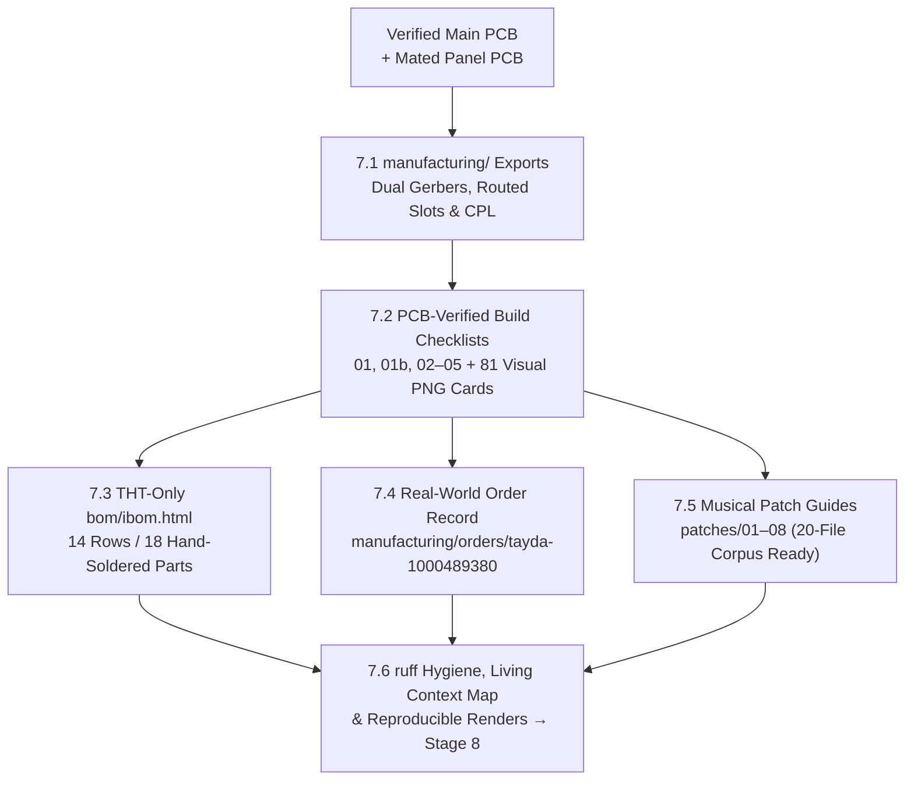

import Callout from '../../../components/Callout.astro';
import Figure from '../../../components/Figure.astro';
import FigureGrid from '../../../components/FigureGrid.astro';
import pcbaAlignmentU1Img from '../../../assets/images/checklists/pcba_alignment_U1.png';
import handAssemblyJPwrImg from '../../../assets/images/checklists/hand_assembly_J_PWR.png';
import boardBringupMapImg from '../../../assets/images/checklists/board_bringup_00_test_point_map.png';

Passing DRC and liking your 3D renders is not the finish line — manufacturing failures most often happen between "DRC passes" and "boxes arrive on the bench." A missing paste check, an unrouted NPTH slot, a rotated diode in the CPL preview, an out-of-stock timing capacitor substituted without updating bring-up math, or an unwashed high-impedance node around the slew capacitor can turn a clean layout into a rework weekend.

In Stage 7 — captured across **Session Traces** [`10-a47d447e` (`prompts/10-a47d447e-please-create-markdown-checklists-main-board-order.md`)](https://github.com/domesticmouse/EnvelopeFollower/blob/main/prompts/10-a47d447e-please-create-markdown-checklists-main-board-order.md), [`12-0e25fc0a` (`prompts/12-0e25fc0a-please-update-readme-md.md`)](https://github.com/domesticmouse/EnvelopeFollower/blob/main/prompts/12-0e25fc0a-please-update-readme-md.md), [`14-f42ac6f5` (`prompts/14-f42ac6f5-i-m-attempting-to-create-a-bom.md`)](https://github.com/domesticmouse/EnvelopeFollower/blob/main/prompts/14-f42ac6f5-i-m-attempting-to-create-a-bom.md), and [`16-cd7d0409` (`prompts/16-cd7d0409-i-d-like-to-design-a-front.md`)](https://github.com/domesticmouse/EnvelopeFollower/blob/main/prompts/16-cd7d0409-i-d-like-to-design-a-front.md), and extended in the `EnvelopeFollowerWithSkewLimiter` **Decision Trail** ([PR `#1`](https://github.com/domesticmouse/EnvelopeFollowerWithSkewLimiter/pull/1), [PR `#2`](https://github.com/domesticmouse/EnvelopeFollowerWithSkewLimiter/pull/2), and [PR `#28`](https://github.com/domesticmouse/EnvelopeFollowerWithSkewLimiter/pull/28)) — you export upload-ready fabrication archives for both boards, pair PCB-verified **Build Checklists** with `81` deterministic visual verification PNGs, generate a THT-only interactive assembly map, archive real-world vendor order substitutions, author `8` musical **Patch Guides**, and run `ruff` hygiene plus a **Living Context Map** sync before preparing the **Companion Site**.



---

## Step 7.1: Dual-Board `manufacturing/` Exports & Gerber/CPL Verification

Your finished `ENV / SKEW` module ships as **two separate JLCPCB items inside one shared cart**: a **2-layer FR-4 main board with Bottom-Side Economic PCBA** (`envelope_follower.kicad_pcb`, `30.0 × 108.0 mm`) and a **2-layer FR-4 bare front panel** (`envelope_follower_panel.kicad_pcb`, `30.0 × 128.5 mm`, Matte Black + ENIG). Generating both fabrication sets deterministically inside [`manufacturing/` in `EnvelopeFollowerWithSkewLimiter`](https://github.com/domesticmouse/EnvelopeFollowerWithSkewLimiter/tree/8ad81d0/manufacturing) prevents stale archives from accumulating ([Trace 16](https://github.com/domesticmouse/EnvelopeFollower/blob/main/prompts/16-cd7d0409-i-d-like-to-design-a-front.md)):

| Artifact Path | Contents | Purpose at Fabrication |
| :--- | :--- | :--- |
| `manufacturing/gerbers/` & `envelope_follower_gerbers.zip` | `F.Cu`, `B.Cu`, `F.Paste`, `B.Paste`, `F.SilkS`, `B.SilkS`, `F.Mask`, `B.Mask`, `Edge.Cuts`, separated `PTH`/`NPTH` Excellon + GerberX2 drill map | Main board PCB + bottom-side SMT stencil |
| `manufacturing/jlcpcb_cpl.csv` | `50` translated SMD rows (`Designator,Mid X,Mid Y,Layer,Rotation`, every row `Layer = B`) | JLCPCB Pick-and-Place alignment |
| `manufacturing/panel_gerbers/` & `envelope_follower_panel_gerbers.zip` | `F.Cu`, `B.Cu`, `F.SilkS`, `B.SilkS`, `F.Mask`, `B.Mask`, `Edge.Cuts`, separated `PTH`/`NPTH` Excellon with **routed oval slots** `H1`/`H2` | Bare Matte Black + ENIG 6 HP panel |

### Exporting Gerbers, Routed Excellon Slots & Translated CPL

After re-running clean DRC checks on both boards (`0` errors on main PCB; `0` non-library violations on panel PCB after filtering the `13` expected `lib_footprint_issues` warnings), export both fabrication packages with identical origin conventions (`--use-drill-file-origin` + `--drill-origin plot`):

```bash
# 1. Main board Gerbers & separated Excellon drills
mkdir -p manufacturing/gerbers
kicad-cli pcb export gerbers --output manufacturing/gerbers/ \
  --layers F.Cu,B.Cu,F.Paste,B.Paste,F.SilkS,B.SilkS,F.Mask,B.Mask,Edge.Cuts \
  --subtract-soldermask --use-drill-file-origin --check-zones \
  envelope_follower.kicad_pcb
kicad-cli pcb export drill --output manufacturing/gerbers/ \
  --format excellon --drill-origin plot --excellon-units mm \
  --excellon-separate-th --excellon-oval-format route \
  --generate-map --map-format gerberx2 \
  envelope_follower.kicad_pcb
(cd manufacturing/gerbers && zip -r ../envelope_follower_gerbers.zip .)

# 2. Back-side SMD CPL translated & parity-filtered against jlcpcb_bom.csv (50/50)
kicad-cli pcb export pos --format csv --units mm --side back --smd-only --exclude-dnp \
  --use-drill-file-origin --output /tmp/raw_cpl.csv envelope_follower.kicad_pcb
.venv/bin/python .agents/skills/bom/scripts/translate_bom_pnp.py pnp \
  /tmp/raw_cpl.csv -o manufacturing/jlcpcb_cpl.csv \
  --units mm --bom jlcpcb_bom.csv

# 3. Front panel Gerbers & routed M3 oval slots (no paste layers needed on bare panel)
mkdir -p manufacturing/panel_gerbers
kicad-cli pcb export gerbers --output manufacturing/panel_gerbers/ \
  --layers F.Cu,B.Cu,F.SilkS,B.SilkS,F.Mask,B.Mask,Edge.Cuts \
  --subtract-soldermask --use-drill-file-origin --check-zones \
  envelope_follower_panel.kicad_pcb
kicad-cli pcb export drill --output manufacturing/panel_gerbers/ \
  --format excellon --drill-origin plot --excellon-units mm \
  --excellon-separate-th --excellon-oval-format route \
  --generate-map --map-format gerberx2 \
  envelope_follower_panel.kicad_pcb
(cd manufacturing/panel_gerbers && zip -r ../envelope_follower_panel_gerbers.zip .)
```

Notice two critical KiCad 10 CLI flags here:

- **`--excellon-oval-format route` + `--excellon-separate-th`:** Exports the front panel's top and bottom M3 mounting slots (`H1`, `H2`, `5.50 × 3.20 mm`) as routed `G00 ... M15 / G01 ... M16` slot toolpaths inside `envelope_follower_panel-NPTH.drl` alongside the `3.20 mm` `LED1` NPTH bore, cleanly separated from `envelope_follower_panel-PTH.drl` (`10` grounded control cutouts).
- **`translate_bom_pnp.py pnp --bom jlcpcb_bom.csv`:** Rewrites KiCad's `Pos` columns into JLCPCB's exact `Designator,Mid X,Mid Y,Layer,Rotation` format while asserting `rows_out: 50`, `bom_designators: 50`, `filtered_orphans: 0`, and `set(Layer) == {"B"}`.

### Running `analyze_gerbers.py` & Understanding `B.Paste` Heuristic Parity

Verify both output directories with `.agents/skills/kicad/scripts/analyze_gerbers.py`:

```bash
.venv/bin/python .agents/skills/kicad/scripts/analyze_gerbers.py manufacturing/gerbers/ --full --output /tmp/main_gerbers.json
.venv/bin/python .agents/skills/kicad/scripts/analyze_gerbers.py manufacturing/panel_gerbers/ --full --output /tmp/panel_gerbers.json
```

When auditing `manufacturing/gerbers/`, automated Gerber analyzers sometimes emit a paste-coverage warning (`~37%` of all `B.Cu` features) if they compare total `B.Paste` flashes against *every* copper feature on `B.Cu` (including through-hole component pads and `133` vias). Do not blindly dismiss or blindly panic over that number — verify **SMD pad-to-paste parity** directly: across all `50` SMD parts (`47× 2-pin = 94` + `1× 3-pin D3 = 3` + `2× 14-pin U1/U2 = 28` = **`125` total SMD pads**), `B.Paste` contains **`125 / 125`** exact stencil flashes while `F.Paste` contains `0`.

<Callout type="warning" title="Upload `jlcpcb_bom.csv` — NEVER `envelope_follower_bom.xml`">

Always upload [`jlcpcb_bom.csv`](/EnvelopeFollower/stages/04-skidl-and-schematic/#step-43-anatomy-of-envelope_followerpy--multi-layer-netlist-verification) (`17` rows, `50` SMDs, `$9` total Extended feeder fees) paired with `manufacturing/jlcpcb_cpl.csv` and `manufacturing/envelope_follower_gerbers.zip`. `envelope_follower_bom.xml` is the master `80`-part KiCad/SKiDL database containing `18` Tayda/panel THT components and `12` DNP Keystone test points (`TP1`–`TP12`); uploading it forces expensive manual-soldering surcharges or bogus missing-part flags.

</Callout>

---

## Step 7.2: PCB-Verified Build Checklists (`checklists/`) & `81` Visual Cards

Rather than trusting hand-written lists typed from memory, generate all seven operational documents under [`checklists/` in `EnvelopeFollowerWithSkewLimiter`](https://github.com/domesticmouse/EnvelopeFollowerWithSkewLimiter/tree/8ad81d0/checklists) ([`checklists/README.md`](https://github.com/domesticmouse/EnvelopeFollowerWithSkewLimiter/blob/8ad81d0/checklists/README.md) plus `01`, `01b`, `02`–`05`) directly against `envelope_follower.kicad_pcb`, `envelope_follower_panel.kicad_pcb`, and `jlcpcb_bom.csv`. Builders can also step through interactive, persistent web **Build Checklists** on the [live `ENV / SKEW` Companion Site (`/build/`)](https://domesticmouse.github.io/EnvelopeFollowerWithSkewLimiter/build/). Enforce completeness with a KiCad Python assertion checking:

- `50 / 50` SMD RefDes, values, LCSC SKUs, and both `board=(X, Y)` and back-flipped `back=(30.0 - X, Y)` coordinates match `.kicad_pcb` (`0` mismatches).
- `18 / 18` populated THT designators (`C1`, `C2`, `C7`, `C11`–`C13`, `RV1`–`RV4`, `SW1`–`SW2`, `LED1`, `J1`–`J4`, `J_PWR`) appear explicitly in both the Tayda ordering **Build Checklist** (`03`) and hand-assembly **Build Checklist** (`04`).
- `12 / 12` Keystone test points (`TP1`–`TP12`) and their exact silkscreen names (`GND`, `+12V`, `-12V`, `PRE`, `RECT`, `ENV`, `INV`, `OUT`, `HWR`, `DRV`, `OFF`, `GND2`) appear in the bring-up **Build Checklist** (`05`).

### What Each Build Checklist Verifies

1. **[`01-main-board-ordering.md` in `EnvelopeFollowerWithSkewLimiter`](https://github.com/domesticmouse/EnvelopeFollowerWithSkewLimiter/blob/8ad81d0/checklists/01-main-board-ordering.md) — Main PCB & Economic Bottom-Side PCBA:**
   - Fabrication settings: `FR-4`, `2` layers, `30.0 × 108.0 mm`, `1.6 mm`, `Black` soldermask (note: Matte Black can force Standard PCBA pricing — keep standard Black on the hidden main board to preserve Economic PCBA), `White` silkscreen, **`LeadFree HASL (RoHS)`** or **`ENIG-RoHS`**, and **`Tented`** vias.
   - PCBA settings: **Bottom Side** only, **`SAC305` lead-free** solder, **Specify a location** for QR placement (`JLCJLCJLCJLC`) on the solid `5.0 × 5.0 mm` **`F.SilkS`** box at top-right (`X = 23.8–28.8 mm, Y = 1.0–6.0 mm`), and strictly **`3` Extended SKUs** (`$3`/SKU = `$9` feeder fees total): **`C2878713`** (`TL074HIDR` `×2`), **`C83935`** (`BAT54S` `×1`), and **`C95204`** (`10k 0.1%` `RT0603BRD0710KL` `×14`). Pre-order CLI steps stay marked `[x]`; interactive web/cart checks remain `[ ]`.
2. **[`01b-front-panel-ordering.md` in `EnvelopeFollowerWithSkewLimiter`](https://github.com/domesticmouse/EnvelopeFollowerWithSkewLimiter/blob/8ad81d0/checklists/01b-front-panel-ordering.md) — Mated 6 HP Front Panel (Same JLCPCB Cart):**
   - Fabrication settings: `FR-4`, `2` layers, `30.0 × 128.5 mm`, `1.6 mm` (or `2.0 mm`), **`Matte Black`** soldermask, **`White`** silkscreen, **`ENIG-RoHS`** surface finish (required so all `33` `F.Mask` openings gleam over `F.Cu`), `PCB Assembly = OFF`, and QR/order number placed exclusively on **`B.SilkS`** (`(22.50, 121.00)`) with a PCB remark forbidding any stamp on `F.SilkS`.
   - Combine in the same JLCPCB checkout cart as `envelope_follower_gerbers.zip` to share international shipping.
3. **[`02-pcba-part-alignment.md` in `EnvelopeFollowerWithSkewLimiter`](https://github.com/domesticmouse/EnvelopeFollowerWithSkewLimiter/blob/8ad81d0/checklists/02-pcba-part-alignment.md) — JLCPCB 2D/3D Viewer Sign-Off (Dual Coordinates):**
   - When staring straight at JLCPCB's **Bottom Side** viewer with top (`Y = 0`) up, horizontal coordinates mirror left-to-right (`back_X = 30.0 - board_X`). Printing **both** `back=(X, Y)` and `board=(X, Y)` on every one of the `50` items lets you inspect directly without mental mirroring.
   - Highlights the **"WATCH FOR JLCPCB ROTATION OFFSET"** table for all `7` polarized / multi-pin SMDs — expect to inspect (and rotate in JLCPCB's viewer if shifted by `90°`/`180°`):

   | Ref | Part / Package | LCSC | `jlcpcb_cpl.csv` Rot | Expected Visual Alignment in JLCPCB Bottom Viewer (`Y=0` Up) |
   | :--- | :--- | :---: | :---: | :--- |
   | **`U1`** | `TL074HIDR` (`SOIC-14`) | `C2878713` | `0.0°` | **Pin 1 bevel/dot at bottom-right** (`+12V` pin `4` upper side, `-12V` pin `11` lower side) |
   | **`U2`** | `TL074HIDR` (`SOIC-14`) | `C2878713` | `180.0°` | **Pin 1 bevel/dot at top-left** (`U2C`/`U2D` pins face output jacks & LED) |
   | **`D3`** | `BAT54S` (`SOT-23`) | `C83935` | `0.0°` | **2 pins on right (`D3.1` top-right, `D3.2` bottom-right), 1 common pin on left (`D3.3`)** |
   | **`D1`**, **`D2`** | `B5819W` (`SOD-123`) | `C8598` | `180.0°` | **Cathode band facing left** (vertical rail protection polarity) |
   | **`D4`** | `1N4148W` (`SOD-123`) | `C81598` | `0.0°` | **Cathode band facing right** (charges `NET_ATK_DIODE` toward `RV2`) |
   | **`D5`** | `1N4148W` (`SOD-123`) | `C81598` | `180.0°` | **Cathode band facing left** (discharges `NET_REL_DIODE` toward `RV3`) |

4. **[`03-tayda-ordering.md` in `EnvelopeFollowerWithSkewLimiter`](https://github.com/domesticmouse/EnvelopeFollowerWithSkewLimiter/blob/8ad81d0/checklists/03-tayda-ordering.md) — Canonical `18`-Part THT Shopping Template & Knob Constraint:**
   - Lists explicit RefDes alongside verified Tayda SKUs (`A-1855` `A100K` `RV1`, `A-1672` `2× A1M` `RV2`/`RV3`, `A-8401` `B10K` center-detent `RV4`, `A-6087` `2× Dailywell 2MS1` `SW1`/`SW2`, `A-1076` `3 mm` anti-parallel Red/Green `LED1`, `A-7257` `2× 47 µF / 35 V` `C1`/`C2`, `4× WIMA MKS2` `5.0 mm` box film caps [`2× 470 nF` `C7`/`C11`, `2× 2.2 µF` `C12`/`C13`], `4× WQP-PJ398SM` jacks `J1`–`J4`, and `1× 2×5` shrouded `2.54 mm` Eurorack power header `J_PWR`).
   - Enforces the **`15.50 mm` pot pitch geometry guard**: because `RV1`–`RV4` shafts sit `15.50 mm` apart vertically (`Y = 11.0, 26.5, 42.0, 57.5 mm` on PCB), select knobs with outer skirt diameter **`<= 14.0 mm`** and verify shaft style against Tayda (`T18` splined vs round/D) before checkout. Keep this file untouched as your reusable baseline template; record batch-specific purchases and substitutions separately in Step 7.4.
5. **[`04-hand-assembly.md` in `EnvelopeFollowerWithSkewLimiter`](https://github.com/domesticmouse/EnvelopeFollowerWithSkewLimiter/blob/8ad81d0/checklists/04-hand-assembly.md) — THT Build Sequence (`ibom.html` + Matte Black Panel Hygiene):**
   - Links directly to `bom/ibom.html` (and the hosted [interactive BOM on the `ENV / SKEW` Companion Site](https://domesticmouse.github.io/EnvelopeFollowerWithSkewLimiter/bom/ibom.html)) for visual click-to-highlight placement.
   - **Solder `B.Cu` parts first** (`J_PWR` notch toward right board edge / `-12V` white bar on `B.SilkS`, **`C1`/`C2` opposite polarities** — `C1` `+` -> `+12V`, `C2` `+` -> `GND`, then `C7`, `C11`–`C13`) and trim leads flush on `F.Cu` so nothing shorts against the metal panel shells or PCB standoffs.
   - **Test `LED1` (`A-1076`) before soldering:** Connect `5 V + 1 kΩ` across its two pins to identify which lead lights Green vs Red so positive envelope (`+OUT`) glows Green and negative offset/inverted swing glows Red consistently with `+ / -` panel marks.
   - **Dry-fit panel hardware cleanly:** Snap off Alpha potentiometer anti-rotation tabs (`envelope_follower_panel.kicad_pcb` intentionally omits tab holes to keep the matte black face unblemished), seat `RV1`–`RV4`, `SW1`–`SW2`, `J1`–`J4`, and `LED1` hand-tight into the panel using **nylon M3 mounting washers** on the front screw slots `H1`/`H2`, verify square alignment, then solder all `11` panel controls.
   - **Clean high-impedance nodes with IPA:** Thoroughly flush flux around `U2A.3`, `C11`, `C12`, `C13`, and `SW2` using isopropyl alcohol so surface leakage cannot skew slow `3.0 s` release times (`RV2`/`RV3` up to `1 MΩ`). Confirm toggle states: `SW1` UP = `SMOOTH` / DOWN = `RAW`, `SW2` UP = `SLOW` / DOWN = `FAST`.
6. **[`05-board-bringup.md` in `EnvelopeFollowerWithSkewLimiter`](https://github.com/domesticmouse/EnvelopeFollowerWithSkewLimiter/blob/8ad81d0/checklists/05-board-bringup.md) — Bench Bring-Up, `12`-TP Map & Musical Testing:**
   - Perform cold ohmmeter rail-to-rail and rail-to-GND checks before applying power, set bench supplies to `±12.0 V` current-limited at **`40–50 mA`**, and initialize **`SW1` DOWN (`RAW/OFF`)**, **`SW2` DOWN (`FAST`)**, and `RV4` at center detent.
   - Verify every DC and AC signal stage across all `12` test points (`TP1` `GND`, `TP2` `+12V` `~+11.5–11.8 V`, `TP3` `-12V` `~-11.5–11.8 V`, `TP4` `PRE` `×2` preamp, `TP9` `HWR`, `TP5` `RECT` `|preamp|`, `TP10` `DRV`, `TP6` `ENV`, `TP11` `OFF` `±4.98 V`, `TP7` `INV`, `TP8` `OUT`, `TP12` `GND2`), test normalled breakout behavior on `J2` (`SLEW IN` breaks normalization from internal FWR), run kick-ducking patches on `J4` (`INV OUT`), and follow decision-tree troubleshooting steps if any rail or stage deviates.

### Deterministic Visual Verification Cards (`81` PNGs via KiCad + Cairo)

Coordinates and text tables still leave room for human orientation mistakes at 2 AM in JLCPCB's viewer or on the soldering bench. Following the initial `4a02c46` release, three deterministic Python scripts (culminating in [PR `#1` in `EnvelopeFollowerWithSkewLimiter`](https://github.com/domesticmouse/EnvelopeFollowerWithSkewLimiter/pull/1)) render `envelope_follower.kicad_pcb` via `kicad-cli pcb render` and composite rulered crops, board mini-maps, polarity callouts, and probe overlays with **Cairo** (`pycairo`):

| Generator Script (`8ad81d0`) | Output Directory | Count | What It Hides vs. Shows |
| :--- | :--- | :---: | :--- |
| [`checklists/generate_pcba_alignment_images.py`](https://github.com/domesticmouse/EnvelopeFollowerWithSkewLimiter/blob/8ad81d0/checklists/generate_pcba_alignment_images.py) | `images/pcba_alignment/` | **`51`** | Bottom (`B.Cu`) 3D render with SMD 3D bodies enabled and THT/DNP bodies hidden (`board_overview.png` + `50` `620 × 412 px` SMD alignment cards for `02-pcba-part-alignment.md`) |
| [`checklists/generate_hand_assembly_images.py`](https://github.com/domesticmouse/EnvelopeFollowerWithSkewLimiter/blob/8ad81d0/checklists/generate_hand_assembly_images.py) | `images/hand_assembly/` | **`21`** | `B.Cu` & `F.Cu` renders with SMDs (`insert`) visible and THT/DNP bodies hidden so plated holes and silkscreen polarity stay unobstructed (`3` overviews + `18` `Manual THT` cards for `04-hand-assembly.md`) |
| [`checklists/generate_bringup_images.py`](https://github.com/domesticmouse/EnvelopeFollowerWithSkewLimiter/blob/8ad81d0/checklists/generate_bringup_images.py) | `images/board_bringup/` | **`9`** | `B.Cu` render with SMDs + `7` `B.Cu` THT parts visible and DNP `TP1`–`TP12` bodies hidden, plus bare `F.Cu` control view (`00_test_point_map.png`–`08_troubleshooting_hotspots.png` for `05-board-bringup.md`) |

Together, **`51 + 21 + 9 = 81` annotated PNGs** turn every checklist step into an unmistakable visual check (embedded directly in the repository **Build Checklists** and as lightbox-zoomable images on the live **Companion Site**):

<FigureGrid cols={2}>
  <Figure
    src={pcbaAlignmentU1Img}
    alt="PCBA Alignment Card for U1 SOIC-14 TL074HIDR"
    caption="PCBA Alignment Card (U1 SOIC-14)"
    framed={true}
  />
  <Figure
    src={handAssemblyJPwrImg}
    alt="Hand Assembly Card for J_PWR 2x5 Eurorack Header"
    caption="Hand Assembly Card (J_PWR 2×5 Header)"
    framed={true}
  />
</FigureGrid>

<Figure
  src={boardBringupMapImg}
  alt="Board Bring-Up Test Point Map TP1 through TP12 on B.Cu"
  framed={true}
  maxWidth={520}
/>

---

## Step 7.3: Generating the THT-Only Interactive HTML BOM (`bom/ibom.html`)

JLCPCB handles all `50` rear SMDs automatically, so using an unfiltered KiCad interactive BOM during hand assembly clutters the table with resistors and `0603` capacitors you will never touch with an iron. Using **`InteractiveHtmlBom` (`v2.11.1+`)** inside KiCad PCB Editor ([Trace 14](https://github.com/domesticmouse/EnvelopeFollower/blob/main/prompts/14-f42ac6f5-i-m-attempting-to-create-a-bom.md)), filter the HTML output strictly to the `18` manually soldered parts by reading the `JLCPCB_Class` footprint field embedded by `generate_kicad_pcb.py`:

- Open `envelope_follower.kicad_pcb` in KiCad PCB Editor -> launch **Generate Interactive HTML BOM**.
- **General / Html** tabs: output to `bom/ibom.html`, default to **F** (or Front & Back) view showing silkscreen, fabrication, and pads.
- **Fields** tab:
  - Set **Board variant field** = `JLCPCB_Class`.
  - Set **Variants whitelist** = `Manual THT`.
  - Include extra columns: **`Value`**, **`Footprint`**, **`MPN`**, and **`Manufacturer`**.
- **Output scope check:** Inspect the generated [`bom/ibom.html` in `EnvelopeFollowerWithSkewLimiter`](https://github.com/domesticmouse/EnvelopeFollowerWithSkewLimiter/blob/8ad81d0/bom/ibom.html) header/BOM table and confirm **`14` grouped rows covering `18` THT components** (`11` `F.Cu` panel controls + `7` `B.Cu` components), with `0` SMDs, `0` DNP `TP1`–`TP12`, and `0` `FID1`–`FID3`. Link `../bom/ibom.html` inside [`checklists/04-hand-assembly.md` in `EnvelopeFollowerWithSkewLimiter`](https://github.com/domesticmouse/EnvelopeFollowerWithSkewLimiter/blob/8ad81d0/checklists/04-hand-assembly.md), and try the hosted interactive map directly via [`bom/ibom.html` on the live `ENV / SKEW` Companion Site](https://domesticmouse.github.io/EnvelopeFollowerWithSkewLimiter/bom/ibom.html).

---

## Step 7.4: Recording Real-World Parts Orders & Substitutions (`manufacturing/orders/`)

A real vendor checkout almost never matches your ideal BOM one-to-one: box film capacitors go out of stock, lead-pitch options differ, and you already have jacks or IDC headers in your bench bins. When [PR `#28` in `EnvelopeFollowerWithSkewLimiter`](https://github.com/domesticmouse/EnvelopeFollowerWithSkewLimiter/pull/28) archived a `5`-board Tayda Electronics build order, it introduced a clean separation rule:

- **Keep canonical [`checklists/03-tayda-ordering.md`](https://github.com/domesticmouse/EnvelopeFollowerWithSkewLimiter/blob/8ad81d0/checklists/03-tayda-ordering.md) untouched** as a reusable baseline shopping template for future builders.
- **Log each concrete batch purchase under `manufacturing/orders/`** — pairing a human-readable engineering record ([`manufacturing/orders/tayda-1000489380.md`](https://github.com/domesticmouse/EnvelopeFollowerWithSkewLimiter/blob/8ad81d0/manufacturing/orders/tayda-1000489380.md)) with the verbatim 4-column quick-order cart import ([`manufacturing/orders/tayda-1000489380.tsv`](https://github.com/domesticmouse/EnvelopeFollowerWithSkewLimiter/blob/8ad81d0/manufacturing/orders/tayda-1000489380.tsv), `9` SKUs), own-stock allocations (`J1`–`J4` Thonkiconn jacks, `J_PWR` `2×5` headers, Eurorack ribbon cables, M3 mounting screws), and non-Tayda items (JLCPCB front panels, omitted optional `TP1`–`TP12` test loops).

Recording the exact substitutions in `manufacturing/orders/tayda-1000489380.md` preserves critical mechanical and bench bring-up traceability:

1. **Straight-lead electrolytics (`C1` / `C2` → `A-6764`):** Selected **`A-6764`** (`47 µF / 35 V`, `5 × 11 mm`, `2.0 ± 0.5 mm` straight leads) over `A-7257` (`6.3 × 11 mm`, `5.0 mm` pre-formed leads) so both rail decoupling capacitors seat flush into the `2.50 mm` PCB footprint without bending leads.
2. **Out-of-stock timing capacitor substitution (`C12` / `C13` → `A-6940`) & `SLOW` bring-up math:** Because Tayda's `2.2 µF` and `4.7 µF` WIMA MKS2 SKUs (`A-5753`, `A-5786`, `A-5695`) were out of stock, the order substituted **`A-6940`** (KEMET R82 `1.5 µF / 63 V 5%` box film, `5.0 mm` pitch). Logging that change updates total `SLOW` timing capacitance (`C11 + C12 + C13`) from `4.87 µF` to **`3.47 µF`** (`~7.4×` over `FAST`), shifting expected [`checklists/05-board-bringup.md`](https://github.com/domesticmouse/EnvelopeFollowerWithSkewLimiter/blob/8ad81d0/checklists/05-board-bringup.md) `SLOW` times from `~3.0 s` rise / `~1.84 s` fall (CW) to **`~2.13 s` rise / `~1.31 s` fall** (and `~2.1 ms` / `~1.3 ms` at CCW) so bench measurements match the real soldered components.
3. **Pot shaft & Davies 1900H knob verification (`A-4559`):** Verified that all four ordered pots (`A-1855`, `A-1672`, `A-8401`) use `6.35 mm` smooth round shafts (`15R1`) matching **`A-4559`** (`12.7 mm` OD Davies 1900H clone knobs with set screws), preserving `2.8 mm` of clearance on the `15.50 mm` vertical pot pitch.

---

## Step 7.5: Authoring the `8` Musical Patch Guides (`patches/`)

Once your boards pass [`checklists/05-board-bringup.md`](https://github.com/domesticmouse/EnvelopeFollowerWithSkewLimiter/blob/8ad81d0/checklists/05-board-bringup.md), document how the finished instrument plays in a Eurorack system. Under [`patches/` in `EnvelopeFollowerWithSkewLimiter`](https://github.com/domesticmouse/EnvelopeFollowerWithSkewLimiter/tree/8ad81d0/patches) (initially drafted under `effects/` in commit [`15287c0`](https://github.com/domesticmouse/EnvelopeFollowerWithSkewLimiter/commit/15287c0) and renamed to `patches/` in [`dd6c559`](https://github.com/domesticmouse/EnvelopeFollowerWithSkewLimiter/commit/dd6c559) so directory paths, headings, and **Patch Guide** terminology converged cleanly), [`patches/README.md`](https://github.com/domesticmouse/EnvelopeFollowerWithSkewLimiter/blob/8ad81d0/patches/README.md) plus `8` standalone **Patch Guides** cover both operating modes — and power the interactive Studio Rack workbench at [`/patches/` on the live `ENV / SKEW` Companion Site](https://domesticmouse.github.io/EnvelopeFollowerWithSkewLimiter/patches/):

| Mode | Patch Guides (`8ad81d0`) | Musical Applications |
| :--- | :--- | :--- |
| **Envelope Follower Mode** (`IN` patched, `SLEW IN` unpatched) | [`01-sidechain-ducking.md`](https://github.com/domesticmouse/EnvelopeFollowerWithSkewLimiter/blob/8ad81d0/patches/01-sidechain-ducking.md), [`02-auto-wah-envelope-filter.md`](https://github.com/domesticmouse/EnvelopeFollowerWithSkewLimiter/blob/8ad81d0/patches/02-auto-wah-envelope-filter.md), [`03-compression-expansion-gating.md`](https://github.com/domesticmouse/EnvelopeFollowerWithSkewLimiter/blob/8ad81d0/patches/03-compression-expansion-gating.md), [`04-ducking-and-blooming-fx.md`](https://github.com/domesticmouse/EnvelopeFollowerWithSkewLimiter/blob/8ad81d0/patches/04-ducking-and-blooming-fx.md), [`05-cross-modulation-push-pull.md`](https://github.com/domesticmouse/EnvelopeFollowerWithSkewLimiter/blob/8ad81d0/patches/05-cross-modulation-push-pull.md) | Techno kick ducking, funk auto-wah, opto-style compression/gating, blooming reverb swells, push-pull stereo panning |
| **Asymmetric Skew Limiter Mode** (`SLEW IN` patched) | [`06-audio-rate-slew-waveshaping.md`](https://github.com/domesticmouse/EnvelopeFollowerWithSkewLimiter/blob/8ad81d0/patches/06-audio-rate-slew-waveshaping.md), [`07-asymmetric-portamento-slides.md`](https://github.com/domesticmouse/EnvelopeFollowerWithSkewLimiter/blob/8ad81d0/patches/07-asymmetric-portamento-slides.md), [`08-gate-to-ar-envelope-and-slewed-mod.md`](https://github.com/domesticmouse/EnvelopeFollowerWithSkewLimiter/blob/8ad81d0/patches/08-gate-to-ar-envelope-and-slewed-mod.md) | Audio-rate nonlinear LPF & harmonic fuzz, asymmetric 303-style portamento slides, linear AR/ASR envelopes & smoothed S&H |

Adding these `9` files (`patches/README.md` + `01`–`08`) alongside the `4` **Reference Specs** (`DesignSpec.md`, `EnvelopeFollower.md`, `EnvelopeFollowerImprovements.md`, `panel_svg_spec.md`) and `7` **Build Checklists** (`checklists/README.md`, `01`, `01b`, `02`–`05`) completes the **`20`-file single-source Markdown corpus** that Stages 8 and 9 ingest directly into the **Companion Site** without duplicating content.

---

## Step 7.6: Python `ruff` Hygiene, Living Context Map Sync & Reproducible `images/` Renders

Before handing the hardware repository over to **Companion Site** planning, run three final housekeeping passes ([Trace 12](https://github.com/domesticmouse/EnvelopeFollower/blob/main/prompts/12-0e25fc0a-please-update-readme-md.md), [Trace 16](https://github.com/domesticmouse/EnvelopeFollower/blob/main/prompts/16-cd7d0409-i-d-like-to-design-a-front.md), and [PR `#2`](https://github.com/domesticmouse/EnvelopeFollowerWithSkewLimiter/pull/2)).

### Python `ruff` Lint & Format (`DTZ011` Timezone-Aware Date Fix)

The three checklist generators (`generate_pcba_alignment_images.py`, `generate_hand_assembly_images.py`, `generate_bringup_images.py`) and `generate_schematic.py` total thousands of lines of CAD automation. In [PR `#2` in `EnvelopeFollowerWithSkewLimiter`](https://github.com/domesticmouse/EnvelopeFollowerWithSkewLimiter/pull/2), running `ruff check` and `ruff format` across all non-skill Python scripts caught:

- **`DTZ011` in [`generate_schematic.py`](https://github.com/domesticmouse/EnvelopeFollowerWithSkewLimiter/blob/8ad81d0/generate_schematic.py):** Replaced naive `datetime.date.today()` in the A3 title-block date stamp with timezone-aware UTC-to-local conversion (`datetime.datetime.now(tz=datetime.timezone.utc).astimezone().date().isoformat()`).
- **Type-import & cleanup hygiene:** Moved `Callable` imports to `collections.abc`, removed unused variables and unpacks, and dropped redundant `int()` wrappers around `math.floor`, `math.ceil`, and `round`.

### **Living Context Map** Sync (Foreshadowing Stage 9's **Repository Front Door**)

Update root `README.md` as a **Living Context Map** so its quick-start CLI flags (`--silk-only`, `--sync-silk`, `--check-silk`, `--show-silk`, `--auto-silk`), `/edit-silkscreen` workflow, `panel_art/`, `manufacturing/` (including `orders/`), `bom/ibom.html`, `checklists/`, `patches/`, and `images/` (`86` files: `5` module renders + `81` checklist PNGs) mirror what is actually on disk for upcoming agent sessions.

Keep that comprehensive **Living Context Map** alive while hardware and planning work are active. Once the dedicated **`ENV / SKEW` Companion Site** goes live in Stage 9, you will slim that `195`-line hardware index down into a compact `123`-line **Repository Front Door** ([`README.md` @ `8ad81d0`](https://github.com/domesticmouse/EnvelopeFollowerWithSkewLimiter/blob/8ad81d0/README.md)) that orients visitors and points straight to the published site.

### Reproducible `images/` Export, Cropping & Link Audit

Generate uniform, tight-cropped renders for both the main PCB and mated Matte Black + ENIG panel directly from the command line:

```bash
mkdir -p images
# 1. Schematic preview (rasterize KiCad PDF at max edge 2400 px on macOS)
sips -s format png -Z 2400 envelope_follower.pdf --out images/schematic.png

# 2. High-quality raytraced 3D renders with transparent backgrounds
kicad-cli pcb render --side top --width 900 --height 2400 --background transparent --quality high \
  --output images/pcb_front.png envelope_follower.kicad_pcb
kicad-cli pcb render --side bottom --width 900 --height 2400 --background transparent --quality high \
  --output images/pcb_back.png envelope_follower.kicad_pcb
kicad-cli pcb render --side top --width 900 --height 2400 --background transparent --quality high \
  --output images/panel_front.png envelope_follower_panel.kicad_pcb
kicad-cli pcb render --side bottom --width 900 --height 2400 --background transparent --quality high \
  --output images/panel_back.png envelope_follower_panel.kicad_pcb
```

<Callout type="note" title="Headless `kicad-cli pcb render` displays bare boards unless 3D models resolve">

If 3D STEP/WRL libraries are not installed or mapped under `KICAD10_3DMODEL_DIR`, headless `kicad-cli pcb render` renders the bare copper, soldermask, silkscreen, and plated pads cleanly without throwing errors — which is ideal for inspecting silkscreen readability, ENIG finish color, and pad geometry.

</Callout>

Normalize pairs (`pcb_front.png`/`pcb_back.png` and `panel_front.png`/`panel_back.png`) onto matching canvases using Pillow `getbbox()` with `16 px` padding and `optimize=True` so side-by-side comparison tables align edge-for-edge, and always run a quick Python check verifying zero dead relative Markdown links or `` attributes before pushing:

```python
import pathlib, re

text = pathlib.Path("README.md").read_text(encoding="utf-8")
targets = [m.group(1) for m in re.finditer(r"\[[^\]]*\]\(([^)]+)\)", text)]
targets += [m.group(1) for m in re.finditer(r'(?:src|href)="([^"]+)"', text)]
missing = [
    t for t in targets
    if not t.startswith(("http://", "https://", "#"))
    and not pathlib.Path(t.split("#", 1)[0]).exists()
]
assert not missing, f"Broken local links in README.md: {missing}"
```

---

## Pitfalls Caught in Stage 7

| Pitfall Discovered | Symptom | Fix Applied |
| :--- | :--- | :--- |
| **Default Excellon ovals without `route`** | JLCPCB flags `H1`/`H2` M3 oval NPTH slots or converts them to round drills | Pass `--drill-origin plot --excellon-separate-th --excellon-oval-format route` on both boards |
| **Raw `B.Paste` coverage heuristic (`~37%`)** | Static Gerber analyzer warns on paste-to-copper ratio when comparing paste against `133` vias + THT pads | Verify exact **`125 / 125`** paste-flash parity against the `50` SMD footprints (`0` on `F.Paste`) |
| **Uploading `envelope_follower_bom.xml`** | JLCPCB tries to source THT jacks/pots/film caps and DNP Keystone test points (`TP1`–`TP12`) | Upload `jlcpcb_bom.csv` (`17` rows, `50` SMDs, `3` Extended SKUs) paired with `manufacturing/jlcpcb_cpl.csv` |
| **Mentally flipping `B.Cu` viewer coordinates** | Misreading left/right cathode bands (`D1`–`D5`) or Pin 1 (`U1`/`U2`) in JLCPCB's bottom viewer | Print both `board=(X, Y)` and mirrored `back=(30.0 - X, Y)` coordinates in `02-pcba-part-alignment.md` and pair them with the `51` `pcba_alignment` PNGs |
| **Oversized knobs on `15.50 mm` pot spacing** | Skirted knobs wider than `14.0 mm` rub against neighbors on `RV1`–`RV4` | Cap knob outer skirt at `<= 14.0 mm` in `03-tayda-ordering.md`, snap off Alpha pot anti-rotation tabs, and verify round-shaft match (`A-4559` `12.7 mm` OD) |
| **Mutating canonical `03-tayda-ordering.md` on stock-outs** | Future builders inherit batch-specific capacitor substitutions or misread expected `SLOW` bring-up times | Keep `checklists/03-tayda-ordering.md` untouched and log order substitutions (`A-6764`, `A-6940` `3.47 µF` → `~2.13 s` rise / `~1.31 s` fall) in `manufacturing/orders/` |
| **Unwashed flux around slow-mode nodes** | `SLOW` release sags prematurely when flux leakage shunts `1 MΩ` (`RV2`/`RV3`) | Scrub `U2A.3`, `C11`–`C13`, and `SW2` thoroughly with IPA during hand assembly |
| **Naive `datetime.date.today()` & broken post-rename links** | `ruff` flags `DTZ011` in `generate_schematic.py`, or `README.md` points to `effects/` after renaming to `patches/` | Use UTC-aware `.astimezone().date()`, run `ruff check` / `ruff format`, and audit local Markdown/HTML targets before committing |

---

## Next: Planning the Companion Site (Stage 8) & Tutorial Appendix

Your hardware design is now fabrication-ready, visually documented across `81` **Build Checklist** renders, backed by real-world vendor order logs, and paired with `8` musical **Patch Guides** — completing the `20`-file Markdown corpus. Next, in **[Stage 8: Planning the Companion Site with `/wayfinder`](/EnvelopeFollower/stages/08-wayfinder-site-planning/)**, you shift from hardware CAD into software/site planning: layering `mattpocock/skills` atop your hardware skills and running a structured `/wayfinder` planning arc (from one seed **Prompt Block** through parallel research, HITL grilling, `GLOSSARY.md`, ADR `0001`, throwaway UI prototypes, and an implementation spec) before building and shipping the live **`ENV / SKEW` Companion Site** in Stage 9.

You can also consult the **Tutorial Appendix** at any time:

- **[Netlist, BOM & Silkscreen Schedule](/EnvelopeFollower/appendix/netlist-and-bom/)** — Complete `80`-component (`+ 3` fiducials) BOM, verbatim `17`-row `jlcpcb_bom.csv`, all `48` active nets, `9`-section schematic capture checklist, and full `silk_layout.json` schedule.
- **[Engineering Sign-Off Checklist](/EnvelopeFollower/appendix/engineering-sign-off-checklist/)** — Printable end-to-end summary tying engineering phases directly to the `EnvelopeFollowerWithSkewLimiter` repository deliverables.
