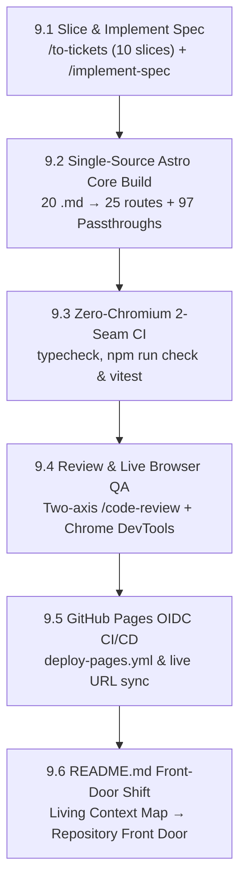
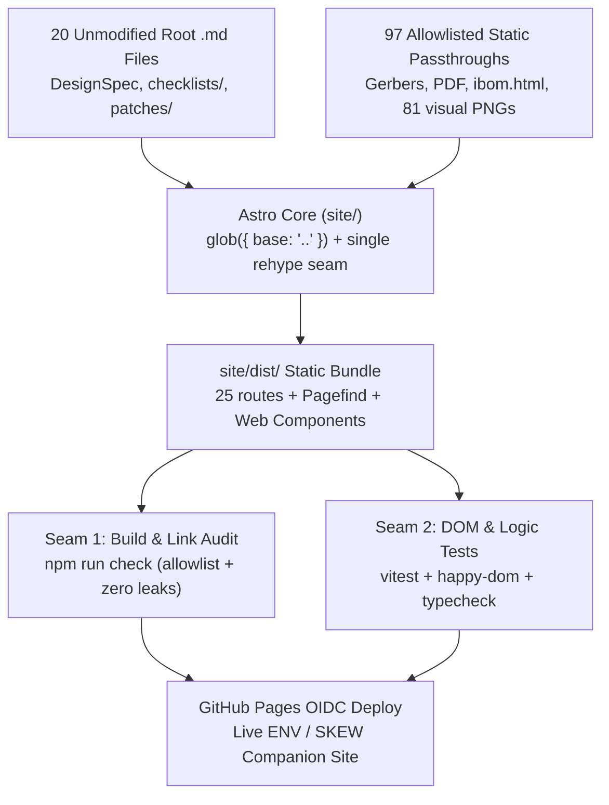

import Callout from '../../../components/Callout.astro';
import Figure from '../../../components/Figure.astro';
import patchWorkbenchImg from '../../../assets/images/site/patch-workbench.webp';
import hardwarePanelInspectorImg from '../../../assets/images/site/hardware-panel-inspector.webp';
import landingShowcaseImg from '../../../assets/images/site/landing-showcase.webp';

In Stage 8, `/wayfinder` turned an open-ended website request into a decision-complete specification ([ENV / SKEW GitHub Pages Site & README Overhaul — Implementation Specification](https://github.com/domesticmouse/EnvelopeFollowerWithSkewLimiter/issues/17)) grounded in `GLOSSARY.md`, [ADR `0001`](https://github.com/domesticmouse/EnvelopeFollowerWithSkewLimiter/blob/8ad81d0/docs/adr/0001-astro-core-single-source-site.md), two research reports, and two throwaway UI prototype branches.

Stage 9 walks through the repeatable delivery loop that turned Spec `#17` into the live [`ENV / SKEW` Companion Site](https://domesticmouse.github.io/EnvelopeFollowerWithSkewLimiter/) without duplicating hardware files, installing Chromium in CI, or leaving `README.md` stuck in its mid-build state:



Unlike Stages 1–5 and Step 8.2, Stage 9 uses short inline slash commands (`/to-tickets`, `/implement-spec`, `/code-review`) paired with the public GitHub **Decision Trail** rather than standalone **Prompt Blocks**, and focuses on architectural contracts rather than line-by-line Astro or TypeScript code.

---

## Step 9.1: Slicing Spec `#17` with `/to-tickets` & Shipping via `/implement-spec`

Handing a 25-route site specification to one mega-session invites context drift and half-wired features. Instead, invoke `/to-tickets` against [Spec `#17`](https://github.com/domesticmouse/EnvelopeFollowerWithSkewLimiter/issues/17) to carve the work into **vertical tracer-bullet slices** (`ready-for-agent`) wired with native `blocked_by` dependencies — where every slice ships end-to-end (data, templates, styles, and tests) rather than horizontal layers:

| Slice Ticket | Landed In | Vertical Scope Delivered |
| :--- | :---: | :--- |
| [Site foundation, dark-studio design system, Static Passthrough, and Landing Showcase (/)](https://github.com/domesticmouse/EnvelopeFollowerWithSkewLimiter/issues/18) | [PR `#29`](https://github.com/domesticmouse/EnvelopeFollowerWithSkewLimiter/pull/29) | `site/` Astro Core scaffold, dark-studio tokens, self-hosted fonts, **Static Passthrough** integration, `/` **Curated Page** |
| [Single-source Markdown pipeline, rehype transform module, and Reference Specs (/specs/ & /specs/*)](https://github.com/domesticmouse/EnvelopeFollowerWithSkewLimiter/issues/19) | [PR `#30`](https://github.com/domesticmouse/EnvelopeFollowerWithSkewLimiter/pull/30) | `20`-file `glob()` content loader, `rehype-single-source.ts`, KaTeX + lazy Mermaid, `/specs/` & `4` **Reference Specs** |
| [Interactive `<env-skew-panel>` visualizer, patch-state sidecar, and /patches/ Studio Rack Hub](https://github.com/domesticmouse/EnvelopeFollowerWithSkewLimiter/issues/20) | [PR `#31`](https://github.com/domesticmouse/EnvelopeFollowerWithSkewLimiter/pull/31) | `<env-skew-panel>` Web Component, typed `patch-states.ts` sidecar, `/patches/` hub |
| [Individual Patch Guide workbench pages (/patches/01–08)](https://github.com/domesticmouse/EnvelopeFollowerWithSkewLimiter/issues/21) | [PR `#31`](https://github.com/domesticmouse/EnvelopeFollowerWithSkewLimiter/pull/31) | `8` **Patch Guide** workbench routes with `A/B` `tablist` and bidirectional `data-control` sync |
| [Hardware Showcase (/hardware/ #overview, #schematic, #pcb) and unified `<zoom-pan-viewer>`](https://github.com/domesticmouse/EnvelopeFollowerWithSkewLimiter/issues/22) | [PR `#31`](https://github.com/domesticmouse/EnvelopeFollowerWithSkewLimiter/pull/31) | Unified `<zoom-pan-viewer>` dialog/stage and `/hardware/` `#overview`, `#schematic`, `#pcb` |
| [Interactive Front-Panel Layer Inspector (/hardware/#panel)](https://github.com/domesticmouse/EnvelopeFollowerWithSkewLimiter/issues/23) | [PR `#31`](https://github.com/domesticmouse/EnvelopeFollowerWithSkewLimiter/pull/31) | `<panel-layer-inspector>` 3-tab viewer with 4 vector toggles and `panel_svg_spec.md` §8 keepout overlay |
| [Interactive Build Checklists (/build/ and /build/01–05) with persistence, lightboxes, and hosted iBOM](https://github.com/domesticmouse/EnvelopeFollowerWithSkewLimiter/issues/24) | [PR `#31`](https://github.com/domesticmouse/EnvelopeFollowerWithSkewLimiter/pull/31) | Persistent `211`-item `/build/` + `6` **Build Checklists**, `81` PNG lightboxes, JLCPCB strips, `bom/ibom.html` card |
| [Origin Story (/origin/) and Fabrication Downloads Hub (/downloads/)](https://github.com/domesticmouse/EnvelopeFollowerWithSkewLimiter/issues/25) | [PR `#31`](https://github.com/domesticmouse/EnvelopeFollowerWithSkewLimiter/pull/31) | Three-chapter `/origin/` provenance page (`HAGIWO No. 43` → `ENV / SKEW`) and grouped `/downloads/` hub |
| [Site-wide Pagefind Search (⌘K), full 25-route contract gate, and browser verification](https://github.com/domesticmouse/EnvelopeFollowerWithSkewLimiter/issues/26) | [PR `#31`](https://github.com/domesticmouse/EnvelopeFollowerWithSkewLimiter/pull/31) | Pagefind `⌘K` `<dialog>` modal and full `25`-route `npm run check` contract verification |
| [Root README.md overhaul and GitHub Pages CI/CD workflow](https://github.com/domesticmouse/EnvelopeFollowerWithSkewLimiter/issues/27) | [PR `#31`](https://github.com/domesticmouse/EnvelopeFollowerWithSkewLimiter/pull/31) | Root `README.md` **Repository Front Door** shift, `.github/workflows/deploy-pages.yml`, and README link checks |

In each implementation session, `/implement-spec` reads [`GLOSSARY.md`](https://github.com/domesticmouse/EnvelopeFollowerWithSkewLimiter/blob/8ad81d0/GLOSSARY.md) and [`docs/adr/0001-astro-core-single-source-site.md`](https://github.com/domesticmouse/EnvelopeFollowerWithSkewLimiter/blob/8ad81d0/docs/adr/0001-astro-core-single-source-site.md), picks the next unblocked slice, runs red-green-refactor `tdd` at the agreed seams, and commits cleanly. Foundation slices (`#18`, `#19`) shipped via standalone PRs ([PR `#29`](https://github.com/domesticmouse/EnvelopeFollowerWithSkewLimiter/pull/29), [PR `#30`](https://github.com/domesticmouse/EnvelopeFollowerWithSkewLimiter/pull/30)), while slices `#20`–`#27` landed sequentially commit-by-commit in [PR `#31`](https://github.com/domesticmouse/EnvelopeFollowerWithSkewLimiter/pull/31).

---

## Step 9.2: Single-Source Astro Core Architecture in `site/`

The central architectural constraint from [ADR `0001`](https://github.com/domesticmouse/EnvelopeFollowerWithSkewLimiter/blob/8ad81d0/docs/adr/0001-astro-core-single-source-site.md) is **zero source duplication**: all `20` root hardware Markdown files (`DesignSpec.md`, `EnvelopeFollower.md`, `EnvelopeFollowerImprovements.md`, `panel_svg_spec.md`, `checklists/`, and `patches/`) stay untouched at repository root with `0` YAML frontmatter blocks, while all web tooling lives isolated under [`site/` in `EnvelopeFollowerWithSkewLimiter`](https://github.com/domesticmouse/EnvelopeFollowerWithSkewLimiter/tree/8ad81d0/site):



Keeping Node, TypeScript, and Astro strictly inside `site/` leaves Python hardware scripts (`envelope_follower.py`, `generate_schematic.py`, `generate_kicad_pcb.py`) completely decoupled from web builds:

```text
site/
├── astro.config.mjs       # Unified remark/rehype pipeline + Static Passthrough integration
├── package.json           # Node >= 24, Astro Core, KaTeX, Mermaid, Pagefind, Vitest + happy-dom
├── scripts/check-site.ts  # Seam 1 CLI entrypoint calling verifyBuiltSite() on site/dist/
├── src/
│   ├── content.config.ts  # glob({ base: '..' }) loader + frontmatterFreeSchema (.strict())
│   ├── components/        # Astro chrome + 3 Native Web Components (<env-skew-panel>, etc.)
│   ├── data/              # Typed metadata catalogs (patch-states.ts, build-checklists.ts)
│   ├── layouts/           # SiteLayout.astro & DocLayout.astro
│   ├── lib/               # routes.ts, static-passthrough.ts, site-contract.ts, controllers
│   ├── pages/             # 25 canonical HTML routes beneath SITE_BASE
│   └── plugins/           # remark-double-dollar-math.ts & rehype-single-source.ts
└── tests/                 # Seam 2: 17 Vitest + happy-dom test suites (79 tests)
```

### Single-Source Ingestion, Passthroughs & Native Web Components

Instead of spreading Markdown edits or ad-hoc asset copies across `25` page templates, `site/` concentrates every cross-cutting contract into three TypeScript modules and three dependency-free Native Web Components:

| Module / Component | Pin (`8ad81d0`) | Architectural Responsibility |
| :--- | :--- | :--- |
| **`rehype-single-source.ts`** (`990` lines) + `remark-double-dollar-math.ts` (`46` lines) | [`rehype-single-source.ts`](https://github.com/domesticmouse/EnvelopeFollowerWithSkewLimiter/blob/8ad81d0/site/src/plugins/rehype-single-source.ts) | Single AST transform seam: maps relative `.md` links to canonical routes (`MD_TO_ROUTE`), rewrites passthrough assets + injects `width`/`height`, converts Mermaid fences to lazy `.mermaid` containers, wraps accessible `.table-wrapper` regions (passing through `patches/README.md` `layout-table`), strips GitHub-only Patch nav while tagging `data-control` rows, suppresses duplicate `#patch-guides-index` / `#workflow-order` sections, wraps `panel_svg_spec.md` §8 JSON in `<details data-pagefind-ignore>`, and normalizes `211` checklist items + `81` PNG lightboxes |
| **`static-passthrough.ts`** (`258` lines) | [`static-passthrough.ts`](https://github.com/domesticmouse/EnvelopeFollowerWithSkewLimiter/blob/8ad81d0/site/src/lib/static-passthrough.ts) | Serves in dev and copies verbatim at build time **`97` allowlisted Static Passthroughs** (`11` explicit artifacts including byte-identical `bom/ibom.html`, `envelope_follower.pdf`, Gerbers ZIPs, CSVs, `panel_art/*`, `EnvelopeFollower.webp` + `86` files in `images/`), while `isExcludedRepoPath()` blocks `README.md`, `AGENTS.md`, `skills-lock.json`, `*.vectorcraft`, `**/*.py`, unpacked Gerber folders, `docs/agents/`, `docs/research/`, and `.agents/` |
| **`routes.ts`** (`112` lines) & **`content-manifest.ts`** (`294` lines) | [`routes.ts`](https://github.com/domesticmouse/EnvelopeFollowerWithSkewLimiter/blob/8ad81d0/site/src/lib/routes.ts) | Locks the `25`-route HTML map (`5` **Curated Pages**, `9` **Patch Guides**, `7` **Build Checklists**, `4` **Reference Specs**) and maps the `20` allowlisted root Markdown files via `glob({ base: '..' })` with `z.object({}).strict()` |
| **`<env-skew-panel>`** (`816` lines) | [`env-skew-panel.ts`](https://github.com/domesticmouse/EnvelopeFollowerWithSkewLimiter/blob/8ad81d0/site/src/components/env-skew-panel.ts) | Interactive 6 HP faceplate Web Component powered by build-time inlined `front_soldermask.svg` + `front_silkscreen.svg`, `11`-tick rotary math, `A/B` `Idle` / `Active Signal` states, and bidirectional `data-control` row sync |
| **`<zoom-pan-viewer>`** (`781` lines) | [`zoom-pan-viewer.ts`](https://github.com/domesticmouse/EnvelopeFollowerWithSkewLimiter/blob/8ad81d0/site/src/components/zoom-pan-viewer.ts) | Unified schematic/PCB zoom-pan stage (`Ctrl`/`⌘`+wheel safe) and site-wide fullscreen `<dialog>` lightbox across `/hardware/`, `/origin/`, and all `81` **Build Checklist** photos |
| **`<panel-layer-inspector>`** (`305` lines) | [`panel-layer-inspector.ts`](https://github.com/domesticmouse/EnvelopeFollowerWithSkewLimiter/blob/8ad81d0/site/src/components/panel-layer-inspector.ts) | Three-tab `/hardware/#panel` inspector (`Interactive Layers`, `3D Front`, `3D Back`) with independent toggles (`F.Mask`, `F.SilkS`, `Mechanical Keepouts`, `Registration Frame`) and `panel_svg_spec.md` §8 JSON keepout overlay |

Two client-side features complete the bench experience without backend services:

- **Persistent `211`-item Build Checklists:** Stripping `[x]` and `disabled` at build time starts every builder at `0 / N` across `01` (`42`), `01b` (`22`), `02` (`54`), `03` (`22`), `04` (`41`), and `05` (`30`), persisting progress locally under `envskew:checklist:v1:<slug>` with deterministic FNV-1a item IDs (`checklist-id.ts`).
- **Scoped Pagefind `⌘K` search:** Indexing runs only over `<main data-pagefind-body>` (excluding workbench side rails and JSON appendices via `data-pagefind-ignore`), indexing **`5,004` words across `25` routes** in [PR `#31`](https://github.com/domesticmouse/EnvelopeFollowerWithSkewLimiter/pull/31).

Below is the live **Patch Guide** workbench on [`/patches/01-sidechain-ducking/` on the live `ENV / SKEW` Companion Site](https://domesticmouse.github.io/EnvelopeFollowerWithSkewLimiter/patches/01-sidechain-ducking/), pairing unmodified `patches/01-sidechain-ducking.md` prose in the center column with the sticky `<env-skew-panel>` visualizer on the right:

<Figure
  src={patchWorkbenchImg}
  alt="Studio Rack Workbench on /patches/01-sidechain-ducking/ showing the collapsible Patch Guide rail, central patch steps, and sticky <env-skew-panel> visualizer"
  framed={true}
/>

---

## Step 9.3: Zero-Chromium 2-Seam CI Verification

Rather than installing Playwright and a `~300 MB` Chromium binary just to smoke-test static pages and `11` client-side Mermaid diagrams, [Issue `#16`](https://github.com/domesticmouse/EnvelopeFollowerWithSkewLimiter/issues/16) locked **two fast, zero-Chromium seams** run locally and on every CI build in `site/`:

```bash
cd site
npm run typecheck   # astro check && tsc --noEmit (0 errors across 70 files)
npm test            # vitest run + happy-dom (79 tests across 17 suites in < 2 s)
npm run build       # astro build --force && npx pagefind --site dist
npm run check       # node scripts/check-site.ts -> verifyBuiltSite() over site/dist/
```

1. **Seam 1 — Built-site contract (`npm run check` → [`site-contract.ts`](https://github.com/domesticmouse/EnvelopeFollowerWithSkewLimiter/blob/8ad81d0/site/src/lib/site-contract.ts)):** Parses the real compiled `site/dist/` HTML with `happy-dom` (`verifyBuiltSite()`, `644` lines), asserting all `25` canonical routes, all `97` allowlisted **Static Passthroughs** (including byte-for-byte `bom/ibom.html` parity), `0` leaked excluded files, `85` `` tags with positive integer `width`/`height` and valid targets, `1,218` resolved links and cross-page `#fragment` IDs, `211` enabled/unchecked checkboxes, `81` checklist lightboxes, Pagefind bundle files, `patch-states.ts` parity, and root `README.md` link integrity.
2. **Seam 2 — Typecheck & DOM/logic suites (`npm run typecheck` + `npm test`):** Validates Astro templates and TypeScript (`0` errors across `70` files) and executes **`79` Vitest + `happy-dom` tests across `17` suites** in under `2 s` covering `rehype-single-source.ts`, `static-passthrough.ts`, `site-contract.ts`, controllers, and all three Web Components.

<Callout type="warning" title="Explicit Boundary of Headless `happy-dom` Verification">

`happy-dom` tests DOM mutations, ARIA attributes, and contract invariants — it **cannot** execute a browser layout engine, measure real webfont glyph rendering, compute CSS cascade collisions, or catch SVG namespace quirks where HTML attributes behave differently from SVG presentation rules. Treat zero-Chromium CI as the fast regression floor, and pair it with Step 9.4's live browser QA before calling a visual change done.

</Callout>

---

## Step 9.4: Independent Two-Axis `/code-review` & Live Chrome DevTools QA (PR `#32`)

Once all `10` slices built cleanly under `npm run check` and `vitest`, shipping still waited on two distinct human-and-agent quality gates:

### Independent Two-Axis `/code-review` (`56b323f`, `19` Files)

Running `/code-review` spawns two parallel, fresh-context reviewers against the full diff — one auditing **Spec parity** against [Spec `#17`](https://github.com/domesticmouse/EnvelopeFollowerWithSkewLimiter/issues/17), and one auditing **Standards** (code reuse, module seams, search hygiene, CI rules). Commit [`56b323f`](https://github.com/domesticmouse/EnvelopeFollowerWithSkewLimiter/commit/56b323f) resolved findings across **`19` files**:

- **Spec parity catches:** Replaced custom `<div>` progress meters with native `<progress>` on `/build/` and `/build/[slug]`; restored `/build/` → `/downloads/` actions; added `.bringup-jump-strip` navigation on `/build/05-board-bringup/`; filtered `JlcpcbUploadStrip.astro` assets by board (`main` vs. `panel`); dropped an unrequested `download` attribute on `IbomLaunchCard.astro`; corrected `/origin/` `SMOOTH` split-resistor passive T-filter terminology and added its `Reference` column; injected `▲` `.callout-badge` markers on critical checklist alerts; and aligned `README.md` (`120` → `123` lines).
- **Standards & hygiene catches:** Extracted shared `showModalSafe()` (`dialog-chrome.ts`) and `resolveRepoRoot()` (`repo-files.ts`) to eliminate helper duplication across four modules; added `data-pagefind-ignore` to Patch Guide navigation rails/docks; tightened `site-contract.ts` assertions; and removed `pull_request` `paths-ignore` from `.github/workflows/deploy-pages.yml` so PR verification never skips when root docs change.

### Live Chrome DevTools QA & Post-Merge SVG Hotfix ([PR `#32`](https://github.com/domesticmouse/EnvelopeFollowerWithSkewLimiter/pull/32))

Even after `79 / 79` `happy-dom` tests passed, live Chrome DevTools inspection on [`/hardware/#panel` on the live `ENV / SKEW` Companion Site](https://domesticmouse.github.io/EnvelopeFollowerWithSkewLimiter/hardware/#panel) caught two real rendering defects that only a real SVG + CSS engine exposes:

1. **SVG namespace `[hidden]` bug:** `<panel-layer-inspector>` toggled HTML's `hidden` attribute on `<g data-layer="...">` inside `.panel-inspector-svg`. Because SVG `<g>` elements ignore the HTML user-agent `[hidden] { display: none; }` stylesheet rule unless explicitly styled in CSS or given `display="none"`, unchecking `F.Mask`, `F.SilkS`, or `Keepouts` left those layers visible in Chrome!
2. **`0.05 mm` registration-frame visibility:** `_03_Registration_Frame` from `panel_art/front_soldermask.svg` rendered as an ultra-thin `0.05 mm` hairline that blended into the `#141518` stage.

[PR `#32`](https://github.com/domesticmouse/EnvelopeFollowerWithSkewLimiter/pull/32) (`8ad81d0`) fixed both: [`panel-layer-inspector.ts`](https://github.com/domesticmouse/EnvelopeFollowerWithSkewLimiter/blob/8ad81d0/site/src/components/panel-layer-inspector.ts) now syncs `display="none"` alongside `hidden`, [`hardware.css`](https://github.com/domesticmouse/EnvelopeFollowerWithSkewLimiter/blob/8ad81d0/site/src/styles/hardware.css) adds `.panel-inspector-svg [data-layer][hidden] { display: none; }`, [`panel-svg-shared.ts`](https://github.com/domesticmouse/EnvelopeFollowerWithSkewLimiter/blob/8ad81d0/site/src/lib/panel-svg-shared.ts) recolors `_03_Registration_Frame` to `#4ADE80` emerald green (`stroke-width: 0.7`), and [`panel-layer-inspector.test.ts`](https://github.com/domesticmouse/EnvelopeFollowerWithSkewLimiter/blob/8ad81d0/site/tests/panel-layer-inspector.test.ts) locks the fix against regression:

<Figure
  src={hardwarePanelInspectorImg}
  alt="Interactive Front-Panel Layer Inspector on /hardware/#panel showing F.Mask, F.SilkS, Mechanical Keepouts, and the #4ADE80 emerald Registration Frame active after PR #32"
  framed={true}
/>

---

## Step 9.5: GitHub Pages OIDC CI/CD & Repository Metadata Sync

Deployment runs through [`.github/workflows/deploy-pages.yml`](https://github.com/domesticmouse/EnvelopeFollowerWithSkewLimiter/blob/8ad81d0/.github/workflows/deploy-pages.yml) on **Node.js `24` LTS** with `npm ci` cached on `site/package-lock.json` and zero Pages secrets — using GitHub's native OIDC token instead:

```yaml
on:
  push:
    branches: [main]
    paths-ignore: ['.agents/**', 'docs/agents/**', 'docs/research/**', 'skills-lock.json']
  pull_request:
    branches: [main]        # unconditional: verify every PR without paths-ignore
  workflow_dispatch:

permissions:
  contents: read
  pages: write
  id-token: write

jobs:
  build:   # runs npm ci -> typecheck -> test -> build -> check on PRs & main
  deploy:  # if: github.event_name != 'pull_request' -> actions/deploy-pages@v4
```

### One-Time GitHub Settings & Post-Deploy Checklist

Before the first `main` deploy succeeds, complete two one-time repository settings steps in GitHub:

1. **Settings → Pages → Build and deployment:** Switch **Source** from *Deploy from a branch* to **GitHub Actions** so `actions/deploy-pages@v4` can publish `site/dist` via OIDC.
2. **Post-deploy repository "About" sync:** Once the first green run publishes the live [`ENV / SKEW` Companion Site](https://domesticmouse.github.io/EnvelopeFollowerWithSkewLimiter/), update the repository's **About** panel with the canonical Pages URL and concise hardware description so GitHub visitors land on the site in one click.

Here is the live landing **Curated Page** at [`https://domesticmouse.github.io/EnvelopeFollowerWithSkewLimiter/`](https://domesticmouse.github.io/EnvelopeFollowerWithSkewLimiter/):

<Figure
  src={landingShowcaseImg}
  alt="Live ENV / SKEW Companion Site landing showcase at domesticmouse.github.io/EnvelopeFollowerWithSkewLimiter/ featuring the Studio Monograph hero and built-in faceplate SVG"
  framed={true}
/>

---

## Step 9.6: Transitioning `README.md` from **Living Context Map** to **Repository Front Door**

A repository's root `README.md` has **two distinct lifecycle jobs** — trying to force one format across every stage hurts either active agent sessions or human visitors:

| Lifecycle Phase | Role of Root `README.md` | Concrete `EnvelopeFollowerWithSkewLimiter` Snapshot |
| :--- | :--- | :--- |
| **Active build & planning (Stages 1–8)** | **Living Context Map:** dense workspace inventory (every file row, inline galleries, `## Installed Skills`, CLI flags) kept synchronized for AI coding sessions | [`4a02c46:README.md`](https://github.com/domesticmouse/EnvelopeFollowerWithSkewLimiter/blob/4a02c46/README.md) (`171` lines) → [`c7d736a:README.md`](https://github.com/domesticmouse/EnvelopeFollowerWithSkewLimiter/blob/c7d736a/README.md) (`195` lines after Tayda order PR `#28`) |
| **Post-launch (Stage 9.6)** | **Repository Front Door:** compact human entry point with live **Companion Site** launch strip, 3-up hero row, grouped layout table, collapsible `<details>` CLI recipes, and provenance | [`8ad81d0:README.md`](https://github.com/domesticmouse/EnvelopeFollowerWithSkewLimiter/blob/8ad81d0/README.md) (`123` lines, shipped in PR `#31` alongside `verifyReadmeLinks()` in `site-contract.ts`) |

Wait until the live **Companion Site** passes all checks before slimming `README.md`, leave `patches/README.md` and `checklists/README.md` untouched so Astro's single-source loader keeps `/patches/` and `/build/` intact, and include complete **HAGIWO/ハギヲ** (`@solder_state`, Project **No. 43**, `2022-01-28`) + `domesticmouse/EnvelopeFollower` + Apache 2.0 attribution.

---

## Pitfalls Caught in Stage 9

| Pitfall Discovered | Symptom | Fix Applied |
| :--- | :--- | :--- |
| **Duplicating hardware Markdown or binaries into `site/`** | `DesignSpec.md`, `patches/`, or `images/` diverge silently between GitHub browsing and the live **Companion Site** | Load the `20` root `.md` files verbatim via `glob({ base: '..' })`, transform at AST time in `rehype-single-source.ts`, and copy `97` allowlisted **Static Passthroughs** at build time |
| **Leaking internal files into `site/dist/` or polluting Pagefind** | `.py` scripts, `.vectorcraft` files, `.agents/`, or `docs/research/` publish to Pages, or workbench chrome clogs `⌘K` search results | Enforce `isExcludedRepoPath()` in `static-passthrough.ts`, verify `site/dist/` in `npm run check`, and mark side rails/JSON appendices with `data-pagefind-ignore` |
| **Treating `happy-dom` unit tests as visual browser proof** | `79 / 79` unit tests pass while SVG `<g data-layer>` ignores HTML `[hidden]` and `0.05 mm` registration strokes vanish on `#141518` | Pair fast zero-Chromium CI with mandatory Chrome DevTools QA before release, then lock browser catches (`display="none"`, `#4ADE80`, `stroke-width: 0.7`) in [PR `#32`](https://github.com/domesticmouse/EnvelopeFollowerWithSkewLimiter/pull/32) |
| **Skipping independent two-axis `/code-review`** | Subtle spec omissions (`<progress>` vs. `<div>`, missing jump strips, duplicate `showModalSafe()` helpers) slip past author self-review | Run parallel Spec + Standards `/code-review` across the PR diff and resolve all findings (`56b323f` across `19` files) before merging |
| **Putting `paths-ignore` on `pull_request` CI triggers** | PRs modifying root Markdown or `README.md` skip build/contract checks and can break single-source ingestion unnoticed | Restrict `paths-ignore` to `push` on `main` (`.agents/**`, `docs/agents/**`, `docs/research/**`, `skills-lock.json`) and keep `pull_request` unconditional |
| **Transforming `README.md` too early or never** | Slimming `README.md` during CAD layout starves AI sessions of file context; leaving the `195`-line map post-launch buries the live **Companion Site** | Keep `README.md` as a **Living Context Map** through Stage 8, then slim it to a `123`-line **Repository Front Door** in Step 9.6 once the site ships |

---

## Tutorial Appendix & Next Steps

You have completed the full 9-stage arc from **Hagiwo Sketch** to fabricated 6 HP Eurorack hardware, `81` visual **Build Checklist** renders, `8` musical **Patch Guides**, `/wayfinder` planning, and a verified, OIDC-deployed **Companion Site**. Keep these two **Tutorial Appendix** references open alongside the live [`ENV / SKEW` Companion Site](https://domesticmouse.github.io/EnvelopeFollowerWithSkewLimiter/):

- **[Netlist, BOM & Silkscreen Schedule](/EnvelopeFollower/appendix/netlist-and-bom/)** — Complete `80`-component (`+ 3` fiducials) BOM, verbatim `17`-row `jlcpcb_bom.csv`, all `48` active nets, `9`-section schematic capture checklist, and full `silk_layout.json` schedule.
- **[Engineering Sign-Off Checklist](/EnvelopeFollower/appendix/engineering-sign-off-checklist/)** — End-to-end engineering verification summary tying hardware fabrication and **Companion Site** launch directly to [`EnvelopeFollowerWithSkewLimiter` (`8ad81d0`)](https://github.com/domesticmouse/EnvelopeFollowerWithSkewLimiter/tree/8ad81d0).
