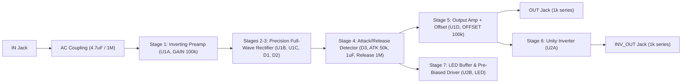

# Envelope Follower Circuit Description

Extracted from [`EnvelopeFollower.webp`](./EnvelopeFollower.webp) (hand-drawn schematic titled **"Envelope Follower"**, dated `2022-01-18 22:58`).

---

## 1. Overview & Specifications

This circuit is a dual-supply analog **precision full-wave envelope follower** suitable for modular synthesizer / Eurorack CV generation. It accepts an AC-coupled audio or control signal at `IN`, amplifies and full-wave rectifies it, smooths it with independent `ATK` (attack) and `Release` controls, provides a DC-offset-adjustable non-inverted output (`OUT`), a complementary inverted output (`INV_OUT`), and a buffered `LED` level indicator.

| Parameter | Specification | Notes |
|---|---|---|
| **Supply Rails** | `+12 V`, `GND`, `-12 V` | Dual bipolar supply (`Vcc+ = +12V`, `Vcc- = -12V`) |
| **Op-Amps** | 6 op-amp channels (`TL074` or `TL072`) | Recommended: `1× TL074` (quad) + `1× TL072` (dual), or `3× TL072` |
| **Inputs** | `IN` (mono jack) | AC-coupled (`4.7 µF`, `f_c ≈ 3.4 Hz`), `Z_in ≈ 9.9 kΩ` |
| **Outputs** | `OUT`, `INV_OUT` (mono jacks) | `1 kΩ` series protection resistors; `INV_OUT = -OUT` |
| **Panel Controls** | `GAIN` (`100 kΩ`), `ATK` (`50 kΩ`), `Release` (`1 MΩ`), `OFFSET` (`100 kΩ`) | 4 potentiometers |
| **Indicator** | `LED` | Driven by dedicated unity-gain buffer pre-biased to `-2.79 V` |
| **Total Gain (`OUT` / `\|V_in\|`)** | `0×` to `~27.7×` (before clipping) | `GAIN` (`0–10×`) × rectifier (`1.1×`) × output stage (`2.25–2.52×`) |

### Signal Flow

---

## 2. Bill of Materials (BOM)

> **Reference Designator Note:** The source schematic (`EnvelopeFollower.webp`) does not print component designators (`R1`, `C1`, `U1`, etc.). Consistent designators are assigned below in signal-flow order so every entry in the BOM, stage analysis, and netlist maps 1-to-1.

### 2.1 Summary BOM (Grouped by Component & Value)

| Qty | Part Type | Value / Part Number | Specifications & Notes | Assigned Designators |
|---:|---|---|---|---|
| **16** | Resistor | `10 kΩ` | 1/4 W (or SMD 0603/0805), 1% metal film recommended | `R2`–`R7`, `R10`–`R15`, `R17`, `R18`, `R20`, `R22` |
| **3** | Resistor | `1 kΩ` | 1/4 W (or SMD), 1% | `R9`, `R16`, `R19` |
| **2** | Resistor | `22 kΩ` | 1/4 W (or SMD), 1% | `R8`, `R21` |
| **1** | Resistor | `33 kΩ` | 1/4 W (or SMD), 1% | `R23` |
| **1** | Resistor | `1 MΩ` | 1/4 W (or SMD), 1–5% | `R1` |
| **2** | Potentiometer | `100 kΩ` | Linear (`B100K`) typical; `GAIN` (audio/log optional), `OFFSET` (linear) | `RV1` (`GAIN`), `RV4` (`OFFSET`) |
| **1** | Potentiometer | `50 kΩ` | Linear (`B50K`) or reverse-log / log | `RV2` (`ATK`) |
| **1** | Potentiometer | `1 MΩ` | Linear (`B1M`) or log (`A1M` for finer short-release control) | `RV3` (`Release`) |
| **1** | Capacitor (Non-Polarized) | `4.7 µF` | Film, MLCC, or bipolar electrolytic (`≥ 25 V` rated) | `C1` |
| **1** | Capacitor (Non-Polarized) | `1 µF` | Film or ceramic (low-leakage dielectric preferred over electrolytic) | `C2` |
| **2** | Capacitor (Polarized) | `4.7 µF` | Aluminum electrolytic, `≥ 25 V` (or `35 V`) rated | `C3`, `C4` |
| **3** | Signal Diode | `1N4148` | Small-signal silicon switching diode | `D1`, `D2`, `D3` |
| **1** | LED | Standard indicator LED | 3 mm or 5 mm; high-efficiency LED recommended (see Section 7) | `LED1` |
| **1** | Quad Op-Amp IC | `TL074` | DIP-14 or SOIC-14 (`U1A`–`U1D`) | `U1` |
| **1** | Dual Op-Amp IC | `TL072` | DIP-8 or SOIC-8 (`U2A`–`U2B`); alternatively use `3× TL072` total | `U2` |
| **3** | Audio / CV Jack | 3.5 mm mono jack | 2-terminal Tip/Sleeve (or switched e.g. Thonkiconn WQP-PJ398SM) | `J1` (`IN`), `J2` (`OUT`), `J3` (`INV_OUT`) |
| **1** | Power Header | 3-net (`+12V`, `GND`, `-12V`) | e.g., 2×5-pin Eurorack shrouded power header or 3-pin header | `J4` |

*(Total physical parts: 23 resistors, 4 potentiometers, 4 capacitors, 3 diodes, 1 LED, 2 op-amp ICs, 3 jacks, 1 power header.)*

### 2.2 Complete Itemized Component List

| Ref | Type | Value / MPN | Polarity / Rating | Schematic Label / Role |
|---|---|---|---|---|
| `R1` | Resistor | `1 MΩ` | 1% / 5% | Input DC ground reference after `C1` |
| `R2` | Resistor | `10 kΩ` | 1% | Input resistor to `U1A` inverting preamp |
| `R3` | Resistor | `10 kΩ` | 1% | Input resistor to `U1B` half-wave rectifier |
| `R4` | Resistor | `10 kΩ` | 1% | Feedforward path resistor 1 (`R4 + R5 = 20 kΩ`) |
| `R5` | Resistor | `10 kΩ` | 1% | Feedforward path resistor 2 to `U1C` summing node |
| `R6` | Resistor | `10 kΩ` | 1% | `U1B` precision rectifier feedback resistor |
| `R7` | Resistor | `10 kΩ` | 1% | Half-wave rectifier summing resistor into `U1C` |
| `R8` | Resistor | `22 kΩ` | 1% | `U1C` full-wave summing amplifier feedback resistor |
| `R9` | Resistor | `1 kΩ` | 1% | Series resistor between hold cap `C2` and `ENV_NODE` |
| `R10` | Resistor | `10 kΩ` | 1% | Minimum discharge resistor in series with `Release` pot |
| `R11` | Resistor | `10 kΩ` | 1% | `OFFSET` bias divider upper resistor to `+12V` |
| `R12` | Resistor | `10 kΩ` | 1% | `OFFSET` bias divider lower resistor to `-12V` |
| `R13` | Resistor | `10 kΩ` | 1% | `OFFSET` wiper summing resistor to `U1D` (`-`) |
| `R14` | Resistor | `10 kΩ` | 1% | `U1D` (`-`) gain-setting shunt resistor to `GND` |
| `R15` | Resistor | `10 kΩ` | 1% | `U1D` feedback resistor |
| `R16` | Resistor | `1 kΩ` | 1% | `OUT` jack output series protection resistor |
| `R17` | Resistor | `10 kΩ` | 1% | `U2A` inverting amplifier input resistor |
| `R18` | Resistor | `10 kΩ` | 1% | `U2A` inverting amplifier feedback resistor |
| `R19` | Resistor | `1 kΩ` | 1% | `INV_OUT` jack output series protection resistor |
| `R20` | Resistor | `10 kΩ` | 1% | `U2B` LED buffer input isolation resistor |
| `R21` | Resistor | `22 kΩ` | 1% | LED current-limiting resistor |
| `R22` | Resistor | `10 kΩ` | 1% | LED cathode negative-bias divider resistor to `GND` |
| `R23` | Resistor | `33 kΩ` | 1% | LED cathode negative-bias divider resistor to `-12V` |
| `RV1` | Potentiometer | `100 kΩ` | Wired as 2-pin rheostat | `GAIN` — preamp feedback resistance (`0–100 kΩ`) |
| `RV2` | Potentiometer | `50 kΩ` | Wired as 2-pin rheostat | `ATK` — attack charging series resistance (`0–50 kΩ`) |
| `RV3` | Potentiometer | `1 MΩ` | Wired as 2-pin rheostat | `Release` — discharge resistance (`0–1 MΩ`) |
| `RV4` | Potentiometer | `100 kΩ` | Wired as 3-pin divider | `OFFSET` — output DC offset voltage control (`-10 V` to `+10 V` wiper) |
| `C1` | Capacitor | `4.7 µF` | Non-polarized, `≥ 25 V` | Input AC-coupling capacitor |
| `C2` | Capacitor | `1 µF` | Non-polarized, `≥ 25 V` | Envelope integration / hold capacitor |
| `C3` | Capacitor | `4.7 µF` | Polarized electrolytic, `≥ 25 V` | `+12V` power rail bulk decoupling (`+` to `+12V`, `-` to `GND`) |
| `C4` | Capacitor | `4.7 µF` | Polarized electrolytic, `≥ 25 V` | `-12V` power rail bulk decoupling (`+` to `GND`, `-` to `-12V`) |
| `D1` | Diode | `1N4148` | Fast switching diode | `U1B` negative-input clamp diode |
| `D2` | Diode | `1N4148` | Fast switching diode | `U1B` rectifier output diode |
| `D3` | Diode | `1N4148` | Fast switching diode | Envelope peak-charging / reverse-blocking diode |
| `LED1` | LED | `LED` | 3 mm / 5 mm | Envelope level indicator |
| `U1` | Quad Op-Amp | `TL074` | `±12 V` rails | `U1A` preamp, `U1B` half-wave rect, `U1C` FWR sum, `U1D` output + offset |
| `U2` | Dual Op-Amp | `TL072` | `±12 V` rails | `U2A` inverted output (`INV_OUT`), `U2B` LED buffer |
| `J1` | Mono Jack | 3.5 mm | Tip / Sleeve | `IN` signal input |
| `J2` | Mono Jack | 3.5 mm | Tip / Sleeve | `OUT` envelope CV output |
| `J3` | Mono Jack | 3.5 mm | Tip / Sleeve | `INV_OUT` inverted envelope CV output |
| `J4` | Power Input | 3-rail | `+12V in`, `GND`, `-12V in` | Main power input |

---

## 3. Op-Amp IC Pin Assignment (`TL074` + `TL072`)

The schematic notes: **`All op-amp: TL074 or TL072`**, **`Vcc+ is +12V.`**, **`Vcc- is -12V.`**

### `U1`: `TL074` (14-Pin DIP / SOIC)

| Channel | Function | `+` Input Pin | `-` Input Pin | Output Pin | Power Pins |
|---|---|---:|---:|---:|---|
| `U1A` | Input Gain Amplifier (`GAIN`) | Pin 3 (`GND`) | Pin 2 (`PREAMP_SUM`) | Pin 1 (`PREAMP_OUT`) | Pin 4 = `+12V` |
| `U1B` | Precision Half-Wave Rectifier | Pin 5 (`GND`) | Pin 6 (`RECT_SUM`) | Pin 7 (`RECT_OUT_N`) | Pin 11 = `-12V` |
| `U1C` | Full-Wave Summing Amplifier | Pin 10 (`GND`) | Pin 9 (`FWR_SUM`) | Pin 8 (`FWR_OUT`) | *(shared)* |
| `U1D` | Output Stage + DC Offset (`OUT`) | Pin 12 (`ENV_NODE`) | Pin 13 (`OUT_SUM`) | Pin 14 (`ENV_OUT`) | *(shared)* |

### `U2`: `TL072` (8-Pin DIP / SOIC)

| Channel | Function | `+` Input Pin | `-` Input Pin | Output Pin | Power Pins |
|---|---|---:|---:|---:|---|
| `U2A` | Inverted Output (`INV_OUT`) | Pin 3 (`GND`) | Pin 2 (`INV_SUM`) | Pin 1 (`INV_OUT_RAW`) | Pin 8 = `+12V` |
| `U2B` | Envelope `LED` Voltage Buffer | Pin 5 (`LED_BUF_IN`) | Pin 6 (`LED_BUF_OUT`) | Pin 7 (`LED_BUF_OUT`) | Pin 4 = `-12V` |

*(Alternative IC configurations: `3× TL072` uses all 6 channels with zero spares; `2× TL074` leaves 2 unused channels, which must be tied off safely as unity buffers with `+` connected to `GND` and `-` connected to output.)*

---

## 4. Stage-by-Stage Circuit Analysis

### 4.0 Power Supply & Rail Decoupling
- **Inputs:** `J4` brings in `+12V in`, `GND`, and `-12V in` (e.g., via a standard 10-pin Eurorack IDC header: pins 1–2 = `-12V`, pins 3–8 = `GND`, pins 9–10 = `+12V`).
- **Bulk Capacitors (`C3`, `C4`):**
  - `C3` (`4.7 µF` electrolytic): **`+` terminal to `+12V`**, **`-` terminal to `GND`**.
  - `C4` (`4.7 µF` electrolytic): **`+` terminal to `GND`**, **`-` terminal to `-12V`**. *(Double-check `C4` polarity: `GND` is 12 V positive relative to `-12V`, so `+` goes to `GND`.)*
- All op-amp positive supply pins (`U1` pin 4, `U2` pin 8) connect to `+12V`; all negative supply pins (`U1` pin 11, `U2` pin 4) connect to `-12V`.

### 4.1 Stage 1 — AC-Coupled Input & Adjustable Preamp (`U1A`)
- **Topology:** AC-coupled inverting op-amp amplifier.
- **Connections:** `J1` (`IN`) Tip → `C1` (`4.7 µF`, unpolarized) → node `AC_IN`. From `AC_IN`, `R1` (`1 MΩ`) shunts to `GND` and `R2` (`10 kΩ`) feeds `U1A` (`-`). `U1A` (`+`) is tied to `GND`. `RV1` (`100 kΩ` `GAIN`) is wired as a variable feedback resistor between `U1A` (`-`) and `U1A` output (`PREAMP_OUT`).
- **Behavior:**
  - Input impedance in passband: `Z_in ≈ R1 || R2 = 1 MΩ || 10 kΩ ≈ 9.90 kΩ`.
  - High-pass cutoff frequency: `f_c = 1 / (2π × 9.90 kΩ × 4.7 µF) ≈ 3.42 Hz`.
  - Inverting voltage gain: `V_preamp = -(R_GAIN / 10 kΩ) × V_in`, adjustable from `0` (mute) to `-10` (`20 dB`).

### 4.2 Stages 2 & 3 — Precision Full-Wave Rectifier (`U1B`, `U1C`)
- **Topology:** Classic two-op-amp inverting-summing precision full-wave rectifier.
- **Half-Wave Core (`U1B`):**
  - `U1B` (`+`) is grounded (`GND`).
  - `PREAMP_OUT` feeds `U1B` (`-`) through `R3` (`10 kΩ`).
  - `D1` (`1N4148`): **Anode** at `U1B` output (`RECT_OUT_N`), **Cathode** at `U1B` (`-`).
  - `D2` (`1N4148`): **Cathode** at `U1B` output (`RECT_OUT_N`), **Anode** at node `RECT_HALF`.
  - `R6` (`10 kΩ`) closes negative feedback from `RECT_HALF` back to `U1B` (`-`).
  - Operation:
    - When `V_preamp > 0`: `U1B` output swings negative, reverse-biasing `D1` and forward-biasing `D2`. Negative feedback closes through `D2` and `R6`, yielding `V_rect_half = -V_preamp`.
    - When `V_preamp ≤ 0`: `U1B` output swings positive, forward-biasing `D1` (clamped near `+0.6 V`) and reverse-biasing `D2`. `RECT_HALF` sits at `0 V` via `R6` to `U1B`'s virtual ground.
- **Full-Wave Summer (`U1C`):**
  - `U1C` (`+`) is grounded (`GND`).
  - `PREAMP_OUT` feeds `U1C` (`-`) through `R4` (`10 kΩ`) in series with `R5` (`10 kΩ`), giving `20 kΩ` total feedforward resistance.
  - `RECT_HALF` feeds `U1C` (`-`) through `R7` (`10 kΩ`).
  - `R8` (`22 kΩ`) provides feedback from `U1C` output (`FWR_OUT`) to `U1C` (`-`).
  - Transfer function:
    - For `V_preamp > 0`: `V_fwr = -22k × (V_preamp / 20k + (-V_preamp) / 10k) = +1.1 × V_preamp`.
    - For `V_preamp ≤ 0`: `V_fwr = -22k × (V_preamp / 20k + 0 / 10k) = -1.1 × V_preamp`.
    - Combined: **`V_fwr = +1.1 × |V_preamp|`** (strictly non-negative full-wave rectified signal).

### 4.3 Stage 4 — Attack / Release Envelope Detector
- **Connections:**
  - `D3` (`1N4148`): **Anode** at `FWR_OUT` (`U1C` output), **Cathode** to `RV2` (`50 kΩ` `ATK` pot, wired as rheostat) → `ENV_CAP`.
  - `C2` (`1 µF`, unpolarized): connected from `ENV_CAP` to `GND`.
  - `R9` (`1 kΩ`): connected from `ENV_CAP` to `ENV_NODE`.
  - `R10` (`10 kΩ`) in series with `RV3` (`1 MΩ` `Release` pot, wired as rheostat) connects from `ENV_NODE` to `GND`.
- **Operation & Time Constants:**
  - When `V_fwr > V_C2 + V_f(D3)` (`~0.6 V`), `D3` conducts and charges `C2` positively through `RV2` (`ATK`).
  - **Attack time constant:** `τ_atk ≈ R_ATK × 1 µF` = `< 1 ms` (at `0 Ω`, limited by `D3` and `U1C` current limit) up to `50 ms` (at `50 kΩ`).
  - When `V_fwr` drops below `V_C2`, `D3` blocks reverse current and `C2` discharges to `GND` through `R9 + R10 + R_REL`.
  - **Release time constant:** `τ_rel = (1 kΩ + 10 kΩ + R_REL) × 1 µF` = **`11 ms`** (at `0 Ω`) to **`1.011 s`** (at `1 MΩ`).

### 4.4 Stage 5 — Output Amplifier & DC Offset (`U1D`, `OUT`)
- **Topology:** Non-inverting envelope amplifier summed with an adjustable DC bias at the inverting feedback network.
- **Connections:**
  - `ENV_NODE` connects directly to `U1D` (`+`) (negligible loading thanks to JFET input).
  - `OFFSET` divider: `+12V` → `R11` (`10 kΩ`) → `RV4` (`100 kΩ` `OFFSET` pot) → `R12` (`10 kΩ`) → `-12V`. The wiper sits between **`-10.0 V`** and **`+10.0 V`** with a position-dependent Thevenin source impedance `R_pot_th` (`9.17 kΩ` at ends, `30.0 kΩ` at center).
  - `RV4` wiper connects through `R13` (`10 kΩ`) to `U1D` (`-`) (`OUT_SUM`).
  - `R14` (`10 kΩ`) connects `OUT_SUM` to `GND`; `R15` (`10 kΩ`) provides feedback from `U1D` output (`ENV_OUT`) to `OUT_SUM`.
  - `ENV_OUT` drives `J2` (`OUT`) Tip through `R16` (`1 kΩ`).
- **Transfer Function:**
  Let `R_off_eff = 10 kΩ + R_pot_th` (`19.17 kΩ` at ends, `40.0 kΩ` at center) and `V_pot` be the open-circuit divider voltage (`-10 V` to `+10 V`):
  $$V_{\text{env\_out}} = V_{\text{env}} \cdot \left(2 + \frac{10\,\text{k}\Omega}{R_{\text{off\_eff}}}\right) - V_{\text{pot}} \cdot \frac{10\,\text{k}\Omega}{R_{\text{off\_eff}}}$$
  - **Center (`V_pot = 0 V`):** `V_env_out = 2.25 × V_env` (`0 V` DC offset).
  - **`RV4` at `+12V` end (`V_pot = +10 V`):** `V_env_out = 2.52 × V_env - 5.22 V`.
  - **`RV4` at `-12V` end (`V_pot = -10 V`):** `V_env_out = 2.52 × V_env + 5.22 V`.

### 4.5 Stage 6 — Inverted Envelope Output (`U2A`, `INV_OUT`)
- **Topology:** Unity-gain inverting amplifier.
- **Connections:** `ENV_OUT` (`U1D` output, before `R16`) → `R17` (`10 kΩ`) → `U2A` (`-`); `U2A` (`+`) tied to `GND`; `R18` (`10 kΩ`) feedback from `U2A` output (`INV_OUT_RAW`) to `U2A` (`-`). `INV_OUT_RAW` feeds `J3` (`INV_OUT`) Tip via `R19` (`1 kΩ`).
- **Transfer Function:** `V_inv_out = -V_env_out` (inverts both the envelope signal and the applied DC `OFFSET`).

### 4.6 Stage 7 — Buffered Envelope Indicator (`U2B`, `LED1`)
- **Topology:** Unity-gain voltage follower driving an LED whose cathode is pre-biased negative.
- **Connections:** `ENV_NODE` (pre-`OFFSET`, labeled `LED` off-sheet flag on the schematic) → `R20` (`10 kΩ`) → `U2B` (`+`). `U2B` (`-`) connects directly to `U2B` output (`LED_BUF_OUT`). `LED_BUF_OUT` → `R21` (`22 kΩ`) → `LED1` **Anode**. `LED1` **Cathode** connects to the midpoint (`LED_K`) of `R22` (`10 kΩ` to `GND`) and `R23` (`33 kΩ` to `-12V`).
- **Behavior:**
  - The `10 kΩ / 33 kΩ` divider sets the LED cathode open-circuit bias to `-12 V × (10k / 43k) = -2.79 V` behind a Thevenin impedance of `10k || 33k = 7.67 kΩ` (`R_total = 22k + 7.67k = 29.67 kΩ`).
  - Pre-biasing the cathode near `-2.79 V` offsets the LED forward drop (`V_f ≈ 1.8–3.0 V`) so the indicator illuminates immediately as the envelope voltage rises above `0 V`:
    $$I_{\text{LED}} \approx \frac{V_{\text{env}} + 2.79\,\text{V} - V_f}{29.67\,\text{k}\Omega}$$
  - At `V_env = +10 V`, `I_LED ≈ 0.34–0.37 mA` (see Section 7 for LED selection note).

---

## 5. Complete Pin-to-Pin Netlist

Every electrical net in the circuit is listed below with all connected component pins.

| Net Name | Connected Component Pins |
|---|---|
| **`+12V`** | `J4.+12V_in`, `C3.+`, `R11.1`, `U1.4` (`V+`), `U2.8` (`V+`) |
| **`-12V`** | `J4.-12V_in`, `C4.-`, `R12.2`, `R23.2`, `U1.11` (`V-`), `U2.4` (`V-`) |
| **`GND`** | `J4.GND`, `C3.-`, `C4.+`, `J1.Sleeve`, `R1.2`, `U1.3` (`U1A+`), `U1.5` (`U1B+`), `U1.10` (`U1C+`), `C2.2`, `RV3.2`, `RV3.3`, `R14.2`, `J2.Sleeve`, `U2.3` (`U2A+`), `J3.Sleeve`, `R22.2` |
| **`IN_TIP`** | `J1.Tip`, `C1.1` |
| **`AC_IN`** | `C1.2`, `R1.1`, `R2.1` |
| **`PREAMP_SUM`** | `R2.2`, `RV1.1`, `U1.2` (`U1A-`) |
| **`PREAMP_OUT`** | `U1.1` (`U1A OUT`), `RV1.2`, `RV1.3`, `R3.1`, `R4.1` |
| **`RECT_SUM`** | `R3.2`, `D1.K`, `R6.1`, `U1.6` (`U1B-`) |
| **`RECT_OUT_N`** | `U1.7` (`U1B OUT`), `D1.A`, `D2.K` |
| **`RECT_HALF`** | `D2.A`, `R6.2`, `R7.1` |
| **`FF_MID`** | `R4.2`, `R5.1` |
| **`FWR_SUM`** | `R5.2`, `R7.2`, `R8.1`, `U1.9` (`U1C-`) |
| **`FWR_OUT`** | `U1.8` (`U1C OUT`), `R8.2`, `D3.A` |
| **`RECT_DIODE_OUT`** | `D3.K`, `RV2.1` |
| **`ENV_CAP`** | `RV2.2`, `RV2.3`, `C2.1`, `R9.1` |
| **`ENV_NODE`** *(labeled `LED`)* | `R9.2`, `R10.1`, `U1.12` (`U1D+`), `R20.1` |
| **`REL_MID`** | `R10.2`, `RV3.1` |
| **`OFFSET_TOP`** | `R11.2`, `RV4.3` |
| **`OFFSET_BOT`** | `R12.1`, `RV4.1` |
| **`OFFSET_WIPER`** | `RV4.2`, `R13.1` |
| **`OUT_SUM`** | `R13.2`, `R14.1`, `R15.1`, `U1.13` (`U1D-`) |
| **`ENV_OUT`** | `U1.14` (`U1D OUT`), `R15.2`, `R16.1`, `R17.1` |
| **`OUT_TIP`** | `R16.2`, `J2.Tip` |
| **`INV_SUM`** | `R17.2`, `R18.1`, `U2.2` (`U2A-`) |
| **`INV_OUT_RAW`** | `U2.1` (`U2A OUT`), `R18.2`, `R19.1` |
| **`INV_OUT_TIP`** | `R19.2`, `J3.Tip` |
| **`LED_BUF_IN`** | `R20.2`, `U2.5` (`U2B+`) |
| **`LED_BUF_OUT`** | `U2.7` (`U2B OUT`), `U2.6` (`U2B-`), `R21.1` |
| **`LED_ANODE`** | `R21.2`, `LED1.A` |
| **`LED_K`** | `LED1.K`, `R22.1`, `R23.1` |

*(Pin convention: Resistors/non-polarized capacitors `.1`/`.2` are non-polar; polarized caps `.+`/`.−` denote anode/cathode; diodes/LED `.A`/`.K` denote anode/cathode; potentiometers `.1`=CCW, `.2`=Wiper, `.3`=CW when viewed from shaft side.)*

---

## 6. Potentiometer & Jack Wiring Conventions

### Potentiometer Lug Orientation (Viewed from Front / Shaft Side)
Standard panel potentiometers number terminals left-to-right (with shaft facing you, lugs down) as **Pin 1 (CCW)**, **Pin 2 (Wiper)**, **Pin 3 (CW)**:
- **`RV1` (`GAIN`, `100 kΩ`):** Short Pin 2 + Pin 3 (`PREAMP_OUT`), connect Pin 1 (`PREAMP_SUM`). Turning **clockwise increases resistance (`0 → 100 kΩ`) and increases gain (`0× → 10×`)**.
- **`RV2` (`ATK`, `50 kΩ`):** Short Pin 2 + Pin 3 (`ENV_CAP`), connect Pin 1 (`RECT_DIODE_OUT`). Turning **clockwise increases resistance (`0 → 50 kΩ`) and increases attack time (`< 1 ms → 50 ms`)**. *(If you prefer clockwise = faster attack, short Pin 1 + Pin 2 instead and connect Pin 3 separately.)*
- **`RV3` (`Release`, `1 MΩ`):** Short Pin 2 + Pin 3 (`GND`), connect Pin 1 (`REL_MID`). Turning **clockwise increases resistance (`0 → 1 MΩ`) and increases release time (`11 ms → 1.01 s`)**.
- **`RV4` (`OFFSET`, `100 kΩ`):**
  - As wired in the netlist above (`Pin 3` → `OFFSET_TOP` / `+12V` side, `Pin 1` → `OFFSET_BOT` / `-12V` side): turning **clockwise** drives `RV4` wiper toward `+12 V`, which shifts `OUT` **negative** (`-5.22 V`) and `INV_OUT` **positive** (`+5.22 V`) because the wiper sums into `U1D`'s inverting input.
  - **Recommended panel wiring if you want CW = positive `OUT`:** Swap `RV4.1` and `RV4.3` (`Pin 1` → `OFFSET_TOP` / `+12V` side, `Pin 3` → `OFFSET_BOT` / `-12V` side).

### Jack Connections
- `J1` (`IN`), `J2` (`OUT`), `J3` (`INV_OUT`) are drawn as 2-terminal mono jacks (`Tip` and `Sleeve` = `GND`).
- If building with 3-pin switched Eurorack jacks (e.g., Thonkiconn `WQP-PJ398SM`): connect `Tip` and `Sleeve` as listed in Section 5; on `J1` (`IN`), the switched normal pin can optionally tie to `GND` (keeping input quiet when unplugged, though `R1 = 1 MΩ` already pulls `AC_IN` to `GND`), while on `J2` and `J3` (`OUT`, `INV_OUT`), leave the switched normal pin **no-connect (`NC`)**.

---

## 7. Practical Build & Verification Notes

The items below distinguish **practical PCB/breadboard construction details** from the bare hand-drawn schematic in `EnvelopeFollower.webp`:

1. **Local IC Decoupling Capacitors (Recommended Addition):**
   `EnvelopeFollower.webp` shows only the two bulk `4.7 µF` rail capacitors (`C3`, `C4`). When laying out a PCB or breadboard, add **`100 nF` ceramic bypass capacitors** from `+12V` to `GND` and `-12V` to `GND` placed directly adjacent to each IC's power pins (`U1` pins 4 & 11, `U2` pins 8 & 4) to prevent op-amp oscillation.
2. **Optional Reverse-Polarity Power Protection (Eurorack Addition):**
   Not shown in the schematic. If powering from an unkeyed or Eurorack ribbon cable (`J4`), consider adding series Schottky diodes (e.g., `1N5819`) or `10 Ω` current-limiting resistors + clamp diodes on `+12V in` and `-12V in` to protect `TL074`/`TL072` and `C3`/`C4` against reversed headers.
3. **Capacitor Selection (`C1`–`C4`):**
   - `C1` (`4.7 µF`) and `C2` (`1 µF`) are drawn unpolarized. Use a **film or C0G/X7R ceramic** capacitor for `C2` (`1 µF`) so dielectric leakage does not shorten long `Release` decays.
   - `C3` and `C4` (`4.7 µF`) are polarized electrolytics; use at least **`25 V` (preferably `35 V` or `50 V`)** voltage ratings for safe margin on `±12 V` rails.
4. **LED Selection & Brightness (`LED1`):**
   With `R21 = 22 kΩ` and the `-2.79 V` cathode bias divider (`R22 = 10 kΩ`, `R23 = 33 kΩ`), peak LED current at `V_env = +10 V` is only **`~0.34–0.37 mA`**. Use a **modern high-efficiency / ultra-bright LED** (which glows clearly at `0.1–0.5 mA`). Note also that with a low-`V_f` red LED (`~1.8 V`), a faint `~30 µA` idle current flows at `V_env = 0 V`, whereas a green/blue/white LED (`V_f ≈ 2.6–3.2 V`) stays completely dark at `0 V`.
5. **Diode Threshold & Gain Headroom:**
   Because `D3` (`1N4148`) sits outside `U1C`'s feedback loop, signals below `V_f(D3) ≈ 0.6 V` at `U1C` output do not charge `C2`. Turn `GAIN` (`RV1`) up for quiet/line-level signals. On `±12 V` supplies, `TL07x` outputs saturate around `±10.5 V` to `±11 V`, so `OUT` and `INV_OUT` naturally clip near `±10.5 V` when `GAIN` and `OFFSET` are pushed high.
6. **`OFFSET` Gain Interaction:**
   Because `RV4` (`100 kΩ`) feeds `R13` (`10 kΩ`) directly without a voltage follower buffer, its varying Thevenin impedance slightly shifts `U1D`'s envelope gain between **`2.25×`** (center) and **`2.52×`** (ends) as `OFFSET` is adjusted. This matches the schematic as drawn.
7. **Bring-Up Test Checklist:**
   - Before inserting `U1` and `U2`, power `J4` with `±12 V` and verify `+12V`, `-12V`, `GND`, and `LED_K ≈ -2.79 V`.
   - With `U1`/`U2` installed and `IN` grounded (`GAIN = 0`, `OFFSET = center`), verify `OUT ≈ 0 V`, `INV_OUT ≈ 0 V`, and `U1B` / `U1C` outputs near `0 V`.
   - Inject a `1 kHz`, `2 Vpp` (`±1 V`) sine wave into `IN` with `GAIN` at ~10–20% (`R_GAIN ≈ 10 kΩ`), `ATK` minimum, `Release` minimum, `OFFSET` centered: verify `U1C` output (`FWR_OUT`) shows a positive full-wave rectified waveform (`~1.1 V` peak) and `OUT` / `INV_OUT` track cleanly in opposite polarities while `LED1` illuminates.
