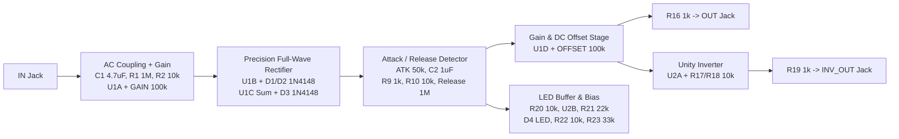

# Envelope Follower — Circuit Description & Build Guide

Extracted from [EnvelopeFollower.webp](./EnvelopeFollower.webp) (title: *Envelope Follower*, dated `2022-01-18 22:58`).

> **Note on Reference Designators:** The source schematic specifies component values, diode/IC part numbers, jack names, and front-panel control labels, without printed reference designators (`R1`, `C1`, etc.). Standard reference designators (`R1`–`R23`, `C1`–`C4`, `D1`–`D4`, `RV1`–`RV4`, `U1`–`U2`, `J1`–`J4`) are assigned consistently throughout this document to provide an unambiguous Bill of Materials and point-to-point netlist.

---

## 1. Circuit Overview & Specifications

This circuit is a **Eurorack-compatible analog envelope follower** operating on a **±12 V dual supply**. It AC-couples an audio/modulation input signal, amplifies it via a variable-gain inverting stage, performs precision full-wave rectification, extracts an attack/release control voltage envelope, applies gain and bipolar DC offset trim, and outputs both normal (`OUT`) and polarity-inverted (`INV_OUT`) envelope voltages along with an active level-indicator `LED`.

| Parameter | Value / Behavior | Notes |
|---|---|---|
| **Supply Rails** | `±12 V` (`+12V in`, `GND`, `-12V in`) | Dual-rail op-amp supply (`Vcc+ = +12V`, `Vcc- = -12V`) |
| **Active ICs** | 6 op-amp channels (`TL074` or `TL072`) | `1× TL074` + `1× TL072` (or `3× TL072`) |
| **Input (`IN`)** | AC-coupled, $f_c \approx 3.4\text{ Hz}$ | Input impedance $\approx 9.9\text{ k}\Omega$ AC (`1 MΩ || 10 kΩ` to virtual ground) |
| **Input Gain (`GAIN`)** | $0\times$ to $-10\times$ (`-∞` to `+20 dB`, inverting) | `100 kΩ` rheostat over `10 kΩ` input resistor |
| **Rectifier** | Precision full-wave rectifier + peak diode | $V_{\text{FWR}} = +1.1\,|V_{\text{amp}}|$, followed by `1N4148` (`D3`, `~0.6 V` drop) |
| **Attack (`ATK`)** | $\tau_{\text{atk}} \approx 0\text{ ms}$ to $50\text{ ms}$ | `50 kΩ` pot into `1 µF` cap (`C2`) |
| **Release (`Release`)** | $\tau_{\text{rel}} \approx 11\text{ ms}$ to $1.01\text{ s}$ | `1 kΩ + 10 kΩ + 0..1 MΩ` discharging `1 µF` cap (`C2`) |
| **Output Gain & Offset (`OFFSET`)** | Gain $2.25\times\text{–}2.52\times$; DC offset $\approx \pm 5.2\text{ V}$ | Output gain varies slightly with `OFFSET` wiper impedance |
| **Outputs** | `OUT` and `INV_OUT` ($-V_{\text{OUT}}$) | Each protected by a `1 kΩ` series output resistor |
| **Visual Indicator** | Buffered `LED` driven from envelope node | Cathode pre-biased to $\approx -2.79\text{ V}$ via `10 kΩ` / `33 kΩ` divider |

### High-Level Signal Flow

---

## 2. Bill of Materials (BOM)

### 2.1 Summary BOM (Grouped by Value)

| Qty | Reference(s) | Value | Component Type | Key Notes |
|---:|---|---|---|---|
| 3 | `R9`, `R16`, `R19` | `1 kΩ` | Resistor | 1/4 W metal film (or 0603/0805 SMD), 1% |
| 16 | `R2`–`R7`, `R10`–`R15`, `R17`, `R18`, `R20`, `R22` | `10 kΩ` | Resistor | 1% recommended for rectifier & inverter symmetry |
| 2 | `R8`, `R21` | `22 kΩ` | Resistor | 1% (R8 sets rectifier gain = 1.1×) |
| 1 | `R23` | `33 kΩ` | Resistor | 1% or 5% |
| 1 | `R1` | `1 MΩ` | Resistor | Input DC pull-down |
| 1 | `RV2` | `50 kΩ` | Potentiometer (`ATK`) | Single-gang, wired as rheostat |
| 2 | `RV1`, `RV4` | `100 kΩ` | Potentiometer (`GAIN`, `OFFSET`) | `RV1` wired as rheostat; `RV4` wired as voltage divider |
| 1 | `RV3` | `1 MΩ` | Potentiometer (`Release`) | Single-gang, wired as rheostat |
| 1 | `C2` | `1 µF` | Capacitor (non-polarized) | Film or X7R MLCC (drawn unpolarized; ≥ 25 V) |
| 1 | `C1` | `4.7 µF` | Capacitor (non-polarized) | Film, bipolar electrolytic, or MLCC (drawn unpolarized; ≥ 25 V) |
| 2 | `C3`, `C4` | `4.7 µF` | Capacitor (polarized electrolytic) | Power rail bulk filtering; ≥ 25 V (35 V preferred) |
| 3 | `D1`, `D2`, `D3` | `1N4148` | Fast switching diode | Signal rectification & peak hold |
| 1 | `D4` | `LED` | Indicator LED | High-brightness 3 mm or 5 mm LED recommended (see Section 3.6) |
| 1 | `U1` | `TL074` | Quad JFET-input op-amp | DIP-14 or SOIC-14 (or replace `U1` + `U2` with `3× TL072`) |
| 1 | `U2` | `TL072` | Dual JFET-input op-amp | DIP-8 or SOIC-8 |
| 3 | `J1`, `J2`, `J3` | 3.5 mm Mono | Panel audio/CV jack | Tip = signal, Sleeve = `GND` (e.g., Thonkiconn WQP-PJ398SM) |
| 1 | `J4` | Power Input | `+12V in` / `GND` / `-12V in` | Typically a 10-pin (2×5) Eurorack IDC power header |

### 2.2 Itemized Component List

| Ref | Value | Type / Part | Stage | Polarity / Pin Orientation |
|---|---|---|---|---|
| `R1` | `1 MΩ` | Resistor | Input | Non-polarized |
| `R2` | `10 kΩ` | Resistor | Input Gain | Non-polarized |
| `R3` | `10 kΩ` | Resistor | Half-Wave Rectifier | Non-polarized |
| `R4` | `10 kΩ` | Resistor | Half-Wave Rectifier | Non-polarized |
| `R5` | `10 kΩ` | Resistor | Full-Wave Summing | Non-polarized |
| `R6` | `10 kΩ` | Resistor | Rectifier Feed-Forward #1 | Non-polarized (in series with `R7`) |
| `R7` | `10 kΩ` | Resistor | Rectifier Feed-Forward #2 | Non-polarized (in series with `R6`) |
| `R8` | `22 kΩ` | Resistor | Full-Wave Summing Feedback | Non-polarized |
| `R9` | `1 kΩ` | Resistor | Envelope Detector Isolation | Non-polarized |
| `R10` | `10 kΩ` | Resistor | Release Minimum Resistor | Non-polarized |
| `R11` | `10 kΩ` | Resistor | Offset Divider (+12V end) | Non-polarized |
| `R12` | `10 kΩ` | Resistor | Offset Divider (-12V end) | Non-polarized |
| `R13` | `10 kΩ` | Resistor | Offset Summing Resistor | Non-polarized |
| `R14` | `10 kΩ` | Resistor | Output Stage Ground Ref | Non-polarized |
| `R15` | `10 kΩ` | Resistor | Output Stage Feedback | Non-polarized |
| `R16` | `1 kΩ` | Resistor | `OUT` Protection | Non-polarized |
| `R17` | `10 kΩ` | Resistor | `INV_OUT` Input | Non-polarized |
| `R18` | `10 kΩ` | Resistor | `INV_OUT` Feedback | Non-polarized |
| `R19` | `1 kΩ` | Resistor | `INV_OUT` Protection | Non-polarized |
| `R20` | `10 kΩ` | Resistor | `LED` Buffer Input | Non-polarized |
| `R21` | `22 kΩ` | Resistor | `LED` Current Limiter | Non-polarized |
| `R22` | `10 kΩ` | Resistor | `LED` Cathode Bias (to `GND`) | Non-polarized |
| `R23` | `33 kΩ` | Resistor | `LED` Cathode Bias (to `-12V`) | Non-polarized |
| `C1` | `4.7 µF` | Non-polarized Cap | Input AC Coupling | Non-polarized in schematic |
| `C2` | `1 µF` | Non-polarized Cap | Envelope Storage | Non-polarized in schematic (`ENV_CAP` stays $\ge 0\text{ V}$) |
| `C3` | `4.7 µF` | Electrolytic Cap | `+12V` Power Filter | **`+` to `+12V`**, **`-` to `GND`** |
| `C4` | `4.7 µF` | Electrolytic Cap | `-12V` Power Filter | **`+` to `GND`**, **`-` to `-12V`** |
| `D1` | `1N4148` | Signal Diode | Rectifier Clamp | **Anode = `U1B` out (pin 7)**, **Cathode = `U1B` `-` (pin 6)** |
| `D2` | `1N4148` | Signal Diode | Rectifier Output | **Anode = `V_RECT` (`R4`/`R5`)**, **Cathode = `U1B` out (pin 7)** |
| `D3` | `1N4148` | Signal Diode | Attack Steering / Peak Hold | **Anode = `U1C` out (pin 8)**, **Cathode = `RV2` (`ATK`)** |
| `D4` | `LED` | Light-Emitting Diode | Level Indicator | **Anode = `R21`**, **Cathode = `R22`/`R23` (`LED_K`)** |
| `RV1` | `100 kΩ` | Potentiometer (`GAIN`) | Input Gain | Rheostat: Pin 1 (`U1A` `-`), Pins 2+3 (`U1A` out) |
| `RV2` | `50 kΩ` | Potentiometer (`ATK`) | Attack Time | Rheostat: `D3` cathode to one outer pin, wiper+other outer pin to `C2`/`R9` |
| `RV3` | `1 MΩ` | Potentiometer (`Release`) | Release Time | Rheostat: `R10` to one outer pin, wiper+other outer pin to `GND` |
| `RV4` | `100 kΩ` | Potentiometer (`OFFSET`) | Output DC Offset | Divider: outer pins to `R11`/`R12`, wiper to `R13` |
| `U1` | `TL074` | Quad Op-Amp | `U1A`–`U1D` | Pin 4 = `+12V`, Pin 11 = `-12V` |
| `U2` | `TL072` | Dual Op-Amp | `U2A`–`U2B` | Pin 8 = `+12V`, Pin 4 = `-12V` |
| `J1` | `IN` | 3.5 mm Jack | Audio/CV Input | Tip = `IN_TIP`, Sleeve = `GND` |
| `J2` | `OUT` | 3.5 mm Jack | Positive Envelope Out | Tip = `OUT_TIP`, Sleeve = `GND` |
| `J3` | `INV_OUT` | 3.5 mm Jack | Inverted Envelope Out | Tip = `INV_OUT_TIP`, Sleeve = `GND` |
| `J4` | Power | `+12V in` / `GND` / `-12V in` | Power Input | External bipolar supply |

### 2.3 IC Pinout Reference (`TL074` & `TL072`)

Only `U2B` (`LED` buffer) explicitly shows `+12V` and `-12V` power pins on the schematic diagram; the diagram note (`All op-amp: TL074 or TL072 / Vcc+ is +12V. / Vcc- is -12V.`) applies to all 6 channels.

- **`U1` (`TL074`, DIP-14 / SOIC-14):**
  - `U1A`: `Out = 1`, `- = 2`, `+ = 3` (Input Variable Gain)
  - `U1B`: `+ = 5`, `- = 6`, `Out = 7` (Precision Half-Wave Rectifier)
  - `U1C`: `Out = 8`, `- = 9`, `+ = 10` (Full-Wave Summing Inverter)
  - `U1D`: `+ = 12`, `- = 13`, `Out = 14` (Output Buffer / Gain + Offset)
  - Power: `Vcc+ (+12V) = 4`, `Vcc- (-12V) = 11`
- **`U2` (`TL072`, DIP-8 / SOIC-8):**
  - `U2A`: `Out = 1`, `- = 2`, `+ = 3` (`INV_OUT` Unity Inverter)
  - `U2B`: `+ = 5`, `- = 6`, `Out = 7` (`LED` Driver Buffer)
  - Power: `Vcc+ (+12V) = 8`, `Vcc- (-12V) = 4`

*(Alternative: All 6 stages can be implemented using **three `TL072`** dual op-amp packages if you prefer stocking a single op-amp part number.)*

---

## 3. Stage-by-Stage Functional Description

### 3.1 Power Supply Filtering (`+12V in`, `GND`, `-12V in`)
- `+12V in` feeds the `+12V` rail and is bypassed to `GND` by `C3` (`4.7 µF` electrolytic, `+` to `+12V`, `-` to `GND`).
- `-12V in` feeds the `-12V` rail and is bypassed to `GND` by `C4` (`4.7 µF` electrolytic, **`+` to `GND`, `-` to `-12V`** because `0 V > -12 V`).
- **Practical build note (not drawn in source):** Add `100 nF` ceramic decoupling capacitors close to each IC's `Vcc+` and `Vcc-` pins to `GND`, and if using a standard 10-pin (2×5) Eurorack power header (`-12V` on pins 1–2, `GND` on pins 3–8, `+12V` on pins 9–10), consider adding series Schottky protection diodes (e.g., `1N5819`) or resettable PTC fuses to guard against reversed ribbon cables.

### 3.2 Input Coupling & Variable Gain Stage (`IN`, `U1A`, `GAIN`)
- The input jack `J1` (`IN`) feeds `C1` (`4.7 µF`, non-polarized) to block any input DC offset.
- After `C1`, `R1` (`1 MΩ`) ties the node to `GND` (preventing floating charge when unplugged), while `R2` (`10 kΩ`) feeds the inverting (`-`) input of `U1A` (`U1A` `+` is tied to `GND`).
- Because `U1A` `-` is a virtual ground (`0 V`), the AC input impedance above the high-pass cutoff is $Z_{\text{in}} \approx R_1 \parallel R_2 \approx 9.9\text{ k}\Omega$, giving a `-3 dB` low-frequency corner at:
  $$f_c = \frac{1}{2\pi \cdot (R_1 \parallel R_2) \cdot C_1} \approx \frac{1}{2\pi \cdot 9901\,\Omega \cdot 4.7\,\mu\text{F}} \approx 3.42\text{ Hz}$$
- `RV1` (`100 kΩ`, labeled `GAIN`) is wired as a 2-terminal variable feedback resistor across `U1A` (`-` to `Out`). The inverting stage gain is:
  $$A_{v1} = -\frac{R_{\text{GAIN}}}{R_2} = -\frac{0\text{ to }100\,\text{k}\Omega}{10\,\text{k}\Omega} = 0\times\text{ to }-10\times\quad (-\infty\text{ to }+20\text{ dB})$$
- **Potentiometer wiring (`RV1`):** Connect **Pin 1 (CCW)** to `U1A` `-` (pin 2) and tie **Pin 2 (Wiper) + Pin 3 (CW)** together to `U1A` `Out` (pin 1). Turning `GAIN` clockwise increases gain from `0×` to `-10×`.

### 3.3 Precision Full-Wave Rectifier (`U1B`, `U1C`, `D1`, `D2`, `D3`)
The output of `U1A` ($V_1$) drives a classic two-op-amp inverting summing precision full-wave rectifier:
1. **Half-Wave Precision Rectifier (`U1B`):**
   - `U1B` `+` (pin 5) is tied to `GND`. `R3` (`10 kΩ`) connects $V_1$ to `U1B` `-` (pin 6).
   - `D1` (`1N4148`) clamps the feedback loop for negative-output half-cycles: **Anode = `U1B` `Out` (pin 7)**, **Cathode = `U1B` `-` (pin 6)**.
   - `D2` (`1N4148`) rectifies into node `V_RECT`: **Anode = `V_RECT`**, **Cathode = `U1B` `Out` (pin 7)**.
   - `R4` (`10 kΩ`) feeds back from `V_RECT` to `U1B` `-` (pin 6).
   - **Operation:**
     - When $V_1 > 0$: `U1B` output swings negative, `D1` is reverse-biased (OFF), `D2` conducts, and `U1B` forces $V_{\text{RECT}} = -V_1 < 0$.
     - When $V_1 < 0$: `U1B` output swings positive ($\approx +0.6\text{ V}$), `D1` conducts to hold `U1B` `-` at virtual ground, `D2` is reverse-biased (OFF), and $V_{\text{RECT}} = 0\text{ V}$ (pulled to virtual ground of `U1C` via `R5`).
2. **Full-Wave Summing Inverter (`U1C`):**
   - `U1C` `+` (pin 10) is tied to `GND`.
   - `U1C` `-` (pin 9) sums $V_1$ through two `10 kΩ` resistors in series (`R6 + R7 = 20 kΩ`) and $V_{\text{RECT}}$ through `R5` (`10 kΩ`), with `R8` (`22 kΩ`) in feedback:
     $$V_3 = -22\,\text{k}\Omega \left(\frac{V_1}{20\,\text{k}\Omega} + \frac{V_{\text{RECT}}}{10\,\text{k}\Omega}\right)$$
   - When $V_1 > 0$ ($V_{\text{RECT}} = -V_1$): $V_3 = -22\,\text{k}\Omega \left(\frac{V_1}{20\,\text{k}\Omega} - \frac{V_1}{10\,\text{k}\Omega}\right) = +1.1\,V_1 > 0$.
   - When $V_1 < 0$ ($V_{\text{RECT}} = 0$): $V_3 = -22\,\text{k}\Omega \left(\frac{V_1}{20\,\text{k}\Omega}\right) = -1.1\,V_1 > 0$.
   - Thus **`U1C` always produces a positive full-wave rectified voltage**: $V_3 = +1.1\,|V_1|$.
   - *(Why `R6` + `R7` are two `10 kΩ` resistors in series: this builds the required `20 kΩ` `2:1` summing resistor using the BOM's single `10 kΩ` resistor value.)*
3. **Envelope Isolation Diode (`D3`):**
   - `D3` (`1N4148`) connects `U1C` `Out` (pin 8) to `RV2` (`ATK`): **Anode = `U1C` `Out` (pin 8)**, **Cathode = `RV2` (`ATK`)**.
   - `D3` allows positive peaks from `U1C` to charge `C2` (`1 µF`) through `ATK`, while blocking reverse discharge back into `U1C` when $V_3$ falls. Because `D3` sits outside `U1C`'s feedback loop, it introduces a `~0.6 V` forward threshold before `C2` begins charging (compensated by `GAIN` and `OFFSET`).

### 3.4 Attack & Release Envelope Detector (`ATK`, `C2`, `R9`, `R10`, `Release`)
- **Attack charging path:** `D3` cathode $\rightarrow$ `RV2` (`50 kΩ` `ATK` pot wired as a rheostat) $\rightarrow$ `ENV_CAP` (`C2` = `1 µF` to `GND`).
  - Attack time constant: $\tau_{\text{atk}} \approx R_{\text{ATK}} \cdot C_2 = (0\text{ to }50\,\text{k}\Omega) \cdot 1\,\mu\text{F} = 0\text{ ms to }50\text{ ms}$ (plus small diode dynamic resistance).
  - **Potentiometer wiring (`RV2`):** The diagram ties the wiper to the `C2` side. Wire **Pin 1 (CCW) + Pin 2 (Wiper)** to `ENV_CAP` (`C2`/`R9`) and **Pin 3 (CW)** to `D3` cathode if you want **clockwise rotation = longer/slower attack time** (or wire Pin 1 to `D3` cathode and Pins 2+3 to `ENV_CAP` for clockwise = faster attack).
- **Isolation & Release discharging path:** `ENV_CAP` connects through `R9` (`1 kΩ`) to `ENV_NODE`, which feeds:
  - `U1D` `+` (pin 12, high-Z JFET input)
  - `LED` net $\rightarrow$ `R20` (`10 kΩ`) $\rightarrow$ `U2B` `+` (pin 5, high-Z JFET input)
  - `R10` (`10 kΩ`) in series with `RV3` (`1 MΩ`, labeled `Release`) to `GND`.
  - Release time constant: $\tau_{\text{rel}} = (R_9 + R_{10} + R_{\text{Release}}) \cdot C_2 = (11\,\text{k}\Omega\text{ to }1.011\,\text{M}\Omega) \cdot 1\,\mu\text{F} \approx 11\text{ ms to }1.011\text{ s}$.
  - At minimum release (`0 Ω`), `R9` (`1 kΩ`) and `R10` (`10 kΩ`) form a slight `11 / 12 ≈ 0.917` divider on the envelope voltage; above ~100 ms release this drop is `< 1%`.
  - **Potentiometer wiring (`RV3`):** Connect **Pin 3 (CW)** to `R10`, and tie **Pin 1 (CCW) + Pin 2 (Wiper)** to `GND` so turning `Release` **clockwise increases decay/release time** (`11 ms` $\rightarrow$ `1.01 s`).

### 3.5 DC Offset, Gain & Outputs (`OFFSET`, `U1D`, `OUT`, `U2A`, `INV_OUT`)
- **Offset voltage divider (`R11`, `RV4`, `R12`):**
  - `R11` (`10 kΩ`) from `+12V`, `RV4` (`100 kΩ` `OFFSET` pot), and `R12` (`10 kΩ`) to `-12V` form a `120 kΩ` string across `24 V`, giving an unloaded wiper span of **$-10\text{ V}$ to $+10\text{ V}$** and a wiper Thevenin resistance $R_{\text{th}}(\alpha)$ ranging from $9.17\text{ k}\Omega$ (at ends) to $30\text{ k}\Omega$ (at center).
- **Non-Inverting Summing/Gain Output Stage (`U1D`):**
  - `U1D` `+` (pin 12) receives $V_{\text{env}}$ from `ENV_NODE`.
  - `U1D` `-` (pin 13) connects to `R15` (`10 kΩ` feedback to `U1D` `Out`), `R14` (`10 kΩ` to `GND`), and `R13` (`10 kΩ` from `RV4` wiper).
  - Exact transfer function (including pot source resistance $R_{\text{th}}(\alpha)$):
    $$V_{\text{U1D}} = V_{\text{env}}\left(2 + \frac{10\,\text{k}\Omega}{10\,\text{k}\Omega + R_{\text{th}}(\alpha)}\right) - V_{\text{th}}(\alpha)\left(\frac{10\,\text{k}\Omega}{10\,\text{k}\Omega + R_{\text{th}}(\alpha)}\right)$$
    - At `OFFSET` center ($V_{\text{th}} = 0\text{ V}$, $R_{\text{th}} = 30\,\text{k}\Omega$): **$0\text{ V}$ offset**, gain $= 2.25\times$.
    - At `OFFSET` extremes ($V_{\text{th}} = \pm 10\text{ V}$, $R_{\text{th}} = 9.17\,\text{k}\Omega$): **$\mp 5.22\text{ V}$ DC offset**, gain $= 2.52\times$ (clipping near `±10.5 V` TL07x headroom).
  - **Potentiometer wiring (`RV4`):** Because the wiper feeds the **inverting** input of `U1D`, wire **Pin 1 (CCW) to `R11` (`+12V` side)** and **Pin 3 (CW) to `R12` (`-12V` side)** if you want **clockwise rotation to shift `OUT` positive** (swap Pins 1 and 3 if you want CW to shift `OUT` negative / `INV_OUT` positive).
- **Main Output (`OUT`) & Inverted Output (`INV_OUT`):**
  - `U1D` `Out` (pin 14) drives `J2` (`OUT` tip) through `R16` (`1 kΩ`).
  - `U1D` `Out` also drives `U2A` (`R17 = 10 kΩ` to `U2A` `-` pin 2, `R18 = 10 kΩ` feedback to `U2A` `Out` pin 1, `U2A` `+` pin 3 to `GND`), a $-1\times$ unity-gain inverter, feeding `J3` (`INV_OUT` tip) through `R19` (`1 kΩ`).

### 3.6 Buffered LED Level Indicator (`U2B`, `D4`)
- `ENV_NODE` connects via the `LED` net flag and `R20` (`10 kΩ`) to `U2B` `+` (pin 5), wired as a unity-gain voltage follower (`U2B` `-` pin 6 tied directly to `U2B` `Out` pin 7).
- `U2B` `Out` drives `D4` (`LED`) anode through `R21` (`22 kΩ`).
- `D4` cathode connects to node `LED_K`, biased by `R22` (`10 kΩ` to `GND`) and `R23` (`33 kΩ` to `-12V`):
  $$V_{\text{th,K}} = -12\,\text{V} \cdot \frac{10\,\text{k}\Omega}{10\,\text{k}\Omega + 33\,\text{k}\Omega} \approx -2.79\text{ V}, \qquad R_{\text{th,K}} = 10\,\text{k}\Omega \parallel 33\,\text{k}\Omega \approx 7.67\,\text{k}\Omega$$
- **LED behavior:** The `-2.79 V` cathode bias cancels typical LED forward voltage (`~2.0–2.8 V`) so the LED begins glowing immediately as `ENV_NODE` rises above `0 V`:
  - With a blue/white/emerald-green LED ($V_F \approx 2.8\text{ V}$), idle current at `0 V` is `~0 µA` (fully dark when idle).
  - With a standard red/amber LED ($V_F \approx 1.8\text{–}2.0\text{ V}$), idle bias is `~27–33 µA` (very faint or off), rising to `~0.19 mA` at $V_{\text{env}} = +5\text{ V}$ and `~0.36 mA` at $V_{\text{env}} = +10\text{ V}$ across `R21 + R_th,K ≈ 29.7 kΩ`. Use a **high-efficiency / high-brightness LED** so it remains clearly visible at sub-milliamp currents (or reduce `R21` if using an older low-efficiency diffused LED).

---

## 4. Complete Point-to-Point Netlist

Every electrical node in the schematic is listed below with its exact connected component pins:

| Net Name | Connected Component Pins | Function |
|---|---|---|
| `+12V` | `J4.+12V_in`, `C3.+`, `R11.1`, `U1.4` (`Vcc+`), `U2.8` (`Vcc+`) | Positive 12 V supply rail |
| `-12V` | `J4.-12V_in`, `C4.-`, `R12.2`, `R23.2`, `U1.11` (`Vcc-`), `U2.4` (`Vcc-`) | Negative 12 V supply rail |
| `GND` | `J4.GND`, `C3.-`, `C4.+`, `J1.Sleeve`, `J2.Sleeve`, `J3.Sleeve`, `R1.2`, `U1.3` (`U1A+`), `U1.5` (`U1B+`), `U1.10` (`U1C+`), `C2.2`, `RV3.1`, `RV3.2`, `R14.2`, `U2.3` (`U2A+`), `R22.2` | Reference ground (0 V) |
| `IN_TIP` | `J1.Tip`, `C1.1` | External audio/CV input |
| `AC_IN` | `C1.2`, `R1.1`, `R2.1` | AC-coupled input node |
| `U1A_IN_M` | `R2.2`, `RV1.1`, `U1.2` (`U1A-`) | Gain stage virtual ground |
| `V_AMP` | `U1.1` (`U1A_Out`), `RV1.2`, `RV1.3`, `R3.1`, `R6.1` | Amplified inverted signal |
| `U1B_IN_M` | `R3.2`, `R4.1`, `D1.K`, `U1.6` (`U1B-`) | Half-wave rectifier summing node |
| `U1B_OUT` | `U1.7` (`U1B_Out`), `D1.A`, `D2.K` | Rectifier op-amp output |
| `V_RECT` | `D2.A`, `R4.2`, `R5.1` | Half-wave rectified output (`-V_AMP` when `V_AMP > 0`, else `0 V`) |
| `FF_MID` | `R6.2`, `R7.1` | Midpoint of series `10k + 10k` feed-forward resistor |
| `U1C_IN_M` | `R5.2`, `R7.2`, `R8.1`, `U1.9` (`U1C-`) | Full-wave summing node |
| `V_FWR` | `U1.8` (`U1C_Out`), `R8.2`, `D3.A` | Positive full-wave rectified output (`+1.1 * |V_AMP|`) |
| `ATK_IN` | `D3.K`, `RV2.3` | Peak-rectified input to attack pot |
| `ENV_CAP` | `RV2.1`, `RV2.2`, `C2.1`, `R9.1` | Attack-filtered envelope capacitor node |
| `ENV_NODE` (`LED`) | `R9.2`, `R10.1`, `U1.12` (`U1D+`), `R20.1` | Unbuffered envelope CV & `LED` tap |
| `REL_MID` | `R10.2`, `RV3.3` | Junction between `10 kΩ` minimum resistor and `Release` pot |
| `OFFSET_TOP` | `R11.2`, `RV4.1` | `+10 V` end of `OFFSET` pot |
| `OFFSET_BOT` | `R12.1`, `RV4.3` | `-10 V` end of `OFFSET` pot |
| `OFFSET_WIPER` | `RV4.2`, `R13.1` | Adjustable offset voltage tap (`±10 V`) |
| `U1D_IN_M` | `R13.2`, `R14.1`, `R15.1`, `U1.13` (`U1D-`) | Output stage inverting summing node |
| `V_OUT_PRE` | `U1.14` (`U1D_Out`), `R15.2`, `R16.1`, `R17.1` | Buffered/offset positive envelope output |
| `OUT_TIP` | `R16.2`, `J2.Tip` | `OUT` panel jack signal |
| `U2A_IN_M` | `R17.2`, `R18.1`, `U2.2` (`U2A-`) | Output inverter summing node |
| `V_INV_PRE` | `U2.1` (`U2A_Out`), `R18.2`, `R19.1` | Inverted envelope output |
| `INV_OUT_TIP` | `R19.2`, `J3.Tip` | `INV_OUT` panel jack signal |
| `U2B_IN_P` | `R20.2`, `U2.5` (`U2B+`) | `LED` buffer non-inverting input |
| `U2B_OUT` | `U2.7` (`U2B_Out`), `U2.6` (`U2B-`), `R21.1` | `LED` buffer output |
| `LED_A` | `R21.2`, `D4.A` | `LED` anode |
| `LED_K` | `D4.K`, `R22.1`, `R23.1` | `LED` cathode (`~ -2.79 V` bias node) |

---

## 5. Practical Build & Bring-Up Checklist

1. **Diode Polarity:** Double-check all three `1N4148` diodes (`D1`, `D2`, `D3`) before soldering—reversing `D1` or `D2` breaks full-wave symmetry, and reversing `D3` produces a negative peak detector instead of a positive envelope.
2. **Electrolytic Polarity (`C3`, `C4`):** Observe that `C4` on the `-12V` rail has its **`+` lead at `GND`** and its **`-` lead at `-12V`**.
3. **Decoupling Capacitors:** Even though not explicitly drawn in the sketch, solder one `100 nF` ceramic capacitor from `+12V` to `GND` and one from `-12V` to `GND` right next to `U1` and `U2` to prevent oscillation.
4. **Potentiometer Taper Suggestions:**
   - `GAIN` (`RV1`, `100 kΩ`): Linear (`B100K`) or Reverse-Log (`C100K`) for smooth dB control.
   - `ATK` (`RV2`, `50 kΩ`): Linear (`B50K`) or Audio/Log (`A50K`) for fine control at fast attack settings.
   - `Release` (`RV3`, `1 MΩ`): Audio/Log (`A1M`) strongly recommended for smooth control over short `11 ms–150 ms` releases as well as long `1 s` decays (Linear `B1M` works too, with most range compressed near the bottom).
   - `OFFSET` (`RV4`, `100 kΩ`): Linear (`B100K`), optionally center-detented.
5. **Initial Power-Up Test:**
   - Measure `+12V` (`U1.4`, `U2.8`) and `-12V` (`U1.11`, `U2.4`) before inserting socketed ICs (if using sockets).
   - With `IN` unplugged, set `GAIN` mid-way and verify `OFFSET` sweeps `OUT` smoothly over roughly `±5 V` and `INV_OUT` tracks `-OUT`.
   - Center `OFFSET` so `OUT ≈ 0 V` at idle, set `ATK` fast and `Release` medium, feed a `1 Vpp` `100 Hz` sine wave into `IN`, and verify `OUT` rises smoothly to a steady positive DC voltage (adjustable with `GAIN`), `INV_OUT` mirrors it negatively, and `LED` illuminates proportionally.
