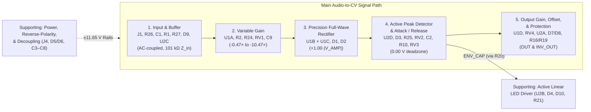
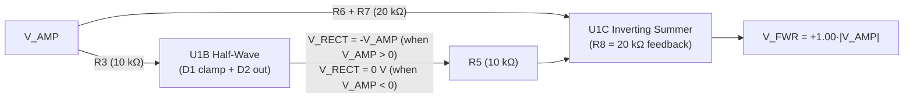

# Envelope Follower — Circuit Explanation & Audio Electronics Guide

An educational walkthrough of the Eurorack analog envelope follower specified in [EnvelopeFollowerImproved.md](./EnvelopeFollowerImproved.md) and sourced in [EnvelopeFollowerBOM.md](./EnvelopeFollowerBOM.md).

---

## 1. What Does an Envelope Follower Do?

An **audio signal** is a fast alternating voltage (`AC`) that swings above and below `0 V` dozens to thousands of times per second. A synthesizer **control voltage (`CV`)**, by contrast, is a slow-moving signal (usually `0 V` to `+5 V` or `+8 V`, or bipolar `±5 V`) that turns knobs electronically—opening a filter, sweeping a VCA, or shifting pitch.

An **envelope follower** bridges those two worlds: it listens to the incoming audio waveform, measures how loud the signal is from moment to moment, and outputs a smooth CV that traces the signal's amplitude contour (its **envelope**). Patch a drum loop, guitar, or synth voice into `IN`, and `OUT` produces a smooth modulation signal that rises sharply on every hit (`Attack`) and glides smoothly back to zero afterward (`Release`). Meanwhile, `INV_OUT` produces an exact upside-down mirror image (`-OUT`), making it effortless to *duck* a bassline or filter cutoff whenever a kick drum hits.

### Following the Main Arc

To see how the circuit turns fast AC audio into a clean, adjustable DC control voltage, we will trace the **main audio signal path** from left to right across five stages:

### How the Two Quad Op-Amp ICs Are Allocated

The entire circuit runs on just **two identical `TL074HIDR` quad op-amp chips** (`U1` and `U2`, 8 channels total, with zero spare channels left floating):

| Op-Amp | Role in Circuit | Section |
|---|---|---|
| `U2C` | `100 kΩ` AC-coupled input unity buffer (`Pins 10, 9, 8`) | [Stage 1](#stage-1-input-conditioning-protection-and-unity-buffer) |
| `U1A` | Variable input gain amplifier (`Pins 3, 2, 1`) | [Stage 2](#stage-2-variable-input-gain-stage) |
| `U1B` | Precision half-wave rectifier (`Pins 5, 6, 7`) | [Stage 3](#stage-3-unity-gain-precision-full-wave-rectifier) |
| `U1C` | Unity full-wave summing inverter (`Pins 10, 9, 8`) | [Stage 3](#stage-3-unity-gain-precision-full-wave-rectifier) |
| `U2D` | Active zero-deadzone super-diode peak detector (`Pins 12, 13, 14`) | [Stage 4](#stage-4-active-zero-deadzone-peak-detector-and-attackrelease) |
| `U1D` | Non-inverting output gain + `OFFSET` summer (`Pins 12, 13, 14`) | [Stage 5](#stage-5-output-gain-linearized-offset-inverter-and-protection) |
| `U2A` | `INV_OUT` unity inverter (`Pins 3, 2, 1`) | [Stage 5](#stage-5-output-gain-linearized-offset-inverter-and-protection) |
| `U2B` | Active linear feedback `LED` current driver (`Pins 5, 6, 7`) | [Section 3](#3-supporting-subsystem-active-linear-led-meter) |

---

## 2. Main Arc: Following the Audio Signal Path

### Stage 1: Input Conditioning, Protection, and Unity Buffer

**Components:** `J1` (`IN` jack), `R26` (`1 kΩ`, `1 W`), `C1` (`1 µF` film), `R1` (`100 kΩ`), `R27` (`10 kΩ`), `D9` (`BAV99`), `U2C`

Before amplifying or rectifying an incoming signal, a Eurorack input needs to do four jobs cleanly: stay quiet when unplugged, strip off any unwanted DC offset, present a standard high input impedance so it does not load down the source, and survive hot-plugging or electrostatic discharge (`ESD`).

1. **Normalled Input Jack (`J1`):**
   - When no patch cable is inserted into `J1`, its internal tip-normal switch (`J1.TN`) connects the tip (`IN_TIP`) directly to `GND`. That guarantees the input sits silently at `0 V` instead of floating like an antenna and generating false triggers from `50/60 Hz` mains hum. Plugging in a cable mechanically lifts `TN` open.
2. **Surge Limiting (`R26`) and AC Coupling (`C1`, `R1`):**
   - `IN_TIP` passes first through **`R26` (`1 kΩ`, `1 W` `2512`)**, which limits inrush current if you plug a live `±10 V` signal or ESD zap straight into the input.
   - Next comes **`C1` (`1 µF / 63 V` metallized polyester film)** in series with **`R1` (`100 kΩ` to `GND`)**. Because capacitors block steady DC while passing changing AC signals, `C1` and `R1` form a high-pass filter whose `-3 dB` cutoff frequency is:
     $$f_c = \frac{1}{2\pi \,(R_{26} + R_1)\, C_1} = \frac{1}{2\pi \,(101\,\text{k}\Omega)\,(1\,\mu\text{F})} \approx 1.58\,\text{Hz}$$
     Everything in the audible range (`20 Hz` to `20 kHz`) passes untouched (`< 0.03 dB` loss at `20 Hz`), while any steady DC voltage on the input cable is stripped away so it cannot masquerade as fake audio loudness.
   - **Why `101 kΩ` matters:** Eurorack inputs standardize around `100 kΩ`. A `101 kΩ` input draws virtually no current from the sending module (`< 1%` drop from a `1 kΩ` output), and even works cleanly when fed by passive attenuators or buffered instrument pickups.
   - **Why `C1` must be a film capacitor (not ceramic MLCC):** High-value `1 µF` ceramic capacitors (`X7R`) lose `30%–60%` of their capacitance under DC bias (introducing low-frequency distortion) and act like tiny piezoelectric microphones if you tap the front panel. A metallized polyester film box capacitor (`C241J105J2SA201`) has linear capacitance and zero microphonics.
3. **ESD/Overvoltage Clamping (`R27`, `D9`) and Input Buffer (`U2C`):**
   - `AC_IN` feeds **`U2C +` (`U2.10`)** through **`R27` (`10 kΩ`)**, with **`D9` (`BAV99,215` dual series diode)** tying `U2C_IN_P` between `-12V` (`Pin 1`) and `+12V` (`Pin 2`). During normal `±10 V` signals, both diodes stay reverse-biased and invisible (`~1.5 pF`). If a static spike or `±20 V` transient arrives, `D9` clamps the op-amp pin safely to the supply rails while `R27` limits clamp current to `< 0.8 mA`.
   - **`U2C`** (`Pin 9 -` wired straight to `Pin 8 Out`) is a **unity-gain voltage follower**. Its CMOS input looks like an open circuit (`~1 pA` bias current), preserving the `101 kΩ` input impedance, while its output (`IN_BUF`) drives the next stage at near-`0 Ω` impedance. Using `U2C` here decouples the panel impedance (`100 kΩ`) from the gain stage (`10 kΩ` / `100 kΩ`), and choosing `TL074H` guarantees **zero phase reversal** even if a hot transient clips the input near the rails (older `TL074` chips can invert their output polarity if driven below `~ -8 V`).

---

### Stage 2: Variable Input Gain Stage

**Components:** `U1A`, `R2` (`10 kΩ`), `R24` (`4.7 kΩ`), `RV1` (`A100k` `GAIN` pot), `C9` (`22 pF` `C0G`)

Musical sources vary wildly in level—a modular synth oscillator can hit `±10 V` (`20 Vpp`), while a line-level synth, drum machine, or guitar pickup might be `±0.5 V` to `±1.5 V`. `U1A` scales the buffered signal (`IN_BUF`) into an optimal working range for the rectifier and peak detector.

1. **Inverting Amplifier & Virtual Ground:**
   - `U1A +` (`Pin 3`) is tied to `GND` (`0 V`). Because `U1A` has negative feedback from its output (`V_AMP`, `Pin 1`) back to its inverting input (`U1A_IN_M`, `Pin 2`), the op-amp drives `V_AMP` to whatever voltage keeps `Pin 2` sitting at **`0 V` (virtual ground)**.
   - Therefore, input current $I_{\text{in}} = V_{\text{IN\_BUF}} / R_2$ cannot enter the high-Z op-amp pin; it must flow straight across the feedback path (`R24 + RV1`), setting the voltage gain to:
     $$A_{v1} = -\frac{R_{24} + R_{\text{RV1}}}{R_2} = -\frac{4.7\,\text{k}\Omega + (0\text{ to }100\,\text{k}\Omega)}{10\,\text{k}\Omega} = -0.47\times \text{ to } -10.47\times \quad (-6.56\text{ dB to }+20.4\text{ dB})$$
   - **Why is inverting the audio fine?** An envelope follower only cares about signal amplitude (`|V|`), which is identical upside-down. Better still, an inverting stage can smoothly *attenuate* hot signals below `1.0×` (`0.47×` at minimum), which a simple non-inverting amplifier (minimum gain `1 + R_f/R_g ≥ 1.0×`) cannot do!
2. **Why `R24` (`4.7 kΩ`) Is Essential:**
   - If `RV1` were the only feedback element, turning `GAIN` fully counter-clockwise (`0 Ω`) would give `0×` gain (a dead zone at the bottom of the knob), strap `U1A`'s output straight to its summing node through a mechanical wiper (causing `+20 dB` scratchy jumps if the wiper momentarily bounces), and short out `C9`.
   - Adding `R24 = 4.7 kΩ` on the summing-node side sets a clean **`0.47×` floor**: a hot `±10 V` Eurorack wave scales down to `4.7 V` peak—plenty to drive the detector cleanly without clipping the `1.40×` output stage (`4.7 V × 1.40 = 6.58 V`, well inside the `±11.45 V` rails). Cranking `GAIN` clockwise reaches `10.47×`, boosting quiet `0.5 V` signals up to `~5.2 V`.
3. **Potentiometer Taper and Wiring (`RV1 = A100k`):**
   - `RV1` is wired as a 2-terminal variable resistor (rheostat): `Pin 1 (CCW)` connects to `GAIN_MID` (`R24`), and `Pin 2 (Wiper) + Pin 3 (CW)` tie together to `V_AMP`. At CCW, the wiper sits at `Pin 1` (`0 Ω`); turning clockwise inserts more of the `100 kΩ` track, increasing gain.
   - Using an **Audio/Logarithmic (`A100k`)** taper gives fine, musical control over the critical `0.47×` to `2.5×` range in the first half of the knob's rotation (`~10–15%` resistance at noon) instead of cramming all normal Eurorack levels into the bottom millimeter of travel.
4. **Ultrasonic Compensation (`C9 = 22 pF` `C0G`):**
   - Wiring `C9` across the *entire* feedback branch (`U1A_IN_M` to `V_AMP`) creates a gentle first-order low-pass pole. At maximum gain (`104.7 kΩ`), its `-3 dB` roll-off is:
     $$f_c = \frac{1}{2\pi \,(104.7\,\text{k}\Omega)\,(22\,\text{pF})} \approx 69.1\,\text{kHz}$$
     This tames stray wiring capacitance and prevents ultrasonic oscillation in the fast `5.25 MHz` `TL074H` while leaving the `20 Hz–20 kHz` audio spectrum flat. Placing `C9` outside `R24` ensures it never gets shorted to `0 Ω` when `GAIN` is turned all the way down (where the pole rises harmlessly to `~1.54 MHz`).

---

### Stage 3: Unity-Gain Precision Full-Wave Rectifier

**Components:** `U1B`, `U1C`, `R3`–`R7` (`10 kΩ` each), `R8` (`20 kΩ`), `D1`, `D2` (`1N4148W`)

To measure loudness, we cannot average raw AC audio directly—positive and negative half-cycles would cancel out to `0 V`. We need to **rectify** the signal (`|V_AMP|`), flipping negative swings upward.

If you tried doing this with a passive diode, any audio quieter than `~0.6 V` (the silicon diode turn-on threshold) would vanish completely, and louder signals would lose `0.6 V` off the top. Instead, `U1B` and `U1C` form a classic **two-op-amp precision full-wave rectifier** that puts the diodes inside an op-amp's feedback loop so the op-amp cancels out their `0.6 V` drop automatically.

Let's trace both halves of every audio cycle:

1. **Step 1 — Precision Half-Wave Rectifier (`U1B`):**
   - `U1B +` (`Pin 5`) sits at `GND`. `R3` (`10 kΩ`) feeds `V_AMP` into `U1B -` (`Pin 6`).
   - **When $V_{\text{AMP}} > 0$ (positive swing):** Current flows into `Pin 6`, driving `U1B_OUT` (`Pin 7`) negative. This reverse-biases `D1` (OFF) and forward-biases `D2` (ON), pulling `V_RECT` negative through `R4` (`10 kΩ`) until `Pin 6` sits at `0 V` virtual ground. Thus:
     $$V_{\text{RECT}} = -\frac{R_4}{R_3} V_{\text{AMP}} = -V_{\text{AMP}} \quad (< 0)$$
     Notice that `U1B_OUT` has to swing one diode drop lower (`-V_AMP - 0.6 V`) to force `V_RECT = -V_AMP`. Here again, `TL074H`'s rail-to-rail output (`-11.45 V`) prevents `U1B` from clipping early on large peaks.
   - **When $V_{\text{AMP}} < 0$ (negative swing):** Current pulls out of `Pin 6`, driving `U1B_OUT` positive. Now `D2` is reverse-biased (OFF), disconnecting `V_RECT` from `U1B_OUT`, while **`D1` turns ON**, clamping `U1B_OUT` just `+0.6 V` above the `0 V` virtual ground. Without `D1`, `U1B` would slam open-loop to `+11.45 V` and struggle to slew back fast enough on high-frequency audio. With `D2` off and `Pin 6` held at `0 V`, no current flows through `R4`, so **`V_RECT = 0 V`**.

2. **Step 2 — Unity Summing Inverter (`U1C`):**
   - `U1C` sums two inputs into its `0 V` virtual ground (`Pin 9`):
     - `V_AMP` directly through **`R6 + R7 = 10 kΩ + 10 kΩ = 20 kΩ`** (weight `R8 / 20 kΩ = 1`)
     - `V_RECT` through **`R5 = 10 kΩ`** (weight `R8 / 10 kΩ = 2`)
   - With **`R8 = 20 kΩ`** in feedback (corrected from `22 kΩ` in older designs so gain is exact `1.00×` rather than `1.10×`):
     $$V_{\text{FWR}} = -20\,\text{k}\Omega \left(\frac{V_{\text{AMP}}}{20\,\text{k}\Omega} + \frac{V_{\text{RECT}}}{10\,\text{k}\Omega}\right) = -(V_{\text{AMP}} + 2\,V_{\text{RECT}})$$
   - Checking both half-cycles:
     - When $V_{\text{AMP}} > 0$: $V_{\text{RECT}} = -V_{\text{AMP}}$, so $V_{\text{FWR}} = -(V_{\text{AMP}} - 2\,V_{\text{AMP}}) = \mathbf{+V_{\text{AMP}}}$.
     - When $V_{\text{AMP}} < 0$: $V_{\text{RECT}} = 0$, so $V_{\text{FWR}} = -(V_{\text{AMP}} + 0) = -V_{\text{AMP}} = \mathbf{+|V_{\text{AMP}}|}$.

Across the entire waveform, **`V_FWR = +1.00 × |V_AMP|`**. Because negative half-cycles are folded upward instead of thrown away, **full-wave rectification doubles the ripple frequency** (e.g., a `100 Hz` bass note pulses at `200 Hz`), allowing faster attacks with half as much ripple!

---

### Stage 4: Active Zero-Deadzone Peak Detector and Attack/Release

**Components:** `U2D`, `D3` (`1N4148W`), `R25` (`330 Ω`), `RV2` (`A50k` `ATK`), `C2` (`1 µF` film), `R10` (`10 kΩ`), `RV3` (`A1M` `Release`), `R9` & `R20` (`10 kΩ`)

Now we have a rapid unipolar pulse train (`V_FWR`) bouncing between `0 V` and the audio peaks. This stage smooths those pulses into an expressive control voltage by charging capacitor `C2` (`ENV_CAP`) at an adjustable **Attack** rate and letting it drain at an adjustable **Release** rate.

1. **The Active "Super-Diode" Peak Detector (`U2D`, `D3`):**
   - If `V_FWR` charged `C2` through a passive diode `D3`, any quiet signal below `~0.6 V` would never reach the capacitor, chopping off quiet reverb tails and soft notes prematurely, and diode `V_F` would drift with temperature (`-2 mV/°C`) and attack current.
   - Instead, **`U2D`** wraps `D3` inside a negative-feedback loop: `U2D +` (`U2.12`) sees `V_FWR`, `U2D Out` (`U2.14`) drives `D3` anode, and **`U2D -` (`U2.13`) senses `ATK_IN` right at `D3`'s cathode**.
   - Whenever $V_{\text{FWR}} > V_{\text{ATK\_IN}}$, `U2D` boosts its output by whatever `~0.6 V` drop `D3` needs so that **`V_ATK_IN = V_FWR` down to `0.00 V`**—zero deadzone!
   - **Why take feedback at `ATK_IN` (ahead of `R25 + RV2`) instead of at `ENV_CAP`?**
     1. Putting the big `1 µF` capacitor `C2` inside the op-amp's feedback loop would introduce a massive low-frequency phase lag and make `U2D` oscillate.
     2. Closing the loop *ahead* of `R25 + RV2` makes `ATK_IN` behave as an ideal `0.00 V`-threshold rectified source, preserving true, predictable exponential RC attack curves through `R25 + RV2`.
   - **What happens between audio peaks ($V_{\text{FWR}} < V_{\text{ATK\_IN}}$)?** `U2D Out` swings down to `-11.45 V`, reverse-biasing `D3` cleanly. A silicon `1N4148W` diode has `< 25 nA` room-temperature reverse leakage (vastly lower than Schottky diodes, which leak microamps and spoil long releases), and `U2D -` (`~1 pA` CMOS input) draws virtually zero charge from `C2`. When the next peak rises above `V_ATK_IN`, `TL074H`'s `20 V/µs` slew rate and zero phase reversal recover `U2D Out` from `-11.45 V` in just `~0.6 µs`.

2. **Attack Charging Path (`R25`, `RV2`, `C2`):**
   - Current flows from `ATK_IN` through **`R25` (`330 Ω`)** and **`RV2` (`A50k`, `ATK`)** into **`C2` (`1 µF / 63 V` film)**.
   - Time constant:
     $$\tau_{\text{atk}} = (R_{25} + R_{\text{RV2}}) \cdot C_2 = (330\,\Omega\text{ to }50.33\,\text{k}\Omega) \cdot 1\,\mu\text{F} = \mathbf{0.33\text{ ms to }50.33\text{ ms}}$$
   - **Why `R25 = 330 Ω`?** Without it, turning `ATK` to `0 Ω` would force `U2D` to drive a pure `1 µF` capacitive load through `D3`, hitting current limit (`26 mA`) and injecting harsh current spikes onto the power rails. `330 Ω` keeps minimum attack snappy (`0.33 ms`, virtually instantaneous for musical transients) while protecting `U2D` (for full-scale `> 8.6 V` steps at `RV2 = 0 Ω`, `TL074H`'s internal `26 mA` short-circuit limiter gracefully caps the initial peak surge).
   - **Why `C2` MUST be film (never MLCC):** At `10 V` across `C2`, an `X7R` ceramic capacitor loses `30%–60%` of its capacitance—making Attack and Release speed up unexpectedly on loud notes—and produces microphonic spikes if you turn adjacent knobs! Polyester film (`C241J105J2SA201`) holds a rock-steady `1.00 µF` from `0 V` to `11.5 V`.

3. **Release Discharging Path (`R10`, `RV3`, `C2`):**
   - While `D3` is reverse-biased, `C2` drains to `GND` through **`R10` (`10 kΩ`)** and **`RV3` (`A1M`, `Release`)**:
     $$\tau_{\text{rel}} = (R_{10} + R_{\text{RV3}}) \cdot C_2 = (10\,\text{k}\Omega\text{ to }1.01\,\text{M}\Omega) \cdot 1\,\mu\text{F} = \mathbf{10\text{ ms to }1.01\text{ s}}$$
   - Notice `R10` taps `ENV_CAP` *directly* (`0%` voltage attenuation even at minimum `Release`), while **`R9` (`10 kΩ`)** and **`R20` (`10 kΩ`)** sit solely in series with the CMOS inputs of `U1D +` and `U2B +`. Because CMOS inputs draw only `~1 pA`, `R9` and `R20` drop `~10 nV` (`0%` loss) during normal operation while safely limiting ESD-clamp current if `C2` stays charged after power-off.
   - **Potentiometer Direction & Taper (`RV2 = A50k`, `RV3 = A1M`):** Both pots wire **`Pin 1 (CCW)` upstream** (`ATK_POT_IN` / `REL_MID`) and **`Pin 2 (Wiper) + Pin 3 (CW)` downstream** (`ENV_CAP` / `GND`). Turning either knob **clockwise** adds resistance and slows the envelope (`CW = slower attack / longer release`), and the **Audio/Log (`A`)** taper spreads out the musically sensitive fast range (`0.33–10 ms` attack, `10–150 ms` release) cleanly across the lower half of the dial.
   - *(Practical note on Attack vs. Release interaction:)* Because `R10 + RV3` drains `C2` continuously even while `R25 + RV2` charges it, keep $\tau_{\text{rel}} \gg \tau_{\text{atk}}$ when you want full peak amplitude. Setting a slow attack (`50 ms`) alongside a minimum release (`10 ms`) turns `R25 + RV2` and `R10` into a voltage divider during charging, intentionally attenuating fast transients.

---

### Stage 5: Output Gain, Linearized `OFFSET`, Inverter, and Protection

**Components:** `R11` & `R12` (`1 kΩ`), `RV4` (`B10k` `OFFSET`), `R13` (`22 kΩ`), `R15` (`10 kΩ`), `C10` (`47 pF` `C0G`), `U1D`, `U2A`, `R17` & `R18` (`10 kΩ`), `C11` (`47 pF` `C0G`), `D7` & `D8` (`BAV99`), `R16` & `R19` (`1 kΩ`, `1 W`), `J2` (`OUT`), `J3` (`INV_OUT`)

At `ENV_CAP`, we have a smooth `0 V` to `+11.45 V` unipolar envelope. The output stage scales it slightly (`~1.40×`), lets you shift its resting baseline anywhere from negative to positive (`OFFSET`), creates an inverted copy (`INV_OUT`), and hardens both jacks against Eurorack patching accidents.

1. **Low-Impedance Bipolar `OFFSET` Divider (`R11`, `RV4`, `R12`):**
   - `RV4` (`B10k` **Linear** pot—linear so exact center = `0.00 V`) spans between `R11` (`1 kΩ` to `+11.65 V`) and `R12` (`1 kΩ` to `-11.65 V`).
   - Across `12 kΩ` total (`1 kΩ + 10 kΩ + 1 kΩ`), the divider draws `23.3 V / 12 kΩ = 1.94 mA`, giving an unloaded wiper sweep of **`±9.71 V`** (`±11.65 V × 5/6`) and a wiper Thevenin source resistance $R_{\text{th}}(\alpha)$ between **`0.917 kΩ`** (extremes) and **`3.00 kΩ`** (center).

2. **Output Summing & Gain Stage (`U1D`):**
   - `ENV_CAP` enters `U1D +` (`Pin 12`) via `R9`, while `OFFSET_WIPER` enters `U1D -` (`Pin 13`) through **`R13` (`22 kΩ`)**, with **`R15` (`10 kΩ` || `C10 = 47 pF`)** in feedback (`R14` is omitted). By superposition:
     $$V_{\text{OUT\_PRE}} = V_{\text{ENV}}\left(1 + \frac{10\,\text{k}\Omega}{22\,\text{k}\Omega + R_{\text{th}}(\alpha)}\right) - V_{\text{th}}(\alpha)\left(\frac{10\,\text{k}\Omega}{22\,\text{k}\Omega + R_{\text{th}}(\alpha)}\right)$$
   - **At `OFFSET` center** ($V_{\text{th}} = 0\,\text{V}$, $R_{\text{th}} = 3.00\,\text{k}\Omega$):
     - Signal gain = $1 + \frac{10}{22 + 3.00} = \mathbf{1.400\times}$, DC offset = **`0.00 V`**. A `0–5 V` envelope maps neatly to `0–7.0 V` at `OUT`, leaving plenty of headroom before hitting the `±11.45 V` rail.
   - **At `OFFSET` extremes** ($V_{\text{th}} = \pm 9.71\,\text{V}$, $R_{\text{th}} = 0.917\,\text{k}\Omega$):
     - Signal gain = $1 + \frac{10}{22 + 0.917} = \mathbf{1.436\times}$ (**only `2.6%` gain variation** across the entire `OFFSET` sweep, because `R_th ≤ 3.0 kΩ` is small compared to `R13 = 22 kΩ`).
     - DC offset = $\mp 9.71\,\text{V} \cdot \frac{10}{22.917} = \mathbf{\mp 4.24\text{ V}}$.
   - **Why `OFFSET` wires `+12V` to CCW (`Pin 1`) and `-12V` to CW (`Pin 3`):** Because `OFFSET_WIPER` feeds the **inverting (`-`)** leg of `U1D` (`-V_th`), putting the negative voltage on `Pin 3 (CW)` makes turning `OFFSET` **clockwise shift `OUT` positive** (`-4.24 V` $\rightarrow$ `+4.24 V`).
   - **`C10 = 47 pF` (`C0G`)** across `R15` (`10 kΩ`) rolls off feedback above `339 kHz`, keeping `U1D` unconditionally stable.

3. **Inverted Output (`U2A`) — Built for Ducking & Sidechaining:**
   - `U2A` is a classic unity-gain inverting amplifier (`U2A +` to `GND`, `R17 = 10 kΩ` input, `R18 = 10 kΩ || C11 = 47 pF` feedback):
     $$V_{\text{INV\_PRE}} = -1.00\,V_{\text{OUT\_PRE}}$$
   - **Musical trick with `OFFSET` + `INV_OUT`:** Suppose you want a pad sound's filter cutoff to sit open at `+4 V` and dip down whenever a drum hits. Simply turn `OFFSET` CCW so `OUT` idles at `-4.0 V` (making `INV_OUT` idle at **`+4.0 V`**). When a drum hits, `OUT` rises toward `0 V` and `INV_OUT` **ducks smoothly downward** from `+4.0 V` toward `0 V`!

4. **Output ESD Clamps, `1 W` Fault Resistors, & Jack `TN` Safety (`D7`, `D8`, `R16`, `R19`, `J2`, `J3`):**
   - `D7` (`V_OUT_PRE`) and `D8` (`V_INV_PRE`) are `BAV99,215` dual series clamps tied to `±12V` **on the op-amp side** of `R16` and `R19`.
   - **`R16` (`OUT`) and `R19` (`INV_OUT`)** are **`1 kΩ, 1 W` (`2512`)** series resistors. Normally, `1 kΩ` provides standard Eurorack output impedance (`~1%` loss into `100 kΩ` inputs) and isolates the op-amps from `~1–2 nF` of patch-cable capacitance. In a Eurorack patching mishap—say, patching `OUT` at `+12 V` straight into another module's output driving `-12 V`—the `1 kΩ` resistor sees `24 V` continuously and dissipates:
     $$P_{\text{fault}} = \frac{(24\,\text{V})^2}{1000\,\Omega} = 0.576\,\text{W} \approx 0.58\,\text{W}$$
     A standard `0603` (`0.1 W`) or `1/4 W` (`0.25 W`) resistor would overheat and fail, whereas the **`1.0 W` `2512`** survives indefinitely!
   - **Crucial jack wiring (`J2.TN`, `J3.TN` = `NC`):** Unlike `IN` (`J1`), the normalled switch pins on `OUT` (`J2.TN`) and `INV_OUT` (`J3.TN`) **must stay unconnected**. Grounding `TN` on an output jack would short `R16`/`R19` directly to `GND` whenever no cable is plugged in!

---

## 3. Supporting Subsystem: Active Linear LED Meter

**Components:** `U2B`, `R20` (`10 kΩ`), `D4` (`3 mm` Yellow-Green LED), `D10` (`1N4148W`), `R21` (`3.3 kΩ`)

An LED is a **current-controlled** diode with a steep exponential turn-on threshold (`V_F ≈ 1.8 V` for red, `~2.0 V` for yellow-green, `~2.8–3.4 V` for emerald green/blue/white). If you simply connect `ENV_CAP` through a resistor to an LED, the LED stays completely dark until the envelope clears `~2 V`, hiding quiet signals!

`U2B` solves this by placing `D4` **inside the op-amp's feedback loop**:
- `ENV_CAP` drives `U2B +` (`U2.5`) through `R20` (`10 kΩ`).
- `U2B Out` (`U2.7`) drives `D4` anode (`Pin 2`); `D4` cathode (`Pin 1`, `LED_K`) returns to `U2B -` (`U2.6`) and **`R21` (`3.3 kΩ` to `GND`)**.
- Negative feedback forces `V_LED_K` to equal `V_ENV` regardless of what color LED is installed (since `U2B Out` simply floats `V_F` higher—`V_ENV + 2.0 V` for the specified `204-10SYGD/S530-E3` LED). By Ohm's law across `R21`:
  $$I_{\text{LED}} = \frac{V_{\text{ENV}}}{R_{21}} = \frac{V_{\text{ENV}}}{3.3\,\text{k}\Omega}$$
- **Performance across the envelope sweep:**
  - At idle (`V_ENV = 0.00 V`): **`I_LED = 0.00 mA`** (completely dark for *any* LED color, with `R22` and `R23` removed).
  - At `+5.0 V`: `I_LED = 1.52 mA` (clean, easily visible glow).
  - Linear ceiling: Because `U2B Out` tops out at `+11.45 V` and `D4` drops `~2.0 V`, brightness tracks linearly all the way up to `V_ENV ≈ +9.45 V` (`~2.86 mA`).
- **Why `D10` (`1N4148W`) sits backwards across `D4`:** At `0 V` idle, `U2B`'s tiny input offset voltage (`±1 mV`) could make `U2B Out` slam to `-11.45 V` while trying to pull `LED_K` negative—applying `11.5 V` of reverse bias across `D4`, well over a typical LED's `5 V` reverse breakdown limit ($V_R$). Anti-parallel `D10` (`Anode` to `LED_K`, `Cathode` to `LED_A`) conducts at `~0.6 V`, clamping `U2B Out` safely at `~ -0.6 V` during idle and letting `U2B` turn `D4` back on instantaneously when a signal arrives.

---

## 4. Supporting Subsystem: Power Handling, Protection, and Decoupling

**Components:** `J4` (`2×5` shrouded Eurorack header), `D5` & `D6` (`B5819W SL`), `C3` & `C4` (`22 µF / 50 V`), `C5`–`C8` (`100 nF / 50 V` `X7R`)

Eurorack power distribution carries `±12 V` over 10-pin ribbon cables without built-in per-module current limiting, and modules sit side by side on shared bus boards. Reliable power handling here uses four layers of defense:

1. **Keyed Doepfer A-100 Power Header (`J4`):**
   - Shrouded `2×5` (`2.54 mm`) header (`IDC2.54-2*5PZ`): Pins `1–2` = `-12V_IN` (marked `-12V / RED` on silkscreen), Pins `3–8` = `GND`, Pins `9–10` = `+12V_IN`. The shroud prevents 180° offset or backwards insertion with keyed cables.
2. **Series Reverse-Polarity Schottky Diodes (`D5`, `D6`):**
   - Even with a shrouded header, third-party unkeyed or mis-crimped cables happen. **`D5`** sits in series with `+12V_IN` (`Pin 2 A -> +12V_IN`, `Pin 1 K -> +12V`), and **`D6`** sits in series with `-12V_IN` (`Pin 2 A -> -12V`, `Pin 1 K -> -12V_IN`).
   - If power is plugged in backwards (`+12 V` on `-12V_IN` and `-12 V` on `+12V_IN`), both diodes reverse-bias immediately: **`0 mA` flows**, protecting both ICs and polarized capacitors without shorting the rack power supply.
   - Using `40 V / 1 A` **`B5819W SL`** Schottky diodes provides `> 1.6×` reverse-voltage margin against worst-case `24 V` rail-to-rail bias (do not substitute `20 V` `1N5817` parts), while costing only **`~0.35 V`** forward drop at the module's `~12–18 mA` draw—yielding protected internal rails of **`±11.65 V`**.
3. **Bulk Rail Storage (`C3`, `C4` = `22 µF / 50 V` SMD Electrolytic):**
   - Located immediately downstream of `D5` and `D6` to smooth low-frequency bus ripple and supply transient currents (such as `U2D` charging `C2` or `U1D`/`U2A` driving long cables).
   - **Polarity lesson (`C4`):** Electrolytic capacitors are polarized (`+` must always sit at a higher voltage than `-`). On the positive rail (`C3`), `+` connects to `+12V` and `-` connects to `GND`. On the negative rail (`C4`), **`GND` (`0 V`) is more positive than `-12 V`**, so **`C4 +` goes to `GND` and `C4 -` goes to `-12V`**! Rating both at `50 V` gives a generous `4.17×` voltage derating on `12 V` rails.
4. **Local High-Frequency IC Decoupling (`C5`–`C8` = `100 nF / 50 V` `X7R` `0603`):**
   - Large electrolytic caps have too much internal inductance to shunt MHz switching transients. Placing `100 nF` ceramic MLCCs within **`≤ 3–5 mm`** of every op-amp supply pin (`U1.4`, `U1.11`, `U2.4`, `U2.11` to `GND`) provides a local high-frequency charge reservoir so `U1` and `U2` never oscillate or cross-talk through trace inductance.
5. **Why `TL074HIDR` Instead of Classic `TL074`?**
   - Classic `TL074` clips around `±10.1 V` behind Schottky drops (and `U1B` clips `0.6 V` earlier), suffers phase reversal below `~ -8 V`, and has `±3–10 mV` offset. The pin-compatible `TL074HIDR` gives **`±11.45 V` rail-to-rail output**, **zero phase reversal**, **`±1 mV` offset**, **`20 V/µs` slew**, **`~1 pA` CMOS inputs**, and **`26 mA` short-circuit protection**.

---

## 5. From Schematic to Hardware: Materials, Layout & Bench Bring-Up

### Why Specific Component Types Were Selected

| Component Role | Parts | Type Chosen & Why |
|---|---|---|
| **Audio Coupling & Timing** | `C1`, `C2` (`1 µF / 63 V`) | **Metallized polyester film (`P=5.0 mm`):** Stable capacitance over `0–12 V` DC bias and zero piezoelectric microphonics (unlike `X7R` MLCCs). |
| **Op-Amp Compensation** | `C9` (`22 pF`), `C10`/`C11` (`47 pF`) | **`C0G/NP0` (`0603`):** Temperature-stable, zero voltage coefficient, non-microphonic HF feedback compensation. |
| **Local Rail Bypass** | `C5`–`C8` (`100 nF / 50 V`) | **`X7R` (`0603`):** Compact, low-ESR/low-ESL decoupling at `4.17×` voltage rating. |
| **Fault / Surge Resistors** | `R16`, `R19`, `R26` (`1 kΩ / 1 W`) | **`2512` `1 W` thick-film:** Survives continuous `24 V` opposing-rail patch faults (`0.58 W < 1.0 W`) where `0603`/`0.25 W` parts burn up. |
| **Panel Potentiometers** | `RV1` (`A100k`), `RV2` (`A50k`), `RV3` (`A1M`), `RV4` (`B10k`) | **Audio/Log (`A`)** tapers on Gain/Attack/Release match human logarithmic sensitivity; **Linear (`B`)** taper on `OFFSET` centers `0.00 V` symmetrically. |
| **Removed Legacy Refs** | `R14`, `R22`, `R23` | Intentionally omitted (`R14` removed to lower `U1D` gain from `2.25×` to `1.40×`; `R22`/`R23` replaced by `U2B` active current sink). |

### Dual-Sided PCB Partitioning & Assembly Strategy

To make the module inexpensive to manufacture in small runs (`$17.00` LCSC parts + Extended setup fees across 5 boards, excluding bare PCB, SMT assembly fee, shipping, and consigned jacks/pots), the board cleanly separates machine-placed SMT parts from hand-soldered hardware:

- **Rear (`B.Cu`) — JLCPCB Economic Single-Sided SMT (`44` parts, `17` lines):** `U1`, `U2`, all SMT resistors (`R1`–`R13`, `R15`–`R21`, `R24`–`R27`), `C3`–`C11`, and SMT diodes (`D1`–`D3`, `D5`–`D10`) sit exclusively on `B.Cu` (`14` Basic + `3` Extended lines).
- **Rear (`B.Cu`) — Post-PCBA Manual THT (`3` parts):** `J4` (`2×5` shrouded power header) and the two tall `P=5.0 mm` box film caps (`C1`, `C2`) mount on the rear so they stay clear of the front panel.
- **Front (`F.Cu`) — Post-PCBA Panel-Mated THT (`8` parts):** `J1`–`J3` (`WQP-PJ398SM` jacks), `RV1`–`RV4` (9 mm vertical pots), and `D4` (`3 mm` LED) sit on `F.Cu` and are test-fitted onto the `10.5 mm` standoff Eurorack panel before soldering so every shaft and bushing aligns stress-free.
- **KiCad `BAV99` Symbol Caution (`D7`–`D9`):** KiCad's built-in `Diode:BAV99` schematic symbol labels pins `1/3` as `"K"` and `2` as `"A"`, whereas the physical `Nexperia BAV99,215` `SOT-23` package is **`Pin 1 = A1` (`-12V`)**, **`Pin 2 = K2` (`+12V`)**, **`Pin 3 = COM` (`signal`)**. Always verify physical pad numbers `1/2/3` in the PCB netlist!

### Bench Bring-Up & Verification Walkthrough

Once assembled, you can verify every stage in order using a current-limited `±12 V` bench power supply, multimeter, and oscillator/scope:

1. **Cold Visual Inspection:** Confirm `D5`/`D6` cathode bars (`Pin 1 -> +12V` on `D5`; `Pin 1 -> -12V_IN` on `D6`), `C4` polarity (`+` at `GND`, `-` at `-12V`), `BAV99` orientation (`Pin 1 = -12V`, `Pin 2 = +12V`, `Pin 3 = signal`), and zero continuity from `J2.TN`/`J3.TN` to `GND`.
2. **Power Rails & Idle State:** Apply `±12 V` (current limit `~15–25 mA`). Verify `+11.65 V ± 0.1 V` at `U1.4`/`U2.4`, `-11.65 V ± 0.1 V` at `U1.11`/`U2.11`, and verify `D4` stays completely dark (`I_LED = 0.00 mA`).
3. **Output Summing & Inverter (`IN` unpatched):** Sweep `OFFSET` (`RV4`) full CCW to CW and verify `OUT` sweeps smoothly from `~ -4.24 V` to `+4.24 V`, while `INV_OUT` tracks `-OUT` within `±1%`. Return `OFFSET` to center (`0.00 V`).
4. **Zero-Deadzone Proof:** Patch a tiny `100 mVpp` (`50 mV` peak) `100 Hz` sine wave into `IN` with `GAIN` at minimum (`0.47×`, giving `~23.5 mV` peak at `V_FWR`) and fast `ATK`/`Release`. Even far below a silicon diode's `600 mV` drop, `OUT` should measure a steady positive DC envelope (`~33 mV` at `1.40×`), proving `U2D`'s `0.00 V` active peak detector works.
5. **Control Direction & LED Tracking:** Sweep `GAIN` (`RV1`) CW to confirm smooth logarithmic rise from `0.47×` to `10.47×` while `D4` tracks brightness linearly; turn `ATK` (`RV2`) CW to verify slower transient rise (`0.33–50.3 ms`); turn `Release` (`RV3`) CW to verify smooth decay lengthening (`10 ms–1.01 s`).
