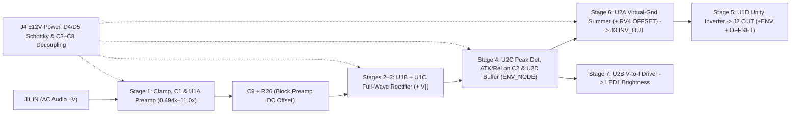

# Envelope Follower — Circuit Explanation & Audio Electronics Guide

An educational walkthrough of the Eurorack **Envelope Follower** specified in [`EnvelopeFollowerImproved.md`](./EnvelopeFollowerImproved.md) and [`EnvelopeFollowerBOM.md`](./EnvelopeFollowerBOM.md). The main narrative follows an audio signal step by step from the input jack (`J1`) to the CV output jacks (`J2`, `J3`), followed by dedicated sections explaining the LED current driver, power supply protection, op-amp architecture, and practical component choices.

---

## 1. The Big Picture: Turning Sound Into Control Voltage

An audio signal—such as a drum loop, bassline, guitar, or synth voice—is an **alternating current (AC)** waveform that swings rapidly above and below `0 V` dozens to thousands of times per second. If you patch raw audio directly into a filter cutoff or VCA CV input, the filter just vibrates at audio rate instead of opening and closing smoothly with the rhythm of the notes.

An **envelope follower** solves this by extracting the **amplitude contour** (loudness shape) of the audio and outputting it as a smooth, slow-moving **control voltage (CV)**. Every time a note hits, the output rises smoothly at a speed set by **`ATK` (Attack)**; as the note rings out or stops, the output decays back down at a rate set by **`Release`**.

### The Main Signal Arc at a Glance

### Stage-by-Stage Transformation Summary

| Stage | Circuit Block | Core Active / Key Parts | What Goes In | What Comes Out | Panel Control |
|---|---|---|---|---|---|
| **Stage 1** | Input Protection & Preamp | `R25`, `D6`, `C1`, `RV1`, `U1A` | Raw AC/DC audio at `J1` | Clean, scaled AC audio (`0.494×` to `11.0×`) | **`GAIN`** (`RV1`, `A100k`) |
| **Stages 2–3** | AC-Coupled Full-Wave Rectifier | `C9`, `U1B`, `U1C`, `D1`, `D2`, `R3`–`R8` | Bipolar AC audio (`±V`) | Positive-only rectified bounces (`+\|V\|`) | — |
| **Stage 4** | Active Peak Detector & Buffer | `U2C`, `D3`, `D9`, `C2`, `RV2`, `RV3`, `U2D` | Fast `+ \|V\|` pulses | Smooth `0 V` to `+10 V` envelope (`ENV_NODE`) | **`ATK`** (`RV2`), **`Release`** (`RV3`) |
| **Stage 6** | Virtual-Ground `OFFSET` Summer | `U2A`, `RV4`, `R11`–`R13`, `R17`–`R19`, `D8` | `ENV_NODE` (`0` to `+10 V`) | Inverted CV (`-V_env - V_offset`) at `J3` (`INV_OUT`) | **`OFFSET`** (`RV4`, `B10k`) |
| **Stage 5** | Unity Output Inverter | `U1D`, `R14`–`R16`, `D7` | `INV_OUT_RAW` | Non-inverted CV (`+V_env + V_offset`) at `J2` (`OUT`) | **`OFFSET`** (`RV4`, `B10k`) |
| **Stage 7** | Active LED Current Driver | `U2B`, `R20`, `R21`, `D10`, `LED1` | `ENV_NODE` (`V_env`) | Proportional LED current (`I_LED = V_env / 1.5 kΩ`) | Visual feedback (`LED1`) |

---

## 2. Main Signal Arc: Following the Audio from `IN` to `OUT`

### 2.1 Stage 1 — Input Armor, AC Coupling & `GAIN` Preamp

**Designators:** `J1`, `R25`, `D6`, `C1`, `RV1`, `R24`, `R1`, `R28`, `U1A`, `R2`, `R29`, `C10`

Before amplifying a single microvolt, Stage 1 solves four practical problems common to modular synthesizers: muting an unplugged input, surviving accidental over-voltages, blocking unwanted DC bias, and presenting a standardized high input impedance (`~100 kΩ`) to whatever gear is plugged in.

#### 1. Self-Muting Switched Input Jack (`J1`)
`J1` (`WQP-PJ398SM`) is a 3-pin switched mono 3.5 mm jack (`T` = Tip, `S` = Sleeve, `TN` = Tip Normal). When no cable is plugged in, an internal leaf spring connects `J1.T` (`IN_TIP`) to `J1.TN`, which is tied directly to `GND`. That grounds the input node so an unpatched jack cannot act like an antenna picking up 50/60 Hz mains hum and causing false flickering on `LED1` or `OUT`. Inserting a plug lifts the switch open so the incoming signal travels forward.

#### 2. Input Over-Voltage & ESD Armor (`R25` + `D6`)
Modular studios expose jacks to electrostatic discharge (ESD) from fingers, hot-plugged cables, `±15 V` vintage gear, or even accidental `+48 V` phantom power. Right at `IN_TIP`:
- **`R25` (`1 kΩ`, `1 W`, `2512` thick-film)** sits in series between `J1.T` and `IN_CLAMP`. Using a physically large `2512` `1 W` resistor (`200 V` rated) gives plenty of thermal and voltage margin if an external source tries to push tens of volts into the input.
- **`D6` (`BAV99`, `100 V` dual series silicon diode in `SOT-23`)** sits at `IN_CLAMP`, with its bottom anode (`Pin 1`) tied to `-12V` and its top cathode (`Pin 2`) tied to `+12V`. Under normal `±10 V` modular audio, both diodes are reverse-biased and invisible. If `IN_CLAMP` spikes above `+12V + ~0.7 V` or below `-12V - ~0.7 V`, one diode conducts and shunts the surge safely into the power rails while `R25` limits the fault current.

Notice that `D6` sits **before** `C1` rather than directly on `U1A`'s high-impedance input pin: silicon `BAV99` diodes have very low reverse leakage, and placing them ahead of `C1` prevents any trace diode leakage current from creating DC drift on the amplifier input.

#### 3. AC Coupling & High Input Impedance (`C1`, `RV1`, `R24`)
Synthesizers and mixers sometimes output audio riding on a DC offset (for example, `+2.5 V` on a single-supply pedal or uncalibrated VCO). If that DC bias reached our rectifier, the module would output a constant phantom envelope even during silence.

**`C1` (`1 µF / 63 V` `WIMA MKS2` PET film)** sits in series between `IN_CLAMP` and `AC_IN`, blocking DC (`0 Hz`) while passing AC waveforms cleanly. On the far side of `C1`, the signal passes down through the `GAIN` potentiometer **`RV1` (`A100k`)** and floor resistor **`R24` (`4.7 kΩ`)** to `GND`.

This network sets two key Stage 1 specifications:
1. **Input Impedance (`Z_in`):** Looking into `J1.T` across the audio band (where `C1` acts nearly like a short), a source sees `R25` (`1 kΩ`) in series with `RV1 + R24` (`100 kΩ + 4.7 kΩ`):
   $$Z_{\text{in}} \approx 1\,\text{k}\Omega + 100\,\text{k}\Omega + 4.7\,\text{k}\Omega = 105.7\,\text{k}\Omega$$
   *(At full `CW` gain, wiper bleed resistor `R1 = 1 MΩ` sits in parallel with `RV1 + R24`, nudging `Z_in` slightly to `~95.8 kΩ`.)* Meeting the Eurorack `~100 kΩ` input standard means passive mixers, guitar pickups, and modules with `1 kΩ` output resistors suffer `< 1%` voltage drop when patched in.
2. **High-Pass Cutoff (`f_c`):** Together with `RV1 + R24 = 104.7 kΩ`, `C1` forms a passive RC high-pass filter:
   $$f_c = \frac{1}{2\pi \cdot 104.7\,\text{k}\Omega \cdot 1\,\mu\text{F}} = 1.52\,\text{Hz}$$
   Sub-bass notes (`20–40 Hz`) and even slow sub-audio triggers pass with virtually zero attenuation or phase sag.

> **Why a bulky `WIMA MKS2` film capacitor for `C1` instead of a tiny ceramic MLCC?**  
> High-capacitance Class II ceramic caps (`X7R`/`X5R`) suffer from the **piezoelectric effect**—tapping the front panel flexes the ceramic crystal and generates microphonic voltage spikes that get amplified by `U1A` into false envelope triggers! PET box film capacitors (`WIMA MKS2`) are non-microphonic, symmetric (no polarity), and distortion-free.

#### 4. The `GAIN` Attenuator, Gain Floor & Wiper Safety (`RV1`, `R24`, `R1`, `R28`)
Rather than putting the `GAIN` pot inside `U1A`'s feedback loop (which would vary feedback impedance and risk instability or `0×` mute shorts), `RV1` acts as a passive voltage divider *ahead* of a fixed-gain non-inverting amplifier:
- `AC_IN` feeds **`RV1.3` (`CW`)**, **`RV1.2` (`Wiper`)** goes to `GAIN_WIPER`, and **`RV1.1` (`CCW`)** connects through **`R24` (`4.7 kΩ`)** to `GND`.
- Why include **`R24` (`4.7 kΩ`)**? Without `R24`, turning `GAIN` fully counter-clockwise (`CCW`) would ground the signal completely (`0×` dead mute), creating a confusing dead zone at the bottom of the knob. With `R24`, the minimum divider ratio at full CCW is `4.7 kΩ / 104.7 kΩ = 0.0449×` (or `0.0447×` including `R1`).
- **Audio/Logarithmic Taper (`A100k`):** An `A`-taper pot reaches roughly `15%` of its resistance at `50%` rotation (`12 o'clock`). That spreads `0.5×–2.1×` gain gently across the lower half of the knob—perfect for hot `±5 V` to `±10 V` Eurorack signals—while packing `2.1×–11.0×` boost into the upper half for quiet line-level synths, microphones (via preamp), or electric guitars.
- **`R1` (`1 MΩ`):** Connects `GAIN_WIPER` to `GND`. If the mechanical wiper ever momentarily lifts off the carbon track due to dust or wear, `R1` holds `U1A(+)` firmly at `0 V` instead of letting it float and blast rail noise.
- **`R28` (`1 kΩ`):** Sits in series between `GAIN_WIPER` and `PREAMP_IN` (`U1A+`), limiting current into `TL074H`'s internal input ESD diodes to `< 1 mA` during extreme hot-plug steps.

#### 5. Fixed `11.0×` Non-Inverting Preamp & Stability Compensation (`U1A`, `R2`, `R29`, `C10`)
`U1A` is wired as a classic **non-inverting op-amp amplifier**:
- Input signal enters Pin 3 (`PREAMP_IN`, `+`), drawing virtually zero current (`I_bias ≈ 1 pA` typ for `TL074H`).
- Pin 2 (`PREAMP_INV`, `-`) sees a resistor divider from `PREAMP_OUT` (Pin 1) through **`R29` (`100 kΩ`)** and **`R2` (`10 kΩ`)** to `GND`.
- Negative feedback forces `V_- = V_+`, giving a fixed voltage gain:
  $$G_{\text{U1A}} = 1 + \frac{R_{29}}{R_2} = 1 + \frac{100\,\text{k}\Omega}{10\,\text{k}\Omega} = 11.0\times \quad (+20.8\,\text{dB})$$

Multiplying `G_U1A` by `RV1`'s divider range gives the overall Stage 1 gain range:
- **Minimum (`RV1` full CCW):** `11.0 × (4.7 kΩ / 104.7 kΩ) = 0.494×` (`-6.1 dB`, keeping screaming `±10 V` oscillators comfortably unclipped)
- **Maximum (`RV1` full CW):** `11.0×` (`+20.8 dB`)

Finally, **`C10` (`15 pF` `C0G/NP0` ceramic)** sits in parallel across feedback resistor `R29` (`100 kΩ`). Even `5–10 pF` of stray PCB trace capacitance on `U1A(-)` forms an unwanted phase lag against `100 kΩ`; `C10` introduces a controlled feedback pole at:
$$f_p = \frac{1}{2\pi \cdot 100\,\text{k}\Omega \cdot 15\,\text{pF}} = 106.1\,\text{kHz}$$
This rolls off ultrasonic gain smoothly above `100 kHz` to keep `U1A` unconditionally stable while leaving `20 Hz–20 kHz` audio completely untouched.

---

### 2.2 Stages 2 & 3 — Inter-Stage DC Blocking & Precision Full-Wave Rectifier

**Designators:** `C9`, `R26`, `U1B`, `U1C`, `D1`, `D2`, `R3`–`R8`, `C17`

Now we have a well-scaled AC waveform at `PREAMP_OUT`, swinging equally positive and negative around `0 V`. Next we need to flip every negative half-cycle upside-down so the entire signal becomes positive (`+|V|`).

#### 1. Blocking `U1A`'s Amplified DC Offset (`C9`, `R26`)
Every real op-amp has a tiny built-in **input offset voltage (`V_os`)**—typically `1 mV` (up to `4 mV` max) on `TL074H`. Because `U1A` has a non-inverting DC gain of `11.0×`, its `V_os` gets multiplied to `11–44 mV` of DC voltage at `PREAMP_OUT`.

That might sound tiny, but remember Stage 4 uses a **zero-deadzone peak detector**! If `44 mV` of DC leaked into the rectifier, the module would output a permanent false envelope offset even with nothing patched in.

**`C9` (`1 µF / 63 V` `WIMA MKS2` film)** breaks the DC path between `PREAMP_OUT` and `AC_PRE`. Because `U1B(-)` and `U1C(-)` are held at `0 V` **virtual ground**, `C9` sees `R3` (`100 kΩ`) in parallel with `R4 + R5` (`200 kΩ`) and power-up ground reference **`R26` (`1 MΩ`)**:
$$R_{\text{load}} = 100\,\text{k}\Omega \parallel 200\,\text{k}\Omega \parallel 1\,\text{M}\Omega = 62.5\,\text{k}\Omega, \qquad f_c = \frac{1}{2\pi \cdot 62.5\,\text{k}\Omega \cdot 1\,\mu\text{F}} = 2.55\,\text{Hz}$$
All audio frequencies pass right through while `U1A`'s DC offset is completely stripped away.

#### 2. Why Full-Wave, and Why Not Plain Diodes?
- **Half-wave vs. full-wave:** Throwing away the negative half of an audio signal cuts the pulse rate in half (at `50 Hz`, the detector waits `20 ms` between peaks instead of `10 ms`), causing twice as much droop/ripple and uneven response on asymmetrical waveforms like sawtooth waves or brass instruments. Full-wave rectification captures *both* positive and negative peaks (`2× f_in` ripple).
- **Why passive diodes fail:** A standard silicon diode needs `~0.6 V` forward voltage (`V_f`) just to start conducting (`±0.6 V` = `1.2 Vpp` deadzone). Quiet signals vanish completely, and louder signals lose `0.6 V` off the bottom. Wrapping diodes inside an op-amp's negative feedback loop causes the op-amp to supply that `0.6 V` automatically, turning the circuit into a **precision ("ideal") rectifier** accurate down to millivolts.

#### 3. Walking Through `U1B` + `U1C` on Both Half-Cycles
`U1B` (Precision Half-Wave Rectifier) and `U1C` (Inverting Summing Amplifier) work as a team. Both non-inverting inputs (`U1B+` Pin 5 and `U1C+` Pin 10) are tied to `GND`, holding their inverting inputs (`RECT_SUM` and `FWR_SUM`) at `0 V` virtual ground whenever feedback is active.

Let the AC voltage at `AC_PRE` be $V_{\text{pre}}$:

- **Case A — Positive Half-Cycle ($V_{\text{pre}} > 0$):**
  1. Positive voltage pushes current through `R3` (`100 kΩ`) into `RECT_SUM` (`U1B-`), nudging it positive, so `U1B` output (`RECT_OUT_N`, Pin 7) swings **negative**.
  2. That reverse-biases **`D1`** (`1N4148W`, `K` at `RECT_SUM`, `A` at `RECT_OUT_N`) so `D1` turns **OFF**, and forward-biases **`D2`** (`1N4148W`, `K` at `RECT_OUT_N`, `A` at `RECT_HALF`), turning `D2` **ON**.
  3. Feedback now closes around `U1B` through **`R6` (`100 kΩ`)**, holding `RECT_SUM` at `0 V` virtual ground. Because `R3 = R6 = 100 kΩ`, `U1B` acts as a unity inverter at `RECT_HALF` (`U1B` automatically drops `RECT_OUT_N` an extra `~0.6 V` below `RECT_HALF` to overcome `D2`):
     $$V_{\text{RECT\_HALF}} = -V_{\text{pre}}$$
  4. Now look at `U1C` (`FWR_SUM`, Pin 9): it sums *two* currents into its `200 kΩ` feedback resistor **`R8`**:
     - The raw positive signal $V_{\text{pre}}$ via **`R4 + R5`** (`100 kΩ + 100 kΩ = 200 kΩ`), and
     - The inverted signal $V_{\text{RECT\_HALF}} = -V_{\text{pre}}$ via **`R7`** (`100 kΩ`), which carries **double** the weight (`200 kΩ / 100 kΩ = 2×`)!
     $$V_{\text{FWR\_OUT}} = -200\,\text{k}\Omega \left(\frac{V_{\text{pre}}}{200\,\text{k}\Omega} + \frac{-V_{\text{pre}}}{100\,\text{k}\Omega}\right) = -V_{\text{pre}} + 2V_{\text{pre}} = +V_{\text{pre}}$$

- **Case B — Negative Half-Cycle ($V_{\text{pre}} < 0$):**
  1. Negative voltage pulls current out of `RECT_SUM`, so `U1B` output (`RECT_OUT_N`) swings **positive**.
  2. Now **`D1` turns ON** and **`D2` turns OFF**. `D1` closes a tight local clamp from `RECT_OUT_N` straight back to `RECT_SUM`, keeping `U1B` out of rail saturation (`RECT_OUT_N ≈ +0.6 V`, `RECT_SUM = 0 V`).
  3. Because `D2` is OFF, `U1B` is completely disconnected from `RECT_HALF`. And since both ends of `R6` (`RECT_SUM`) and `R7` (`FWR_SUM`) sit at `0 V` virtual ground with no drive at `RECT_HALF`, `V_RECT_HALF = 0 V` and zero current flows through `R7`!
  4. `U1C` therefore sees *only* $V_{\text{pre}}$ arriving through `R4 + R5 = 200 kΩ`, inverting it via `R8 = 200 kΩ`:
     $$V_{\text{FWR\_OUT}} = -200\,\text{k}\Omega \left(\frac{V_{\text{pre}}}{200\,\text{k}\Omega} + 0\right) = -V_{\text{pre}} = +|V_{\text{pre}}|$$

Result: whether $V_{\text{pre}}$ goes positive or negative, `FWR_OUT` outputs **`+1.000 × |V_pre|`**!

#### 4. Why `0.1%` Thin-Film Resistors (`R3`–`R8`) & `C17` (`15 pF`) Matter
Look closely at the positive half-cycle equation above: `U1C` computes `+2 - 1 = +1` by subtracting the `R4+R5` feedforward path from twice the `R7` rectified path. Because of that subtraction, resistor tolerance errors in `R3`, `R6`, and `R7` have **double sensitivity** on positive vs. negative symmetry:
- With ordinary `1%` resistors, worst-case mismatch between positive and negative half-cycles reaches **`±8.2%`**. That turns a clean `2× f_in` double-bounce waveform into a lopsided waveform, injecting fundamental-frequency (`1× f_in`) ripple into Stage 4.
- Using **`0.1%` thin-film resistors** (`R3`–`R7` = `100 kΩ ±0.1%`, `R8` = `200 kΩ ±0.1%`) keeps worst-case asymmetry **under `0.8%`**! Notice also why `200 kΩ` in the feedforward leg is built from two `100 kΩ 0.1%` resistors in series (`R4 + R5`): it reuses the exact same BOM reel (`C122538`, tighter `±25 ppm/°C` drift) as `R3`, `R6`, and `R7`.
- **`C17` (`15 pF` `C0G`)** across `R8` (`200 kΩ`) provides high-frequency feedback compensation on `U1C` (`f_p = 53.1 kHz`), taming any ultrasonic ringing at the sharp zero-crossing "V" notches of the rectified waveform.

---

### 2.3 Stage 4 — Active Zero-Deadzone Peak Detector, Attack/Release Controls & Buffer

**Designators:** `U2C`, `D3`, `D9`, `C16`, `R9`, `RV2`, `C2`, `R10`, `RV3`, `U2D`, `R27`

At `FWR_OUT`, our signal is now all positive (`+|V|`), bouncing rapidly down to `0 V` twice every audio cycle. Stage 4 turns those fast bounces into a smooth envelope by storing charge on capacitor **`C2` (`1 µF` `WIMA MKS2` film)**—charging rapidly up to new peaks (**Attack**) and bleeding slowly back down between peaks (**Release**).

#### 1. Active Zero-Deadzone Loop (`U2C` + `U2D` + `R27`)
If you connected `FWR_OUT` through a simple diode `D3` straight into `C2`, `D3`'s `~0.6 V` forward drop would once again swallow quiet signals (`< 0.6 V`) and distort low-level dynamics.

Instead, this circuit puts **`D3` (`1N4148W`) inside `U2C`'s negative feedback loop**:
- `FWR_OUT` enters `U2C(+)` (Pin 10).
- `U2C` output (`DET_OP_OUT`, Pin 8) pushes charge through `D3` → `R9` → `RV2` onto **`C2`** (`ENV_CAP`).
- **`U2D`** (Pin 12 `+`, Pin 13 `-` wired to Pin 14 `OUT`) acts as an ultra-high-impedance **unity-gain voltage follower**, buffering `ENV_CAP` onto **`ENV_NODE`**. Because `TL074H`'s input bias current is only `~1 pA`, `U2D` reads the capacitor's voltage without stealing any charge from `C2`.
- **`R27` (`10 kΩ`)** returns that buffered voltage from `ENV_NODE` back to `U2C(-)` (`DET_FB`, Pin 9).

How it tracks with zero deadzone: whenever `FWR_OUT` rises even `1 mV` above `ENV_NODE`, `U2C` drives `DET_OP_OUT` up as high as necessary (automatically adding `D3`'s `~0.6 V` drop plus any voltage drop across `R9` and `RV2`) until `ENV_NODE` matches `FWR_OUT`. Even tiny `20 mVpp` inputs track cleanly with **`0 V` diode deadzone**!

#### 2. Anti-Saturation Clamp (`D9`) & Lead Compensation (`C16`)
Two subtle components make this active loop fast and rock-steady:
- **`D9` (`1N4148W`, Anode at `DET_FB`, Cathode at `DET_OP_OUT`):** When `FWR_OUT` drops below `ENV_NODE` (between audio peaks or after a note ends), `U2C(+)` is lower than `U2C(-)`, so `U2C` swings negative. That immediately turns `D3` OFF so `C2` cannot discharge backward into `U2C`. Without `D9`, breaking the feedback loop would cause `U2C` to slam into the `-11.65 V` negative rail—and recovering from deep saturation causes sluggish re-triggering on the next transient. Instead, as soon as `DET_OP_OUT` dips `~0.6 V` below `DET_FB`, **`D9` conducts**, closing a local feedback loop around `U2C` (`DET_FB` tracks `FWR_OUT` and `DET_OP_OUT` rests gently at `FWR_OUT - 0.6 V`, just one diode drop below `D3` turn-on!). Meanwhile, `U2D`'s output—*not* `C2`—supplies the small `≤ 1 mA` clamp current through `R27` (`10 kΩ`), leaving `C2`'s stored charge untouched.
- **`C16` (`47 pF` `C0G` across `DET_OP_OUT` and `DET_FB`):** During attack, `RV2` and `C2` add phase delay inside `U2C`'s loop alongside `U2D`. Above `f_z = 1 / (2π × 10 kΩ × 47 pF) = 338.6 kHz`, `C16` bypasses `R27` and feeds high frequencies straight back from `U2C`'s output to its `-` input, guaranteeing unconditional phase margin and clean transient edges without ringing.

#### 3. Attack Timing (`R9 = 470 Ω`, `RV2 = A50k`)
Charging current flows: `U2C` → `D3` → **`R9` (`470 Ω`)** → **`RV2` (`A50k`)** → `C2` (`1 µF`).
- **Why `R9 = 470 Ω` is upstream of `C2`:** If `RV2` is turned all the way down (`0 Ω` for fastest attack), an op-amp trying to drive an unbuffered `1 µF` capacitor directly sees a dead short at high frequencies, hitting short-circuit limits and losing phase margin. Placing `R9` before `C2` caps `U2C`'s peak output current at `(11.5 V - 0.6 V) / 470 Ω ≈ 23 mA`—safely inside `TL074H`'s `26 mA` continuous short-circuit limit—and keeps `R9` completely out of the release divider path so there is zero `Release`-dependent amplitude sag.
- **Timing Range:** The passive RC time constant is $\tau_{\text{atk}} = (470\,\Omega + R_{\text{ATK}}) \times 1\,\mu\text{F} = 0.47\,\text{ms}$ to `50.5 ms`. Because `U2C` drives hard toward its `+11.5 V` rail during fast steps (closed-loop overdrive), a `0 → 5 V` audio hit actually charges `C2` in **`~0.2 ms` (min `ATK`) to `~25 ms` (max `ATK`)**.
- **Panel Behavior:** `RV2` is wired with `Pin 1` (`CCW`) at `ATK_IN` and `Pin 2 + Pin 3` shorted at `ENV_CAP` (shorting wiper to CW guarantees the circuit stays safely closed at `50 kΩ` even if a wiper ever skips). Turning `ATK` **clockwise (`CW`)** adds resistance and **slows down the attack**. Using an **`A50k` audio/log taper** spreads ultra-snappy `0.2–4 ms` drum transient settings smoothly across the lower half of the knob.

#### 4. Release Timing & Why `C2` Must Be Film (`R10 = 22 kΩ`, `RV3 = A1M`)
Between peaks, `D3` is reverse-biased (`1N4148W` has `< 25 nA` leakage, unlike power Schottky diodes whose `50–500 µA` leakage would prematurely drain `C2` and ruin slow decays!). `C2` discharges smoothly toward `GND` through **`R10` (`22 kΩ`)** in series with **`RV3` (`A1M`, `Pin 1` to `REL_MID`, `Pin 2+3` shorted to `GND`)**:
$$\tau_{\text{rel}} = (22\,\text{k}\Omega + R_{\text{REL}}) \times 1\,\mu\text{F} = 22\,\text{ms} \;\text{to}\; 1.022\,\text{s}$$
Turning **`Release` clockwise (`CW`)** increases resistance for longer decays, and the **`A1M` audio/log taper** expands snappy `22–150 ms` settings across the bottom `50%` of knob travel instead of cramming them into the first `9%` as a linear pot would.

> **Why `WIMA MKS2` (`1 µF / 63 V` PET Film) is mandatory for `C2`:**  
> Standard `X7R` ceramic capacitors lose `30–60%` of their capacitance under `5–10 V` DC bias! If `C2` were an `X7R` cap, loud envelopes would decay nearly twice as fast as quiet ones, distorting the musical feel. PET film (`MKS2`) exhibits **zero DC-bias capacitance derating** and ultra-low leakage.

---

### 2.4 Stages 5 & 6 — `OFFSET` Mixing, Dual Outputs & Output Protection

**Designators:** `RV4`, `R11`–`R19`, `C11`–`C15`, `U2A`, `U1D`, `D7`, `D8`, `J2`, `J3`

Buffered `ENV_NODE` (`0 V` to `+10 V` unipolar envelope) now drives two matched CV outputs: **`OUT` (`J2`)** and **`INV_OUT` (`J3`)**, shifted anywhere from `-8.89 V` to `+8.89 V` by the **`OFFSET`** knob (`RV4`).

#### 1. Clean Bipolar `OFFSET` Generator (`R11`, `R12`, `C11`–`C15`, `RV4 = B10k`)
`RV4` (`B10k` linear taper—so `12 o'clock` sits right at `0 V`) spans between `OFFSET_TOP` (`CW`, Pin 3) and `OFFSET_BOT` (`CCW`, Pin 1), fed from the protected `±11.65 V` rails through `R11` (`1 kΩ`) and `R12` (`1 kΩ`):
- Total string resistance is `1 kΩ + 10 kΩ + 1 kΩ = 12 kΩ`, drawing `23.3 V / 12 kΩ = 1.94 mA`.
- That establishes `OFFSET_TOP = +9.71 V` and `OFFSET_BOT = -9.71 V` (`P_RV4 = 19.4² / 10 kΩ = 37.6 mW`, safely below a 9 mm pot's `50 mW` rating).
- **Rail Ripple Filtering:** Because `RV4` taps the `±12V` supply rails directly, any switching noise on your Eurorack bus PSU would leak straight onto the CV outputs without filtering. **`C11` (`22 µF`) + `C12` (`100 nF`)** bypass `OFFSET_TOP` to `GND` (`f_c ≈ 7.9 Hz`), **`C13` (`22 µF`, `+` to `GND`, `-` to `OFFSET_BOT`) + `C14` (`100 nF`)** bypass `OFFSET_BOT` to `GND`, and **`C15` (`100 nF`)** shunts high-frequency wiper noise at `OFFSET_WIPER` to `GND`.

#### 2. Virtual-Ground Summing (`U2A` → `INV_OUT`) & Unity Inversion (`U1D` → `OUT`)
Notice the numbering in the specification tables: **`U2A` (Stage 6) sums first to create `INV_OUT`, and `U1D` (Stage 5) inverts that sum to create `OUT`!** Why reorder the stages so `INV_OUT` comes first?

Because `U2A(+)` (Pin 3) is grounded, `U2A(-)` (Pin 2, `INV_SUM`) is a **`0 V` virtual ground**:
- `ENV_NODE` feeds `INV_SUM` through **`R17` (`10 kΩ`)**.
- `OFFSET_WIPER` feeds `INV_SUM` through **`R13` (`10 kΩ`)**.
- **`R18` (`10 kΩ`)** closes negative feedback to `INV_OUT_RAW` (`U2A` Pin 1).

Because `INV_SUM` stays frozen at `0 V`, the changing Thévenin impedance of `RV4`'s wiper (`917 Ω` at the ends to `3.0 kΩ` at center) **causes `0%` shift in envelope signal gain**—`V_env` always sees an exact `-10 kΩ / 10 kΩ = -1.000×` gain! Meanwhile, `R13` (`10 kΩ`) slightly scales the `±9.71 V` open-circuit pot voltage by `10 kΩ / (10 kΩ + 917 Ω)` to `±8.89 V`:
$$V_{\text{INV\_OUT\_RAW}} = -\left(V_{\text{env}} + \frac{10\,\text{k}\Omega}{10\,\text{k}\Omega + R_{\text{pot\_th}}(\theta)}\,V_{\text{pot}}(\theta)\right)$$

Next, **`U1D`** (`U1D+` = `GND`, **`R14 = 10 kΩ`** input, **`R15 = 10 kΩ`** feedback) simply flips the sign (`-1.000×`) to yield `ENV_OUT`:
$$V_{\text{ENV\_OUT}} = +V_{\text{env}} + V_{\text{offset}}, \qquad V_{\text{offset}} \in [-8.89\,\text{V},\, +8.89\,\text{V}]$$
- Turning `RV4` **clockwise (`CW`)** shifts **`OUT` positive** and **`INV_OUT` negative**.
- Retaining `1.000×` overall output gain preserves Stage 4's full `0–10 V` dynamic range without clipping `U1D`/`U2A` early.
- **Musical use of `INV_OUT` + `OFFSET`:** Set `OFFSET` to `+5 V` and patch `INV_OUT` to a filter cutoff or VCA: now the CV starts high (`+5 V`, filter open) during silence and **ducks downward** toward `0 V` or `-5 V` whenever a kick drum hits—instant analog sidechain ducking!

#### 3. Eurorack Output Protection (`R16`, `R19`, `D7`, `D8`, `J2`, `J3`)
Eurorack patch cables are unplugged and re-patched live, making output faults routine:
- **`R16` (`OUT`) and `R19` (`INV_OUT`) = `1 kΩ`, `1 W`, `2512` thick-film:**
  - Establishes standard `1 kΩ` Eurorack output impedance (`< 1%` loss into `100 kΩ` inputs), isolates the op-amps from capacitive long patch cables (preventing oscillation), and limits a short-to-`GND` to `~11.5 mA` (safely below `TL074H`'s `26 mA` limit).
  - Why **`1 W` (`2512`)** instead of tiny `0603` (`0.1 W`) resistors? If you accidentally patch another module's `+12 V` output straight into our jack while it is sitting at `-11.6 V` (`ΔV ≈ 23.6 V`), `1 kΩ` dissipates $23.6^2 / 1000 = 0.56\,\text{W}$ continuously—smoking a `0603` or `1/4 W` part, whereas a `1 W` `2512` resistor survives indefinitely.
- **`D7` (`OUT`) and `D8` (`INV_OUT`) = `BAT54S` (`30 V` dual series Schottky in `SOT-23`):** Placed behind `R16`/`R19` at `ENV_OUT` and `INV_OUT_RAW`, clamping external ESD or over-voltage surges at `~0.35 V` past `±12V` *before* `TL074H`'s internal silicon ESD clamps (`±10 mA` max) can take stress. Because op-amp output nodes are low-impedance, Schottky reverse leakage causes zero drift here.
- **Switched Normal Pins (`J2.TN`, `J3.TN` = `NC`):** Unlike the input jack `J1`, output jack normal pins are left **strictly disconnected (`NC`)** so unplugged outputs are never shorted to ground through `R16`/`R19`.

---

## 3. Supporting Subsystems

### 3.1 Stage 7 — Active Transconductance `LED1` Driver (`U2B`, `R20`, `R21`, `D10`, `LED1`)

How do you make an LED track envelope voltage linearly from **completely off at `0 V`** (zero idle glow) to bright at `+10 V`, regardless of whether the builder solders a Yellow (`2.0 V`), Red (`1.7–2.4 V`), Green (`2.0 V`), or Blue (`3.4 V`) LED?

You build a **Voltage-to-Current (transconductance) source** with **`U2B`**:
- `ENV_NODE` feeds `U2B(+)` (Pin 5) through **`R20` (`10 kΩ`)** (input protection).
- `U2B` output (`LED_ANODE`, Pin 7) drives **`LED1` Anode**.
- `LED1` Cathode (`LED_FB`) connects back to `U2B(-)` (Pin 6) and **`R21` (`1.5 kΩ`)** to `GND`.

Negative feedback forces `U2B(-)` (`LED_FB`) to equal `V_env`. By Ohm's law, the current through `R21`—which has nowhere else to come from except through `LED1`—is strictly proportional to `V_env`:
$$I_{\text{LED}} = \frac{V_{\text{env}}}{1.5\,\text{k}\Omega}$$
- At `V_env = 0 V`: **`0.00 mA`** (completely dark when silent)
- At `V_env = 5 V`: **`3.33 mA`**
- At `V_env = 10 V`: **`6.67 mA`**

`U2B` automatically raises `LED_ANODE` to `V_env + V_f` to push the exact target current regardless of LED color or temperature.

**Why is `D10` (`1N4148W`) wired backwards (anti-parallel) across `LED1`?**  
If `V_env` ever sits even a couple of millivolts negative (due to tiny op-amp `V_os`), `U2B` tries to pull current backward through `LED1`. An LED is a one-way street; without `D10`, `U2B` would slam to `-11.65 V`, exceeding a typical LED's `~5 V` reverse breakdown limit! Connecting `D10` with Anode to `LED_FB` and Cathode to `LED_ANODE` turns `D10` ON at `-0.6 V`, closing the feedback loop harmlessly and protecting `LED1`.

---

### 3.2 Power Handling, Reverse-Polarity Protection & Decoupling (`J4`, `D4`, `D5`, `C3`–`C8`)

#### 1. Keyed Eurorack Power Header (`J4`) & Reverse-Polarity Protection (`D4`, `D5`)
`J4` (`IDC2.54-2*5PZ`, mounted on `B.Cu`) is a shrouded/keyed `2×5` Eurorack power header following the Doepfer A-100 standard:
- **Pins `1–2`**: `-12V_IN` (red stripe on ribbon cable)
- **Pins `3–8`**: `GND`
- **Pins `9–10`**: `+12V_IN`

Even with a keyed shroud, unkeyed DIY power cables can still be plugged in backwards—which normally swaps `+12 V` and `-12 V`, destroying op-amps and popping electrolytic capacitors instantly. **`D4` and `D5` (`B5819W SL`, `40 V / 1 A` Schottky, `SOD-123`)** sit in series right after `J4`:
- **`D4`**: Anode (`Pin 2`) to `+12V_IN`, Cathode (`Pin 1`) to protected `+12V`.
- **`D5`**: Cathode (`Pin 1`) to `-12V_IN`, Anode (`Pin 2`) to protected `-12V`.

Three critical design choices here:
1. **Low forward drop:** Schottky diodes drop only `~0.35 V` under this module's `< 20 mA` total draw, giving clean **`±11.65 V` protected rails**.
2. **`40 V` breakdown margin:** Under a reversed or shorted `±12 V` bus fault, reverse voltage across a blocking diode can reach `24 V` (rail-to-rail span)—making a `40 V` `B5819W` essential (a `20 V` `1N5817` would break down).
3. **Downstream placement:** **`C3`, `C4`, `C5`–`C8`, and all ICs sit strictly downstream of `D4`/`D5`**, so a backwards ribbon cable draws `0 mA` and never reverse-biases the electrolytic capacitors.

#### 2. Two-Tier Rail Decoupling (`C3`, `C4` vs. `C5`–`C8`)
Clean op-amp behavior requires both low-frequency energy storage and high-frequency local impedance control:
- **Bulk Electrolytics (`C3`, `C4` = `22 µF / 50 V` SMD electrolytic):** Smooth low-frequency supply ripple near `J4`. Notice polarity carefully on the negative rail:
  - **`C3` (`+12V`):** `+` (`Pin 1`) to `+12V`, `-` (`Pin 2`) to `GND`.
  - **`C4` (`-12V`):** `+` (`Pin 1`) to `GND`, `-` (`Pin 2`) to `-12V` (because `GND` is `11.65 V` *more positive* than `-12V`!).
- **Local IC Bypass Capacitors (`C5`–`C8` = `100 nF / 50 V` `X7R` `0603`):** Electrolytics become inductive at megahertz frequencies. Placing small `100 nF` ceramic capacitors within `< 3–5 mm` of each IC's power pins (`C5`/`C6` at `U1` Pins `4`/`11` → `GND`, `C7`/`C8` at `U2` Pins `4`/`11` → `GND`) supplies instantaneous surge current for `TL074H`'s `20 V/µs` slewing edges and prevents rail bounce or oscillation. Using `50 V` rated X7R parts on `12 V` rails minimizes capacitance loss from DC-bias derating.

---

### 3.3 Op-Amp Architecture (`2× TL074HIDR`, `U1` & `U2`)

All 8 analog blocks fit neatly onto **two identical `TL074HIDR` (`SOIC-14`) quad op-amps** with **zero unused or floating channels** (unused op-amps left floating can oscillate rail-to-rail and inject noise into the supply):

| IC / Channel | Stage & Function | `+` Pin | `-` Pin | `OUT` Pin | Key Role / Reason `TL074H` Shines Here |
|---|---|---:|---:|---:|---|
| **`U1A`** | Stage 1 Non-Inverting Preamp (`11.0×`) | Pin 3 | Pin 2 | Pin 1 | `1 pA` bias doesn't load `RV1`; phase-reversal-free input |
| **`U1B`** | Stage 2 Precision Half-Wave Rectifier | Pin 5 | Pin 6 | Pin 7 | `20 V/µs` slew rate crosses diode deadzone cleanly at `20 kHz` |
| **`U1C`** | Stage 3 Full-Wave Summing (`1.000×`) | Pin 10 | Pin 9 | Pin 8 | `5.25 MHz` GBW handles sharp rectified corners accurately |
| **`U1D`** | Stage 5 Unity Output Inverter (`OUT`) | Pin 12 | Pin 13 | Pin 14 | Rail-to-rail output (`~115 mV` from rails); `±26 mA` short-safe |
| **`U2A`** | Stage 6 Virtual-Ground Summer (`INV_OUT`) | Pin 3 | Pin 2 | Pin 1 | `1 mV` typ `V_os` keeps zero-offset CV error minimal |
| **`U2B`** | Stage 7 Active V-to-I `LED1` Driver | Pin 5 | Pin 6 | Pin 7 | Cleanly drives `LED1` up to `6.67 mA` at `+10 V` |
| **`U2C`** | Stage 4 Active Peak Detector | Pin 10 | Pin 9 | Pin 8 | Fast slewing + internal ESD clamps + phase-reversal immunity |
| **`U2D`** | Stage 4 Peak-Hold Unity Buffer | Pin 12 | Pin 13 | Pin 14 | `1 pA` input bias holds `C2` (`ENV_CAP`) without draining it |

*(Both ICs share Pin 4 = `+12V` and Pin 11 = `-12V`.)*

---

## 4. Practical Component Guide & Construction Notes

### 4.1 Why Each Component Type Was Chosen (`EnvelopeFollowerBOM.md`)

A great way to learn hardware design is to look at *why* a BOM mixes different resistor, capacitor, and diode technologies instead of using the cheapest part everywhere:

| Component Group | Designators | Package / Part in BOM | Why This Specific Technology? |
|---|---|---|---|
| **Audio Coupling & Peak-Hold Caps** | `C1`, `C2`, `C9` | `1 µF 63 V` `WIMA MKS2` PET Box Film (THT) | Zero DC-bias capacitance drop (unlike `X7R`!), no piezoelectric microphonics, symmetric AC operation, ultra-low leakage on `C2` |
| **Stability Compensation Caps** | `C10`, `C17` (`15 pF`), `C16` (`47 pF`) | `0603` `50 V` **`C0G/NP0`** MLCC | Class I dielectric: zero voltage/temperature drift, rock-solid feedback poles (`106.1 kHz`, `53.1 kHz`, `338.6 kHz`) |
| **Power & `OFFSET` Bypass Caps** | `C5`–`C8`, `C12`, `C14`, `C15` (`100 nF`) | `0603` `50 V` **`X7R`** MLCC | Compact, cheap high-frequency decoupling where exact capacitance tolerance isn't critical (`50 V` rating limits DC-bias loss) |
| **Bulk Rail & Filter Electrolytics** | `C3`, `C4`, `C11`, `C13` (`22 µF`) | `50 V` SMD Aluminum Electrolytic (`6.3×5.4 mm`) | High bulk capacitance at low cost for `< 10 Hz` `OFFSET` RC filtering and rail energy storage (observe `+`/`-` orientation on negative rails!) |
| **FWR Precision Resistors** | `R3`–`R7` (`100 kΩ`), `R8` (`200 kΩ`) | `0603` **`0.1%` Thin-Film** (`RT0603...`) | Suppresses positive/negative FWR half-wave mismatch to `< 0.8%` (vs. `±8.2%` with `1%` parts), avoiding `1× f_in` ripple |
| **Fault-Rated I/O Resistors** | `R16`, `R19`, `R25` (`1 kΩ`) | **`2512` `1 W`** (`200 V` thick-film) | Survives continuous opposite-rail `±12 V` output-to-output patching (`0.56 W < 1 W`) and external input surges |
| **Signal Diodes** | `D1`, `D2`, `D3`, `D9`, `D10` | `1N4148W` (`SOD-123`, `75 V / 4 ns`) | Fast switching and `< 25 nA` low reverse leakage—vital on `D3` so `C2` holds long `1 s` decays |
| **Input ESD Clamp** | `D6` | `BAV99` (`SOT-23`, `100 V` silicon) | High reverse breakdown (`100 V`) and ultra-low leakage ahead of `C1` |
| **Output ESD / Back-Feed Clamps** | `D7`, `D8` | `BAT54S` (`SOT-23`, `30 V` Schottky) | Low `~0.35 V` forward clamp engages *before* `TL074H` internal silicon ESD diodes (`±10 mA` limit) |
| **Power Reverse-Polarity Diodes** | `D4`, `D5` | `B5819W` (`SOD-123`, `40 V / 1 A` Schottky) | Low `~0.35 V` drop (`±11.65 V` rails) plus `40 V` blocking above `24 V` rail-to-rail span |

#### Potentiometer Tapers & Reference Numbering Notes
- **Taper Choice (`A` vs. `B`):** `RV1` (`GAIN`, `A100k`), `RV2` (`ATK`, `A50k`), and `RV3` (`Release`, `A1M`) use **audio/logarithmic (`A`)** tapers because human ears and musical timing feel exponential—giving fine control at low settings while still reaching big extremes at `CW`. `RV4` (`OFFSET`, `B10k`) uses a **linear (`B`)** taper so `12 o'clock` sits cleanly at `0 V`.
- **Lug Orientation (viewed from shaft side, `1 = CCW`, `2 = Wiper`, `3 = CW`):**
  - `RV1` (`GAIN`): `CW` = higher gain (`0.494× → 11.0×`).
  - `RV2` (`ATK`): `CW` = slower attack (`~0.2 ms → ~25 ms`).
  - `RV3` (`Release`): `CW` = slower release (`22 ms → 1.022 s`).
  - `RV4` (`OFFSET`): `CW` = positive `OUT` (`-8.89 V → +8.89 V`) and negative `INV_OUT`.
- **Designator & BOM Notes:** The BOM totals **65 components** across **29 unique lines** (`53` SMT parts placed by JLCPCB PCBA + `12` THT parts soldered manually). Reference numbers `R22` and `R23` are intentionally absent (legacy passive LED bias resistors replaced by Stage 7's active `U2B` driver). If optimizing JLCPCB Extended feeder fees, `R8` (`200 kΩ 0.1%`, `C136955`) can optionally be formed from `2× RT0603BRD07100KL` (`100 kΩ 0.1%`, `C122538`) in series on a suitably routed layout.

### 4.2 Assembly & Mechanical Clearance
- **SMT vs. THT Split:** All `53` surface-mount parts (`U1`, `U2`, `D1`–`D10`, `0603` passives, `2512` protection resistors, and `5.4 mm`-tall SMD electrolytics) sit well below the **`10.5 mm` Eurorack front-panel standoff**.
- **Through-Hole Parts (`12` total):** `C1, C2, C9` (`WIMA MKS2`, `10.0 mm` tall—mount flush on `F.Cu` or place on `B.Cu` for extra clearance) can be assembled via JLCPCB Standard THT or hand-soldered alongside `J1`–`J3` (Thonkiconn jacks), `RV1`–`RV4` (9 mm vertical pots), `LED1` (3 mm LED aligned to the front panel), and `J4` (`2×5` IDC header mounted on `B.Cu`).

### 4.3 Bench Bring-Up & Oscilloscope Probing Tour

If you have a multimeter and oscilloscope on your bench, walking these three checks lets you watch every stage do its job:

1. **Power & Bias Check (Current-Limited `±12 V` on `J4`):**
   - Measure protected rails downstream of `D4`/`D5`: `+12V ≈ +11.65 V`, `-12V ≈ -11.65 V`.
   - Measure `RV4` outer lugs: `OFFSET_TOP ≈ +9.71 V`, `OFFSET_BOT ≈ -9.71 V`.
   - *(Optional test)* Reversing power polarity on a current-limited bench supply draws `0 mA`.
2. **Idle Silence Check (`J1` Unpatched, `RV4` Centered):**
   - Because `J1.TN` grounds `IN_TIP` and `C9` blocks `U1A`'s `V_os`, probing `PREAMP_OUT`, `FWR_OUT`, `ENV_NODE`, `OUT`, and `INV_OUT` should all read **`≈ 0 V`** (within a few millivolts).
   - `LED1` should be **completely dark** (`0.00 mA`).
3. **Live Waveform Tour (`1 kHz`, `2 Vpp` / `±1 V` Sine Wave into `J1`):**
   - **`PREAMP_OUT` (`U1.1`):** Clean `1 kHz` sine wave scaling smoothly from `~1 Vpp` (`0.494×` at CCW) up to `~22 Vpp` (`11.0×` at CW, clipping neatly near `±11.5 V` at maximum).
   - **`FWR_OUT` (`U1.8`):** Positive-only `2 kHz` "bouncing arches" (`+|V_pre|`) with matched peak heights (`< 0.8%` asymmetry) touching `0 V` cleanly.
   - **`ENV_CAP` (`C2.1`) / `ENV_NODE` (`U2.14`):** Tracks the positive peak height cleanly (`0 V` deadzone—test turning amplitude down to `20 mVpp` and watch it still track!). Sweep `ATK` (`RV2`) to see leading edges round off; sweep `Release` (`RV3`) from fast (`22 ms` scalloped ripple) to slow (`1.02 s` smooth hold).
   - **`OUT` (`J2.T`) & `INV_OUT` (`J3.T`):** Mirror-image copies of `ENV_NODE` shifting symmetrically around whatever DC voltage (`-8.89 V` to `+8.89 V`) you dial in with `OFFSET` (`RV4`), while `LED1` brightens smoothly in direct proportion to `ENV_NODE`.
