# Envelope Follower (Improved Eurorack Revision) — Circuit Specification

Updated circuit specification incorporating the improvements and Eurorack protections from [`EnvelopeFollowerImprovements.md`](./EnvelopeFollowerImprovements.md) onto the baseline topology in [`EnvelopeFollower.md`](./EnvelopeFollower.md).

---

## 1. Overview & Specifications

This module is a dual-supply analog **precision full-wave envelope follower** engineered for **Eurorack (`±12 V`) modular synthesizer** operation and **JLCPCB SMT assembly** (with panel-mounted controls, jacks, IDC power header, 3 mm LED, and box film capacitors mounted through-hole).

| Parameter | Improved Specification | Notes / Baseline Comparison |
|---|---|---|
| **Supply Rails** | `±12 V` input (`±11.65 V` protected rails) | Keyed `2×5` IDC `J4` + series `40 V / 1 A` Schottky diodes (`D4`, `D5`) |
| **Op-Amps** | **`2× TL074H`** (`U1`, `U2`, SOIC-14) | 8 channels used (`U1A`–`U1D`, `U2A`–`U2D`), zero unused/floating channels |
| **Input (`IN`)** | AC-coupled (`1 µF` film), `Z_in ≈ 105.7 kΩ` | `1 kΩ / 1 W` surge R (`R25`) + `BAV99` clamp (`D6`); `J1` normal pin → `GND` |
| **Preamp (`GAIN`)** | `0.494×` to `11.0×` (`-6.1 dB` to `+20.8 dB`) | `RV1 = A100k` log attenuator + `R24 = 4.7 kΩ` floor + `15 pF` C0G comp (`C10`) |
| **Full-Wave Rectifier** | AC-coupled `1.000×` FWR (`U1B`, `U1C`) | `C9 = 1 µF` film DC block + `0.1%` thin-film `R3`–`R8` (`< 0.8%` asymmetry) |
| **Envelope Detector** | Active zero-deadzone peak detector (`U2C`, `U2D`) | Eliminates `0.6 V` `D3` deadband; `D9` anti-sat clamp + `C16 = 47 pF` comp |
| **Attack (`ATK`)** | `~0.2 ms` to `~25 ms` active (`τ_RC = 0.47–50.5 ms`) | `RV2 = A50k` log pot + pre-cap `R9 = 470 Ω` (stops `U1C`/`U2C` shorts & `9.1%` sag) |
| **Release (`Release`)** | `22 ms` to `1.022 s` (`C2 = 1 µF` `WIMA MKS2` film) | `RV3 = A1M` log pot + `R10 = 22 kΩ`; zero DC-bias derating on `C2` |
| **Outputs (`OUT`, `INV_OUT`)** | `1.000×` envelope gain + `±8.89 V` `OFFSET` | `U2A` virtual-ground summer (`0%` gain shift) + `U1D` inverter; `CW = +OUT` |
| **Output Protection** | `1 kΩ` (`1 W` `2512`) + `BAT54S` rail clamps | Survives continuous `±12 V` output-to-output patching (`0.56 W < 1 W`); `J2`/`J3` normal = `NC` |
| **Indicator (`LED1`)** | Active V-to-I driver (`U2B`), `I_LED = V_env / 1.5 kΩ` | `0.00 mA` at `0 V` (zero idle glow), `3.33 mA` at `5 V`, `6.67 mA` at `10 V`; `D10` clamp |

### Signal Flow

```mermaid
flowchart LR
    J1["J1 IN (TN->GND)"] --> CLAMP["R25 (1k 1W) + D6 (BAV99)"]
    CLAMP --> C1["C1 (1uF Film)"]
    C1 --> GAIN["RV1 (A100k) + R24 (4.7k Floor)"]
    GAIN --> U1A["U1A: 11x Preamp (+15pF)"]
    U1A --> C9["C9 (1uF Film AC Couple)"]
    C9 --> FWR["U1B/U1C: 0.1% FWR (1.0x)"]
    FWR --> U2C["U2C: Active Peak Det (D3, D9, 47pF)"]
    U2C --> ATK["R9 (470R) + RV2 (A50k)"]
    ATK --> C2["C2 (1uF Film) || R10 (22k) + RV3 (A1M)"]
    C2 --> U2D["U2D: Peak Hold Unity Buffer (ENV_NODE)"]
    U2D -->|R27 10k FB| U2C
    U2D --> U2B["U2B: Active V-to-I LED1 Driver (R21 1.5k, D10)"]
    U2D --> U2A["U2A: Virtual-Gnd Summer (+RV4 B10k OFFSET)"]
    U2A --> OUTINV["R19 (1k 1W) + D8 (BAT54S) -> J3 INV_OUT"]
    U2A --> U1D["U1D: Unity Inverter"]
    U1D --> OUTPOS["R16 (1k 1W) + D7 (BAT54S) -> J2 OUT"]
```

---

## 2. Incorporated Improvements Summary (`IMP-01` – `IMP-08`)

| ID | Implemented Design Change | Designators Affected |
|---|---|---|
| **IMP-01** | Keyed `2×5` IDC header `J4`, series `40 V / 1 A` `B5819W` reverse-polarity diodes (`D4`, `D5`), `4× 100 nF / 50 V` local IC bypass caps (`C5`–`C8`), and `22 µF / 50 V` SMD bulk electrolytics (`C3`, `C4`) downstream of `D4`/`D5` | `J4`, `D4`, `D5`, `C3`–`C8` |
| **IMP-02** | Moved `R9` (`470 Ω`) *upstream* of `C2` (`D3` → `R9` → `RV2` → `C2`), increased `R10` to `22 kΩ`, and placed charging inside `U2C`'s closed feedback loop to eliminate `U2C` capacitive shorts and `9.1%` release sag | `R9`, `R10`, `RV2`, `U2C`, `U2D` |
| **IMP-03** | Active zero-deadzone peak detector (`U2C`) + unity buffer (`U2D`) with `D9` (`1N4148W`) anti-saturation clamp and `C16` (`47 pF` C0G) loop compensation; `WIMA MKS2` (`1 µF 63 V`) film cap mandated for `C2` | `U2C`, `U2D`, `D3`, `D9`, `R27`, `C16`, `C2` |
| **IMP-04** | Raised `Z_in` to `~105.7 kΩ` using non-inverting `U1A` (`11.0×` fixed gain) behind `RV1` (`A100k`), `R24` (`4.7 kΩ` floor = `0.494×` min), `R1` (`1 MΩ` wiper bleed), `C10` (`15 pF` C0G), `R28` (`1 kΩ` input clamp limit), `R25` (`1 kΩ 1 W`) + `D6` (`BAV99`), `C1` (`1 µF` film), and `J1.TN → GND` | `J1`, `R25`, `D6`, `C1`, `RV1`, `R24`, `R1`, `R28`, `R2`, `R29`, `C10`, `U1A` |
| **IMP-05** | Reordered Stages 5–6 so `U2A` sums buffered `ENV_NODE` + `RV4` (`B10k`) at virtual ground (`0%` gain shift) for `INV_OUT`, and `U1D` inverts for `OUT` (`1.000×` gain, `CW = +OUT`); RC-filtered `OFFSET_TOP`/`BOT` (`R11`/`R12 = 1 kΩ` + `22 µF` + `100 nF`) + wiper bypass `C15` (`100 nF`); added `1 kΩ / 1 W` `2512` resistors (`R16`, `R19`) + `BAT54S` clamps (`D7`, `D8`); `J2.TN`/`J3.TN = NC` | `U2A`, `U1D`, `RV4`, `R11`–`R19`, `C11`–`C15`, `D7`, `D8`, `J2`, `J3` |
| **IMP-06** | Rewired `U2B` as an active V-to-I `LED1` driver (`I_LED = V_env / 1.5 kΩ`, `R21`) with anti-parallel `D10` (`1N4148W`); eliminated passive `-2.79 V` bias resistors `R22` and `R23` | `U2B`, `R20`, `R21`, `D10`, `LED1` *(removed `R22`, `R23`)* |
| **IMP-07** | Added `0.1%` thin-film resistors (`R3`–`R7` = `100 kΩ`, `R8` = `200 kΩ`) + `C17` (`15 pF` C0G) and inter-stage AC coupling (`C9` = `1 µF` film + `R26` = `1 MΩ`) to block `U1A`'s `11×` DC offset from reaching the zero-deadzone peak detector | `C9`, `R26`, `R3`–`R8`, `C17` |
| **IMP-08** | Adopted log pots `RV1 = A100k`, `RV2 = A50k`, `RV3 = A1M`, and linear `RV4 = B10k`; consolidated ICs to `2× TL074H` (`SOIC-14`) utilizing all 8 channels (`0` unused channels) | `U1`, `U2`, `RV1`–`RV4` |

---

## 3. Op-Amp IC Pin Assignment (`2× TL074H`, SOIC-14)

Both `U1` and `U2` use **`TL074HIDR`** (`Package_SO:SOIC-14_3.9x8.7mm_P1.27mm`): `V_S = ±11.65 V` (protected), `V_os = 1 mV` typ (`4 mV` max), `I_bias = 1 pA` typ, `GBW = 5.25 MHz`, `SR = 20 V/µs`, phase-reversal-free input stage (`V_ICR` includes `V-` to `V+`), rail-to-rail output (`~115 mV` from rails at `10 kΩ`), internal ESD input clamps (`±10 mA` max), continuous single-channel short-circuit protection (`±26 mA` typ).

### `U1`: `TL074H` (SOIC-14) — Front-End, FWR & Non-Inverted Output

| Channel | Stage / Function | `+` Pin | `-` Pin | `OUT` Pin | Power Pins |
|---|---|---:|---:|---:|---|
| `U1A` | Stage 1 Non-Inverting Preamp (`11.0×`) | Pin 3 (`PREAMP_IN`) | Pin 2 (`PREAMP_INV`) | Pin 1 (`PREAMP_OUT`) | Pin 4 = `+12V` |
| `U1B` | Stage 2 Precision Half-Wave Rectifier | Pin 5 (`GND`) | Pin 6 (`RECT_SUM`) | Pin 7 (`RECT_OUT_N`) | Pin 11 = `-12V` |
| `U1C` | Stage 3 Full-Wave Summing Amp (`1.000×`) | Pin 10 (`GND`) | Pin 9 (`FWR_SUM`) | Pin 8 (`FWR_OUT`) | *(shared)* |
| `U1D` | Stage 5 Unity Output Inverter (`OUT`) | Pin 12 (`GND`) | Pin 13 (`OUT_SUM`) | Pin 14 (`ENV_OUT`) | *(shared)* |

### `U2`: `TL074H` (SOIC-14) — Active Peak Detector, Buffer, `INV_OUT` & `LED1`

| Channel | Stage / Function | `+` Pin | `-` Pin | `OUT` Pin | Power Pins |
|---|---|---:|---:|---:|---|
| `U2A` | Stage 6 Virtual-Ground Summer (`INV_OUT`) | Pin 3 (`GND`) | Pin 2 (`INV_SUM`) | Pin 1 (`INV_OUT_RAW`) | Pin 4 = `+12V` |
| `U2B` | Stage 7 Active V-to-I `LED1` Driver | Pin 5 (`LED_BUF_IN`) | Pin 6 (`LED_FB`) | Pin 7 (`LED_ANODE`) | Pin 11 = `-12V` |
| `U2C` | Stage 4 Active Zero-Deadzone Peak Detector | Pin 10 (`FWR_OUT`) | Pin 9 (`DET_FB`) | Pin 8 (`DET_OP_OUT`) | *(shared)* |
| `U2D` | Stage 4 Peak-Hold Unity Buffer (`ENV_NODE`) | Pin 12 (`ENV_CAP`) | Pin 13 (`ENV_NODE`) | Pin 14 (`ENV_NODE`) | *(shared)* |

---

## 4. Stage-by-Stage Circuit Analysis

### 4.0 Power Supply, Protection & Rail Decoupling (`J4`, `D4`, `D5`, `C3`–`C8`)
- **`J4` (`2×5` Keyed Eurorack IDC, THT):** Pins `1–2` = `-12V_IN` (red stripe), Pins `3–8` = `GND`, Pins `9–10` = `+12V_IN`.
- **Reverse-Polarity Protection (`D4`, `D5` = `B5819W SL`, `40 V / 1 A` Schottky, `SOD-123`):**
  - `D4`: Anode to `+12V_IN`, Cathode to protected `+12V`.
  - `D5`: Cathode to `-12V_IN`, Anode to protected `-12V`.
  - Under normal load (`< 20 mA` total quiescent + LED), forward drop is `~0.35 V` (`±11.65 V` protected rails). Under a reversed ribbon cable, both diodes reverse-block up to `40 V` (`> 24 V` rail-to-rail span) with zero fault current into `U1`/`U2`/`C3`/`C4`.
- **Bulk & Local Decoupling (strictly downstream of `D4`/`D5`):**
  - `C3` (`22 µF / 50 V` SMD electrolytic, `6.3×5.4 mm`): `+` to `+12V`, `-` to `GND`.
  - `C4` (`22 µF / 50 V` SMD electrolytic, `6.3×5.4 mm`): `+` to `GND`, `-` to `-12V`.
  - `C5`–`C8` (`4× 100 nF / 50 V` X7R `0603`): Placed `< 3–5 mm` from `U1` (`C5` Pin 4 → `GND`, `C6` Pin 11 → `GND`) and `U2` (`C7` Pin 4 → `GND`, `C8` Pin 11 → `GND`).

### 4.1 Stage 1 — Protected High-Z Input & `A100k` Preamp (`J1`, `R25`, `D6`, `C1`, `RV1`, `U1A`)
- **Input Jack & Clamp:** `J1` (`IN`, switched `WQP-PJ398SM`) ties `TN` to `GND` so an unpatched input is silently muted. `J1.Tip` passes through `R25` (`1 kΩ`, `2512`, `1 W`) to `IN_CLAMP`, where `D6` (`BAV99`, `100 V` low-leakage dual silicon clamp) clamps transients to `+12V`/`-12V` *before* `C1`.
- **AC Coupling & `GAIN` Divider:** `C1` (`1 µF` `WIMA MKS2` film) couples `IN_CLAMP` to `AC_IN` (`RV1.3` CW of `A100k`), with `R24` (`4.7 kΩ`) from `RV1.1` (CCW) to `GND`.
  - Passband input impedance: `Z_in = 1 kΩ + 100 kΩ + 4.7 kΩ = 105.7 kΩ` (meets Eurorack `100 kΩ` standard).
  - High-pass cutoff: `f_c = 1 / (2π × 104.7 kΩ × 1 µF) = 1.52 Hz`.
  - Wiper protection: `R1` (`1 MΩ` from `GAIN_WIPER` to `GND`) pulls `U1A(+)` to `0 V` on wiper lift; `R28` (`1 kΩ`) limits `TL074H` internal input clamp diode current to `< 1 mA` during extreme hot-plug steps.
- **Non-Inverting Preamp (`U1A`):** `R2` (`10 kΩ`) to `GND`, `R29` (`100 kΩ`) feedback, compensated by `C10` (`15 pF` C0G, `f_p = 106.1 kHz`).
  - Fixed stage gain: `G_u1a = 1 + 100 kΩ / 10 kΩ = 11.0×`.
  - Overall Stage 1 gain range: **`0.494×`** (`R24` floor at CCW) to **`11.0×`** (CW), with `A100k` audio taper placing `0.5×–2.1×` across the lower half of knob rotation for hot Eurorack signals and `2.1×–11.0×` across the upper half for quiet line/guitar sources.

### 4.2 Stages 2 & 3 — AC-Coupled `0.1%` Precision Full-Wave Rectifier (`C9`, `U1B`, `U1C`)
- **Inter-Stage AC Coupling (`C9`, `R26`):** `C9` (`1 µF` `WIMA MKS2` film) blocks `U1A`'s `11× V_os` DC offset before the zero-deadzone peak detector. `R26` (`1 MΩ` to `GND`) keeps `AC_PRE` referenced during power-up. Because `U1B(-)` and `U1C(-)` are virtual grounds, `C9` sees `R_load = R3 || (R4 + R5) || R26 = 100 kΩ || 200 kΩ || 1 MΩ = 62.5 kΩ`, yielding `f_c = 1 / (2π × 62.5 kΩ × 1 µF) = 2.55 Hz`.
- **Precision FWR (`U1B`, `U1C`):**
  - `R3 = R4 = R5 = R6 = R7 = 100 kΩ ±0.1%` thin-film (`±25 ppm/°C`), `R8 = 200 kΩ ±0.1%` thin-film (compensated by `C17 = 15 pF` C0G, `f_p = 53.1 kHz`).
  - Half-wave (`U1B`): `D1` (`1N4148W`, `A` to `U1B` out, `K` to `U1B-`) and `D2` (`1N4148W`, `K` to `U1B` out, `A` to `RECT_HALF`). For `V_pre > 0`, `V_rect_half = -V_pre`; for `V_pre ≤ 0`, `V_rect_half = 0 V`.
  - Summing (`U1C`): `V_fwr = -200 kΩ × (V_pre / 200 kΩ + V_rect_half / 100 kΩ) = +1.000 × |V_pre|` with worst-case `±0.1%` half-wave mismatch `< 0.8%` (vs `±8.2%` with `1%` resistors) and DC output error `< 5 mV`.

### 4.3 Stage 4 — Active Zero-Deadzone Peak Detector & Buffer (`U2C`, `U2D`, `D3`, `D9`, `C2`, `RV2`, `RV3`)
- **Zero-Deadzone Peak Loop (`U2C`, `U2D`):**
  - `U2C(+)` receives `FWR_OUT`; `U2C` output (`DET_OP_OUT`) drives `D3` (`1N4148W`, anode to `U2C` out) → `R9` (`470 Ω` pre-cap current limiter) → `RV2` (`A50k` `ATK` pot, `Pin 1` to `ATK_IN`, `Pin 2+3` shorted to `ENV_CAP`) → `C2` (`1 µF` `WIMA MKS2` film to `GND`).
  - `U2D` buffers `ENV_CAP` (`Pin 12 +`) at unity gain (`Pin 13 -` tied to `Pin 14 OUT` = `ENV_NODE`), eliminating loading on `C2` (`I_bias ≈ 1 pA`) and returning loop feedback through `R27` (`10 kΩ`) to `U2C(-)` (`DET_FB`).
  - **Anti-Saturation Clamp (`D9`) & Stability (`C16`):** `D9` (`1N4148W`, anode to `DET_FB`, cathode to `DET_OP_OUT`) prevents `U2C` from saturating at `-11.6 V` during decay, clamping `DET_OP_OUT` at `V_C2 - 0.6 V` for instantaneous attack re-triggering. `C16` (`47 pF` C0G across `DET_OP_OUT` and `DET_FB`) provides local high-frequency integrator feedback above `f_z = 1 / (2π × 10 kΩ × 47 pF) = 338 kHz` for unconditional phase margin.
- **Attack & Release Timing (`C2 = 1 µF` film):**
  - **Attack (`RV2 = A50k`):** Passive `τ_atk = (470 Ω + R_ATK) × 1 µF = 0.47 ms` to `50.5 ms`. Under closed-loop `U2C` overdrive (`+11.5 V` rail drive), a `0 → 5 V` transient charges in `~0.2 ms` (min `ATK`) to `~25 ms` (max `ATK`), while `R9 = 470 Ω` caps peak `U2C` current at `~23 mA` (`< 26 mA` `TL074H` limit) and eliminates baseline `9.1%` release sag.
  - **Release (`R10 = 22 kΩ`, `RV3 = A1M`):** `R10` (`22 kΩ`) in series with `RV3` (`A1M`, `Pin 1` to `REL_MID`, `Pin 2+3` shorted to `GND`) discharges `C2` (`ENV_CAP`) exponentially with `τ_rel = (22 kΩ + R_REL) × 1 µF` = **`22 ms`** (min) to **`1.022 s`** (max). The `A1M` audio taper expands `22–150 ms` across the lower `50%` of knob travel.

### 4.4 Stages 5 & 6 — Virtual-Ground `OFFSET` (`B10k`), `1.0×` Outputs & Protection (`U2A`, `U1D`, `J2`, `J3`)
- **Decoupled `OFFSET` Divider (`RV4 = B10k`, `R11`, `R12`, `C11`–`C15`):**
  - `+12V` → `R11` (`1 kΩ`) → `OFFSET_TOP` (bypassed to `GND` by `C11 = 22 µF` + `C12 = 100 nF`, `f_c = 7.9 Hz`) → `RV4.3` (CW).
  - `-12V` → `R12` (`1 kΩ`) → `OFFSET_BOT` (bypassed to `GND` by `C13 = 22 µF` [`+` to `GND`, `-` to `OFFSET_BOT`] + `C14 = 100 nF`, `f_c = 7.9 Hz`) → `RV4.1` (CCW).
  - `RV4.2` (`OFFSET_WIPER`) is bypassed to `GND` by `C15` (`100 nF`) and drives `R13` (`10 kΩ`) into `U2A(-)` (`INV_SUM`). Power dissipation across `RV4` (`10 kΩ`) is `19.4² / 10 kΩ = 37.6 mW` (`< 50 mW` 9mm pot rating).
- **Virtual-Ground Inverting Summer (`U2A` → `INV_OUT`) & Unity Inverter (`U1D` → `OUT`):**
  - `U2A(+)` is grounded; `ENV_NODE` feeds `U2A(-)` via `R17` (`10 kΩ`), `OFFSET_WIPER` feeds `U2A(-)` via `R13` (`10 kΩ`), and `R18` (`10 kΩ`) closes feedback to `INV_OUT_RAW`. Because `U2A(-)` is a virtual ground, **`RV4` wiper impedance causes `0%` envelope gain shift**:
    $$V_{\text{inv\_out\_raw}} = -\left(V_{\text{env}} + \frac{10\,\text{k}\Omega}{10\,\text{k}\Omega + R_{\text{pot\_th}}(\theta)}\,V_{\text{pot}}(\theta)\right)$$
  - `U1D` (`U1D+` = `GND`, `R14 = 10 kΩ` input, `R15 = 10 kΩ` feedback) inverts `INV_OUT_RAW` to produce `ENV_OUT`:
    $$V_{\text{env\_out}} = +V_{\text{env}} + V_{\text{offset}}, \qquad V_{\text{offset}} \in [-8.89\,\text{V},\, +8.89\,\text{V}]$$
  - Turning `RV4` **clockwise** (`CW`) shifts **`OUT` positive** and `INV_OUT` negative.
- **Eurorack Output Protection (`R16`, `R19`, `D7`, `D8`, `J2`, `J3`):**
  - `D7` (`OUT`) and `D8` (`INV_OUT`) are **`BAT54S`** (`30 V` Schottky dual series clamps) placed behind `R16`/`R19` at `ENV_OUT`/`INV_OUT_RAW`, clamping external surges at `~0.35 V` beyond rails before `TL074H` internal silicon clamps engage.
  - `R16` and `R19` are **`1 kΩ, 1 W` (`2512`)** thick-film resistors, surviving continuous opposite-rail output-to-output patching (`ΔV = 23.6 V` → `0.56 W < 1.0 W` rated).
  - `J2.TN` and `J3.TN` (switched jack normal pins) are strictly **`NC`**.

### 4.5 Stage 7 — Active Transconductance `LED1` Driver (`U2B`, `R20`, `R21`, `D10`, `LED1`)
- `ENV_NODE` feeds `U2B(+)` through `R20` (`10 kΩ`). `U2B` output (`LED_ANODE`) drives `LED1` Anode; `LED1` Cathode (`LED_FB`) connects to `U2B(-)` and `R21` (`1.5 kΩ`) to `GND`.
- `D10` (`1N4148W`) is connected anti-parallel across `LED1` (Anode to `LED_FB`, Cathode to `LED_ANODE`) to protect `LED1` against reverse breakdown if `V_env` swings slightly negative.
- **Transfer function:** `I_LED = V_env / 1.5 kΩ` (`0.00 mA` at `0 V` = zero idle glow, `3.33 mA` at `5 V`, `6.67 mA` at `10 V`), independent of LED color or `V_f` and eliminating the baseline `R22`/`R23` `-12V` bleed divider.

---

## 5. Complete Pin-to-Pin Netlist

| Net Name | Connected Component Pins (KiCad Pad / Pin Number) |
|---|---|
| **`+12V_IN`** | `J4.9`, `J4.10`, `D4.2` (`A`) |
| **`-12V_IN`** | `J4.1`, `J4.2`, `D5.1` (`K`) |
| **`+12V`** | `D4.1` (`K`), `C3.1` (`+`), `C5.1`, `C7.1`, `U1.4`, `U2.4`, `D6.2` (`K2`), `D7.2` (`K2`), `D8.2` (`K2`), `R11.1` |
| **`-12V`** | `D5.2` (`A`), `C4.2` (`-`), `C6.1`, `C8.1`, `U1.11`, `U2.11`, `D6.1` (`A1`), `D7.1` (`A1`), `D8.1` (`A1`), `R12.1` |
| **`GND`** | `J4.3`, `J4.4`, `J4.5`, `J4.6`, `J4.7`, `J4.8`, `C3.2` (`-`), `C4.1` (`+`), `C5.2`, `C6.2`, `C7.2`, `C8.2`, `J1.S`, `J1.TN`, `R24.2`, `R1.2`, `R2.2`, `R26.2`, `U1.5`, `U1.10`, `C2.2`, `RV3.2`, `RV3.3`, `C11.2` (`-`), `C12.2`, `C13.1` (`+`), `C14.2`, `C15.2`, `U2.3`, `U1.12`, `J2.S`, `J3.S`, `R21.2` |
| **`IN_TIP`** | `J1.T`, `R25.1` |
| **`IN_CLAMP`** | `R25.2`, `D6.3` (`K1/A2`), `C1.1` |
| **`AC_IN`** | `C1.2`, `RV1.3` (`CW`) |
| **`GAIN_FLOOR`** | `RV1.1` (`CCW`), `R24.1` |
| **`GAIN_WIPER`** | `RV1.2` (`Wiper`), `R1.1`, `R28.1` |
| **`PREAMP_IN`** | `R28.2`, `U1.3` (`U1A+`) |
| **`PREAMP_INV`** | `U1.2` (`U1A-`), `R2.1`, `R29.1`, `C10.1` |
| **`PREAMP_OUT`** | `U1.1` (`U1A OUT`), `R29.2`, `C10.2`, `C9.1` |
| **`AC_PRE`** | `C9.2`, `R26.1`, `R3.1`, `R4.1` |
| **`RECT_SUM`** | `R3.2`, `D1.1` (`K`), `R6.1`, `U1.6` (`U1B-`) |
| **`RECT_OUT_N`** | `U1.7` (`U1B OUT`), `D1.2` (`A`), `D2.1` (`K`) |
| **`RECT_HALF`** | `D2.2` (`A`), `R6.2`, `R7.1` |
| **`FF_MID`** | `R4.2`, `R5.1` |
| **`FWR_SUM`** | `R5.2`, `R7.2`, `R8.1`, `C17.1`, `U1.9` (`U1C-`) |
| **`FWR_OUT`** | `U1.8` (`U1C OUT`), `R8.2`, `C17.2`, `U2.10` (`U2C+`) |
| **`DET_FB`** | `U2.9` (`U2C-`), `D9.2` (`A`), `C16.1`, `R27.1` |
| **`DET_OP_OUT`** | `U2.8` (`U2C OUT`), `D9.1` (`K`), `C16.2`, `D3.2` (`A`) |
| **`RECT_DIODE_OUT`** | `D3.1` (`K`), `R9.1` |
| **`ATK_IN`** | `R9.2`, `RV2.1` (`CCW`) |
| **`ENV_CAP`** | `RV2.2`, `RV2.3`, `C2.1`, `R10.1`, `U2.12` (`U2D+`) |
| **`REL_MID`** | `R10.2`, `RV3.1` (`CCW`) |
| **`ENV_NODE`** | `U2.14` (`U2D OUT`), `U2.13` (`U2D-`), `R27.2`, `R17.1`, `R20.1` |
| **`OFFSET_TOP`** | `R11.2`, `C11.1` (`+`), `C12.1`, `RV4.3` (`CW`) |
| **`OFFSET_BOT`** | `R12.2`, `C13.2` (`-`), `C14.1`, `RV4.1` (`CCW`) |
| **`OFFSET_WIPER`** | `RV4.2` (`Wiper`), `C15.1`, `R13.1` |
| **`INV_SUM`** | `R17.2`, `R13.2`, `R18.1`, `U2.2` (`U2A-`) |
| **`INV_OUT_RAW`** | `U2.1` (`U2A OUT`), `R18.2`, `R14.1`, `D8.3` (`K1/A2`), `R19.1` |
| **`INV_OUT_TIP`** | `R19.2`, `J3.T` |
| **`OUT_SUM`** | `R14.2`, `R15.1`, `U1.13` (`U1D-`) |
| **`ENV_OUT`** | `U1.14` (`U1D OUT`), `R15.2`, `D7.3` (`K1/A2`), `R16.1` |
| **`OUT_TIP`** | `R16.2`, `J2.T` |
| **`LED_BUF_IN`** | `R20.2`, `U2.5` (`U2B+`) |
| **`LED_ANODE`** | `U2.7` (`U2B OUT`), `D10.1` (`K`), `LED1.2` (`A`) |
| **`LED_FB`** | `U2.6` (`U2B-`), `D10.2` (`A`), `LED1.1` (`K`), `R21.1` |
| **`NC`** | `J2.TN`, `J3.TN` |

*(KiCad pad polarity conventions: `D_SOD-123` Pin `1 = K`, `2 = A`; `BAV99` / `BAT54S` `SOT-23` Pin `1 = A1`, `2 = K2`, `3 = K1/A2`; `CP_Elec_6.3x5.4` Pin `1 = +`, `2 = -`; `LED_D3.0mm` Pin `1 = K`, `2 = A`; Potentiometers `1 = CCW`, `2 = Wiper`, `3 = CW` viewed from shaft side.)*

---

## 6. Potentiometer, Jack & Mechanical Construction Notes

- **Potentiometer Lug Behavior (Shaft Side, `1=CCW, 2=Wiper, 3=CW`):**
  - `RV1` (`GAIN`, `A100k`): `Pin 3` (`AC_IN`), `Pin 2` (`GAIN_WIPER`), `Pin 1` (`GAIN_FLOOR`). **CW = higher gain (`0.494×` → `11.0×`)**.
  - `RV2` (`ATK`, `A50k`): `Pin 1` (`ATK_IN`), `Pin 2+3` (`ENV_CAP`). **CW = slower attack (`0.2 ms` → `25 ms`)**.
  - `RV3` (`Release`, `A1M`): `Pin 1` (`REL_MID`), `Pin 2+3` (`GND`). **CW = slower release (`22 ms` → `1.022 s`)**.
  - `RV4` (`OFFSET`, `B10k`): `Pin 3` (`OFFSET_TOP`), `Pin 2` (`OFFSET_WIPER`), `Pin 1` (`OFFSET_BOT`). **CW = positive `OUT` (`-8.89 V` → `+8.89 V`)**.
- **Panel & Mechanical Clearance (`10.5 mm` Eurorack Standoff):**
  - All SMD components (`SOIC-14` `1.75 mm`, `2512` `0.6 mm`, `CP_Elec_6.3x5.4` `5.4 mm`) clear the `10.5 mm` front-panel standoff effortlessly.
  - `WIMA MKS2` (`1 µF 63 V`, `7.2 × 5.0 × 10.0 mm`, `P = 5.0 mm`) sits just under `10.5 mm` when mounted flush on `F.Cu` (or mount on `B.Cu` for extra margin). Because JLCPCB has `0` stock of `470 nF–1 µF` SMD film or high-value `C0G` MLCCs, `C1`, `C2`, `C9` can be included in JLCPCB Standard THT assembly or soldered alongside `J1`–`J4`, `RV1`–`RV4`, and `LED1` after panel fit.
- **Bring-Up Verification:**
  1. Power `J4` with `±12 V` (current-limited); verify `+12V ≈ +11.65 V`, `-12V ≈ -11.65 V`, `OFFSET_TOP ≈ +9.71 V`, `OFFSET_BOT ≈ -9.71 V`, and reversed-polarity protection draws `0 mA`.
  2. With `J1` unpatched and `RV4` centered, confirm `PREAMP_OUT ≈ 0 V`, `FWR_OUT ≈ 0 V`, `ENV_NODE ≈ 0 V`, `OUT ≈ 0 V`, `INV_OUT ≈ 0 V`, and `LED1` completely dark (`0.00 mA`).
  3. Inject a `1 kHz`, `2 Vpp` (`±1 V`) sine wave at `J1`; verify `FWR_OUT` is a clean positive `1.0×` full-wave waveform, `ENV_NODE` tracks peak amplitude cleanly down to `20 mVpp` (`0 V` diode deadzone), `OUT` & `INV_OUT` swing symmetrically around `RV4` offset, and `LED1` brightens smoothly.
