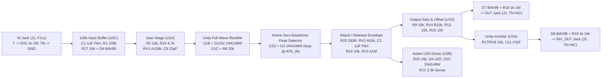

# Envelope Follower (Improved) — Circuit Specification & Assembly Architecture

Improved Eurorack-compatible analog envelope follower derived from [EnvelopeFollower.md](./EnvelopeFollower.md) and [EnvelopeFollowerImprovements.md](./EnvelopeFollowerImprovements.md), with live-verified JLCPCB/LCSC parts cataloged in [EnvelopeFollowerBOM.md](./EnvelopeFollowerBOM.md).

---

## 1. Circuit Overview & Specifications

This revision upgrades the baseline 6-op-amp schematic into a **full `2× TL074H` (`SOIC-14`, 8-channel) Eurorack module** designed for **single-sided JLCPCB Economic PCBA on the rear side (`B.Cu`)**, while reserving the front side (`F.Cu`) strictly for panel-facing through-hole (THT) controls and placing rear-access THT parts (`J4` power header, `C1`/`C2` box film capacitors, and optional `DNP` rear-probing test points `TP1`–`TP8`) on `B.Cu` for post-PCBA hand soldering.

### Key Specifications

| Parameter | Improved Specification | Notes |
|---|---|---|
| **Supply Rails** | `±12 V` Eurorack (`-12V_IN`, `GND`, `+12V_IN`) | Protected rails **`±11.65 V`** via series `40 V / 1 A` Schottky diodes (`D5`, `D6`) |
| **Active ICs** | **`2× TL074HIDR`** (`SOIC-14`, 8 channels used, 0 spare) | TI CMOS/FET-input op-amp: rail-to-rail output (`±11.45 V`), zero phase reversal, `±1 mV` offset, `20 V/µs`, `5.25 MHz` GBW, `26 mA` short-circuit protection |
| **Input (`IN`)** | AC-coupled, **$Z_{\text{in}} = 101\,\text{k}\Omega$**, $f_c \approx 1.58\text{ Hz}$ | `1 kΩ` (`1 W`) surge resistor + `1 µF` film cap (`C1`) + `100 kΩ` pull-down (`R1`) + `BAV99` clamp (`D9`) into **`U2C`** unity buffer |
| **Input Gain (`GAIN`)** | **$0.47\times$ to $10.47\times$** (`-6.56 dB` to `+20.4 dB`, inverting) | `R2 = 10 kΩ`, `R24 = 4.7 kΩ` gain floor, **`RV1 = A100k`** (Audio/Log), `C9 = 22 pF` C0G comp (`f_c ≈ 69.1 kHz`) |
| **Precision Rectifier** | Exact unity full-wave: **$V_{\text{FWR}} = +1.00\,|V_{\text{AMP}}|$** | `U1B` half-wave + `U1C` summing inverter with **`R8 = 20 kΩ`** (replaces `22 kΩ` `1.1×`) |
| **Peak Detector** | **Active zero-deadzone (`0.00 V` threshold)** | **`U2D`** super-diode loop with `D3` (`1N4148W`) inside feedback at `ATK_IN` |
| **Attack (`ATK`)** | **$\tau_{\text{atk}} = 0.33\text{ ms}$ to $50.33\text{ ms}$** (CW = slower) | `R25 = 330 Ω` current limiter + **`RV2 = A50k`** (Audio/Log) into **`C2 = 1 µF` film** (`63 V`) |
| **Release (`Release`)** | **$\tau_{\text{rel}} = 10\text{ ms}$ to $1.01\text{ s}$** (CW = longer) | `R10 = 10 kΩ` + **`RV3 = A1M`** (Audio/Log) tapped directly at `ENV_CAP` (zero divider drop) |
| **Output Stage (`OFFSET`)** | Gain **$1.400\times$ to $1.436\times$** (`2.6%` variation); offset **$\pm 4.24\text{ V}$** | Low-Z **`RV4 = B10k`** divider (`R11 = R12 = 1 kΩ`, `R13 = 22 kΩ`, `R15 = 10 kΩ`, `R14` removed) |
| **Outputs** | `OUT` (`+`) and `INV_OUT` (`-1.00×`) | Each clamped by `BAV99` (`D7`, `D8`) and protected by **`1 kΩ / 1 W`** (`2512`) fault resistor (`R16`, `R19`); `TN` left `NC` |
| **Visual Indicator** | Active linear current-driven `3 mm` `LED` (`D4`) | **`U2B`** feedback current sink (`I_LED = V_ENV / 3.3 kΩ`), `0.00 mA` idle, color-independent, anti-parallel `D10` (`1N4148W`) |

### Op-Amp Channel Allocation (`2× TL074HIDR`, `SOIC-14`)

| IC / Channel | Pins (`+`, `-`, `Out`) | Circuit Function |
|---|---|---|
| `U1A` | `3`, `2`, `1` | Input Variable Gain Stage (`-0.47×` to `-10.47×`) |
| `U1B` | `5`, `6`, `7` | Precision Half-Wave Rectifier |
| `U1C` | `10`, `9`, `8` | Unity Full-Wave Summing Inverter (`+1.00× |V_AMP|`) |
| `U1D` | `12`, `13`, `14` | Non-Inverting Output Summing/Gain + `OFFSET` Stage |
| `U2A` | `3`, `2`, `1` | `INV_OUT` Unity Inverter (`-1.00×`) |
| `U2B` | `5`, `6`, `7` | Active Linear Feedback `LED` Current Driver |
| `U2C` | `10`, `9`, `8` | **`100 kΩ` Input Unity Buffer** |
| `U2D` | `12`, `13`, `14` | **Active Zero-Deadzone Super-Diode Peak Detector** |

*Power pins on both `U1` and `U2`: `Pin 4 = +12V`, `Pin 11 = -12V` (each bypassed within `≤ 5 mm` by `100 nF` `50 V` X7R MLCCs `C5`–`C8`). All 8 channels are actively assigned; `0` spare channels remain.*

### High-Level Signal Flow

---

## 2. Summary of Improvements & Corrections Applied

Every safety issue, signal-path defect, and documentation error flagged in [EnvelopeFollowerImprovements.md](./EnvelopeFollowerImprovements.md) is resolved in this specification:

| Area / Refs | Change Implemented | Reason / Impact |
|---|---|---|
| `J4`, `D5`, `D6`, `C3`, `C4` | Shrouded `2×5` `2.54 mm` IDC (`J4` on `B.Cu`), series `40 V / 1 A` Schottkys (`D5`, `D6` `B5819W SL`), `22 µF / 50 V` SMD bulk caps (`C3`, `C4`) | Prevents reversed-cable IC destruction (`0 mA` reverse fault draw); `4.17×` cap voltage derating and `4.7×` higher bulk storage in `5.4 mm` SMD profile |
| `C5`–`C8` | Added `4× 100 nF 50 V X7R` (`0603`) bypass caps at `U1.4`, `U1.11`, `U2.4`, `U2.11` | Suppresses ultrasonic supply impedance spikes and op-amp oscillation |
| `U2C`, `R1`, `R26`, `R27`, `D9`, `C1` | Dedicated `100 kΩ` input buffer (`U2C`) with `R26 = 1 kΩ (1 W)` surge resistor, `C1 = 1 µF (63 V)` film, `R1 = 100 kΩ`, `R27 = 10 kΩ`, `D9 = BAV99` | Standard `101 kΩ` Eurorack input impedance, `1.58 Hz` cutoff, ESD/overvoltage clamping, zero loading on passive sources, preserves `100 kΩ` `GAIN` pot |
| `U1A`, `R24`, `RV1`, `C9` | Added `R24 = 4.7 kΩ` gain floor + `C9 = 22 pF` `C0G` comp; changed `RV1` to **`A100k`** | Eliminates `0×` dead zone and wiper-lift gain spikes (`0.47×` to `10.47×`); prevents ultrasonic peaking without shorting `C9` |
| `U1B`, `U1C`, `R8` | Upgraded to `TL074H`; changed `R8` from `22 kΩ` to **`20 kΩ`** | Exact `1.00×` rectifier gain (`V_FWR = |V_AMP|`), removes `22 kΩ` mismatch, recovers rail headroom |
| `U2D`, `D3`, `R25` | Active super-diode peak detector (`U2D`) with `D3` inside loop; added `R25 = 330 Ω` series limiter | Eliminates `~0.6 V` diode deadband & thermal drift (`0.00 V` threshold) while keeping `1N4148W` `< 25 nA` leakage and bounding attack surge |
| `RV2`, `RV3` | Changed to **`A50k`** (`ATK`) & **`A1M`** (`Release`); corrected pot wiring (`Pin 1` upstream, `Pins 2+3` downstream) | Fixes reversed CW/CCW direction from `EnvelopeFollower.md`; turning CW now smoothly increases attack (`0.33–50.3 ms`) and release (`10 ms–1.01 s`) |
| `C1`, `C2` | Both specified strictly as **`1 µF 63 V` Metallized Polyester Film** (`P=5.0 mm`, `B.Cu` THT) | Eliminates MLCC `30–60%` DC-bias capacitance droop and piezoelectric microphonics |
| `R9`, `R10` | Moved `R10` (`10 kΩ`) + `RV3` directly to `ENV_CAP`; `R9` (`10 kΩ`) now feeds `U1D +` solely | Eliminates the `9.1%` short-release amplitude drop into `U1D` |
| `U1D`, `RV4`, `R11`–`R15`, `C10`, `C11` | **Removed `R14`**; lowered `RV4` to **`B10k`** (`R11 = R12 = 1 kΩ`, `R13 = 22 kΩ`, `R15 = 10 kΩ`); added `C10`, `C11` (`47 pF` C0G) | Lowers output gain from `2.25–2.52×` to `1.400–1.436×` (fixes early clipping at `4.2 V` and cuts `OFFSET` gain shift from `12%` to `2.6%`) |
| `R16`, `R19`, `D7`, `D8`, `J2`/`J3.TN` | Upgraded `R16`, `R19` to **`1 kΩ / 1 W` (`2512`)**; added `D7`, `D8` (`BAV99`); set `J2.TN` & `J3.TN` to **`NC`** | Survives continuous opposing-rail patch faults (`0.58 W < 1.0 W`), adds ESD clamping, eliminates unplugged `TN`-to-`GND` short |
| `U2B`, `D4`, `D10`, `R21`–`R23` | **Removed `R22`, `R23`**; active feedback LED sink (`U2B` + `R21 = 3.3 kΩ` + anti-parallel `D10` `1N4148W`) | `0.00 mA` idle dark state for any LED color, linear brightness tracking (`I_LED = V_ENV / 3.3 kΩ`), `5 V` reverse-bias protection |

*Removed original designators (kept unused in numbering for clear cross-reference): **`R14`**, **`R22`**, **`R23`**.*

---

## 3. Stage-by-Stage Functional & Mathematical Description

### 3.1 Power Supply, Reverse-Polarity Protection, & Decoupling (`J4`, `D5`, `D6`, `C3`–`C8`)
- **`J4` (Eurorack `2×5` Keyed IDC Header):** Follows Doepfer A-100 pinout: pins `1–2` = `-12V_IN` (mark `-12V / RED` stripe on PCB silkscreen), pins `3–8` = `GND`, pins `9–10` = `+12V_IN`.
- **Series Schottky Protection (`D5`, `D6`):**
  - `D5` (`B5819W SL`, `40 V / 1 A` `SOD-123`): `Pin 2 (A)` $\rightarrow$ `+12V_IN`, `Pin 1 (K)` $\rightarrow$ `+12V`.
  - `D6` (`B5819W SL`, `40 V / 1 A` `SOD-123`): `Pin 2 (A)` $\rightarrow$ `-12V`, `Pin 1 (K)` $\rightarrow$ `-12V_IN`.
  - At `~12–18 mA` total quiescent + active current draw, forward drop is `~0.35 V`, delivering **`±11.65 V`** internal rails (`> 1.6×` reverse voltage margin at `24 V` fault).
- **Bulk Filtering (`C3`, `C4`):** `22 µF / 50 V` SMD aluminum electrolytics (`6.3 × 5.4 mm`) immediately downstream of `D5`/`D6`:
  - `C3`: **`+` (`Pin 1`) $\rightarrow$ `+12V`**, **`-` (`Pin 2`) $\rightarrow$ `GND`**.
  - `C4`: **`+` (`Pin 1`) $\rightarrow$ `GND`**, **`-` (`Pin 2`) $\rightarrow$ `-12V`**.
- **Local IC Bypass (`C5`–`C8`):** `4× 100 nF` `50 V` `X7R` (`0603`) placed within `≤ 3–5 mm` of `U1.4`/`U1.11` and `U2.4`/`U2.11` to `GND`.

### 3.2 `100 kΩ` Input Buffer & ESD/Surge Protection (`J1`, `R26`, `C1`, `R1`, `R27`, `D9`, `U2C`)
- **`J1` (`IN`):** Tip (`J1.T`) connects to `R26` (`1 kΩ`, `1 W`, `2512`) $\rightarrow$ `C1` (`1 µF / 63 V` film) $\rightarrow$ `AC_IN`. Normalled switch pin `J1.TN` ties to `GND` so an unpatched input sits silently at `0 V`.
- **`AC_IN` Input Impedance & Cutoff:** `R1` (`100 kΩ` to `GND`) establishes a Eurorack-standard AC input impedance and `-3 dB` high-pass cutoff:
  $$Z_{\text{in}} = R_{26} + R_1 = 1\,\text{k}\Omega + 100\,\text{k}\Omega = 101\,\text{k}\Omega, \qquad f_c = \frac{1}{2\pi \cdot 101\,\text{k}\Omega \cdot 1\,\mu\text{F}} \approx 1.58\,\text{Hz}$$
- **Clamp & Unity Buffer (`R27`, `D9`, `U2C`):**
  - `R27` (`10 kΩ`) isolates `AC_IN` into `U2C_IN_P`, clamped to `±12V` rails by `D9` (`BAV99,215`: `Pin 1 -> -12V`, `Pin 2 -> +12V`, `Pin 3 -> U2C_IN_P`). Even under a `±20 V` transient, `R27` limits clamp current to `< 0.8 mA` while `D9` adds only `~1.5 pF`.
  - `U2C` (`Pin 10 = +`, `Pin 9 = -` tied to `Pin 8 = Out`) buffers `IN_BUF` with `0 Ω` output impedance and **zero phase reversal** on `TL074H`.

### 3.3 Variable Input Gain Stage (`U1A`, `R2`, `R24`, `RV1`, `C9`)
- `IN_BUF` drives `R2` (`10 kΩ`) into `U1A -` (`Pin 2`; `Pin 3 +` tied to `GND`).
- **`R24` (`4.7 kΩ`)** in series with **`RV1` (`A100k`, `GAIN`)** sets the inverting closed-loop gain:
  $$A_{v1} = -\frac{R_{24} + R_{\text{RV1}}}{R_2} = -\frac{4.7\,\text{k}\Omega + (0\text{ to }100\,\text{k}\Omega)}{10\,\text{k}\Omega} = -0.47\times\text{ to }-10.47\times\quad (-6.56\text{ dB to }+20.4\text{ dB})$$
- **Potentiometer wiring (`RV1`):** `Pin 1 (CCW)` $\rightarrow$ `GAIN_MID` (`R24.2`); `Pin 2 (Wiper) + Pin 3 (CW)` tied together $\rightarrow$ `V_AMP` (`U1.1`). Turning `GAIN` clockwise smoothly scales gain using an Audio/Log (`A100k`) curve.
- **Ultrasonic Compensation (`C9`):** `22 pF` `50 V C0G` (`0603`) spans the entire feedback branch (`U1A_IN_M` to `V_AMP`), giving $f_c \approx 69.1\text{ kHz}$ at max gain (`104.7 kΩ`) and avoiding capacitive shorting at `RV1 = 0 Ω`.

### 3.4 Unity-Gain Precision Full-Wave Rectifier (`U1B`, `U1C`, `R3`–`R8`, `D1`, `D2`)
- **Half-Wave Precision Rectifier (`U1B`):** `U1B +` (`Pin 5`) to `GND`; `R3` (`10 kΩ`) from `V_AMP` to `U1B -` (`Pin 6`); `D1` (`1N4148W`: `K` to `U1B -`, `A` to `U1B Out`); `D2` (`1N4148W`: `A` to `V_RECT`, `K` to `U1B Out`); `R4` (`10 kΩ`) from `V_RECT` to `U1B -`. Produces $V_{\text{RECT}} = -V_{\text{AMP}}$ when $V_{\text{AMP}} > 0$ and $0\text{ V}$ when $V_{\text{AMP}} < 0$.
- **Unity Summing Inverter (`U1C`):** `U1C +` (`Pin 10`) to `GND`; `U1C -` (`Pin 9`) sums `V_AMP` through `R6 + R7` (`10 kΩ + 10 kΩ = 20 kΩ`) and `V_RECT` through `R5` (`10 kΩ`), with **`R8 = 20 kΩ`** feedback (`U1C -` to `V_FWR` `Pin 8`):
  $$V_{\text{FWR}} = -20\,\text{k}\Omega\left(\frac{V_{\text{AMP}}}{20\,\text{k}\Omega} + \frac{V_{\text{RECT}}}{10\,\text{k}\Omega}\right) = +1.00\,|V_{\text{AMP}}|$$

### 3.5 Active Zero-Deadzone Peak Detector & Attack/Release (`U2D`, `D3`, `R25`, `RV2`, `C2`, `R10`, `RV3`)
- **Active Super-Diode (`U2D`, `D3`):**
  - `U2D +` (`U2.12`) $\leftarrow$ `V_FWR` (`U1.8`).
  - `U2D Out` (`U2.14`) $\rightarrow$ `D3` (`1N4148W`) `Anode (Pin 2)`; `D3 Cathode (Pin 1)` = `ATK_IN`.
  - `U2D -` (`U2.13`) $\leftarrow$ `ATK_IN` (feedback taken directly at `D3` cathode, **ahead of** `R25 + RV2`).
  - Whenever $V_{\text{FWR}} > V_{\text{ATK\_IN}}$, `U2D` forces **`V_ATK_IN = V_FWR` with `0.00 V` deadzone**, preserving true exponential RC charging through `R25 + RV2` without placing `C2`'s low-frequency pole inside the op-amp feedback loop. When $V_{\text{FWR}} < V_{\text{ATK\_IN}}$, `U2D Out` swings to `-11.45 V`, `D3` reverse-biases (`< 25 nA` room-temp leakage), and `U2D -` (`~1 pA` CMOS input) draws zero charge from `C2`. Because `TL074H` has `20 V/µs` slew and zero phase reversal, recovery from `-11.45 V` takes `~0.6 µs`.
- **Attack Charging (`R25`, `RV2`, `C2`):**
  - `R25` (`330 Ω`) + `RV2` (`A50k`, `ATK`) connect `ATK_IN` to `ENV_CAP` (`C2 = 1 µF / 63 V` film to `GND`).
  - Time constant: $\tau_{\text{atk}} = (330\,\Omega\text{ to }50.33\,\text{k}\Omega) \cdot 1\,\mu\text{F} = \mathbf{0.33\text{ ms to }50.33\text{ ms}}$. *(Note: on full-scale `> 8.6 V` step inputs with `RV2 = 0 Ω`, `TL074H`'s internal `26 mA` short-circuit protection safely bounds initial surge current through `330 Ω`; `470 Ω` may be substituted if sub-`26 mA` linear drive up to `11.4 V` is preferred.)*
  - **Potentiometer wiring (`RV2`):** `Pin 1 (CCW)` $\rightarrow$ `ATK_POT_IN` (`R25.2`); `Pin 2 (Wiper) + Pin 3 (CW)` tied together $\rightarrow$ `ENV_CAP`. **Clockwise = slower attack.**
- **Release Discharging (`R10`, `RV3`):**
  - `R10` (`10 kΩ`) taps `ENV_CAP` directly (`0%` voltage divider attenuation at minimum release!) into `RV3` (`A1M`, `Release`) to `GND`.
  - Time constant: $\tau_{\text{rel}} = (10\,\text{k}\Omega\text{ to }1.01\,\text{M}\Omega) \cdot 1\,\mu\text{F} = \mathbf{10\text{ ms to }1.01\text{ s}}$.
  - **Potentiometer wiring (`RV3`):** `Pin 1 (CCW)` $\rightarrow$ `REL_MID` (`R10.2`); `Pin 2 (Wiper) + Pin 3 (CW)` tied together $\rightarrow$ `GND`. **Clockwise = longer release.**
- **Input Isolation (`R9`, `R20`):** `R9` (`10 kΩ`) feeds `U1D +` (`U1.12`) and `R20` (`10 kΩ`) feeds `U2B +` (`U2.5`), protecting op-amp ESD clamps on power-down with zero DC drop (`10 kΩ × 1 pA = 10 nV`).

### 3.6 Output Gain, Linearized `B10k` Offset, & Protected Outputs (`RV4`, `R11`–`R19`, `C10`–`C11`, `U1D`, `U2A`, `D7`, `D8`, `J2`, `J3`)
- **Low-Impedance `OFFSET` Divider (`R11`, `RV4`, `R12`):**
  - `R11` (`1 kΩ`) from `+12V` to `RV4.1`, `RV4 = B10k` (`10 kΩ` linear pot), `R12` (`1 kΩ`) from `RV4.3` to `-12V`.
  - Divider current = `23.3 V / 12 kΩ = 1.94 mA`. On `±11.65 V` protected rails, unloaded wiper voltage spans **`±9.71 V`** (`±10.0 V` at raw `±12 V`), with wiper Thevenin resistance $R_{\text{th}}(\alpha)$ ranging from **`0.917 kΩ`** (ends) to **`3.00 kΩ`** (center).
- **Output Gain + Summing Stage (`U1D`):**
  - `R14` is **omitted**; `R13` (`22 kΩ`) connects `OFFSET_WIPER` (`RV4.2`) to `U1D -` (`U1.13`), and `R15` (`10 kΩ` || `C10 = 47 pF`) provides feedback to `V_OUT_PRE` (`U1.14`):
    $$V_{\text{OUT\_PRE}} = V_{\text{ENV}}\left(1 + \frac{10\,\text{k}\Omega}{22\,\text{k}\Omega + R_{\text{th}}(\alpha)}\right) - V_{\text{th}}(\alpha)\left(\frac{10\,\text{k}\Omega}{22\,\text{k}\Omega + R_{\text{th}}(\alpha)}\right)$$
  - At `OFFSET` center ($V_{\text{th}} = 0\,\text{V}, R_{\text{th}} = 3.00\,\text{k}\Omega$): Gain = **`1.400×`**, DC offset = **`0.00 V`**.
  - At `OFFSET` extremes ($V_{\text{th}} = \pm 9.71\,\text{V}, R_{\text{th}} = 0.917\,\text{k}\Omega$): Gain = **`1.436×`** (**`2.6%` gain shift** across full sweep vs. `12%` originally), DC offset = **`∓4.24 V`** (`±4.36 V` nominal).
  - **Potentiometer wiring (`RV4`):** `Pin 1 (CCW)` $\rightarrow$ `OFFSET_TOP` (`+12V` side), `Pin 3 (CW)` $\rightarrow$ `OFFSET_BOT` (`-12V` side), `Pin 2 (Wiper)` $\rightarrow$ `OFFSET_WIPER`. **Clockwise = shifts `OUT` positive.**
- **Unity Inverter (`U2A`):** `U2A +` (`U2.3`) to `GND`; `R17` (`10 kΩ`) from `V_OUT_PRE` to `U2A -` (`U2.2`); `R18` (`10 kΩ` || `C11 = 47 pF`) to `V_INV_PRE` (`U2.1`), producing $V_{\text{INV\_PRE}} = -V_{\text{OUT\_PRE}}$.
- **Output Protection & Jacks (`D7`, `D8`, `R16`, `R19`, `J2`, `J3`):**
  - `D7` (`BAV99,215` at `V_OUT_PRE`) and `D8` (`BAV99,215` at `V_INV_PRE`) clamp ESD/overvoltage transients to `±12V` rails (`Pin 1 -> -12V`, `Pin 2 -> +12V`, `Pin 3 -> pre-resistor output`).
  - `R16` (`OUT`) and `R19` (`INV_OUT`) are **`1 kΩ, 1 W` (`2512`)** thick-film resistors, safely dissipating continuous opposing-rail patch faults (`(24 V)^2 / 1 kΩ = 0.58 W < 1.0 W`).
  - **`J2.TN` (`OUT`) and `J3.TN` (`INV_OUT`) MUST remain unconnected (`NC`).**

### 3.7 Active Linear Feedback `LED` Current Driver (`U2B`, `D4`, `D10`, `R20`, `R21`)
- `R22` and `R23` are **removed**.
- `R20` (`10 kΩ`) feeds `ENV_CAP` to `U2B +` (`U2.5`).
- `U2B Out` (`U2.7`) drives `D4` (`3 mm` THT LED) anode (`Pin 2`); `D4` cathode (`Pin 1`) returns to `U2B -` (`U2.6`) and **`R21` (`3.3 kΩ` sense resistor)** to `GND`.
- **`D10` (`1N4148W`)** sits anti-parallel across `D4` (`Pin 2 A -> LED_K`, `Pin 1 K -> LED_A`), preventing `U2B` from reverse-biasing `D4` beyond `~0.6 V` (`<< 5 V` LED $V_R$ limit) at `0 V` idle.
- **Behavior:** At `ENV_CAP = 0 V`, `I_LED = 0.00 mA` (completely dark regardless of LED color). For `ENV_CAP > 0 V`, $I_{\text{LED}} = V_{\text{ENV}} / 3.3\,\text{k}\Omega$ (`1.52 mA` at `+5 V`, `~2.86 mA` linear ceiling at `+9.45 V` with `V_F ≈ 2.0 V` Yellow-Green LED `C85161`).

---

## 4. Physical Side Partitioning & Mechanical Assembly Notes

| PCB Layer / Assembly Phase | Components | Manufacturing Notes |
|---|---|---|
| **Rear (`B.Cu`) — JLCPCB Economic Single-Sided SMT PCBA** | `U1`, `U2` (`TL074HIDR`), `R1`–`R13`, `R15`–`R21`, `R24`–`R27`, `C3`–`C11`, `D1`–`D3`, `D5`–`D10` (**44 SMT parts**) | Export Gerbers + BOM + bottom-side CPL (`--side back --smd-only --exclude-dnp`); select **Bottom Side** single-sided Economic PCBA at JLCPCB (`14` Basic lines + `3` Extended lines). Add `B.Cu` optical fiducials (`excluded from BOM/POS`). |
| **Rear (`B.Cu`) — Hand-Soldered THT (Post-PCBA)** | `J4` (`IDC2.54-2*5PZ` shrouded `2×5` header), `C1`, `C2` (`1 µF 63 V` `P=5.0 mm` box film caps) | Omitted from PCBA BOM/CPL (`Manual THT`). Orient `J4` key notch away from obstructions and print **`-12V / RED`** stripe clearly on `B.SilkS`. |
| **Rear (`B.Cu`) — Optional Test Points (`DNP` THT)** | `TP1`–`TP8` (Ronghe `RH-5001` `2.5 mm` pin-type test loops, `C5199801`) | Mark **`DNP`**, **`Exclude from BOM`**, and **`Exclude from Position Files`** (`$0` PCBA cost, excluded from `jlcpcb_bom.csv` and CPL). Plated `1.0 mm` drill / `2.0 mm` pads can be probed bare from either side or optionally soldered protruding from **`B.Cu`** only so `F.Cu` clears the `10.5 mm` panel standoff. |
| **Front (`F.Cu`) — Hand-Soldered Panel-Facing THT (Post-PCBA)** | `J1`–`J3` (`WQP-PJ398SM` jacks), `RV1`–`RV4` (`A100k`, `A50k`, `A1M`, `B10k` 9 mm vertical pots), `D4` (`3 mm` THT LED) | Omitted from PCBA BOM/CPL (`Manual / Consigned THT`). Mechanically mate to the `10.5 mm` standoff Eurorack front panel before soldering; bend/spacer `D4` leads to flush-fit panel hole (`3.2 mm` NPTH). |

### Rear-Side Test Point Allocation (`TP1`–`TP8`, `B.Cu`, `DNP`)

Eight plated through-hole test points (`1.0 mm` drill / `2.0 mm` pad) expose the protected power rails and buffered/low-impedance stage boundaries on `B.Cu` for bench bring-up without probing delicate `0603`/`SOIC-14` SMT pads or disassembling the front panel:

| Ref | Net | Circuit Node / Stage | Diagnostic Purpose | Probing & Layout Notes |
|---|---|---|---|---|
| `TP1` | `GND` | Reference ground (`0 V`) | Safe alligator/spring clip ground return away from `J4` `±12V_IN` pins | Highest priority pad to populate with an `RH-5001` loop for hands-free probing |
| `TP2` | `+12V` | Protected positive rail (post-`D5`) | Verifies `D5` drop & `+11.65 V ± 0.1 V` rail / ripple | Avoids probing fine-pitch `U1.4`/`U2.4` pins |
| `TP3` | `-12V` | Protected negative rail (post-`D6`) | Verifies `D6` drop & `-11.65 V ± 0.1 V` rail / ripple | Avoids probing fine-pitch `U1.11`/`U2.11` pins |
| `TP4` | `IN_BUF` | Stage 1 buffer output (`U2.8`) | Verifies `J1`/`R26`/`C1`/`R1`/`D9`/`U2C` (`1.58 Hz` HPF) | `0 Ω` buffered output; avoids loading high-Z `AC_IN`/`U2C_IN_P` |
| `TP5` | `V_AMP` | Stage 2 gain output (`U1.1`) | Verifies `RV1` (`A100k`) sweep (`-0.47×` to `-10.47×`) & headroom | `0 Ω` op-amp output |
| `TP6` | `V_FWR` | Stage 3 rectifier output (`U1.8`) | Verifies exact `+1.00·|V_AMP|` lobe symmetry & `~23.5 mV` threshold | `0 Ω` op-amp output |
| `TP7` | `ENV_CAP` | Stage 4 envelope cap (`C2.1`) | Verifies `U2D` `0.00 V` peak capture, `ATK`, `Release`, & `D3` leakage | **Use a `10×` (`10 MΩ`) probe** (`1×` `1 MΩ` halves `1 MΩ` max release time; `~12–15 pF` probe cap is negligible across `1 µF`) |
| `TP8` | `V_OUT_PRE` | Stage 5 output pre-`R16` (`U1.14`) | Verifies `U1D` (`1.40×`) & `OFFSET` sweep (`±4.24 V`) before `R16` | `0 Ω` op-amp output; lets you test `B.Cu` prior to fitting `J2` |

*Intentionally omitted nodes:* Op-amp virtual-ground summing nodes (`U1A_IN_M`, `U1B_IN_M`, `U1C_IN_M`, `U1D_IN_M`, `U2A_IN_M`) carry no useful waveform and risk ultrasonic oscillation under probe capacitance; high-Z / ESD-isolated inputs (`AC_IN`, `U2C_IN_P`, `U1D_IN_P`, `U2B_IN_P`) and the `U2D` super-diode loop node (`ATK_IN`) are observed downstream at `TP4` and `TP7` instead.

### KiCad Footprint & Symbol Cautions
1. **`BAV99` KiCad Symbol Pin-Label Hazard (`D7`–`D9`):** KiCad's built-in `Diode:BAV99` symbol labels pins `1/3` as `"K"` and `2` as `"A"`, whereas physical `SOT-23` electrical connections (`Nexperia BAV99,215`) are **`Pin 1 = A1` (`-12V`)**, **`Pin 2 = K2` (`+12V`)**, **`Pin 3 = COM` (`signal`)**. Always verify footprint pad numbers `1/2/3` in the netlist!
2. **Panel-Mount Footprints (`F.Cu`):** Per [eurorack_mechanical_spec.md](./.agents/skills/eurorack-panel/references/eurorack_mechanical_spec.md), use:
   - Jacks (`J1`–`J3`): `Connector_Audio:Jack_3.5mm_QingPu_WQP-PJ398SM_Vertical_CircularHoles` (`+6.48 mm` bushing Y-offset from Pad `S`)
   - Pots (`RV1`–`RV4`): `Potentiometer_THT:Potentiometer_Alps_RK09K_Single_Vertical` / `Potentiometer_THT:Potentiometer_Alpha_RD901F-40-00D_Single_Vertical`
   - LED (`D4`): `LED_THT:LED_D3.0mm` (`Pad 1 = Cathode`, `+1.27 mm` optical center X-offset)
3. **Output Jack `TN` Safety:** Tie `J1.TN` (`IN`) to `GND`; leave `J2.TN` (`OUT`) and `J3.TN` (`INV_OUT`) explicitly **`NC`**.
4. **Optional Rear Test Points (`TP1`–`TP8`, `B.Cu`, `DNP`):** Use a `1.0 mm` drill / `2.0 mm` circular THT footprint (`TestPoint:TestPoint_Keystone_5000-5004_Miniature`, `TestPoint:TestPoint_Loop_D2.50mm_Drill1.0mm`, or `TestPoint:TestPoint_THTPad_D2.0mm_Drill1.0mm`; verify Ronghe `RH-5001` pin fit from the LCSC datasheet PDF since `2.5 mm` refers to the bead OD rather than the PCB hole). Mount/solder `RH-5001` on **`B.Cu` only**, set **`DNP` + `Exclude from BOM` + `Exclude from Position Files`** (with `do_erc = False` if needed in SKiDL), label both `TPx` and the net name on **`B.SilkS`** (and `F.SilkS` where clear), and keep pads outside `WQP-PJ398SM` `F.Cu` keepouts, `0603`/`SOIC-14` pads, and `5 × 5 mm` QR zones.

---

## 5. Complete Point-to-Point Netlist

| Net Name | Connected Component Pins | Function |
|---|---|---|
| `+12V_IN` | `J4.9`, `J4.10`, `D5.2` (`A`) | Raw positive Eurorack power input |
| `-12V_IN` | `J4.1`, `J4.2`, `D6.1` (`K`) | Raw negative Eurorack power input |
| `+12V` | `D5.1` (`K`), `C3.1` (`+`), `C5.1`, `C7.1`, `U1.4`, `U2.4`, `R11.1`, `D7.2` (`K2`), `D8.2` (`K2`), `D9.2` (`K2`), `TP2.1` | Protected `+11.65 V` positive rail |
| `-12V` | `D6.2` (`A`), `C4.2` (`-`), `C6.1`, `C8.1`, `U1.11`, `U2.11`, `R12.2`, `D7.1` (`A1`), `D8.1` (`A1`), `D9.1` (`A1`), `TP3.1` | Protected `-11.65 V` negative rail |
| `GND` | `J4.3`–`J4.8`, `C3.2` (`-`), `C4.1` (`+`), `C5.2`, `C6.2`, `C7.2`, `C8.2`, `J1.S`, `J1.TN`, `J2.S`, `J3.S`, `R1.2`, `U1.3`, `U1.5`, `U1.10`, `C2.2`, `RV3.2`, `RV3.3`, `U2.3`, `R21.2`, `TP1.1` | Reference ground (`0 V`) |
| `IN_TIP` | `J1.T`, `R26.1` | `IN` panel jack tip |
| `IN_SURGE` | `R26.2`, `C1.1` | Surge-limited AC input node |
| `AC_IN` | `C1.2`, `R1.1`, `R27.1` | `100 kΩ` AC-coupled input node |
| `U2C_IN_P` | `R27.2`, `D9.3` (`COM`), `U2.10` (`U2C+`) | Clamped input buffer non-inverting input |
| `IN_BUF` | `U2.8` (`U2C_Out`), `U2.9` (`U2C-`), `R2.1`, `TP4.1` | Buffered input signal (`0 Ω` drive) |
| `U1A_IN_M` | `R2.2`, `R24.1`, `C9.1`, `U1.2` (`U1A-`) | Gain stage virtual ground |
| `GAIN_MID` | `R24.2`, `RV1.1` | Junction between `4.7 kΩ` gain floor and `GAIN` pot |
| `V_AMP` | `U1.1` (`U1A_Out`), `RV1.2`, `RV1.3`, `C9.2`, `R3.1`, `R6.1`, `TP5.1` | Amplified inverted signal (`-0.47×` to `-10.47×`) |
| `U1B_IN_M` | `R3.2`, `R4.1`, `D1.1` (`K`), `U1.6` (`U1B-`) | Half-wave rectifier summing node |
| `U1B_OUT` | `U1.7` (`U1B_Out`), `D1.2` (`A`), `D2.1` (`K`) | Half-wave rectifier op-amp output |
| `V_RECT` | `D2.2` (`A`), `R4.2`, `R5.1` | Half-wave rectified signal |
| `FF_MID` | `R6.2`, `R7.1` | Midpoint of series `10 kΩ + 10 kΩ` feed-forward |
| `U1C_IN_M` | `R5.2`, `R7.2`, `R8.1`, `U1.9` (`U1C-`) | Full-wave summing node |
| `V_FWR` | `U1.8` (`U1C_Out`), `R8.2`, `U2.12` (`U2D+`), `TP6.1` | Unity full-wave rectified output (`+1.00·|V_AMP|`) |
| `U2D_OUT` | `U2.14` (`U2D_Out`), `D3.2` (`A`) | Active peak detector drive output |
| `ATK_IN` | `D3.1` (`K`), `U2.13` (`U2D-`), `R25.1` | Zero-deadzone active diode feedback node |
| `ATK_POT_IN` | `R25.2`, `RV2.1` | Current-limited feed into `ATK` pot |
| `ENV_CAP` | `RV2.2`, `RV2.3`, `C2.1`, `R10.1`, `R9.1`, `R20.1`, `TP7.1` | Envelope storage & release tap (`0` to `+11.45 V`) |
| `REL_MID` | `R10.2`, `RV3.1` | Junction between `10 kΩ` min resistor and `Release` pot |
| `U1D_IN_P` | `R9.2`, `U1.12` (`U1D+`) | Protected high-Z input to output stage |
| `OFFSET_TOP` | `R11.2`, `RV4.1` | `+9.71 V` top end of `OFFSET` divider |
| `OFFSET_BOT` | `R12.1`, `RV4.3` | `-9.71 V` bottom end of `OFFSET` divider |
| `OFFSET_WIPER` | `RV4.2`, `R13.1` | `B10k` offset wiper tap (`R_th ≤ 3.0 kΩ`) |
| `U1D_IN_M` | `R13.2`, `R15.1`, `C10.1`, `U1.13` (`U1D-`) | Output stage summing node |
| `V_OUT_PRE` | `U1.14` (`U1D_Out`), `R15.2`, `C10.2`, `D7.3` (`COM`), `R16.1`, `R17.1`, `TP8.1` | Clamped pre-resistor positive output |
| `OUT_TIP` | `R16.2`, `J2.T` | `OUT` panel jack tip (`1 kΩ / 1 W` protected) |
| `U2A_IN_M` | `R17.2`, `R18.1`, `C11.1`, `U2.2` (`U2A-`) | Output inverter summing node |
| `V_INV_PRE` | `U2.1` (`U2A_Out`), `R18.2`, `C11.2`, `D8.3` (`COM`), `R19.1` | Clamped pre-resistor inverted output |
| `INV_OUT_TIP` | `R19.2`, `J3.T` | `INV_OUT` panel jack tip (`1 kΩ / 1 W` protected) |
| `U2B_IN_P` | `R20.2`, `U2.5` (`U2B+`) | Protected high-Z input to `LED` current driver |
| `LED_A` | `U2.7` (`U2B_Out`), `D4.2` (`A`), `D10.1` (`K`) | `LED` anode & reverse-clamp cathode |
| `LED_K` | `D4.1` (`K`), `D10.2` (`A`), `U2.6` (`U2B-`), `R21.1` | `LED` cathode sense node (`V_LED_K = V_ENV`) |

*Explicit `NC` Pins:* `J2.TN` (`OUT` switched contact), `J3.TN` (`INV_OUT` switched contact).

---

## 6. Bring-Up & Verification Checklist

1. **Pre-Power Checks:** Verify `D5`/`D6` cathode orientation (`Pin 1` toward `+12V` for `D5`, toward `-12V_IN` for `D6`), `C4` reversed electrolytic polarity (`+` at `GND`, `-` at `-12V`), and `BAV99` pinout (`Pin 1 = -12V`, `Pin 2 = +12V`, `Pin 3 = signal`). Confirm `J2.TN` and `J3.TN` are isolated from `GND`.
2. **Power Rails:** Clip bench ground to **`TP1` (`GND`)** and apply `±12 V` via a current-limited supply (`~15–25 mA` limit). Confirm protected rails measure **`+11.65 V ± 0.1 V`** at **`TP2` (`+12V`)** (`U1.4`, `U2.4`) and **`-11.65 V ± 0.1 V`** at **`TP3` (`-12V`)** (`U1.11`, `U2.11`), with `D4` completely dark at idle (`I_LED = 0.00 mA`).
3. **Offset & Inverter Sweep (`IN` unpatched):** Sweep `RV4` (`OFFSET`) full CCW $\rightarrow$ CW and verify **`TP8` (`V_OUT_PRE`)** and `OUT` sweep smoothly from **`~ -4.24 V` to `+4.24 V`** while `INV_OUT` mirrors `-OUT` within `±1%`. Center `OFFSET` (`OUT = 0.00 V`).
4. **Zero-Deadzone & Stage-by-Stage Check:** Feed a `100 mVpp` (`50 mV` peak) `100 Hz` sine wave into `IN` with `GAIN` at minimum (`0.47×`). Confirm `100 mVpp` AC at **`TP4` (`IN_BUF`)**, `~47 mVpp` inverted sine at **`TP5` (`V_AMP`)**, `~23.5 mV` peak unipolar lobes at **`TP6` (`V_FWR`)**, steady `~23.5 mV` DC at **`TP7` (`ENV_CAP`)** (measured with a **`10×` / `10 MΩ` probe**), and `~33 mV` DC at **`TP8` (`V_OUT_PRE`)** / `OUT` (`1.40×`), proving `0.00 V` active peak-detector deadband.
5. **Control Direction Check:** Monitoring **`TP7` (`ENV_CAP`)** with a **`10×` (`10 MΩ`) probe**, increase `RV2` (`ATK`) clockwise and verify slower rise (`0.33–50.3 ms`); increase `RV3` (`Release`) clockwise and verify decay slows smoothly from `~10 ms` to `~1.0 s`; increase `RV1` (`GAIN`) clockwise while probing **`TP5` (`V_AMP`)** / **`TP6` (`V_FWR`)** and verify smooth Audio/Log gain rise from `0.47×` to `10.47×` while `D4` tracks `ENV_CAP` linearly.
